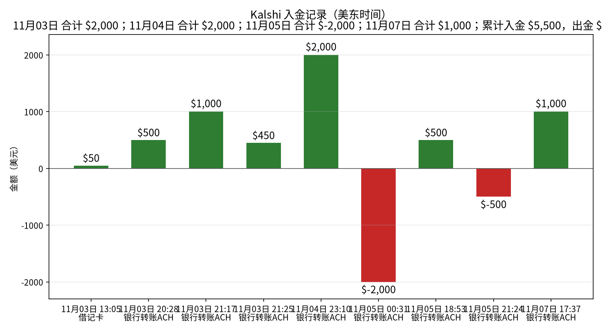
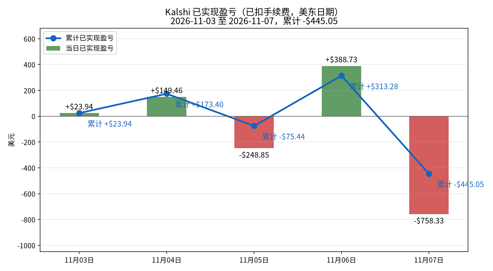
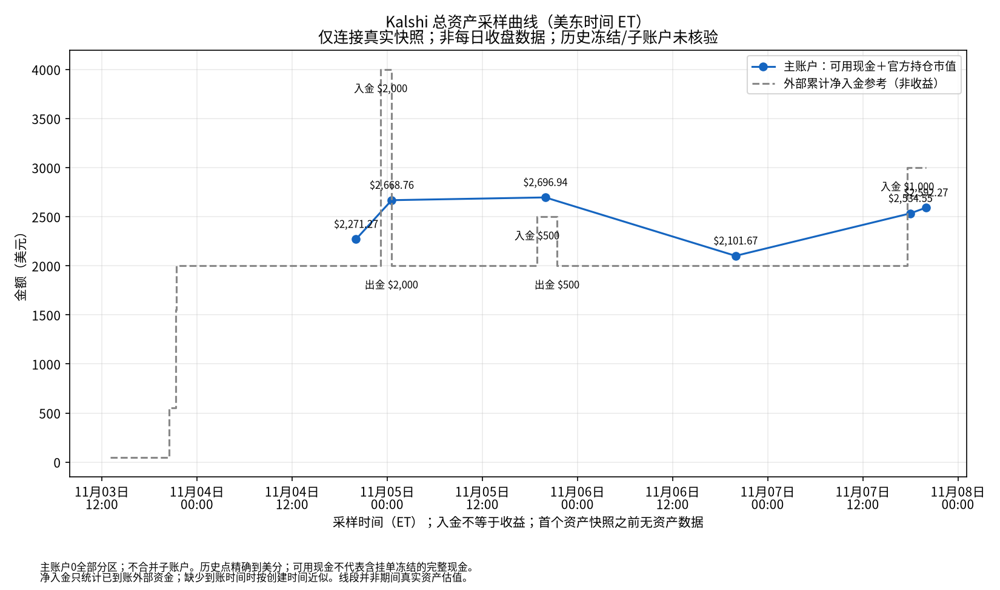
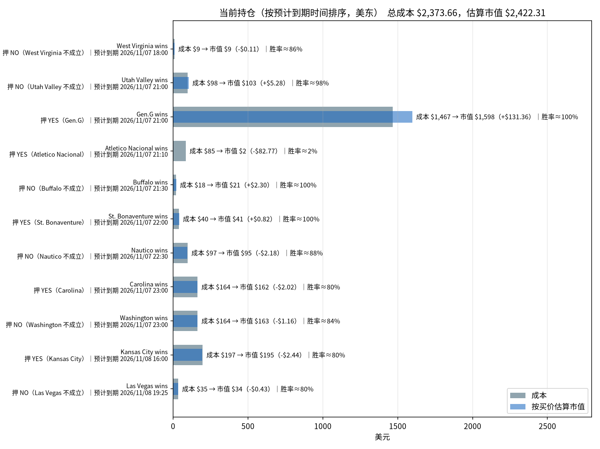

# Kalshi 每日交易报告

按交易日归档的 Kalshi 成交、已实现盈亏与持仓报告。

## Kalshi 资金、盈亏与持仓分析（2026-11-07）

_数据生成时间：2026-11-07 19:57（美东），全部来自 Kalshi 只读 API。持仓价格是生成那一刻的报价，之后会变。_

**当日已实现净盈亏合计：-$758.33**（盈利 29 个市场，亏损 3 个市场；均已扣手续费）。结算盈亏 -$758.33（32 个市场），卖出平仓盈亏 $0.00（0 个市场），累计 -$445.05。

合计：买入 $11,897.88，卖出 $273.54，手续费 $114.34。现金余额 **$162.61**。Kalshi 显示的持仓市值（portfolio_value）：$2,429.66。持仓市场数：11。持仓总成本 $2,373.66，按当前买价估算市值 $2,423.24，浮动盈亏 +$49.58（估算，未扣卖出手续费）。官方总资产（可用现金 $162.6123 ＋ 官方持仓市值 $2,429.66）为 **$2,592.2723**。历史只连接真实采样；历史冻结资金和子账户未核验，入金不是收益。

### 一、入金记录

| 时间（美东） | 类型 | 方式 | 金额 | 手续费 | 状态 |
|---|---|---|---:|---:|---|
| 2026-11-03 13:05 | 入金 | 借记卡 | $50.00 | $0.00 | 已到账 |
| 2026-11-03 20:28 | 入金 | 银行转账ACH | $500.00 | $0.00 | 已到账 |
| 2026-11-03 21:17 | 入金 | 银行转账ACH | $1,000.00 | $0.00 | 已到账 |
| 2026-11-03 21:25 | 入金 | 银行转账ACH | $450.00 | $0.00 | 已到账 |
| 2026-11-04 23:10 | 入金 | 银行转账ACH | $2,000.00 | $0.00 | 已到账 |
| 2026-11-05 00:31 | 出金 | 银行转账ACH | $2,000.00 | $0.00 | 已到账 |
| 2026-11-05 18:53 | 入金 | 银行转账ACH | $500.00 | $0.00 | 已到账 |
| 2026-11-05 21:24 | 出金 | 银行转账ACH | $500.00 | $0.00 | 已到账 |
| 2026-11-07 17:37 | 入金 | 银行转账ACH | $1,000.00 | $0.00 | 已到账 |

**合计入金 $5,500.00，出金 $2,500.00。**

### 二、已实现盈亏曲线

| 日期（美东） | 结算盈亏 | 卖出平仓盈亏 | 当日已实现 | 累计 | 成交笔数 | 当日手续费 |
|---|---:|---:|---:|---:|---:|---:|
| 2026-11-03 | +$23.94（4 个市场） | $0.00（0 个市场） | **+$23.94** | +$23.94 | 72 | $17.04 |
| 2026-11-04 | +$386.26（35 个市场） | -$236.80（1 个市场） | **+$149.46** | +$173.40 | 112 | $125.59 |
| 2026-11-05 | -$248.85（28 个市场） | $0.00（0 个市场） | **-$248.85** | -$75.44 | 61 | $40.92 |
| 2026-11-06 | +$123.19（45 个市场） | +$265.54（4 个市场） | **+$388.73** | +$313.28 | 109 | $47.80 |
| 2026-11-07 | -$758.33（32 个市场） | $0.00（0 个市场） | **-$758.33** | -$445.05 | 160 | $114.34 |

口径：都已扣手续费。结算盈亏 = 结算赔付（含 YES/NO 配对兑付）− 该市场累计买入成本 − 累计手续费；卖出平仓用平均成本法。

**对账**：现金 $162.61 + 持仓按买价估算市值 $2,422.31 = $2,584.92，减去净入金 $3,000.00，买价估值口径差额 **-$415.08**（不是下图官方总资产口径）。盈亏模型对照（可能因采样时差、成本口径而不同，非强制相等）：累计已实现 -$445.05 + 浮动 +$48.65 − 持仓已付手续费 $18.68 = -$415.08。

### 总资产曲线（真实资产快照）

采样时间：2026-11-07T19:57:43-05:00（ET）。主账户可用现金 **$162.6123** ＋ 官方持仓市值 **$2,429.66** ＝ **$2,592.2723**。

当前未成交挂单 0 笔；冻结资金为0。

主账户0，全部交易分区；不合并子账户；内部划转不计外部入金。

总资产曲线口径为API可用现金＋官方持仓市值，不用买价估值替代官方市值。历史挂单冻结及子账户余额未留存，历史点仅代表主账户可核对资产，不保证完整账户净值。真实采样点之间连线仅辅助阅读，不代表连续估值；缺失日期不补值。净入金仅取已到账外部充值减已完成提现；缺少完成时间时以创建时间近似，因此不保证日内到账时点。主账户与子账户内部划转不计入金；主账户资产与全账户外部净入金之差不一定是收益。

审计数据：[data/total_assets.csv](data/total_assets.csv)、[data/total_assets.json](data/total_assets.json)；原始快照在 `data/asset_snapshots/`（原始快照文件未放入本仓库，路径和 sha256 记在 JSON 里）。

**官方口径复核**：可用现金 $162.6123 ＋ 官方持仓市值 $2,429.66 ＝ 总资产 $2,592.2723。官方市值比逐仓买价估值高 $7.3499；因此两种资产口径不能混用。

总资产减外部净入金 = -$407.73；盈亏模型加估值差额 = -$407.73，对账残差 $0.000000。仅在无子账户内部资金影响且现金覆盖完整时，此差额才可解释为整体盈亏。

### 三、当前持仓与到期时间

| 预计到期（美东） | 市场 | 押注 | 份数 | 成本 | 均价 | 买价/卖价 | 估算市值 | 浮动盈亏 | 赢了净赚* | 隐含胜率 |
|---|---|---|---:|---:|---:|---|---:|---:|---:|---:|
| 2026-11-07 18:00 | West Virginia wins `KXNCAAFGAME-26NOV07WVUTTU-WVU` | NO（West Virginia 不成立） | 11.00 | $9.46 | $0.860 | 0.85/0.86 | $9.35 | -$0.11 | +$1.45 | 85.5% |
| 2026-11-07 21:00 | Utah Valley wins `KXNCAAWBGAME-26NOV07SCUUVU-UVU` | NO（Utah Valley 不成立） | 106.49 | $98.02 | $0.920 | 0.97/0.99 | $103.30 | +$5.28 | +$7.93 | 98.0% |
| 2026-11-07 21:00 | Gen.G wins `KXLOLGAME-26NOV071700GENIG-GEN` | YES（Gen.G） | 1,614.12 | $1,466.62 | $0.909 | 0.99/1.0 | $1,597.98 | +$131.36 | +$138.12 | 99.5% |
| 2026-11-07 21:10 | Atletico Nacional wins `KXDIMAYORGAME-26NOV07CANPER-CAN` | YES（Atletico Nacional） | 93.00 | $84.63 | $0.910 | 0.02/0.03 | $1.86 | -$82.77 | +$7.84 | 2.5% |
| 2026-11-07 21:30 | Buffalo wins `KXNCAAWBGAME-26NOV07BUFFYSU-BUFF` | NO（Buffalo 不成立） | 21.00 | $18.49 | $0.880 | 0.99/1.0 | $20.79 | +$2.30 | +$2.36 | 99.5% |
| 2026-11-07 22:00 | St. Bonaventure wins `KXNCAAMBGAME-26NOV07SBONCAN-SBON` | YES（St. Bonaventure） | 41.00 | $39.77 | $0.970 | 0.99/1.0 | $40.59 | +$0.82 | +$1.15 | 99.5% |
| 2026-11-07 22:30 | Nautico wins `KXBRASILEIROBGAME-26NOV07NAUBRA-NAU` | NO（Nautico 不成立） | 109.00 | $97.01 | $0.890 | 0.87/0.88 | $94.83 | -$2.18 | +$11.24 | 87.5% |
| 2026-11-07 23:00 | Carolina wins `KXNHLGAME-26NOV07CHICAR-CAR` | YES（Carolina） | 202.00 | $163.62 | $0.810 | 0.8/0.81 | $161.60 | -$2.02 | +$36.20 | 80.5% |
| 2026-11-07 23:00 | Washington wins `KXNBAGAME-26NOV07WASOKC-WAS` | NO（Washington 不成立） | 196.00 | $163.84 | $0.836 | 0.83/0.84 | $162.68 | -$1.16 | +$30.28 | 83.5% |
| 2026-11-08 16:00 | Kansas City wins `KXNFLGAME-26NOV08NYJKC-KC` | YES（Kansas City） | 243.67 | $197.37 | $0.810 | 0.8/0.81 | $194.94 | -$2.44 | +$43.67 | 80.5% |
| 2026-11-08 19:25 | Las Vegas wins `KXNFLGAME-26NOV08LVSF-LV` | NO（Las Vegas 不成立） | 43.00 | $34.83 | $0.810 | 0.8/0.81 | $34.40 | -$0.43 | +$7.71 | 80.5% |
| **合计（11 个市场）** | | | | **$2,373.66** | | | **$2,422.31** | **+$48.65** | **+$287.94** | |

\*赢了净赚 = 赔付 − 成本 − 该仓位已付手续费。隐含胜率取你这一边买价和卖价的中间值。预计到期取 Kalshi 的 `expected_expiration_time`。

#### 分析

**总敞口。** 持仓总成本 $2,373.66，按当前买价估算市值 $2,422.31，浮动 +$48.65（未扣卖出手续费）。全部押中可再净赚 +$287.94；最坏情况全部押错，亏掉 $2,373.66。账上现金 $162.61。

**什么时候到期：**
- **今天：** 9 个市场，成本 $2,141.45（占 90.2%）；最大一笔是 Gen.G wins YES（Gen.G），成本 $1,466.62，预计 2026-11-07 21:00 到期。
- **2026-11-08：** 2 个市场，成本 $232.20（占 9.8%）；最大一笔是 Kansas City wins YES（Kansas City），成本 $197.37，预计 2026-11-08 16:00 到期。

**集中度。** 成本最大的三笔：Gen.G wins YES（Gen.G） $1,466.62（61.8%）；Kansas City wins YES（Kansas City） $197.37（8.3%）；Washington wins NO（Washington 不成立） $163.84（6.9%）。
浮盈最大的是 Gen.G wins（+$131.36）。

**确定程度（按隐含胜率）：**
- **基本确定（≥95%）：** Gen.G wins YES（Gen.G）（99.5%）、Buffalo wins NO（Buffalo 不成立）（99.5%）、St. Bonaventure wins YES（St. Bonaventure）（99.5%）、Utah Valley wins NO（Utah Valley 不成立）（98.0%）；合计成本 $1,622.89。
- **有不确定性（<90%）：** Nautico wins NO（Nautico 不成立）（87.5%）、West Virginia wins NO（West Virginia 不成立）（85.5%）、Washington wins NO（Washington 不成立）（83.5%）、Carolina wins YES（Carolina）（80.5%）、Kansas City wins YES（Kansas City）（80.5%）、Las Vegas wins NO（Las Vegas 不成立）（80.5%）、Atletico Nacional wins YES（Atletico Nacional）（2.5%）；合计成本 $750.76。

---
图表文件：`charts/deposits-2026-11-07.png`、`charts/pnl_curve-2026-11-07.png`、`charts/positions-2026-11-07.png`、`charts/total_assets-2026-11-07.png`；审计数据 [data/total_assets.csv](data/total_assets.csv)、[data/total_assets.json](data/total_assets.json)。

在线站点：https://cuichuhan.github.io/kalshi-daily-reports/

## 如何新增一天

加一天只需要动三个地方：

1. 把当天报告放进 `reports/`，命名为 `reports/YYYY-MM-DD.html`。版式与 `reports/2026-11-04.html` 相同：沿用同一套样式，把 Markdown 渲染成 HTML，表格一并保留。
2. 在 `index.html` 的列表最上方加一行 `<li><a href="reports/YYYY-MM-DD.html">YYYY-MM-DD</a></li>`（新的日期放最前）。
3. 用当天的分析摘要替换上面的最新分析一节（标题、段落和盈亏表按原文放上）。

不用改样式或其他页面。
