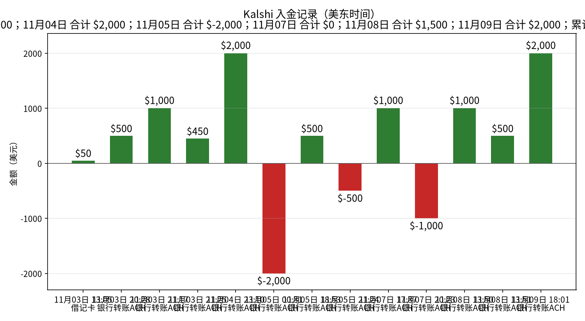
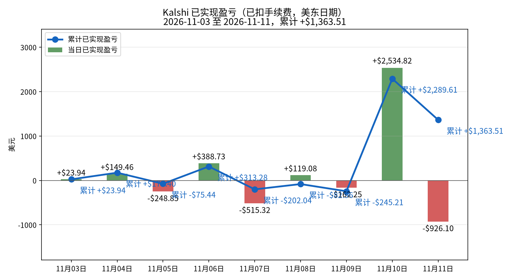
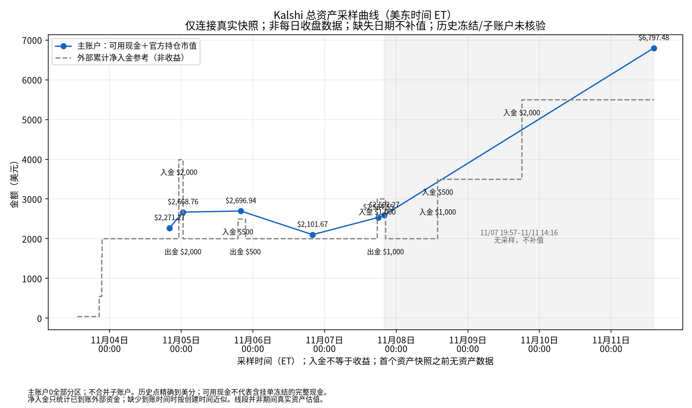
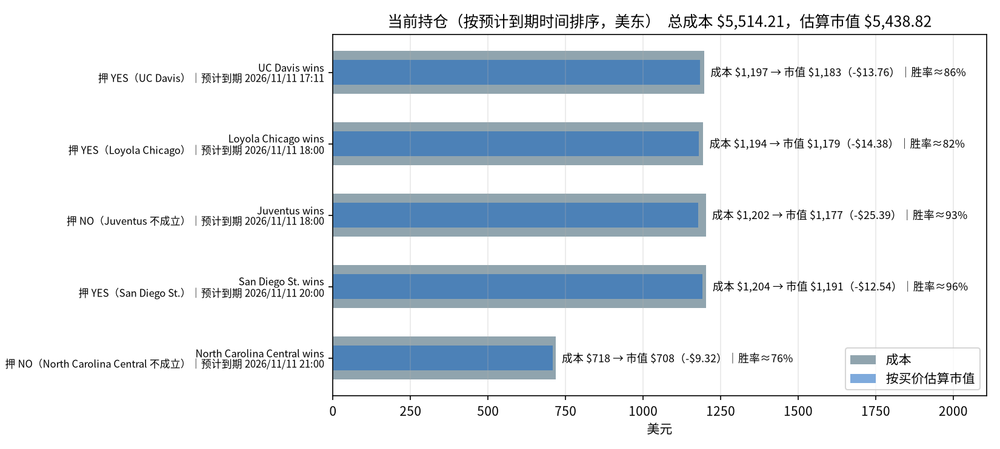

# Kalshi 每日交易报告

按交易日归档的 Kalshi 成交、已实现盈亏与持仓报告。

## Kalshi 资金、盈亏与持仓分析（2026-11-10）

_数据生成时间：2026-11-11 14:16（美东），全部来自 Kalshi 只读 API。持仓价格是生成那一刻的报价，之后会变。_

**回填说明。** 2026-11-08、2026-11-09、2026-11-10 三份报告于 2026-11-11 补发（API 鉴权中断之后生成）。这三天没有总资产快照，没有插值。持仓与总资产数字来自 2026-11-11 14:16（美东）快照，不是各报告日的收盘值。

**当日已实现净盈亏合计：+$2,534.82**（盈利 30 个市场，亏损 2 个市场；均已扣手续费）。结算盈亏 +$2,534.82（32 个市场），卖出平仓盈亏 $0.00（0 个市场），累计 +$2,289.61。

合计：买入 $34,044.36，卖出 $1,336.47，手续费 $394.43。现金余额 **$1,304.22**。Kalshi 显示的持仓市值（portfolio_value）：$5,451.98。持仓市场数：5。持仓总成本 $5,514.21，按当前买价估算市值 $5,438.82，浮动盈亏 -$75.39（估算，未扣卖出手续费）。官方总资产（可用现金 $1,304.2165 ＋ 官方持仓市值 $5,493.26）为 **$6,797.4765**。历史只连接真实采样；历史冻结资金和子账户未核验，入金不是收益。

### 一、入金记录

| 时间（美东） | 类型 | 方式 | 金额 | 手续费 | 状态 |
|---|---|---|---:|---:|---|
| 2026-11-03 13:05 | 入金 | 借记卡 | $50.00 | $0.00 | 已到账 |
| 2026-11-03 20:28 | 入金 | 银行转账ACH | $500.00 | $0.00 | 已到账 |
| 2026-11-03 21:17 | 入金 | 银行转账ACH | $1,000.00 | $0.00 | 已到账 |
| 2026-11-03 21:25 | 入金 | 银行转账ACH | $450.00 | $0.00 | 已到账 |
| 2026-11-04 23:10 | 入金 | 银行转账ACH | $2,000.00 | $0.00 | 已到账 |
| 2026-11-05 00:31 | 出金 | 银行转账ACH | $2,000.00 | $0.00 | 已到账 |
| 2026-11-05 18:53 | 入金 | 银行转账ACH | $500.00 | $0.00 | 已到账 |
| 2026-11-05 21:24 | 出金 | 银行转账ACH | $500.00 | $0.00 | 已到账 |
| 2026-11-07 17:37 | 入金 | 银行转账ACH | $1,000.00 | $0.00 | 已到账 |
| 2026-11-07 20:23 | 出金 | 银行转账ACH | $1,000.00 | $0.00 | 已到账 |
| 2026-11-08 13:50 | 入金 | 银行转账ACH | $1,000.00 | $0.00 | 已到账 |
| 2026-11-08 13:51 | 入金 | 银行转账ACH | $500.00 | $0.00 | 已到账 |
| 2026-11-09 18:01 | 入金 | 银行转账ACH | $2,000.00 | $0.00 | 已到账 |

**合计入金 $9,000.00，出金 $3,500.00。**

### 二、已实现盈亏曲线

| 日期（美东） | 结算盈亏 | 卖出平仓盈亏 | 当日已实现 | 累计 | 成交笔数 | 当日手续费 |
|---|---:|---:|---:|---:|---:|---:|
| 2026-11-03 | +$23.94（4 个市场） | $0.00（0 个市场） | **+$23.94** | +$23.94 | 72 | $17.04 |
| 2026-11-04 | +$386.26（35 个市场） | -$236.80（1 个市场） | **+$149.46** | +$173.40 | 112 | $125.59 |
| 2026-11-05 | -$248.85（28 个市场） | $0.00（0 个市场） | **-$248.85** | -$75.44 | 61 | $40.92 |
| 2026-11-06 | +$123.19（45 个市场） | +$265.54（4 个市场） | **+$388.73** | +$313.28 | 109 | $47.80 |
| 2026-11-07 | -$515.32（49 个市场） | $0.00（0 个市场） | **-$515.32** | -$202.04 | 200 | $126.79 |
| 2026-11-08 | +$119.08（22 个市场） | $0.00（0 个市场） | **+$119.08** | -$82.96 | 61 | $72.93 |
| 2026-11-09 | +$483.39（13 个市场） | -$645.64（4 个市场） | **-$162.25** | -$245.21 | 125 | $186.45 |
| 2026-11-10 | +$2,534.82（32 个市场） | $0.00（0 个市场） | **+$2,534.82** | +$2,289.61 | 238 | $394.43 |
| 2026-11-11 | -$926.10（5 个市场） | $0.00（0 个市场） | **-$926.10** | +$1,363.51 | 117 | $114.33 |

口径：都已扣手续费。结算盈亏 = 结算赔付（含 YES/NO 配对兑付）− 该市场累计买入成本 − 累计手续费；卖出平仓用平均成本法。

**对账**：现金 $1,304.22 + 持仓按买价估算市值 $5,438.82 = $6,743.04，减去净入金 $5,500.00，买价估值口径差额 **+$1,243.04**（不是下图官方总资产口径）。盈亏模型对照（可能因采样时差、成本口径而不同，非强制相等）：累计已实现 +$1,363.51 + 浮动 -$75.39 − 持仓已付手续费 $45.08 = +$1,243.04。

### 总资产曲线（真实资产快照）

采样时间：2026-11-11T14:16:20-05:00（ET）。主账户可用现金 **$1,304.2165** ＋ 官方持仓市值 **$5,493.26** ＝ **$6,797.4765**。

当前未成交挂单 0 笔；冻结资金为0。

主账户0，全部交易分区；不合并子账户；内部划转不计外部入金。

总资产曲线口径为API可用现金＋官方持仓市值，不用买价估值替代官方市值。历史挂单冻结及子账户余额未留存，历史点仅代表主账户可核对资产，不保证完整账户净值。真实采样点之间连线仅辅助阅读，不代表连续估值；缺失日期不补值。净入金仅取已到账外部充值减已完成提现；缺少完成时间时以创建时间近似，因此不保证日内到账时点。主账户与子账户内部划转不计入金；主账户资产与全账户外部净入金之差不一定是收益。

审计数据：[data/total_assets.csv](data/total_assets.csv)、[data/total_assets.json](data/total_assets.json)；原始快照在 `data/asset_snapshots/`（原始快照文件未放入本仓库，路径和 sha256 记在 JSON 里）。

说明：2026-11-10 当日没有留下总资产快照，上图只连接真实采样点，该日不补值。下面数字是 2026-11-11T14:16:20-05:00 的实时快照，不是该日收盘资产。

**官方口径复核**：可用现金 $1,304.2165 ＋ 官方持仓市值 $5,493.26 ＝ 总资产 $6,797.4765。官方市值比逐仓买价估值高 $54.4400；因此两种资产口径不能混用。

总资产减外部净入金 = +$1,297.48；盈亏模型加估值差额 = +$1,297.48，对账残差 $0.000000。仅在无子账户内部资金影响且现金覆盖完整时，此差额才可解释为整体盈亏。

### 三、当前持仓与到期时间

| 预计到期（美东） | 市场 | 押注 | 份数 | 成本 | 均价 | 买价/卖价 | 估算市值 | 浮动盈亏 | 赢了净赚* | 隐含胜率 |
|---|---|---|---:|---:|---:|---|---:|---:|---:|---:|
| 2026-11-11 17:11 | UC Davis wins `KXNCAAMBGAME-26NOV11IWUCD-UCD` | YES（UC Davis） | 1,376.00 | $1,197.12 | $0.870 | 0.86/0.87 | $1,183.36 | -$13.76 | +$167.99 | 86.5% |
| 2026-11-11 18:00 | Loyola Chicago wins `KXNCAAMBGAME-26NOV11LCHIAFA-LCHI` | YES（Loyola Chicago） | 1,438.00 | $1,193.54 | $0.830 | 0.82/0.83 | $1,179.16 | -$14.38 | +$230.26 | 82.5% |
| 2026-11-11 18:00 | Juventus wins `KXUCLWGAME-26NOV11JUVOL-JUV` | NO（Juventus 不成立） | 1,279.00 | $1,202.07 | $0.940 | 0.92/0.94 | $1,176.68 | -$25.39 | +$71.87 | 93.0% |
| 2026-11-11 20:00 | San Diego St. wins `KXNCAAMBGAME-26NOV11COOKSDSU-SDSU` | YES（San Diego St.） | 1,254.00 | $1,203.84 | $0.960 | 0.95/0.96 | $1,191.30 | -$12.54 | +$46.79 | 95.5% |
| 2026-11-11 21:00 | North Carolina Central wins `KXNCAAMBGAME-26NOV11NCCUVMI-NCCU` | NO（North Carolina Central 不成立） | 932.00 | $717.64 | $0.770 | 0.76/0.77 | $708.32 | -$9.32 | +$202.81 | 76.5% |
| **合计（5 个市场）** | | | | **$5,514.21** | | | **$5,438.82** | **-$75.39** | **+$719.71** | |

\*赢了净赚 = 赔付 − 成本 − 该仓位已付手续费。隐含胜率取你这一边买价和卖价的中间值。预计到期取 Kalshi 的 `expected_expiration_time`。

#### 分析

**总敞口。** 持仓总成本 $5,514.21，按当前买价估算市值 $5,438.82，浮动 -$75.39（未扣卖出手续费）。全部押中可再净赚 +$719.71；最坏情况全部押错，亏掉 $5,514.21。账上现金 $1,304.22。

**什么时候到期：**
- **今天：** 5 个市场，成本 $5,514.21（占 100.0%）；最大一笔是 San Diego St. wins YES（San Diego St.），成本 $1,203.84，预计 2026-11-11 20:00 到期。

**集中度。** 成本最大的三笔：San Diego St. wins YES（San Diego St.） $1,203.84（21.8%）；Juventus wins NO（Juventus 不成立） $1,202.07（21.8%）；UC Davis wins YES（UC Davis） $1,197.12（21.7%）。
浮盈最大的是 North Carolina Central wins（-$9.32）。

**确定程度（按隐含胜率）：**
- **基本确定（≥95%）：** San Diego St. wins YES（San Diego St.）（95.5%）；合计成本 $1,203.84。
- **比较稳（90%–95%）：** Juventus wins NO（Juventus 不成立）（93.0%）；合计成本 $1,202.07。
- **有不确定性（<90%）：** UC Davis wins YES（UC Davis）（86.5%）、Loyola Chicago wins YES（Loyola Chicago）（82.5%）、North Carolina Central wins NO（North Carolina Central 不成立）（76.5%）；合计成本 $3,108.30。

---
图表文件：`charts/deposits-2026-11-10.png`、`charts/pnl_curve-2026-11-10.png`、`charts/positions-2026-11-10.png`、`charts/total_assets-2026-11-10.png`；审计数据 [data/total_assets.csv](data/total_assets.csv)、[data/total_assets.json](data/total_assets.json)。

在线站点：https://cuichuhan.github.io/kalshi-daily-reports/

## 如何新增一天

加一天只需要动三个地方：

1. 把当天报告放进 `reports/`，命名为 `reports/YYYY-MM-DD.html`。版式与 `reports/2026-11-04.html` 相同：沿用同一套样式，把 Markdown 渲染成 HTML，表格一并保留。
2. 在 `index.html` 的列表最上方加一行 `<li><a href="reports/YYYY-MM-DD.html">YYYY-MM-DD</a></li>`（新的日期放最前）。
3. 用当天的分析摘要替换上面的最新分析一节（标题、段落和盈亏表按原文放上）。

不用改样式或其他页面。
