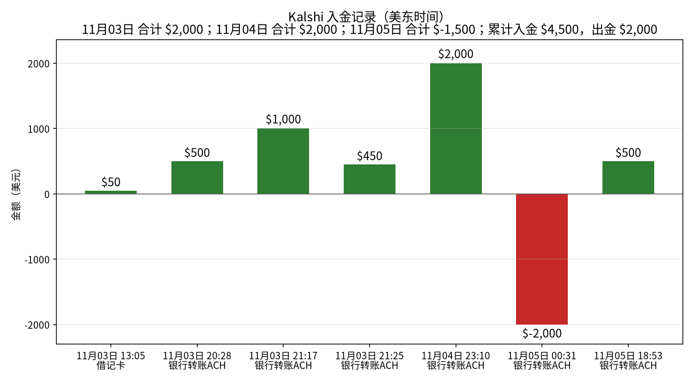
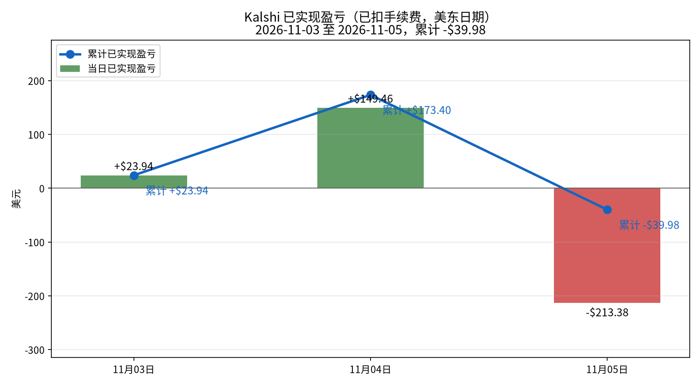
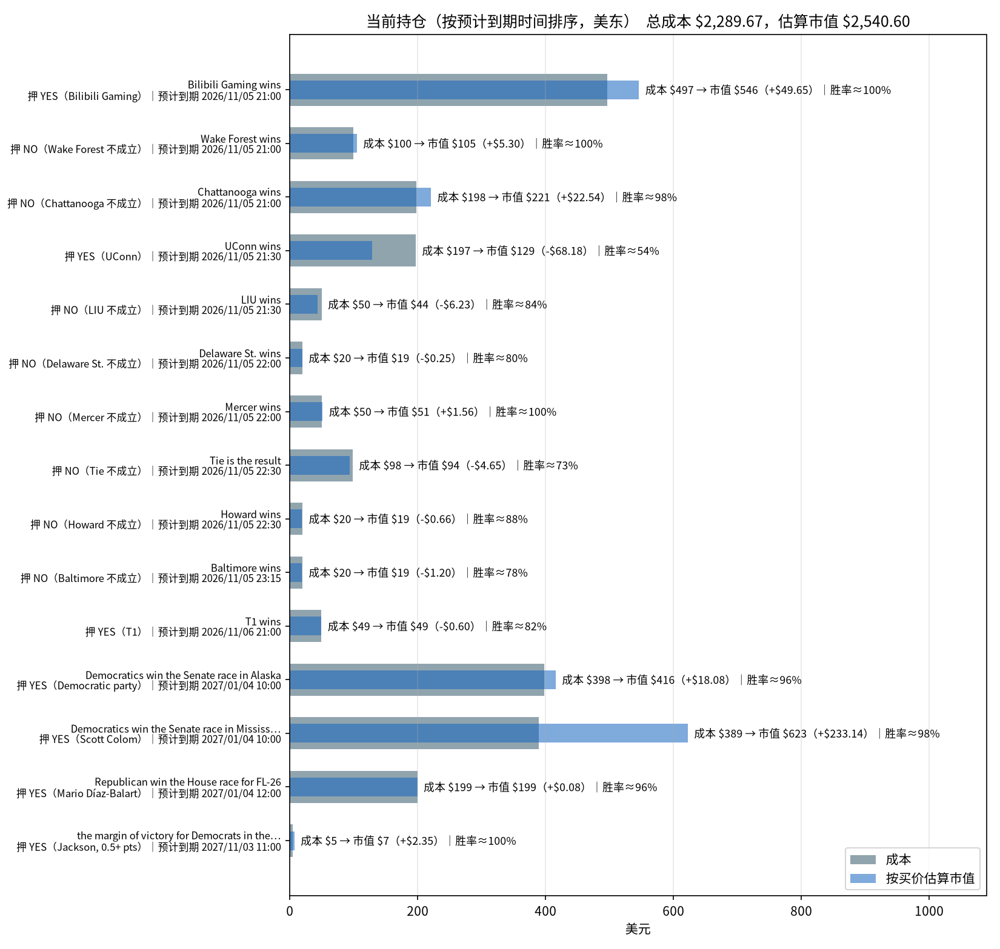

# Kalshi 每日交易报告

按交易日归档的 Kalshi 成交、已实现盈亏与持仓报告。

## Kalshi 资金、盈亏与持仓分析（2026-11-05）

_数据生成时间：2026-11-05 19:57（美东），全部来自 Kalshi 只读 API。持仓价格是生成那一刻的报价，之后会变。_

**当日已实现净盈亏合计：-$213.38**（盈利 11 个市场，亏损 6 个市场；均已扣手续费）。结算盈亏 -$213.38（17 个市场），卖出平仓盈亏 $0.00（0 个市场），累计 -$39.98。

合计：买入 $3,419.05，卖出 $15.20，手续费 $35.07。现金余额 **$145.11**。Kalshi 显示的持仓市值（portfolio_value）：$2,551.83。持仓市场数：15。持仓总成本 $2,289.67，按当前买价估算市值 $2,538.07，浮动盈亏 +$248.40（估算，未扣卖出手续费）。

### 一、入金记录

| 时间（美东） | 类型 | 方式 | 金额 | 手续费 | 状态 |
|---|---|---|---:|---:|---|
| 2026-11-03 13:05 | 入金 | 借记卡 | $50.00 | $0.00 | 已到账 |
| 2026-11-03 20:28 | 入金 | 银行转账ACH | $500.00 | $0.00 | 已到账 |
| 2026-11-03 21:17 | 入金 | 银行转账ACH | $1,000.00 | $0.00 | 已到账 |
| 2026-11-03 21:25 | 入金 | 银行转账ACH | $450.00 | $0.00 | 已到账 |
| 2026-11-04 23:10 | 入金 | 银行转账ACH | $2,000.00 | $0.00 | 已到账 |
| 2026-11-05 00:31 | 出金 | 银行转账ACH | $2,000.00 | $0.00 | 已到账 |
| 2026-11-05 18:53 | 入金 | 银行转账ACH | $500.00 | $0.00 | 已到账 |

**合计入金 $4,500.00，出金 $2,000.00。**

### 二、已实现盈亏曲线

| 日期（美东） | 结算盈亏 | 卖出平仓盈亏 | 当日已实现 | 累计 | 成交笔数 | 当日手续费 |
|---|---:|---:|---:|---:|---:|---:|
| 2026-11-03 | +$23.94（4 个市场） | $0.00（0 个市场） | **+$23.94** | +$23.94 | 72 | $17.04 |
| 2026-11-04 | +$386.26（35 个市场） | -$236.80（1 个市场） | **+$149.46** | +$173.40 | 112 | $125.59 |
| 2026-11-05 | -$213.38（17 个市场） | $0.00（0 个市场） | **-$213.38** | -$39.98 | 56 | $35.07 |

口径：都已扣手续费。结算盈亏 = 结算赔付（含 YES/NO 配对兑付）− 该市场累计买入成本 − 累计手续费；卖出平仓用平均成本法。

**对账**：现金 $145.11 + 持仓按买价估算市值 $2,540.60 = $2,685.71，减去净入金 $2,500.00，账户整体 **+$185.71**。这等于累计已实现 -$39.98 + 浮动 +$250.92 − 持仓已付手续费 $25.23 = +$185.71。

### 三、当前持仓与到期时间

| 预计到期（美东） | 市场 | 押注 | 份数 | 成本 | 均价 | 买价/卖价 | 估算市值 | 浮动盈亏 | 赢了净赚* | 隐含胜率 |
|---|---|---|---:|---:|---:|---|---:|---:|---:|---:|
| 2026-11-05 21:00 | Bilibili Gaming wins `KXLOLGAME-26NOV051700BLGDK-BLG` | YES（Bilibili Gaming） | 551.69 | $496.52 | $0.900 | 0.99/1.0 | $546.17 | +$49.65 | +$51.69 | 99.5% |
| 2026-11-05 21:00 | Wake Forest wins `KXNCAAMBGAME-26NOV05WAKEVAN-WAKE` | NO（Wake Forest 不成立） | 105.93 | $99.57 | $0.940 | 0.99/1.0 | $104.87 | +$5.30 | +$5.94 | 99.5% |
| 2026-11-05 21:00 | Chattanooga wins `KXNCAAMBGAME-26NOV05CHATPSU-CHAT` | NO（Chattanooga 不成立） | 225.37 | $198.33 | $0.880 | 0.98/0.99 | $220.86 | +$22.54 | +$25.38 | 98.5% |
| 2026-11-05 21:30 | UConn wins `KXNCAAWBGAME-26NOV05CONNMICH-CONN` | YES（UConn） | 252.52 | $196.97 | $0.780 | 0.51/0.56 | $128.79 | -$68.18 | +$52.52 | 53.5% |
| 2026-11-05 21:30 | LIU wins `KXNCAAMBGAME-26NOV05LIUHALL-LIU` | NO（LIU 不成立） | 51.93 | $49.85 | $0.960 | 0.84/0.85 | $43.62 | -$6.23 | +$1.94 | 84.5% |
| 2026-11-05 22:00 | Delaware St. wins `KXNCAAMBGAME-26NOV05DSUNAVY-DSU` | NO（Delaware St. 不成立） | 24.65 | $19.72 | $0.800 | 0.79/0.8 | $19.47 | -$0.25 | +$4.65 | 79.5% |
| 2026-11-05 22:00 | Mercer wins `KXNCAAMBGAME-26NOV05MERVT-MER` | NO（Mercer 不成立） | 51.93 | $49.85 | $0.960 | 0.99/1.0 | $51.41 | +$1.56 | +$1.94 | 99.5% |
| 2026-11-05 22:30 | Tie is the result `KXBRASILEIROGAME-26NOV05CRUBAH-TIE` | NO（Tie 不成立） | 128.40 | $98.38 | $0.766 | 0.73/0.735 | $93.73 | -$4.65 | +$28.41 | 73.2% |
| 2026-11-05 22:30 | Howard wins `KXNCAAFGAME-26NOV05SCSTHOW-HOW` | NO（Howard 不成立） | 22.06 | $19.85 | $0.900 | 0.87/0.88 | $19.19 | -$0.66 | +$2.07 | 87.5% |
| 2026-11-05 23:15 | Baltimore wins `KXNFLGAME-26NOV05JACBAL-BAL` | NO（Baltimore 不成立） | 24.08 | $19.75 | $0.820 | 0.77/0.78 | $18.54 | -$1.20 | +$4.09 | 77.5% |
| 2026-11-06 21:00 | T1 wins `KXLOLGAME-26NOV061700T1KC-T1` | YES（T1） | 59.53 | $49.41 | $0.830 | 0.82/0.83 | $48.81 | -$0.60 | +$9.53 | 82.5% |
| 2027-01-04 10:00 | Will Democratics win the Senate race in Alaska? `SENATEAK-26-D` | YES（Democratic party） | 431.86 | $397.80 | $0.921 | 0.963/0.967 | $415.88 | +$18.08 | +$31.87 | 96.5% |
| 2027-01-04 10:00 | Will Democratics win the Senate race in Mississippi? `SENATEMS-26-D` | YES（Scott Colom） | 638.47 | $389.37 | $0.610 | 0.975/0.976 | $622.51 | +$233.14 | +$238.47 | 97.5% |
| 2027-01-04 12:00 | Will Republican win the House race for FL-26? `KXHOUSERACE-FL26-26-R` | YES（Mario Díaz-Balart） | 207.81 | $199.42 | $0.960 | 0.96/0.967 | $199.50 | +$0.08 | +$7.82 | 96.4% |
| 2027-11-03 11:00 | Will the margin of victory for Democrats in the U.S. Senate election in Maine be at least 0.5 percentage points? `KXMIDTERMMOV-MESEND-P0.5` | YES（Jackson, 0.5+ pts） | 7.29 | $4.88 | $0.670 | 0.992/1.0 | $7.23 | +$2.35 | +$2.29 | 99.6% |
| **合计（15 个市场）** | | | | **$2,289.67** | | | **$2,540.60** | **+$250.92** | **+$468.61** | |

\*赢了净赚 = 赔付 − 成本 − 该仓位已付手续费。隐含胜率取你这一边买价和卖价的中间值。预计到期取 Kalshi 的 `expected_expiration_time`。

#### 分析

**总敞口。** 持仓总成本 $2,289.67，按当前买价估算市值 $2,540.60，浮动 +$250.92（未扣卖出手续费）。全部押中可再净赚 +$468.61；最坏情况全部押错，亏掉 $2,289.67。账上现金 $145.11。

**什么时候到期：**
- **今天：** 10 个市场，成本 $1,248.79（占 54.5%）；最大一笔是 Bilibili Gaming wins YES（Bilibili Gaming），成本 $496.52，预计 2026-11-05 21:00 到期。
- **2026-11-06：** 1 个市场，成本 $49.41（占 2.2%）；最大一笔是 T1 wins YES（T1），成本 $49.41，预计 2026-11-06 21:00 到期。
- **更晚（选举等长期市场）：** 4 个市场，成本 $991.47（占 43.3%）；最大一笔是 Will Democratics win the Senate race in Alaska? YES（Democratic party），成本 $397.80，预计 2027-01-04 10:00 到期。

**集中度。** 成本最大的三笔：Bilibili Gaming wins YES（Bilibili Gaming） $496.52（21.7%）；Will Democratics win the Senate race in Alaska? YES（Democratic party） $397.80（17.4%）；Will Democratics win the Senate race in Mississippi? YES（Scott Colom） $389.37（17.0%）。
浮盈最大的是 Will Democratics win the Senate race in Mississippi?（+$233.14）。

**确定程度（按隐含胜率）：**
- **基本确定（≥95%）：** Will the margin of victory for Democrats in the U.S. Senate election in Maine be at least 0.5 percentage points? YES（Jackson, 0.5+ pts）（99.6%）、Bilibili Gaming wins YES（Bilibili Gaming）（99.5%）、Wake Forest wins NO（Wake Forest 不成立）（99.5%）、Mercer wins NO（Mercer 不成立）（99.5%）、Chattanooga wins NO（Chattanooga 不成立）（98.5%）、Will Democratics win the Senate race in Mississippi? YES（Scott Colom）（97.5%）、Will Democratics win the Senate race in Alaska? YES（Democratic party）（96.5%）、Will Republican win the House race for FL-26? YES（Mario Díaz-Balart）（96.4%）；合计成本 $1,835.75。
- **有不确定性（<90%）：** Howard wins NO（Howard 不成立）（87.5%）、LIU wins NO（LIU 不成立）（84.5%）、T1 wins YES（T1）（82.5%）、Delaware St. wins NO（Delaware St. 不成立）（79.5%）、Baltimore wins NO（Baltimore 不成立）（77.5%）、Tie is the result NO（Tie 不成立）（73.2%）、UConn wins YES（UConn）（53.5%）；合计成本 $453.93。

---
图表文件：`charts/deposits-2026-11-05.png`、`charts/pnl_curve-2026-11-05.png`、`charts/positions-2026-11-05.png`；每日盈亏 `charts/pnl_daily.csv`。

在线站点：https://cuichuhan.github.io/kalshi-daily-reports/

## 如何新增一天

加一天只需要动三个地方：

1. 把当天报告放进 `reports/`，命名为 `reports/YYYY-MM-DD.html`。版式与 `reports/2026-11-04.html` 相同：沿用同一套样式，把 Markdown 渲染成 HTML，表格一并保留。
2. 在 `index.html` 的列表最上方加一行 `<li><a href="reports/YYYY-MM-DD.html">YYYY-MM-DD</a></li>`（新的日期放最前）。
3. 用当天的分析摘要替换上面的最新分析一节（标题、段落和盈亏表按原文放上）。

不用改样式或其他页面。
