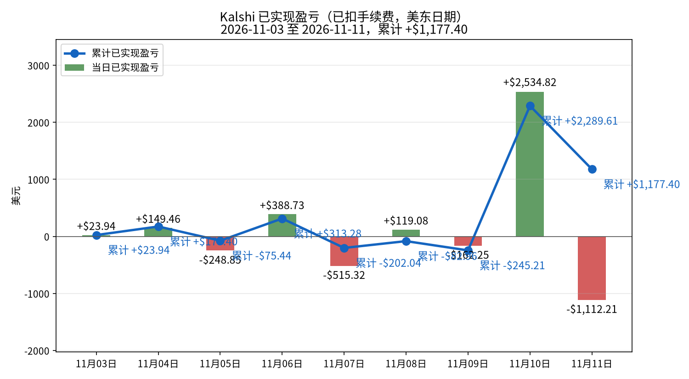
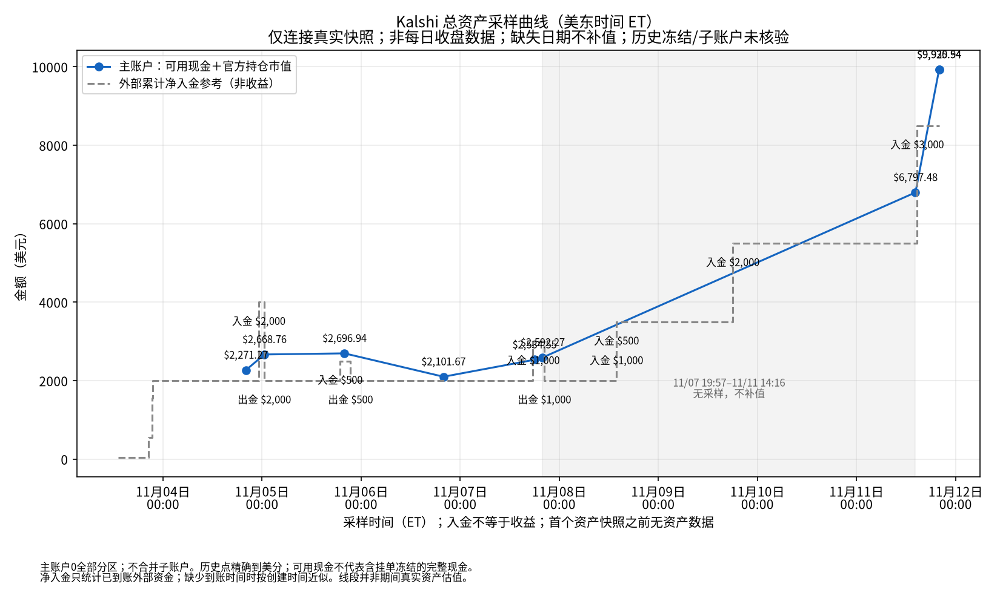
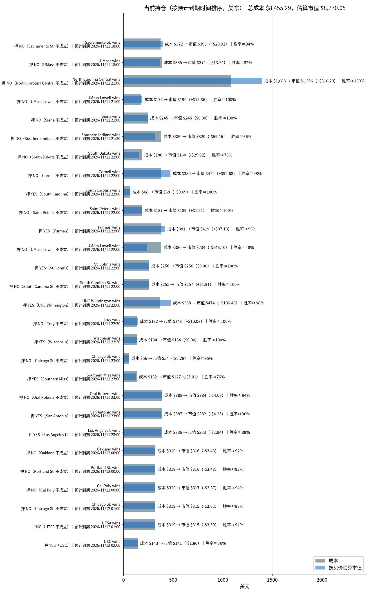

# Kalshi 每日交易报告

按交易日归档的 Kalshi 成交、已实现盈亏与持仓报告。

## Kalshi 资金、盈亏与持仓分析（2026-11-11）

_数据生成时间：2026-11-11 20:00（美东），全部来自 Kalshi 只读 API。持仓价格是生成那一刻的报价，之后会变。_

**当日已实现净盈亏合计：-$1,112.21**（盈利 18 个市场，亏损 2 个市场；均已扣手续费）。结算盈亏 -$1,112.21（21 个市场），卖出平仓盈亏 $0.00（0 个市场），累计 +$1,177.40。

合计：买入 $26,537.11，卖出 $7,749.72，手续费 $223.63。现金余额 **$1,145.91**。Kalshi 显示的持仓市值（portfolio_value）：$8,780.03。持仓市场数：28。持仓总成本 $8,455.29，按当前买价估算市值 $8,765.47，浮动盈亏 +$310.19（估算，未扣卖出手续费）。分析采样官方持仓市值 $8,784.63，官方总资产（可用现金 $1,145.9117 ＋ 官方持仓市值 $8,784.63）为 **$9,930.5417**。历史只连接真实采样；历史冻结资金和子账户未核验，入金不是收益。

### 一、入金记录

| 时间（美东） | 类型 | 方式 | 金额 | 手续费 | 状态 |
|---|---|---|---:|---:|---|
| 2026-11-03 13:05 | 入金 | 借记卡 | $50.00 | $0.00 | 已到账 |
| 2026-11-03 20:28 | 入金 | 银行转账ACH | $500.00 | $0.00 | 已到账 |
| 2026-11-03 21:17 | 入金 | 银行转账ACH | $1,000.00 | $0.00 | 已到账 |
| 2026-11-03 21:25 | 入金 | 银行转账ACH | $450.00 | $0.00 | 已到账 |
| 2026-11-04 23:10 | 入金 | 银行转账ACH | $2,000.00 | $0.00 | 已到账 |
| 2026-11-05 00:31 | 出金 | 银行转账ACH | $2,000.00 | $0.00 | 已到账 |
| 2026-11-05 18:53 | 入金 | 银行转账ACH | $500.00 | $0.00 | 已到账 |
| 2026-11-05 21:24 | 出金 | 银行转账ACH | $500.00 | $0.00 | 已到账 |
| 2026-11-07 17:37 | 入金 | 银行转账ACH | $1,000.00 | $0.00 | 已到账 |
| 2026-11-07 20:23 | 出金 | 银行转账ACH | $1,000.00 | $0.00 | 已到账 |
| 2026-11-08 13:50 | 入金 | 银行转账ACH | $1,000.00 | $0.00 | 已到账 |
| 2026-11-08 13:51 | 入金 | 银行转账ACH | $500.00 | $0.00 | 已到账 |
| 2026-11-09 18:01 | 入金 | 银行转账ACH | $2,000.00 | $0.00 | 已到账 |
| 2026-11-11 14:41 | 入金 | 银行转账ACH | $3,000.00 | $0.00 | 已到账 |

**合计入金 $12,000.00，出金 $3,500.00。**

### 二、已实现盈亏曲线

| 日期（美东） | 结算盈亏 | 卖出平仓盈亏 | 当日已实现 | 累计 | 成交笔数 | 当日手续费 |
|---|---:|---:|---:|---:|---:|---:|
| 2026-11-03 | +$23.94（4 个市场） | $0.00（0 个市场） | **+$23.94** | +$23.94 | 72 | $17.04 |
| 2026-11-04 | +$386.26（35 个市场） | -$236.80（1 个市场） | **+$149.46** | +$173.40 | 112 | $125.59 |
| 2026-11-05 | -$248.85（28 个市场） | $0.00（0 个市场） | **-$248.85** | -$75.44 | 61 | $40.92 |
| 2026-11-06 | +$123.19（45 个市场） | +$265.54（4 个市场） | **+$388.73** | +$313.28 | 109 | $47.80 |
| 2026-11-07 | -$515.32（49 个市场） | $0.00（0 个市场） | **-$515.32** | -$202.04 | 200 | $126.79 |
| 2026-11-08 | +$119.08（22 个市场） | $0.00（0 个市场） | **+$119.08** | -$82.96 | 61 | $72.93 |
| 2026-11-09 | +$483.39（13 个市场） | -$645.64（4 个市场） | **-$162.25** | -$245.21 | 125 | $186.45 |
| 2026-11-10 | +$2,534.82（32 个市场） | $0.00（0 个市场） | **+$2,534.82** | +$2,289.61 | 238 | $394.43 |
| 2026-11-11 | -$1,112.21（21 个市场） | $0.00（0 个市场） | **-$1,112.21** | +$1,177.40 | 276 | $223.63 |

口径：都已扣手续费。结算盈亏 = 结算赔付（含 YES/NO 配对兑付）− 该市场累计买入成本 − 累计手续费；卖出平仓用平均成本法。

**对账**：现金 $1,145.91 + 持仓按买价估算市值 $8,770.05 = $9,915.96，减去净入金 $8,500.00，买价估值口径差额 **+$1,415.96**（不是下图官方总资产口径）。盈亏模型对照（可能因采样时差、成本口径而不同，非强制相等）：累计已实现 +$1,177.40 + 浮动 +$314.77 − 持仓已付手续费 $76.20 = +$1,415.96。

### 总资产曲线（真实资产快照）

采样时间：2026-11-11T20:00:09-05:00（ET）。主账户可用现金 **$1,145.9117** ＋ 官方持仓市值 **$8,784.63** ＝ **$9,930.5417**。

当前未成交挂单 0 笔；冻结资金为0。

主账户0，全部交易分区；不合并子账户；内部划转不计外部入金。

总资产曲线口径为API可用现金＋官方持仓市值，不用买价估值替代官方市值。历史挂单冻结及子账户余额未留存，历史点仅代表主账户可核对资产，不保证完整账户净值。真实采样点之间连线仅辅助阅读，不代表连续估值；缺失日期不补值。净入金仅取已到账外部充值减已完成提现；缺少完成时间时以创建时间近似，因此不保证日内到账时点。主账户与子账户内部划转不计入金；主账户资产与全账户外部净入金之差不一定是收益。

审计数据：[data/total_assets.csv](data/total_assets.csv)、[data/total_assets.json](data/total_assets.json)；原始快照在 `data/asset_snapshots/`（原始快照文件未放入本仓库，路径和 sha256 记在 JSON 里）。

**官方口径复核**：可用现金 $1,145.9117 ＋ 官方持仓市值 $8,784.63 ＝ 总资产 $9,930.5417。官方市值比逐仓买价估值高 $14.5772；因此两种资产口径不能混用。

总资产减外部净入金 = +$1,430.54；盈亏模型加估值差额 = +$1,430.54，对账残差 $0.000000。仅在无子账户内部资金影响且现金覆盖完整时，此差额才可解释为整体盈亏。

### 三、当前持仓与到期时间

| 预计到期（美东） | 市场 | 押注 | 份数 | 成本 | 均价 | 买价/卖价 | 估算市值 | 浮动盈亏 | 赢了净赚* | 隐含胜率 |
|---|---|---|---:|---:|---:|---|---:|---:|---:|---:|
| 2026-11-11 18:00 | Sacramento St. wins `KXNCAAFGAME-26NOV11SACCMU-SAC` | NO（Sacramento St. 不成立） | 418.12 | $372.13 | $0.890 | 0.94/0.95 | $393.03 | +$20.91 | +$43.13 | 94.5% |
| 2026-11-11 18:00 | UMass wins `KXNCAAFGAME-26NOV11MASSTOL-MASS` | NO（UMass 不成立） | 458.00 | $384.72 | $0.840 | 0.81/0.82 | $370.98 | -$13.74 | +$68.97 | 81.5% |
| 2026-11-11 21:00 | North Carolina Central wins `KXNCAAMBGAME-26NOV11NCCUVMI-NCCU` | NO（North Carolina Central 不成立） | 1,410.00 | $1,085.70 | $0.770 | 0.99/1.0 | $1,395.90 | +$310.20 | +$306.82 | 99.5% |
| 2026-11-11 21:00 | UMass Lowell wins `KXNCAAWBGAME-26NOV11MASSLBC-MASSL` | NO（UMass Lowell 不成立） | 192.00 | $174.72 | $0.910 | 0.99/1.0 | $190.08 | +$15.36 | +$16.18 | 99.5% |
| 2026-11-11 21:00 | Siena wins `KXNCAAWBGAME-26NOV11SIESYR-SIE` | NO（Siena 不成立） | 247.00 | $244.53 | $0.990 | 0.99/1.0 | $244.53 | $0.00 | +$2.30 | 99.5% |
| 2026-11-11 21:30 | Southern Indiana wins `KXNCAAMBGAME-26NOV11USIIUIN-USI` | NO（Southern Indiana 不成立） | 493.00 | $379.61 | $0.770 | 0.65/0.66 | $320.45 | -$59.16 | +$107.28 | 65.5% |
| 2026-11-11 22:00 | South Dakota wins `KXNCAAWBGAME-26NOV11CREISDAK-SDAK` | NO（South Dakota 不成立） | 216.00 | $185.76 | $0.860 | 0.74/0.81 | $159.84 | -$25.92 | +$28.42 | 77.5% |
| 2026-11-11 22:00 | Cornell wins `KXNCAAMBGAME-26NOV11CORSBON-COR` | NO（Cornell 不成立） | 487.00 | $379.71 | $0.780 | 0.97/0.98 | $472.39 | +$92.68 | +$101.43 | 97.5% |
| 2026-11-11 22:00 | South Carolina wins `KXNCAAMBGAME-26NOV11SPCSCAR-SCAR` | YES（South Carolina） | 69.00 | $67.62 | $0.980 | 0.99/1.0 | $68.31 | +$0.69 | +$1.29 | 99.5% |
| 2026-11-11 22:00 | Saint Peter's wins `KXNCAAMBGAME-26NOV11SPCSCAR-SPC` | NO（Saint Peter's 不成立） | 191.00 | $187.18 | $0.980 | 0.99/1.0 | $189.09 | +$1.91 | +$3.56 | 99.5% |
| 2026-11-11 22:00 | Furman wins `KXNCAAMBGAME-26NOV11FURHC-FUR` | YES（Furman） | 436.00 | $381.43 | $0.875 | 0.96/0.97 | $418.56 | +$37.13 | +$51.23 | 96.5% |
| 2026-11-11 22:00 | UMass Lowell wins `KXNCAAMBGAME-26NOV11MASSLMASS-MASSL` | NO（UMass Lowell 不成立） | 487.00 | $379.86 | $0.780 | 0.48/0.49 | $233.76 | -$146.10 | +$101.29 | 48.5% |
| 2026-11-11 22:00 | St. John's wins `KXNCAAMBGAME-26NOV11COLGSJU-SJU` | YES（St. John's） | 259.00 | $256.41 | $0.990 | 0.99/1.0 | $256.41 | $0.00 | +$2.41 | 99.5% |
| 2026-11-11 22:00 | South Carolina St. wins `KXNCAAMBGAME-26NOV11SCSTND-SCST` | NO（South Carolina St. 不成立） | 260.00 | $255.49 | $0.983 | 0.99/1.0 | $257.40 | +$1.91 | +$4.20 | 99.5% |
| 2026-11-11 22:00 | UNC Wilmington wins `KXNCAAMBGAME-26NOV11KENTUNCW-UNCW` | YES（UNC Wilmington） | 484.00 | $367.84 | $0.760 | 0.98/0.99 | $474.32 | +$106.48 | +$109.98 | 98.5% |
| 2026-11-11 22:30 | Troy wins `KXNCAAWBGAME-26NOV11TROYMSST-TROY` | NO（Troy 不成立） | 144.00 | $132.48 | $0.920 | 0.99/1.0 | $142.56 | +$10.08 | +$10.78 | 99.5% |
| 2026-11-11 22:30 | Wisconsin wins `KXNCAAWBGAME-26NOV11DELWIS-WIS` | YES（Wisconsin） | 135.00 | $133.65 | $0.990 | 0.99/1.0 | $133.65 | $0.00 | +$1.26 | 99.5% |
| 2026-11-11 23:00 | Chicago St. wins `KXNCAAWBGAME-26NOV11CHSUIC-CHS` | NO（Chicago St. 不成立） | 57.00 | $55.86 | $0.980 | 0.94/0.96 | $53.58 | -$2.28 | +$1.06 | 95.0% |
| 2026-11-11 23:00 | Southern Miss wins `KXNCAAMBGAME-26NOV11JKSTUSM-USM` | YES（Southern Miss） | 167.00 | $131.93 | $0.790 | 0.76/0.77 | $126.92 | -$5.01 | +$33.13 | 76.5% |
| 2026-11-11 23:00 | Oral Roberts wins `KXNCAAMBGAME-26NOV11ORUTLSA-ORU` | NO（Oral Roberts 不成立） | 408.00 | $387.60 | $0.950 | 0.94/0.95 | $383.52 | -$4.08 | +$19.04 | 94.5% |
| 2026-11-11 23:00 | San Antonio wins `KXNBAGAME-26NOV11SASCHI-SAS` | YES（San Antonio） | 425.00 | $386.75 | $0.910 | 0.9/0.91 | $382.50 | -$4.25 | +$35.81 | 90.5% |
| 2026-11-11 23:00 | Los Angeles L wins `KXNBAGAME-26NOV11LALMIL-LAL` | YES（Los Angeles L） | 435.00 | $385.74 | $0.887 | 0.88/0.89 | $382.80 | -$2.94 | +$46.20 | 88.5% |
| 2026-11-12 00:00 | Oakland wins `KXNCAAMBGAME-26NOV11OAKBSU-OAK` | NO（Oakland 不成立） | 343.00 | $318.99 | $0.930 | 0.92/0.93 | $315.56 | -$3.43 | +$22.45 | 92.5% |
| 2026-11-12 00:00 | Portland St. wins `KXNCAAMBGAME-26NOV11PRSTCSU-PRST` | NO（Portland St. 不成立） | 343.00 | $318.99 | $0.930 | 0.92/0.93 | $315.56 | -$3.43 | +$22.45 | 92.5% |
| 2026-11-12 00:00 | Cal Poly wins `KXNCAAMBGAME-26NOV11CPGC-CP` | NO（Cal Poly 不成立） | 337.00 | $320.15 | $0.950 | 0.94/0.95 | $316.78 | -$3.37 | +$15.73 | 94.5% |
| 2026-11-12 01:00 | Chicago St. wins `KXNCAAMBGAME-26NOV11CHSCBU-CHS` | NO（Chicago St. 不成立） | 362.00 | $318.56 | $0.880 | 0.87/0.88 | $314.94 | -$3.62 | +$40.76 | 87.5% |
| 2026-11-12 01:00 | UTSA wins `KXNCAAMBGAME-26NOV11UTSASEA-UTSA` | NO（UTSA 不成立） | 339.00 | $318.66 | $0.940 | 0.93/0.94 | $315.27 | -$3.39 | +$19.00 | 93.5% |
| 2026-11-12 02:00 | USC wins `KXNCAAMBGAME-26NOV11USCCAL-USC` | YES（USC） | 186.00 | $143.22 | $0.770 | 0.76/0.77 | $141.36 | -$1.86 | +$40.47 | 76.5% |
| **合计（28 个市场）** | | | | **$8,455.29** | | | **$8,770.05** | **+$314.77** | **+$1,256.63** | |

\*赢了净赚 = 赔付 − 成本 − 该仓位已付手续费。隐含胜率取你这一边买价和卖价的中间值。预计到期取 Kalshi 的 `expected_expiration_time`。

#### 分析

**总敞口。** 持仓总成本 $8,455.29，按当前买价估算市值 $8,770.05，浮动 +$314.77（未扣卖出手续费）。全部押中可再净赚 +$1,256.63；最坏情况全部押错，亏掉 $8,455.29。账上现金 $1,145.91。

**什么时候到期：**
- **今天：** 22 个市场，成本 $6,716.72（占 79.4%）；最大一笔是 North Carolina Central wins NO（North Carolina Central 不成立），成本 $1,085.70，预计 2026-11-11 21:00 到期。
- **2026-11-12：** 6 个市场，成本 $1,738.57（占 20.6%）；最大一笔是 Cal Poly wins NO（Cal Poly 不成立），成本 $320.15，预计 2026-11-12 00:00 到期。

**集中度。** 成本最大的三笔：North Carolina Central wins NO（North Carolina Central 不成立） $1,085.70（12.8%）；Oral Roberts wins NO（Oral Roberts 不成立） $387.60（4.6%）；San Antonio wins YES（San Antonio） $386.75（4.6%）。
浮盈最大的是 North Carolina Central wins（+$310.20）。

注意：KXNCAAMBGAME-26NOV11SPCSCAR-SCAR, KXNCAAMBGAME-26NOV11SPCSCAR-SPC 属于同一个事件，合计成本 $254.80，要看它们是对冲还是同向加注。

**确定程度（按隐含胜率）：**
- **基本确定（≥95%）：** North Carolina Central wins NO（North Carolina Central 不成立）（99.5%）、UMass Lowell wins NO（UMass Lowell 不成立）（99.5%）、Siena wins NO（Siena 不成立）（99.5%）、South Carolina wins YES（South Carolina）（99.5%）、Saint Peter's wins NO（Saint Peter's 不成立）（99.5%）、St. John's wins YES（St. John's）（99.5%）、South Carolina St. wins NO（South Carolina St. 不成立）（99.5%）、Troy wins NO（Troy 不成立）（99.5%）、Wisconsin wins YES（Wisconsin）（99.5%）、UNC Wilmington wins YES（UNC Wilmington）（98.5%）、Cornell wins NO（Cornell 不成立）（97.5%）、Furman wins YES（Furman）（96.5%）、Chicago St. wins NO（Chicago St. 不成立）（95.0%）；合计成本 $3,722.62。
- **比较稳（90%–95%）：** Sacramento St. wins NO（Sacramento St. 不成立）（94.5%）、Oral Roberts wins NO（Oral Roberts 不成立）（94.5%）、Cal Poly wins NO（Cal Poly 不成立）（94.5%）、UTSA wins NO（UTSA 不成立）（93.5%）、Oakland wins NO（Oakland 不成立）（92.5%）、Portland St. wins NO（Portland St. 不成立）（92.5%）、San Antonio wins YES（San Antonio）（90.5%）；合计成本 $2,423.27。
- **有不确定性（<90%）：** Los Angeles L wins YES（Los Angeles L）（88.5%）、Chicago St. wins NO（Chicago St. 不成立）（87.5%）、UMass wins NO（UMass 不成立）（81.5%）、South Dakota wins NO（South Dakota 不成立）（77.5%）、Southern Miss wins YES（Southern Miss）（76.5%）、USC wins YES（USC）（76.5%）、Southern Indiana wins NO（Southern Indiana 不成立）（65.5%）、UMass Lowell wins NO（UMass Lowell 不成立）（48.5%）；合计成本 $2,309.40。

---
图表文件：`charts/deposits-2026-11-11.png`、`charts/pnl_curve-2026-11-11.png`、`charts/positions-2026-11-11.png`、`charts/total_assets-2026-11-11.png`；审计数据 [data/total_assets.csv](data/total_assets.csv)、[data/total_assets.json](data/total_assets.json)。

## 如何新增一天

加一天只需要动三个地方：

1. 把当天报告放进 `reports/`，命名为 `reports/YYYY-MM-DD.html`。版式与 `reports/2026-11-04.html` 相同：沿用同一套样式，把 Markdown 渲染成 HTML，表格一并保留。
2. 在 `index.html` 的列表最上方加一行 `<li><a href="reports/YYYY-MM-DD.html">YYYY-MM-DD</a></li>`（新的日期放最前）。
3. 用当天的分析摘要替换上面的最新分析一节（标题、段落和盈亏表按原文放上）。

不用改样式或其他页面。
