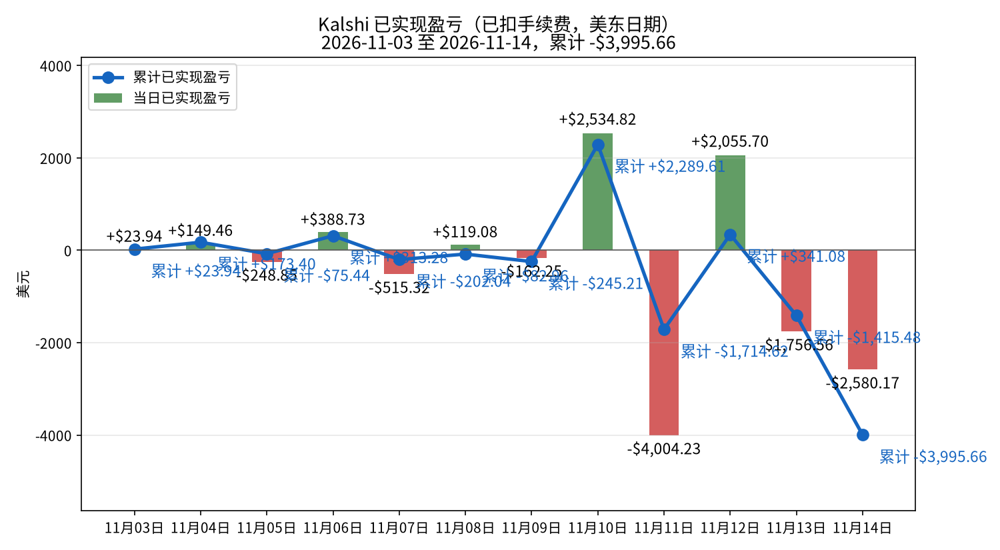
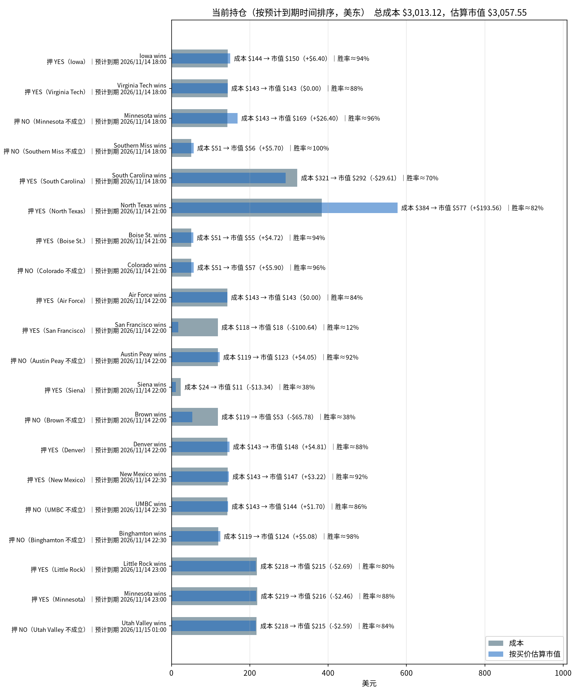

# Kalshi 每日交易报告

按交易日归档的 Kalshi 成交、已实现盈亏与持仓报告。

## Kalshi 资金、盈亏与持仓分析（2026-11-14）

_数据生成时间：2026-11-14 19:56（美东），全部来自 Kalshi 只读 API。持仓价格是生成那一刻的报价，之后会变。_

## 一、入金记录

| 时间（美东） | 类型 | 方式 | 金额 | 手续费 | 状态 |
|---|---|---|---:|---:|---|
| 2026-11-03 13:05 | 入金 | 借记卡 | $50.00 | $0.00 | 已到账 |
| 2026-11-03 20:28 | 入金 | 银行转账ACH | $500.00 | $0.00 | 已到账 |
| 2026-11-03 21:17 | 入金 | 银行转账ACH | $1,000.00 | $0.00 | 已到账 |
| 2026-11-03 21:25 | 入金 | 银行转账ACH | $450.00 | $0.00 | 已到账 |
| 2026-11-04 23:10 | 入金 | 银行转账ACH | $2,000.00 | $0.00 | 已到账 |
| 2026-11-05 00:31 | 出金 | 银行转账ACH | $2,000.00 | $0.00 | 已到账 |
| 2026-11-05 18:53 | 入金 | 银行转账ACH | $500.00 | $0.00 | 已到账 |
| 2026-11-05 21:24 | 出金 | 银行转账ACH | $500.00 | $0.00 | 已到账 |
| 2026-11-07 17:37 | 入金 | 银行转账ACH | $1,000.00 | $0.00 | 已到账 |
| 2026-11-07 20:23 | 出金 | 银行转账ACH | $1,000.00 | $0.00 | 已到账 |
| 2026-11-08 13:50 | 入金 | 银行转账ACH | $1,000.00 | $0.00 | 已到账 |
| 2026-11-08 13:51 | 入金 | 银行转账ACH | $500.00 | $0.00 | 已到账 |
| 2026-11-09 18:01 | 入金 | 银行转账ACH | $2,000.00 | $0.00 | 已到账 |
| 2026-11-11 14:41 | 入金 | 银行转账ACH | $3,000.00 | $0.00 | 已到账 |

**合计入金 $12,000.00，出金 $3,500.00。**

## 二、已实现盈亏曲线

| 日期（美东） | 结算盈亏 | 卖出平仓盈亏 | 当日已实现 | 累计 | 成交笔数 | 当日手续费 |
|---|---:|---:|---:|---:|---:|---:|
| 2026-11-03 | +$23.94（4 个市场） | $0.00（0 个市场） | **+$23.94** | +$23.94 | 72 | $17.04 |
| 2026-11-04 | +$386.26（35 个市场） | -$236.80（1 个市场） | **+$149.46** | +$173.40 | 112 | $125.59 |
| 2026-11-05 | -$248.85（28 个市场） | $0.00（0 个市场） | **-$248.85** | -$75.44 | 61 | $40.92 |
| 2026-11-06 | +$123.19（45 个市场） | +$265.54（4 个市场） | **+$388.73** | +$313.28 | 109 | $47.80 |
| 2026-11-07 | -$515.32（49 个市场） | $0.00（0 个市场） | **-$515.32** | -$202.04 | 200 | $126.79 |
| 2026-11-08 | +$119.08（22 个市场） | $0.00（0 个市场） | **+$119.08** | -$82.96 | 61 | $72.93 |
| 2026-11-09 | +$483.39（13 个市场） | -$645.64（4 个市场） | **-$162.25** | -$245.21 | 125 | $186.45 |
| 2026-11-10 | +$2,534.82（32 个市场） | $0.00（0 个市场） | **+$2,534.82** | +$2,289.61 | 238 | $394.43 |
| 2026-11-11 | -$2,371.65（50 个市场） | -$1,632.59（3 个市场） | **-$4,004.23** | -$1,714.62 | 457 | $410.22 |
| 2026-11-12 | +$2,055.70（68 个市场） | $0.00（0 个市场） | **+$2,055.70** | +$341.08 | 350 | $204.49 |
| 2026-11-13 | -$1,756.56（67 个市场） | $0.00（0 个市场） | **-$1,756.56** | -$1,415.48 | 280 | $201.57 |
| 2026-11-14 | -$2,580.17（46 个市场） | $0.00（0 个市场） | **-$2,580.17** | -$3,995.66 | 230 | $534.28 |

口径：都已扣手续费。结算盈亏 = 结算赔付（含 YES/NO 配对兑付）− 该市场累计买入成本 − 累计手续费；卖出平仓用平均成本法。

**对账**：现金 $1,450.66 + 持仓按买价估算市值 $3,057.55 = $4,508.21，减去净入金 $8,500.00，买价估值口径差额 **-$3,991.79**（不是下图官方总资产口径）。盈亏模型对照（可能因采样时差、成本口径而不同，非强制相等）：累计已实现 -$3,995.66 + 浮动 +$44.43 − 持仓已付手续费 $40.57 = -$3,991.79。

## 总资产曲线（真实资产快照）

采样时间：2026-11-14T19:56:46-05:00（ET）。主账户可用现金 **$1,450.6595** ＋ 官方持仓市值 **$3,123.05** ＝ **$4,573.7095**。

当前未成交挂单 0 笔；冻结资金为0。

主账户0，全部交易分区；不合并子账户；内部划转不计外部入金。

总资产曲线口径为API可用现金＋官方持仓市值，不用买价估值替代官方市值。历史挂单冻结及子账户余额未留存，历史点仅代表主账户可核对资产，不保证完整账户净值。真实采样点之间连线仅辅助阅读，不代表连续估值；缺失日期不补值。净入金仅取已到账外部充值减已完成提现；缺少完成时间时以创建时间近似，因此不保证日内到账时点。主账户与子账户内部划转不计入金；主账户资产与全账户外部净入金之差不一定是收益。

审计数据：`charts/total_assets.csv`、`charts/total_assets.json`；原始快照在 `data/asset_snapshots/`。

**官方口径复核**：可用现金 $1,450.6595 ＋ 官方持仓市值 $3,123.05 ＝ 总资产 $4,573.7095。官方市值比逐仓买价估值高 $65.5000；因此两种资产口径不能混用。

总资产减外部净入金 = -$3,926.29；盈亏模型加估值差额 = -$3,926.29，对账残差 $-0.000000。仅在无子账户内部资金影响且现金覆盖完整时，此差额才可解释为整体盈亏。

## 三、当前持仓与到期时间

| 预计到期（美东） | 市场 | 押注 | 份数 | 成本 | 均价 | 买价/卖价 | 估算市值 | 浮动盈亏 | 赢了净赚* | 隐含胜率 |
|---|---|---|---:|---:|---:|---|---:|---:|---:|---:|
| 2026-11-14 18:00 | Iowa wins `KXNCAAFGAME-26NOV14PURIOWA-IOWA` | YES（Iowa） | 160.00 | $144.00 | $0.900 | 0.94/0.95 | $150.40 | +$6.40 | +$14.99 | 94.5% |
| 2026-11-14 18:00 | Virginia Tech wins `KXNCAAFGAME-26NOV14STANVT-VT` | YES（Virginia Tech） | 163.00 | $143.44 | $0.880 | 0.88/0.89 | $143.44 | $0.00 | +$18.36 | 88.5% |
| 2026-11-14 18:00 | Minnesota wins `KXNCAAFGAME-26NOV14MINNPSU-MINN` | NO（Minnesota 不成立） | 176.00 | $142.56 | $0.810 | 0.96/0.97 | $168.96 | +$26.40 | +$31.54 | 96.5% |
| 2026-11-14 18:00 | Southern Miss wins `KXNCAAFGAME-26NOV14USMLT-USM` | NO（Southern Miss 不成立） | 57.00 | $50.73 | $0.890 | 0.99/1.0 | $56.43 | +$5.70 | +$5.88 | 99.5% |
| 2026-11-14 18:00 | South Carolina wins `KXNCAAFGAME-26NOV14SCARARK-SCAR` | YES（South Carolina） | 423.00 | $321.48 | $0.760 | 0.69/0.7 | $291.87 | -$29.61 | +$96.12 | 69.5% |
| 2026-11-14 21:00 | North Texas wins `KXNCAAMBGAME-26NOV14USAUNT-UNT` | YES（North Texas） | 704.00 | $383.72 | $0.545 | 0.82/0.83 | $577.28 | +$193.56 | +$308.37 | 82.5% |
| 2026-11-14 21:00 | Boise St. wins `KXNCAAFGAME-26NOV14ORSTBSU-BSU` | YES（Boise St.） | 59.00 | $50.74 | $0.860 | 0.94/0.95 | $55.46 | +$4.72 | +$7.76 | 94.5% |
| 2026-11-14 21:00 | Colorado wins `KXNCAAMBGAME-26NOV14COLOPROV-COLO` | NO（Colorado 不成立） | 59.00 | $50.74 | $0.860 | 0.96/0.97 | $56.64 | +$5.90 | +$7.76 | 96.5% |
| 2026-11-14 22:00 | Air Force wins `KXNCAAFGAME-26NOV14SJSUAFA-AFA` | YES（Air Force） | 170.00 | $142.80 | $0.840 | 0.84/0.85 | $142.80 | $0.00 | +$25.60 | 84.5% |
| 2026-11-14 22:00 | San Francisco wins `KXNCAAMBGAME-26NOV14PRSTSF-SF` | YES（San Francisco） | 148.00 | $118.40 | $0.800 | 0.12/0.13 | $17.76 | -$100.64 | +$27.94 | 12.5% |
| 2026-11-14 22:00 | Austin Peay wins `KXNCAAMBGAME-26NOV14PEAYWICH-PEAY` | NO（Austin Peay 不成立） | 135.00 | $118.80 | $0.880 | 0.91/0.92 | $122.85 | +$4.05 | +$15.20 | 91.5% |
| 2026-11-14 22:00 | Siena wins `KXNCAAMBGAME-26NOV14BRWNSIE-SIE` | YES（Siena） | 29.00 | $24.07 | $0.830 | 0.37/0.38 | $10.73 | -$13.34 | +$4.64 | 37.5% |
| 2026-11-14 22:00 | Brown wins `KXNCAAMBGAME-26NOV14BRWNSIE-BRWN` | NO（Brown 不成立） | 143.00 | $118.69 | $0.830 | 0.37/0.38 | $52.91 | -$65.78 | +$22.90 | 37.5% |
| 2026-11-14 22:00 | Denver wins `KXNBAGAME-26NOV14DENNOP-DEN` | YES（Denver） | 170.00 | $143.09 | $0.842 | 0.87/0.88 | $147.90 | +$4.81 | +$25.32 | 87.5% |
| 2026-11-14 22:30 | New Mexico wins `KXNCAAFGAME-26NOV14UNLVUNM-UNM` | YES（New Mexico） | 161.00 | $143.29 | $0.890 | 0.91/0.92 | $146.51 | +$3.22 | +$16.61 | 91.5% |
| 2026-11-14 22:30 | UMBC wins `KXNCAAMBGAME-26NOV14UMBCTOWS-UMBC` | NO（UMBC 不成立） | 170.00 | $142.80 | $0.840 | 0.85/0.87 | $144.50 | +$1.70 | +$25.60 | 86.0% |
| 2026-11-14 22:30 | Binghamton wins `KXNCAAMBGAME-26NOV14BINGDUQ-BING` | NO（Binghamton 不成立） | 127.00 | $119.38 | $0.940 | 0.98/0.99 | $124.46 | +$5.08 | +$7.12 | 98.5% |
| 2026-11-14 23:00 | Little Rock wins `KXNCAAMBGAME-26NOV14NWSTUALR-UALR` | YES（Little Rock） | 269.00 | $217.89 | $0.810 | 0.8/0.81 | $215.20 | -$2.69 | +$48.21 | 80.5% |
| 2026-11-14 23:00 | Minnesota wins `KXNBAGAME-26NOV14CHIMIN-MIN` | YES（Minnesota） | 246.00 | $218.94 | $0.890 | 0.88/0.89 | $216.48 | -$2.46 | +$25.37 | 88.5% |
| 2026-11-15 01:00 | Utah Valley wins `KXNCAAMBGAME-26NOV14UVUNEV-UVU` | NO（Utah Valley 不成立） | 259.00 | $217.56 | $0.840 | 0.83/0.84 | $214.97 | -$2.59 | +$39.00 | 83.5% |
| **合计（20 个市场）** | | | | **$3,013.12** | | | **$3,057.55** | **+$44.43** | **+$774.31** | |

\*赢了净赚 = 赔付 − 成本 − 该仓位已付手续费。隐含胜率取你这一边买价和卖价的中间值。预计到期取 Kalshi 的 `expected_expiration_time`。

### 分析

**总敞口。** 持仓总成本 $3,013.12，按当前买价估算市值 $3,057.55，浮动 +$44.43（未扣卖出手续费）。全部押中可再净赚 +$774.31；最坏情况全部押错，亏掉 $3,013.12。账上现金 $1,450.66。

**什么时候到期：**
- **今天：** 19 个市场，成本 $2,795.56（占 92.8%）；最大一笔是 North Texas wins YES（North Texas），成本 $383.72，预计 2026-11-14 21:00 到期。
- **2026-11-15：** 1 个市场，成本 $217.56（占 7.2%）；最大一笔是 Utah Valley wins NO（Utah Valley 不成立），成本 $217.56，预计 2026-11-15 01:00 到期。

**集中度。** 成本最大的三笔：North Texas wins YES（North Texas） $383.72（12.7%）；South Carolina wins YES（South Carolina） $321.48（10.7%）；Minnesota wins YES（Minnesota） $218.94（7.3%）。
浮盈最大的是 North Texas wins（+$193.56）。

注意：KXNCAAMBGAME-26NOV14BRWNSIE-SIE, KXNCAAMBGAME-26NOV14BRWNSIE-BRWN 属于同一个事件，合计成本 $142.76，要看它们是对冲还是同向加注。

**确定程度（按隐含胜率）：**
- **基本确定（≥95%）：** Southern Miss wins NO（Southern Miss 不成立）（99.5%）、Binghamton wins NO（Binghamton 不成立）（98.5%）、Minnesota wins NO（Minnesota 不成立）（96.5%）、Colorado wins NO（Colorado 不成立）（96.5%）；合计成本 $363.41。
- **比较稳（90%–95%）：** Iowa wins YES（Iowa）（94.5%）、Boise St. wins YES（Boise St.）（94.5%）、Austin Peay wins NO（Austin Peay 不成立）（91.5%）、New Mexico wins YES（New Mexico）（91.5%）；合计成本 $456.83。
- **有不确定性（<90%）：** Virginia Tech wins YES（Virginia Tech）（88.5%）、Minnesota wins YES（Minnesota）（88.5%）、Denver wins YES（Denver）（87.5%）、UMBC wins NO（UMBC 不成立）（86.0%）、Air Force wins YES（Air Force）（84.5%）、Utah Valley wins NO（Utah Valley 不成立）（83.5%）、North Texas wins YES（North Texas）（82.5%）、Little Rock wins YES（Little Rock）（80.5%）、South Carolina wins YES（South Carolina）（69.5%）、Siena wins YES（Siena）（37.5%）、Brown wins NO（Brown 不成立）（37.5%）、San Francisco wins YES（San Francisco）（12.5%）；合计成本 $2,192.88。

---
图表文件：`charts/deposits-2026-11-14.png`、`charts/pnl_curve-2026-11-14.png`、`charts/positions-2026-11-14.png`、`charts/total_assets-2026-11-14.png`；每日盈亏 `charts/pnl_daily.csv`。

## 如何新增一天

加一天只需要动三个地方：

1. 把当天报告放进 `reports/`，命名为 `reports/YYYY-MM-DD.html`。版式与 `reports/2026-11-04.html` 相同：沿用同一套样式，把 Markdown 渲染成 HTML，表格一并保留。
2. 在 `index.html` 的列表最上方加一行 `<li><a href="reports/YYYY-MM-DD.html">YYYY-MM-DD</a></li>`（新的日期放最前）。
3. 用当天的分析摘要替换上面的最新分析一节（标题、段落和盈亏表按原文放上）。

不用改样式或其他页面。
