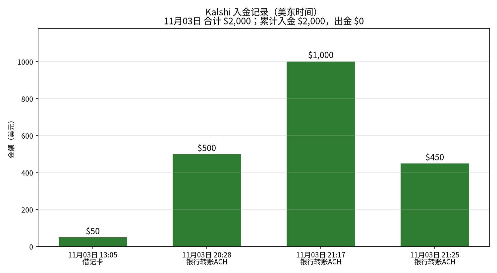
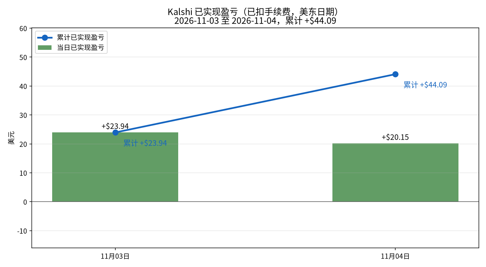
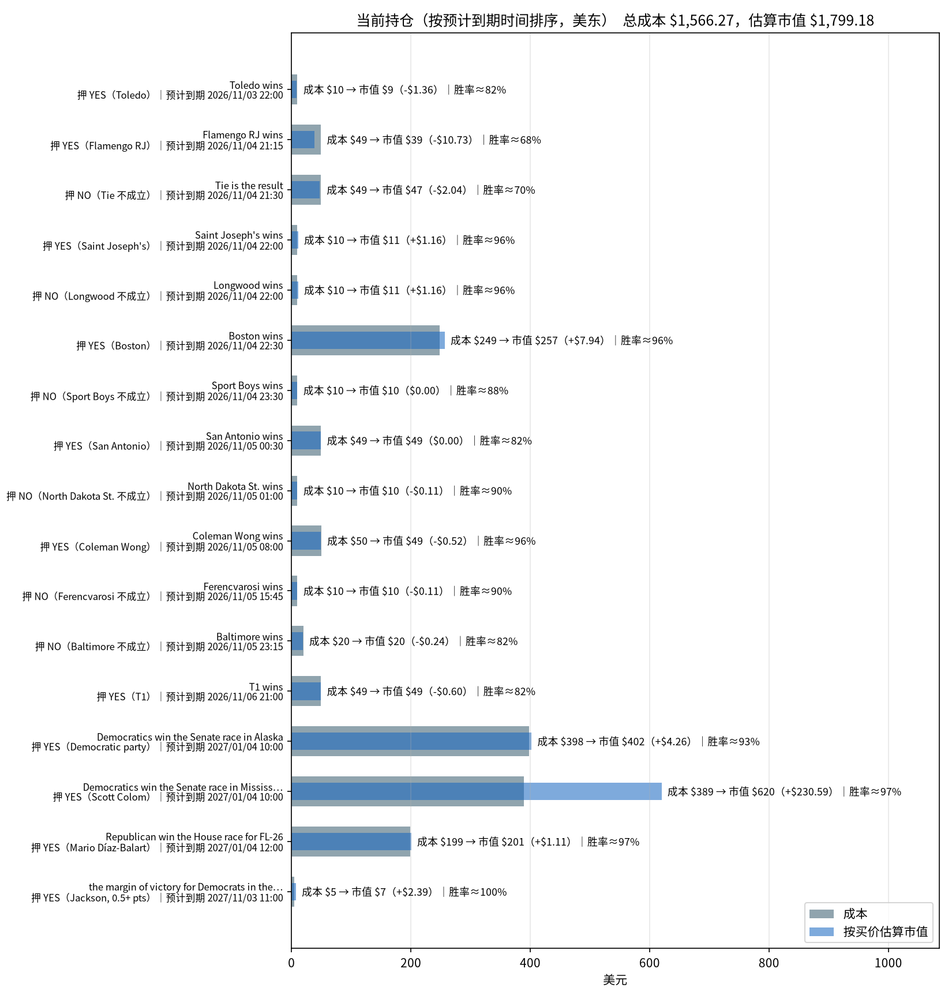

# Kalshi 每日交易报告

按交易日归档的 Kalshi 成交、已实现盈亏与持仓报告。

## Kalshi 资金、盈亏与持仓分析（2026-11-04）

_数据生成时间：2026-11-04 20:04（美东），全部来自 Kalshi 只读 API。持仓价格是生成那一刻的报价，之后会变。_

**当日已实现净盈亏合计：+$20.15**（盈利 23 个市场，亏损 4 个市场；均已扣手续费）。结算盈亏 +$256.95（26 个市场），卖出平仓盈亏 -$236.80（1 个市场），累计 +$44.09。

合计：买入 $4,115.98，卖出 $724.46，手续费 $101.50。现金余额 **$459.18**。Kalshi 显示的持仓市值（portfolio_value）：$1,812.09。持仓市场数：17。持仓总成本 $1,566.27，按当前买价估算市值 $1,798.55，浮动盈亏 +$232.28（估算，未扣卖出手续费）。

### 一、入金记录

| 时间（美东） | 类型 | 方式 | 金额 | 手续费 | 状态 |
|---|---|---|---:|---:|---|
| 2026-11-03 13:05 | 入金 | 借记卡 | $50.00 | $0.00 | 已到账 |
| 2026-11-03 20:28 | 入金 | 银行转账ACH | $500.00 | $0.00 | 已到账 |
| 2026-11-03 21:17 | 入金 | 银行转账ACH | $1,000.00 | $0.00 | 已到账 |
| 2026-11-03 21:25 | 入金 | 银行转账ACH | $450.00 | $0.00 | 已到账 |

**合计入金 $2,000.00，出金 $0.00。**

### 二、已实现盈亏曲线

| 日期（美东） | 结算盈亏 | 卖出平仓盈亏 | 当日已实现 | 累计 | 成交笔数 | 当日手续费 |
|---|---:|---:|---:|---:|---:|---:|
| 2026-11-03 | +$23.94（4 个市场） | $0.00（0 个市场） | **+$23.94** | +$23.94 | 72 | $17.04 |
| 2026-11-04 | +$256.95（26 个市场） | -$236.80（1 个市场） | **+$20.15** | +$44.09 | 90 | $101.50 |

口径：都已扣手续费。结算盈亏 = 结算赔付（含 YES/NO 配对兑付）− 该市场累计买入成本 − 累计手续费；卖出平仓用平均成本法。

**对账**：现金 $459.18 + 持仓按买价估算市值 $1,799.18 = $2,258.36，减去净入金 $2,000.00，账户整体 **+$258.36**。这等于累计已实现 +$44.09 + 浮动 +$232.91 − 持仓已付手续费 $18.64 = +$258.36。

### 三、当前持仓与到期时间

| 预计到期（美东） | 市场 | 押注 | 份数 | 成本 | 均价 | 买价/卖价 | 估算市值 | 浮动盈亏 | 赢了净赚* | 隐含胜率 |
|---|---|---|---:|---:|---:|---|---:|---:|---:|---:|
| 2026-11-03 22:00 | Toledo wins `KXNCAAFGAME-26NOV03TOLSAC-TOL` | YES（Toledo） | 10.48 | $9.96 | $0.950 | 0.82/0.83 | $8.59 | -$1.36 | +$0.49 | 82.5% |
| 2026-11-04 21:15 | Flamengo RJ wins `KXNBBGAME-26NOV041815FLABRA-FLA` | YES（Flamengo RJ） | 63.13 | $49.24 | $0.780 | 0.61/0.74 | $38.51 | -$10.73 | +$13.13 | 67.5% |
| 2026-11-04 21:30 | Tie is the result `KXDIMAYORGAME-26NOV04CUCSFE-TIE` | NO（Tie 不成立） | 68.10 | $49.03 | $0.720 | 0.69/0.7 | $46.99 | -$2.04 | +$18.11 | 69.5% |
| 2026-11-04 22:00 | Saint Joseph's wins `KXNCAAMBGAME-26NOV04LONGJOES-JOES` | YES（Saint Joseph's） | 11.64 | $9.89 | $0.850 | 0.95/0.96 | $11.06 | +$1.16 | +$1.64 | 95.5% |
| 2026-11-04 22:00 | Longwood wins `KXNCAAMBGAME-26NOV04LONGJOES-LONG` | NO（Longwood 不成立） | 11.64 | $9.89 | $0.850 | 0.95/0.96 | $11.06 | +$1.16 | +$1.64 | 95.5% |
| 2026-11-04 22:30 | Boston wins `KXNBAGAME-26NOV04MILBOS-BOS` | YES（Boston） | 270.08 | $248.64 | $0.921 | 0.95/0.96 | $256.58 | +$7.94 | +$20.09 | 95.5% |
| 2026-11-04 23:30 | Sport Boys wins `KXPERLIGA1GAME-26NOV04UNISBA-SBA` | NO（Sport Boys 不成立） | 11.26 | $9.91 | $0.880 | 0.88/0.89 | $9.91 | $0.00 | +$1.27 | 88.5% |
| 2026-11-05 00:30 | San Antonio wins `KXNBAGAME-26NOV04DALSAS-SAS` | YES（San Antonio） | 60.21 | $49.37 | $0.820 | 0.82/0.83 | $49.37 | $0.00 | +$10.22 | 82.5% |
| 2026-11-05 01:00 | North Dakota St. wins `KXNCAAMBGAME-26NOV04NDSUSMC-NDSU` | NO（North Dakota St. 不成立） | 11.03 | $9.93 | $0.900 | 0.89/0.9 | $9.82 | -$0.11 | +$1.03 | 89.5% |
| 2026-11-05 08:00 | Coleman Wong wins `KXATPCHALLENGERMATCH-26NOV05WONHOU-WON` | YES（Coleman Wong） | 51.93 | $49.85 | $0.960 | 0.95/0.96 | $49.33 | -$0.52 | +$1.94 | 95.5% |
| 2026-11-05 15:45 | Ferencvarosi wins `KXUELGAME-26NOV05ACMFTC-FTC` | NO（Ferencvarosi 不成立） | 11.03 | $9.93 | $0.900 | 0.89/0.9 | $9.82 | -$0.11 | +$1.03 | 89.5% |
| 2026-11-05 23:15 | Baltimore wins `KXNFLGAME-26NOV05JACBAL-BAL` | NO（Baltimore 不成立） | 24.08 | $19.75 | $0.820 | 0.81/0.82 | $19.50 | -$0.24 | +$4.09 | 81.5% |
| 2026-11-06 21:00 | T1 wins `KXLOLGAME-26NOV061700T1KC-T1` | YES（T1） | 59.53 | $49.41 | $0.830 | 0.82/0.83 | $48.81 | -$0.60 | +$9.53 | 82.5% |
| 2027-01-04 10:00 | Will Democratics win the Senate race in Alaska? `SENATEAK-26-D` | YES（Democratic party） | 431.86 | $397.80 | $0.921 | 0.931/0.933 | $402.06 | +$4.26 | +$31.87 | 93.2% |
| 2027-01-04 10:00 | Will Democratics win the Senate race in Mississippi? `SENATEMS-26-D` | YES（Scott Colom） | 638.47 | $389.37 | $0.610 | 0.971/0.972 | $619.95 | +$230.59 | +$238.47 | 97.2% |
| 2027-01-04 12:00 | Will Republican win the House race for FL-26? `KXHOUSERACE-FL26-26-R` | YES（Mario Díaz-Balart） | 207.81 | $199.42 | $0.960 | 0.965/0.977 | $200.54 | +$1.11 | +$7.82 | 97.1% |
| 2027-11-03 11:00 | Will the margin of victory for Democrats in the U.S. Senate election in Maine be at least 0.5 percentage points? `KXMIDTERMMOV-MESEND-P0.5` | YES（Jackson, 0.5+ pts） | 7.29 | $4.88 | $0.670 | 0.998/0.999 | $7.28 | +$2.39 | +$2.29 | 99.8% |
| **合计（17 个市场）** | | | | **$1,566.27** | | | **$1,799.18** | **+$232.91** | **+$364.66** | |

\*赢了净赚 = 赔付 − 成本 − 该仓位已付手续费。隐含胜率取你这一边买价和卖价的中间值。预计到期取 Kalshi 的 `expected_expiration_time`。

#### 分析

**总敞口。** 持仓总成本 $1,566.27，按当前买价估算市值 $1,799.18，浮动 +$232.91（未扣卖出手续费）。全部押中可再净赚 +$364.66；最坏情况全部押错，亏掉 $1,566.27。账上现金 $459.18。

**什么时候到期：**
- **预计时间已过、等待结算：** 1 个市场，成本 $9.96（占 0.6%）；最大一笔是 Toledo wins YES（Toledo），成本 $9.96，预计 2026-11-03 22:00 到期。
- **今天：** 6 个市场，成本 $376.61（占 24.0%）；最大一笔是 Boston wins YES（Boston），成本 $248.64，预计 2026-11-04 22:30 到期。
- **2026-11-05：** 5 个市场，成本 $138.82（占 8.9%）；最大一笔是 Coleman Wong wins YES（Coleman Wong），成本 $49.85，预计 2026-11-05 08:00 到期。
- **2026-11-06：** 1 个市场，成本 $49.41（占 3.2%）；最大一笔是 T1 wins YES（T1），成本 $49.41，预计 2026-11-06 21:00 到期。
- **更晚（选举等长期市场）：** 4 个市场，成本 $991.47（占 63.3%）；最大一笔是 Will Democratics win the Senate race in Alaska? YES（Democratic party），成本 $397.80，预计 2027-01-04 10:00 到期。

**集中度。** 成本最大的三笔：Will Democratics win the Senate race in Alaska? YES（Democratic party） $397.80（25.4%）；Will Democratics win the Senate race in Mississippi? YES（Scott Colom） $389.37（24.9%）；Boston wins YES（Boston） $248.64（15.9%）。
浮盈最大的是 Will Democratics win the Senate race in Mississippi?（+$230.59）。

注意：KXNCAAMBGAME-26NOV04LONGJOES-JOES, KXNCAAMBGAME-26NOV04LONGJOES-LONG 属于同一个事件，合计成本 $19.79，要看它们是对冲还是同向加注。

**确定程度（按隐含胜率）：**
- **基本确定（≥95%）：** Will the margin of victory for Democrats in the U.S. Senate election in Maine be at least 0.5 percentage points? YES（Jackson, 0.5+ pts）（99.8%）、Will Democratics win the Senate race in Mississippi? YES（Scott Colom）（97.2%）、Will Republican win the House race for FL-26? YES（Mario Díaz-Balart）（97.1%）、Saint Joseph's wins YES（Saint Joseph's）（95.5%）、Longwood wins NO（Longwood 不成立）（95.5%）、Boston wins YES（Boston）（95.5%）、Coleman Wong wins YES（Coleman Wong）（95.5%）；合计成本 $911.95。
- **比较稳（90%–95%）：** Will Democratics win the Senate race in Alaska? YES（Democratic party）（93.2%）；合计成本 $397.80。
- **有不确定性（<90%）：** North Dakota St. wins NO（North Dakota St. 不成立）（89.5%）、Ferencvarosi wins NO（Ferencvarosi 不成立）（89.5%）、Sport Boys wins NO（Sport Boys 不成立）（88.5%）、Toledo wins YES（Toledo）（82.5%）、San Antonio wins YES（San Antonio）（82.5%）、T1 wins YES（T1）（82.5%）、Baltimore wins NO（Baltimore 不成立）（81.5%）、Tie is the result NO（Tie 不成立）（69.5%）、Flamengo RJ wins YES（Flamengo RJ）（67.5%）；合计成本 $256.52。

---
图表文件：`charts/deposits-2026-11-04.png`、`charts/pnl_curve-2026-11-04.png`、`charts/positions-2026-11-04.png`；每日盈亏 `charts/pnl_daily.csv`。

在线站点：https://cuichuhan.github.io/kalshi-daily-reports/

## 如何新增一天

加一天只需要动三个地方：

1. 把当天报告放进 `reports/`，命名为 `reports/YYYY-MM-DD.html`。版式与 `reports/2026-11-04.html` 相同：沿用同一套样式，把 Markdown 渲染成 HTML，表格一并保留。
2. 在 `index.html` 的列表最上方加一行 `<li><a href="reports/YYYY-MM-DD.html">YYYY-MM-DD</a></li>`（新的日期放最前）。
3. 用当天的分析摘要替换上面的最新分析一节（标题、段落和盈亏表按原文放上）。

不用改样式或其他页面。
