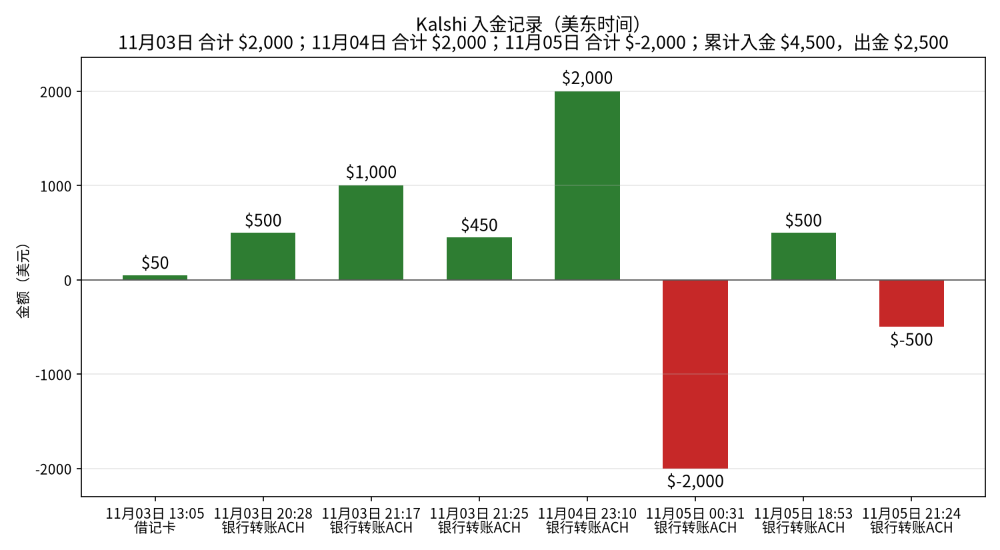
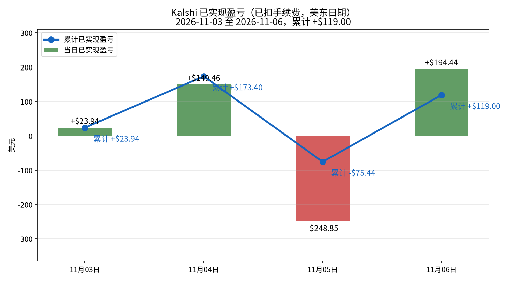
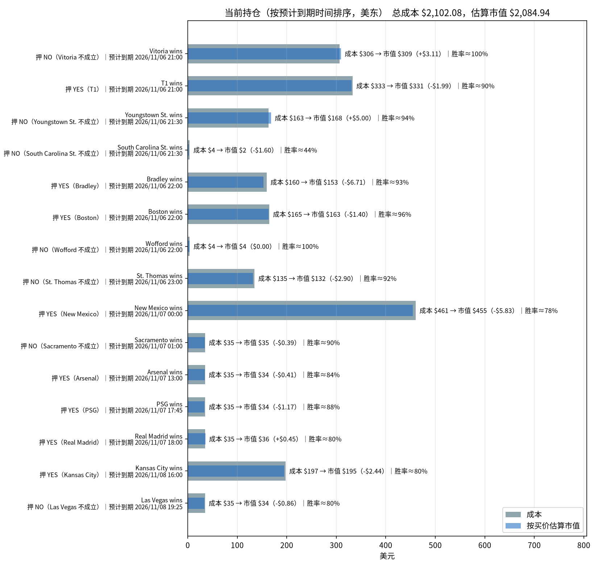

# Kalshi 每日交易报告

按交易日归档的 Kalshi 成交、已实现盈亏与持仓报告。

## Kalshi 资金、盈亏与持仓分析（2026-11-06）

_数据生成时间：2026-11-06 19:58（美东），全部来自 Kalshi 只读 API。持仓价格是生成那一刻的报价，之后会变。_

**当日已实现净盈亏合计：+$194.44**（盈利 24 个市场，亏损 5 个市场；均已扣手续费）。结算盈亏 -$47.01（23 个市场），卖出平仓盈亏 +$241.45（6 个市场），累计 +$119.00。

合计：买入 $3,150.07，卖出 $1,874.40，手续费 $37.41。现金余额 **$0.50**。Kalshi 显示的持仓市值（portfolio_value）：$2,101.17。持仓市场数：15。持仓总成本 $2,102.08，按当前买价估算市值 $2,084.94，浮动盈亏 -$17.14（估算，未扣卖出手续费）。

### 一、入金记录

| 时间（美东） | 类型 | 方式 | 金额 | 手续费 | 状态 |
|---|---|---|---:|---:|---|
| 2026-11-03 13:05 | 入金 | 借记卡 | $50.00 | $0.00 | 已到账 |
| 2026-11-03 20:28 | 入金 | 银行转账ACH | $500.00 | $0.00 | 已到账 |
| 2026-11-03 21:17 | 入金 | 银行转账ACH | $1,000.00 | $0.00 | 已到账 |
| 2026-11-03 21:25 | 入金 | 银行转账ACH | $450.00 | $0.00 | 已到账 |
| 2026-11-04 23:10 | 入金 | 银行转账ACH | $2,000.00 | $0.00 | 已到账 |
| 2026-11-05 00:31 | 出金 | 银行转账ACH | $2,000.00 | $0.00 | 已到账 |
| 2026-11-05 18:53 | 入金 | 银行转账ACH | $500.00 | $0.00 | 已到账 |
| 2026-11-05 21:24 | 出金 | 银行转账ACH | $500.00 | $0.00 | 已到账 |

**合计入金 $4,500.00，出金 $2,500.00。**

### 二、已实现盈亏曲线

| 日期（美东） | 结算盈亏 | 卖出平仓盈亏 | 当日已实现 | 累计 | 成交笔数 | 当日手续费 |
|---|---:|---:|---:|---:|---:|---:|
| 2026-11-03 | +$23.94（4 个市场） | $0.00（0 个市场） | **+$23.94** | +$23.94 | 72 | $17.04 |
| 2026-11-04 | +$386.26（35 个市场） | -$236.80（1 个市场） | **+$149.46** | +$173.40 | 112 | $125.59 |
| 2026-11-05 | -$248.85（28 个市场） | $0.00（0 个市场） | **-$248.85** | -$75.44 | 61 | $40.92 |
| 2026-11-06 | -$47.01（23 个市场） | +$241.45（6 个市场） | **+$194.44** | +$119.00 | 69 | $37.41 |

口径：都已扣手续费。结算盈亏 = 结算赔付（含 YES/NO 配对兑付）− 该市场累计买入成本 − 累计手续费；卖出平仓用平均成本法。

**对账**：现金 $0.50 + 持仓按买价估算市值 $2,084.94 = $2,085.45，减去净入金 $2,000.00，账户整体 **+$85.45**。这等于累计已实现 +$119.00 + 浮动 -$17.14 − 持仓已付手续费 $16.41 = +$85.45。

### 三、当前持仓与到期时间

| 预计到期（美东） | 市场 | 押注 | 份数 | 成本 | 均价 | 买价/卖价 | 估算市值 | 浮动盈亏 | 赢了净赚* | 隐含胜率 |
|---|---|---|---:|---:|---:|---|---:|---:|---:|---:|
| 2026-11-06 21:00 | Vitoria wins `KXBRASILEIROGAME-26NOV06VITFLU-VIT` | NO（Vitoria 不成立） | 311.00 | $306.33 | $0.985 | 0.995/1.0 | $309.44 | +$3.11 | +$4.34 | 99.8% |
| 2026-11-06 21:00 | T1 wins `KXLOLGAME-26NOV061700T1KC-T1` | YES（T1） | 367.58 | $332.82 | $0.905 | 0.9/0.91 | $330.82 | -$1.99 | +$32.59 | 90.5% |
| 2026-11-06 21:30 | Youngstown St. wins `KXNCAAMBGAME-26NOV06YSUOSU-YSU` | NO（Youngstown St. 不成立） | 179.00 | $163.26 | $0.912 | 0.94/0.95 | $168.26 | +$5.00 | +$14.74 | 94.5% |
| 2026-11-06 21:30 | South Carolina St. wins `KXNCAAMBGAME-26NOV06SCSTSCUS-SCST` | NO（South Carolina St. 不成立） | 5.00 | $3.75 | $0.750 | 0.43/0.44 | $2.15 | -$1.60 | +$1.18 | 43.5% |
| 2026-11-06 22:00 | Bradley wins `KXNCAAWBGAME-26NOV06NIUBRAD-BRAD` | YES（Bradley） | 168.00 | $159.59 | $0.950 | 0.91/0.95 | $152.88 | -$6.71 | +$7.85 | 93.0% |
| 2026-11-06 22:00 | Boston wins `KXNBAGAME-26NOV06BOSCHA-BOS` | YES（Boston） | 170.00 | $164.60 | $0.968 | 0.96/0.97 | $163.20 | -$1.40 | +$5.04 | 96.5% |
| 2026-11-06 22:00 | Wofford wins `KXNCAAMBGAME-26NOV06WOFUNC-WOF` | NO（Wofford 不成立） | 4.00 | $3.96 | $0.990 | 0.99/1.0 | $3.96 | $0.00 | +$0.04 | 99.5% |
| 2026-11-06 23:00 | St. Thomas wins `KXNCAAMBGAME-26NOV06USTMINN-UST` | NO（St. Thomas 不成立） | 145.00 | $134.85 | $0.930 | 0.91/0.92 | $131.95 | -$2.90 | +$9.49 | 91.5% |
| 2026-11-07 00:00 | New Mexico wins `KXNCAAFGAME-26NOV06UNMNEV-UNM` | YES（New Mexico） | 583.00 | $460.57 | $0.790 | 0.78/0.79 | $454.74 | -$5.83 | +$115.66 | 78.5% |
| 2026-11-07 01:00 | Sacramento wins `KXNBAGAME-26NOV06SASSAC-SAC` | NO（Sacramento 不成立） | 39.00 | $35.10 | $0.900 | 0.89/0.9 | $34.71 | -$0.39 | +$3.65 | 89.5% |
| 2026-11-07 13:00 | Arsenal wins `KXEPLGAME-26NOV07ARSHUL-ARS` | YES（Arsenal） | 41.00 | $34.85 | $0.850 | 0.84/0.85 | $34.44 | -$0.41 | +$5.78 | 84.5% |
| 2026-11-07 17:45 | PSG wins `KXLIGUE1GAME-26NOV07PSGEST-PSG` | YES（PSG） | 39.00 | $35.10 | $0.900 | 0.87/0.88 | $33.93 | -$1.17 | +$3.65 | 87.5% |
| 2026-11-07 18:00 | Real Madrid wins `KXLALIGAGAME-26NOV07VCFRMA-RMA` | YES（Real Madrid） | 45.00 | $35.10 | $0.780 | 0.79/0.8 | $35.55 | +$0.45 | +$9.36 | 79.5% |
| 2026-11-08 16:00 | Kansas City wins `KXNFLGAME-26NOV08NYJKC-KC` | YES（Kansas City） | 243.67 | $197.37 | $0.810 | 0.8/0.81 | $194.94 | -$2.44 | +$43.67 | 80.5% |
| 2026-11-08 19:25 | Las Vegas wins `KXNFLGAME-26NOV08LVSF-LV` | NO（Las Vegas 不成立） | 43.00 | $34.83 | $0.810 | 0.79/0.8 | $33.97 | -$0.86 | +$7.71 | 79.5% |
| **合计（15 个市场）** | | | | **$2,102.08** | | | **$2,084.94** | **-$17.14** | **+$264.76** | |

\*赢了净赚 = 赔付 − 成本 − 该仓位已付手续费。隐含胜率取你这一边买价和卖价的中间值。预计到期取 Kalshi 的 `expected_expiration_time`。

#### 分析

**总敞口。** 持仓总成本 $2,102.08，按当前买价估算市值 $2,084.94，浮动 -$17.14（未扣卖出手续费）。全部押中可再净赚 +$264.76；最坏情况全部押错，亏掉 $2,102.08。账上现金 $0.50。

**什么时候到期：**
- **今天：** 8 个市场，成本 $1,269.16（占 60.4%）；最大一笔是 T1 wins YES（T1），成本 $332.82，预计 2026-11-06 21:00 到期。
- **2026-11-07：** 5 个市场，成本 $600.72（占 28.6%）；最大一笔是 New Mexico wins YES（New Mexico），成本 $460.57，预计 2026-11-07 00:00 到期。
- **2026-11-08：** 2 个市场，成本 $232.20（占 11.0%）；最大一笔是 Kansas City wins YES（Kansas City），成本 $197.37，预计 2026-11-08 16:00 到期。

**集中度。** 成本最大的三笔：New Mexico wins YES（New Mexico） $460.57（21.9%）；T1 wins YES（T1） $332.82（15.8%）；Vitoria wins NO（Vitoria 不成立） $306.33（14.6%）。
浮盈最大的是 Youngstown St. wins（+$5.00）。

**确定程度（按隐含胜率）：**
- **基本确定（≥95%）：** Vitoria wins NO（Vitoria 不成立）（99.8%）、Wofford wins NO（Wofford 不成立）（99.5%）、Boston wins YES（Boston）（96.5%）；合计成本 $474.89。
- **比较稳（90%–95%）：** Youngstown St. wins NO（Youngstown St. 不成立）（94.5%）、Bradley wins YES（Bradley）（93.0%）、St. Thomas wins NO（St. Thomas 不成立）（91.5%）、T1 wins YES（T1）（90.5%）；合计成本 $790.52。
- **有不确定性（<90%）：** Sacramento wins NO（Sacramento 不成立）（89.5%）、PSG wins YES（PSG）（87.5%）、Arsenal wins YES（Arsenal）（84.5%）、Kansas City wins YES（Kansas City）（80.5%）、Real Madrid wins YES（Real Madrid）（79.5%）、Las Vegas wins NO（Las Vegas 不成立）（79.5%）、New Mexico wins YES（New Mexico）（78.5%）、South Carolina St. wins NO（South Carolina St. 不成立）（43.5%）；合计成本 $836.67。

---
图表文件：`charts/deposits-2026-11-06.png`、`charts/pnl_curve-2026-11-06.png`、`charts/positions-2026-11-06.png`；每日盈亏 `charts/pnl_daily.csv`。

在线站点：https://cuichuhan.github.io/kalshi-daily-reports/

## 如何新增一天

加一天只需要动三个地方：

1. 把当天报告放进 `reports/`，命名为 `reports/YYYY-MM-DD.html`。版式与 `reports/2026-11-04.html` 相同：沿用同一套样式，把 Markdown 渲染成 HTML，表格一并保留。
2. 在 `index.html` 的列表最上方加一行 `<li><a href="reports/YYYY-MM-DD.html">YYYY-MM-DD</a></li>`（新的日期放最前）。
3. 用当天的分析摘要替换上面的最新分析一节（标题、段落和盈亏表按原文放上）。

不用改样式或其他页面。
