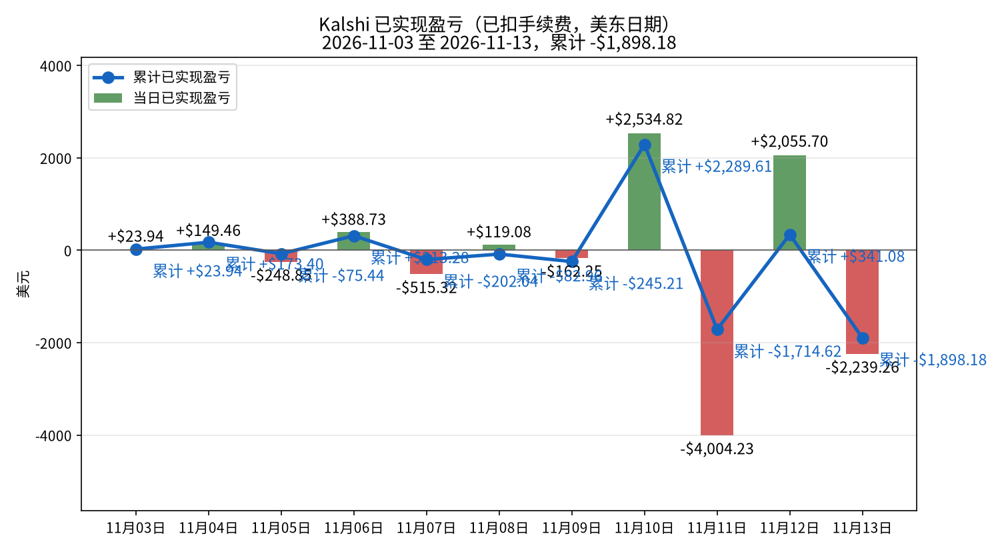
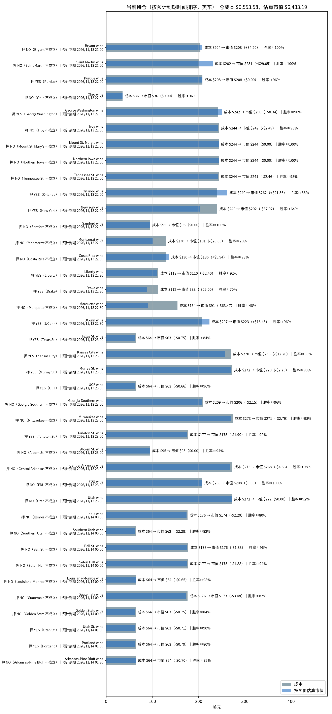

# Kalshi 每日交易报告

按交易日归档的 Kalshi 成交、已实现盈亏与持仓报告。

## Kalshi 资金、盈亏与持仓分析（2026-11-13）

_数据生成时间：2026-11-13 19:53（美东），全部来自 Kalshi 只读 API。持仓价格是生成那一刻的报价，之后会变。_

## 一、入金记录

| 时间（美东） | 类型 | 方式 | 金额 | 手续费 | 状态 |
|---|---|---|---:|---:|---|
| 2026-11-03 13:05 | 入金 | 借记卡 | $50.00 | $0.00 | 已到账 |
| 2026-11-03 20:28 | 入金 | 银行转账ACH | $500.00 | $0.00 | 已到账 |
| 2026-11-03 21:17 | 入金 | 银行转账ACH | $1,000.00 | $0.00 | 已到账 |
| 2026-11-03 21:25 | 入金 | 银行转账ACH | $450.00 | $0.00 | 已到账 |
| 2026-11-04 23:10 | 入金 | 银行转账ACH | $2,000.00 | $0.00 | 已到账 |
| 2026-11-05 00:31 | 出金 | 银行转账ACH | $2,000.00 | $0.00 | 已到账 |
| 2026-11-05 18:53 | 入金 | 银行转账ACH | $500.00 | $0.00 | 已到账 |
| 2026-11-05 21:24 | 出金 | 银行转账ACH | $500.00 | $0.00 | 已到账 |
| 2026-11-07 17:37 | 入金 | 银行转账ACH | $1,000.00 | $0.00 | 已到账 |
| 2026-11-07 20:23 | 出金 | 银行转账ACH | $1,000.00 | $0.00 | 已到账 |
| 2026-11-08 13:50 | 入金 | 银行转账ACH | $1,000.00 | $0.00 | 已到账 |
| 2026-11-08 13:51 | 入金 | 银行转账ACH | $500.00 | $0.00 | 已到账 |
| 2026-11-09 18:01 | 入金 | 银行转账ACH | $2,000.00 | $0.00 | 已到账 |
| 2026-11-11 14:41 | 入金 | 银行转账ACH | $3,000.00 | $0.00 | 已到账 |

**合计入金 $12,000.00，出金 $3,500.00。**

## 二、已实现盈亏曲线

| 日期（美东） | 结算盈亏 | 卖出平仓盈亏 | 当日已实现 | 累计 | 成交笔数 | 当日手续费 |
|---|---:|---:|---:|---:|---:|---:|
| 2026-11-03 | +$23.94（4 个市场） | $0.00（0 个市场） | **+$23.94** | +$23.94 | 72 | $17.04 |
| 2026-11-04 | +$386.26（35 个市场） | -$236.80（1 个市场） | **+$149.46** | +$173.40 | 112 | $125.59 |
| 2026-11-05 | -$248.85（28 个市场） | $0.00（0 个市场） | **-$248.85** | -$75.44 | 61 | $40.92 |
| 2026-11-06 | +$123.19（45 个市场） | +$265.54（4 个市场） | **+$388.73** | +$313.28 | 109 | $47.80 |
| 2026-11-07 | -$515.32（49 个市场） | $0.00（0 个市场） | **-$515.32** | -$202.04 | 200 | $126.79 |
| 2026-11-08 | +$119.08（22 个市场） | $0.00（0 个市场） | **+$119.08** | -$82.96 | 61 | $72.93 |
| 2026-11-09 | +$483.39（13 个市场） | -$645.64（4 个市场） | **-$162.25** | -$245.21 | 125 | $186.45 |
| 2026-11-10 | +$2,534.82（32 个市场） | $0.00（0 个市场） | **+$2,534.82** | +$2,289.61 | 238 | $394.43 |
| 2026-11-11 | -$2,371.65（50 个市场） | -$1,632.59（3 个市场） | **-$4,004.23** | -$1,714.62 | 457 | $410.22 |
| 2026-11-12 | +$2,055.70（68 个市场） | $0.00（0 个市场） | **+$2,055.70** | +$341.08 | 350 | $204.49 |
| 2026-11-13 | -$2,239.26（31 个市场） | $0.00（0 个市场） | **-$2,239.26** | -$1,898.18 | 228 | $93.01 |

口径：都已扣手续费。结算盈亏 = 结算赔付（含 YES/NO 配对兑付）− 该市场累计买入成本 − 累计手续费；卖出平仓用平均成本法。

**对账**：现金 $10.24 + 持仓按买价估算市值 $6,433.19 = $6,443.43，减去净入金 $8,500.00，买价估值口径差额 **-$2,056.57**（不是下图官方总资产口径）。盈亏模型对照（可能因采样时差、成本口径而不同，非强制相等）：累计已实现 -$1,898.18 + 浮动 -$120.39 − 持仓已付手续费 $38.00 = -$2,056.57。

## 总资产曲线（真实资产快照）

采样时间：2026-11-13T19:53:48-05:00（ET）。主账户可用现金 **$10.2401** ＋ 官方持仓市值 **$6,448.01** ＝ **$6,458.2501**。

当前未成交挂单 0 笔；冻结资金为0。

主账户0，全部交易分区；不合并子账户；内部划转不计外部入金。

总资产曲线口径为API可用现金＋官方持仓市值，不用买价估值替代官方市值。历史挂单冻结及子账户余额未留存，历史点仅代表主账户可核对资产，不保证完整账户净值。真实采样点之间连线仅辅助阅读，不代表连续估值；缺失日期不补值。净入金仅取已到账外部充值减已完成提现；缺少完成时间时以创建时间近似，因此不保证日内到账时点。主账户与子账户内部划转不计入金；主账户资产与全账户外部净入金之差不一定是收益。

审计数据：[data/total_assets.csv](data/total_assets.csv)、[data/total_assets.json](data/total_assets.json)；原始快照在 `data/asset_snapshots/`（原始快照文件未放入本仓库，路径和 sha256 记在 JSON 里）。

**官方口径复核**：可用现金 $10.2401 ＋ 官方持仓市值 $6,448.01 ＝ 总资产 $6,458.2501。官方市值比逐仓买价估值高 $14.8170；因此两种资产口径不能混用。

总资产减外部净入金 = -$2,041.75；盈亏模型加估值差额 = -$2,041.75，对账残差 $0.000000。仅在无子账户内部资金影响且现金覆盖完整时，此差额才可解释为整体盈亏。

## 三、当前持仓与到期时间

| 预计到期（美东） | 市场 | 押注 | 份数 | 成本 | 均价 | 买价/卖价 | 估算市值 | 浮动盈亏 | 赢了净赚* | 隐含胜率 |
|---|---|---|---:|---:|---:|---|---:|---:|---:|---:|
| 2026-11-13 21:00 | Bryant wins `KXNCAAMBGAME-26NOV13BRYRUTG-BRY` | NO（Bryant 不成立） | 210.00 | $203.70 | $0.970 | 0.99/1.0 | $207.90 | +$4.20 | +$5.87 | 99.5% |
| 2026-11-13 21:00 | Saint Martin wins `KXCONCACAFNLGAME-26NOV13SMASLV-SMA` | NO（Saint Martin 不成立） | 233.00 | $201.62 | $0.865 | 0.99/1.0 | $230.67 | +$29.05 | +$29.48 | 99.5% |
| 2026-11-13 22:00 | Purdue wins `KXNCAAMBGAME-26NOV13OHIOPUR-PUR` | YES（Purdue） | 217.00 | $208.32 | $0.960 | 0.96/0.97 | $208.32 | $0.00 | +$8.10 | 96.5% |
| 2026-11-13 22:00 | Ohio wins `KXNCAAMBGAME-26NOV13OHIOPUR-OHIO` | NO（Ohio 不成立） | 37.00 | $35.52 | $0.960 | 0.96/0.97 | $35.52 | $0.00 | +$1.38 | 96.5% |
| 2026-11-13 22:00 | George Washington wins `KXNCAAMBGAME-26NOV13HARVGW-GW` | YES（George Washington） | 278.00 | $241.86 | $0.870 | 0.9/0.91 | $250.20 | +$8.34 | +$33.94 | 90.5% |
| 2026-11-13 22:00 | Troy wins `KXNCAAMBGAME-26NOV13TROYNCST-TROY` | NO（Troy 不成立） | 249.00 | $244.02 | $0.980 | 0.97/0.98 | $241.53 | -$2.49 | +$4.64 | 97.5% |
| 2026-11-13 22:00 | Mount St. Mary's wins `KXNCAAMBGAME-26NOV13MSMVT-MSM` | NO（Mount St. Mary's 不成立） | 246.00 | $243.54 | $0.990 | 0.99/1.0 | $243.54 | $0.00 | +$2.29 | 99.5% |
| 2026-11-13 22:00 | Northern Iowa wins `KXNCAAMBGAME-26NOV13UNIMSU-UNI` | NO（Northern Iowa 不成立） | 246.00 | $243.54 | $0.990 | 0.99/1.0 | $243.54 | $0.00 | +$2.29 | 99.5% |
| 2026-11-13 22:00 | Tennessee St. wins `KXNCAAMBGAME-26NOV13TNSTTENN-TNST` | NO（Tennessee St. 不成立） | 246.00 | $243.54 | $0.990 | 0.98/0.99 | $241.08 | -$2.46 | +$2.29 | 98.5% |
| 2026-11-13 22:00 | Orlando wins `KXNBAGAME-26NOV13MILORL-ORL` | YES（Orlando） | 308.00 | $240.24 | $0.780 | 0.85/0.86 | $261.80 | +$21.56 | +$64.06 | 85.5% |
| 2026-11-13 22:00 | New York wins `KXNBAGAME-26NOV13NYKIND-NYK` | YES（New York） | 316.00 | $240.16 | $0.760 | 0.64/0.65 | $202.24 | -$37.92 | +$71.81 | 64.5% |
| 2026-11-13 22:00 | Samford wins `KXNCAAWBGAME-26NOV13SAMIND-SAM` | NO（Samford 不成立） | 96.00 | $95.04 | $0.990 | 0.99/1.0 | $95.04 | $0.00 | +$0.89 | 99.5% |
| 2026-11-13 22:00 | Montserrat wins `KXCONCACAFNLGAME-26NOV13MSRNIC-MSR` | NO（Montserrat 不成立） | 144.00 | $129.60 | $0.900 | 0.7/0.71 | $100.80 | -$28.80 | +$13.49 | 70.5% |
| 2026-11-13 22:00 | Costa Rica wins `KXINTLFRIENDLYGAME-26NOV13ECUCRI-CRI` | NO（Costa Rica 不成立） | 139.00 | $130.28 | $0.937 | 0.98/0.99 | $136.22 | +$5.94 | +$8.15 | 98.5% |
| 2026-11-13 22:30 | Liberty wins `KXNCAAMBGAME-26NOV13NCCULIB-LIB` | YES（Liberty） | 120.00 | $112.80 | $0.940 | 0.92/0.93 | $110.40 | -$2.40 | +$6.73 | 92.5% |
| 2026-11-13 22:30 | Drake wins `KXNCAAMBGAME-26NOV13SDAKDRKE-DRKE` | YES（Drake） | 125.00 | $112.50 | $0.900 | 0.7/0.71 | $87.50 | -$25.00 | +$11.71 | 70.5% |
| 2026-11-13 22:30 | Marquette wins `KXNCAAWBGAME-26NOV13MARQMOSU-MARQ` | NO（Marquette 不成立） | 197.05 | $154.11 | $0.782 | 0.46/0.49 | $90.64 | -$63.47 | +$40.59 | 47.5% |
| 2026-11-13 22:30 | UConn wins `KXNCAAMBGAME-26NOV13OSUCONN-CONN` | YES（UConn） | 235.00 | $206.80 | $0.880 | 0.95/0.96 | $223.25 | +$16.45 | +$26.46 | 95.5% |
| 2026-11-13 23:00 | Texas St. wins `KXNCAAMBGAME-26NOV13USMTXST-TXST` | YES（Texas St.） | 75.00 | $63.75 | $0.850 | 0.84/0.85 | $63.00 | -$0.75 | +$10.58 | 84.5% |
| 2026-11-13 23:00 | Kansas City wins `KXNCAAWBGAME-26NOV13SEMOUMKC-UMKC` | YES（Kansas City） | 326.00 | $269.80 | $0.828 | 0.79/0.81 | $257.54 | -$12.26 | +$52.94 | 80.0% |
| 2026-11-13 23:00 | Murray St. wins `KXNCAAMBGAME-26NOV13TXSOMURR-MURR` | YES（Murray St.） | 275.00 | $272.25 | $0.990 | 0.98/0.99 | $269.50 | -$2.75 | +$2.56 | 98.5% |
| 2026-11-13 23:00 | UCF wins `KXNCAAMBGAME-26NOV13GASOUCF-UCF` | YES（UCF） | 66.00 | $64.02 | $0.970 | 0.96/0.97 | $63.36 | -$0.66 | +$1.85 | 96.5% |
| 2026-11-13 23:00 | Georgia Southern wins `KXNCAAMBGAME-26NOV13GASOUCF-GASO` | NO（Georgia Southern 不成立） | 215.00 | $208.55 | $0.970 | 0.96/0.97 | $206.40 | -$2.15 | +$6.01 | 96.5% |
| 2026-11-13 23:00 | Milwaukee wins `KXNCAAMBGAME-26NOV13MILWTCU-MILW` | NO（Milwaukee 不成立） | 279.00 | $273.42 | $0.980 | 0.97/0.98 | $270.63 | -$2.79 | +$5.20 | 97.5% |
| 2026-11-13 23:00 | Tarleton St. wins `KXNCAAMBGAME-26NOV13ALCNTARL-TARL` | YES（Tarleton St.） | 190.00 | $176.70 | $0.930 | 0.92/0.93 | $174.80 | -$1.90 | +$12.43 | 92.5% |
| 2026-11-13 23:00 | Alcorn St. wins `KXNCAAMBGAME-26NOV13ALCNTARL-ALCN` | NO（Alcorn St. 不成立） | 102.00 | $94.86 | $0.930 | 0.93/0.94 | $94.86 | $0.00 | +$6.68 | 93.5% |
| 2026-11-13 23:00 | Central Arkansas wins `KXNCAAMBGAME-26NOV13CARKARK-CARK` | NO（Central Arkansas 不成立） | 276.00 | $272.58 | $0.988 | 0.97/0.98 | $267.72 | -$4.86 | +$3.18 | 97.5% |
| 2026-11-13 23:00 | FDU wins `KXNCAAMBGAME-26NOV13FDUOKLA-FDU` | NO（FDU 不成立） | 210.00 | $207.90 | $0.990 | 0.99/1.0 | $207.90 | $0.00 | +$1.95 | 99.5% |
| 2026-11-13 23:30 | Utah wins `KXNBAGAME-26NOV13UTAHOU-UTA` | NO（Utah 不成立） | 299.00 | $272.09 | $0.910 | 0.91/0.92 | $272.09 | $0.00 | +$25.20 | 91.5% |
| 2026-11-14 00:00 | Illinois wins `KXNCAAFGAME-26NOV13ILLUCLA-ILL` | NO（Illinois 不成立） | 220.00 | $176.00 | $0.800 | 0.79/0.8 | $173.80 | -$2.20 | +$41.54 | 79.5% |
| 2026-11-14 00:00 | Southern Utah wins `KXNCAAWBGAME-26NOV13SUUWSU-SUU` | NO（Southern Utah 不成立） | 76.00 | $63.84 | $0.840 | 0.81/0.84 | $61.56 | -$2.28 | +$11.44 | 82.5% |
| 2026-11-14 00:00 | Ball St. wins `KXNCAAMBGAME-26NOV13BALLSMU-BALL` | NO（Ball St. 不成立） | 183.00 | $177.51 | $0.970 | 0.96/0.97 | $175.68 | -$1.83 | +$5.12 | 96.5% |
| 2026-11-14 00:00 | Seton Hall wins `KXNCAAMBGAME-26NOV13HALLALA-HALL` | NO（Seton Hall 不成立） | 188.00 | $176.72 | $0.940 | 0.93/0.94 | $174.84 | -$1.88 | +$10.54 | 93.5% |
| 2026-11-14 00:00 | Louisiana-Monroe wins `KXNCAAMBGAME-26NOV13ULMASU-ULM` | NO（Louisiana-Monroe 不成立） | 65.00 | $64.35 | $0.990 | 0.98/0.99 | $63.70 | -$0.65 | +$0.60 | 98.5% |
| 2026-11-14 00:00 | Guatemala wins `KXCONCACAFNLGAME-26NOV13GTMCAN-GTM` | NO（Guatemala 不成立） | 213.00 | $176.01 | $0.826 | 0.81/0.82 | $172.53 | -$3.48 | +$34.85 | 81.5% |
| 2026-11-14 00:30 | Golden State wins `KXNBAGAME-26NOV13GSWSAS-GSW` | NO（Golden State 不成立） | 75.00 | $63.75 | $0.850 | 0.84/0.85 | $63.00 | -$0.75 | +$10.58 | 84.5% |
| 2026-11-14 01:00 | Utah St. wins `KXNCAAMBGAME-26NOV13UCSDUSU-USU` | YES（Utah St.） | 71.00 | $63.90 | $0.900 | 0.89/0.9 | $63.19 | -$0.71 | +$6.65 | 89.5% |
| 2026-11-14 01:00 | Portland wins `KXNBAGAME-26NOV13PORSAC-POR` | YES（Portland） | 79.00 | $63.99 | $0.810 | 0.8/0.81 | $63.20 | -$0.79 | +$14.16 | 80.5% |
| 2026-11-14 01:30 | Arkansas-Pine Bluff wins `KXNCAAMBGAME-26NOV13ARPBCBU-ARPB` | NO（Arkansas-Pine Bluff 不成立） | 70.00 | $64.40 | $0.920 | 0.91/0.92 | $63.70 | -$0.70 | +$5.24 | 91.5% |
| **合计（39 个市场）** | | | | **$6,553.58** | | | **$6,433.19** | **-$120.39** | **+$603.47** | |

\*赢了净赚 = 赔付 − 成本 − 该仓位已付手续费。隐含胜率取你这一边买价和卖价的中间值。预计到期取 Kalshi 的 `expected_expiration_time`。

### 分析

**总敞口。** 持仓总成本 $6,553.58，按当前买价估算市值 $6,433.19，浮动 -$120.39（未扣卖出手续费）。全部押中可再净赚 +$603.47；最坏情况全部押错，亏掉 $6,553.58。账上现金 $10.24。

**什么时候到期：**
- **今天：** 29 个市场，成本 $5,463.11（占 83.4%）；最大一笔是 Milwaukee wins NO（Milwaukee 不成立），成本 $273.42，预计 2026-11-13 23:00 到期。
- **2026-11-14：** 10 个市场，成本 $1,090.47（占 16.6%）；最大一笔是 Ball St. wins NO（Ball St. 不成立），成本 $177.51，预计 2026-11-14 00:00 到期。

**集中度。** 成本最大的三笔：Milwaukee wins NO（Milwaukee 不成立） $273.42（4.2%）；Central Arkansas wins NO（Central Arkansas 不成立） $272.58（4.2%）；Murray St. wins YES（Murray St.） $272.25（4.2%）。
浮盈最大的是 Saint Martin wins（+$29.05）。

注意：KXNCAAMBGAME-26NOV13OHIOPUR-PUR, KXNCAAMBGAME-26NOV13OHIOPUR-OHIO 属于同一个事件，合计成本 $243.84，要看它们是对冲还是同向加注。

注意：KXNCAAMBGAME-26NOV13GASOUCF-UCF, KXNCAAMBGAME-26NOV13GASOUCF-GASO 属于同一个事件，合计成本 $272.57，要看它们是对冲还是同向加注。

注意：KXNCAAMBGAME-26NOV13ALCNTARL-TARL, KXNCAAMBGAME-26NOV13ALCNTARL-ALCN 属于同一个事件，合计成本 $271.56，要看它们是对冲还是同向加注。

**确定程度（按隐含胜率）：**
- **基本确定（≥95%）：** Bryant wins NO（Bryant 不成立）（99.5%）、Saint Martin wins NO（Saint Martin 不成立）（99.5%）、Mount St. Mary's wins NO（Mount St. Mary's 不成立）（99.5%）、Northern Iowa wins NO（Northern Iowa 不成立）（99.5%）、Samford wins NO（Samford 不成立）（99.5%）、FDU wins NO（FDU 不成立）（99.5%）、Tennessee St. wins NO（Tennessee St. 不成立）（98.5%）、Costa Rica wins NO（Costa Rica 不成立）（98.5%）、Murray St. wins YES（Murray St.）（98.5%）、Louisiana-Monroe wins NO（Louisiana-Monroe 不成立）（98.5%）、Troy wins NO（Troy 不成立）（97.5%）、Milwaukee wins NO（Milwaukee 不成立）（97.5%）、Central Arkansas wins NO（Central Arkansas 不成立）（97.5%）、Purdue wins YES（Purdue）（96.5%）、Ohio wins NO（Ohio 不成立）（96.5%）、UCF wins YES（UCF）（96.5%）、Georgia Southern wins NO（Georgia Southern 不成立）（96.5%）、Ball St. wins NO（Ball St. 不成立）（96.5%）、UConn wins YES（UConn）（95.5%）；合计成本 $3,596.50。
- **比较稳（90%–95%）：** Alcorn St. wins NO（Alcorn St. 不成立）（93.5%）、Seton Hall wins NO（Seton Hall 不成立）（93.5%）、Liberty wins YES（Liberty）（92.5%）、Tarleton St. wins YES（Tarleton St.）（92.5%）、Utah wins NO（Utah 不成立）（91.5%）、Arkansas-Pine Bluff wins NO（Arkansas-Pine Bluff 不成立）（91.5%）、George Washington wins YES（George Washington）（90.5%）；合计成本 $1,139.43。
- **有不确定性（<90%）：** Utah St. wins YES（Utah St.）（89.5%）、Orlando wins YES（Orlando）（85.5%）、Texas St. wins YES（Texas St.）（84.5%）、Golden State wins NO（Golden State 不成立）（84.5%）、Southern Utah wins NO（Southern Utah 不成立）（82.5%）、Guatemala wins NO（Guatemala 不成立）（81.5%）、Portland wins YES（Portland）（80.5%）、Kansas City wins YES（Kansas City）（80.0%）、Illinois wins NO（Illinois 不成立）（79.5%）、Montserrat wins NO（Montserrat 不成立）（70.5%）、Drake wins YES（Drake）（70.5%）、New York wins YES（New York）（64.5%）、Marquette wins NO（Marquette 不成立）（47.5%）；合计成本 $1,817.65。

---
图表文件：`charts/deposits-2026-11-13.png`、`charts/pnl_curve-2026-11-13.png`、`charts/positions-2026-11-13.png`、`charts/total_assets-2026-11-13.png`；审计数据 [data/total_assets.csv](data/total_assets.csv)、[data/total_assets.json](data/total_assets.json)。

## 如何新增一天

加一天只需要动三个地方：

1. 把当天报告放进 `reports/`，命名为 `reports/YYYY-MM-DD.html`。版式与 `reports/2026-11-04.html` 相同：沿用同一套样式，把 Markdown 渲染成 HTML，表格一并保留。
2. 在 `index.html` 的列表最上方加一行 `<li><a href="reports/YYYY-MM-DD.html">YYYY-MM-DD</a></li>`（新的日期放最前）。
3. 用当天的分析摘要替换上面的最新分析一节（标题、段落和盈亏表按原文放上）。

不用改样式或其他页面。
