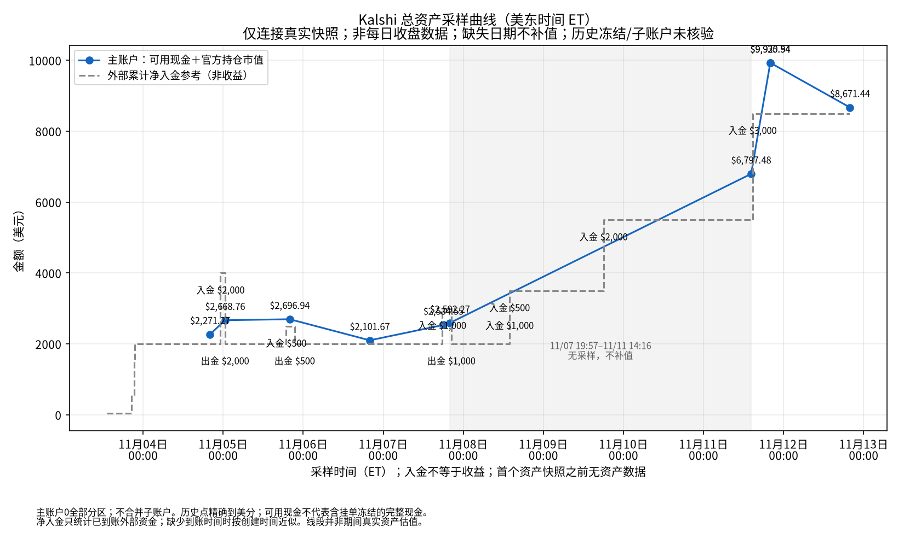

# Kalshi 每日交易报告 — 2026-11-12（美东时间）

_生成时间：2026-11-12 19:53 美东_

## 一、当日成交（284 笔）

| 时间(ET) | 市场 | 方向 | 份数 | 价格 | 金额 | 手续费 |
|---|---|---|---:|---:|---:|---:|
| 01:24:54 | New Zealand wins `KXINTLFRIENDLYGAME-26NOV12NZLIND-NZL` | 买入 YES | 522.36 | $0.9400 | $491.02 | $2.06 |
| 01:24:54 | New Zealand wins `KXINTLFRIENDLYGAME-26NOV12NZLIND-NZL` | 买入 YES | 1,596.40 | $0.9400 | $1,500.62 | $6.30 |
| 01:34:45 | New Zealand wins `KXINTLFRIENDLYGAME-26NOV12NZLIND-NZL` | 买入 YES | 4,237.52 | $0.9400 | $3,983.27 | $16.73 |
| 06:11:38 | Somalia wins `KXAFCONGAME-26NOV12GHASOM-SOM` | 买入 NO | 350.24 | $0.9800 | $343.24 | $0.48 |
| 06:11:38 | Somalia wins `KXAFCONGAME-26NOV12GHASOM-SOM` | 买入 NO | 407.00 | $0.9800 | $398.86 | $0.56 |
| 06:11:38 | Somalia wins `KXAFCONGAME-26NOV12GHASOM-SOM` | 买入 NO | 65.76 | $0.9800 | $64.44 | $0.09 |
| 06:11:39 | How many initial jobless claims will there be the week ending Nov 7, 2026?（At least 175,000） `KXJOBLESSCLAIMS-26NOV12-175000` | 买入 YES | 419.00 | $0.9600 | $402.24 | $1.13 |
| 07:15:58 | Sierra Leone wins `KXAFCONGAME-26NOV12CODSLE-SLE` | 买入 NO | 100.00 | $0.9500 | $95.00 | $0.33 |
| 07:15:58 | Sierra Leone wins `KXAFCONGAME-26NOV12CODSLE-SLE` | 买入 NO | 9.48 | $0.9500 | $9.01 | $0.03 |
| 07:15:58 | Somalia wins `KXAFCONGAME-26NOV12GHASOM-SOM` | 买入 NO | 409.00 | $0.9800 | $400.82 | $0.56 |
| 07:16:00 | Guinea wins `KXAFCONGAME-26NOV12GUIERI-GUI` | 买入 YES | 175.00 | $0.7900 | $138.25 | $2.03 |
| 07:16:00 | Guinea wins `KXAFCONGAME-26NOV12GUIERI-GUI` | 买入 YES | 3.00 | $0.7900 | $2.37 | $0.03 |
| 07:16:00 | Guinea wins `KXAFCONGAME-26NOV12GUIERI-GUI` | 买入 YES | 325.00 | $0.7900 | $256.75 | $3.77 |
| 08:16:37 | Tie is the result `KXUEFANLGAME-26NOV12TURBEL-TIE` | 买入 NO | 1,028.00 | $0.7700 | $791.56 | $12.74 |
| 08:16:38 | Wake Forest wins `KXNCAAWBGAME-26NOV12UNCWWAKE-WAKE` | 买入 YES | 4.00 | $0.9400 | $3.76 | $0.02 |
| 08:16:38 | Wake Forest wins `KXNCAAWBGAME-26NOV12UNCWWAKE-WAKE` | 买入 YES | 93.52 | $0.9400 | $87.91 | $0.37 |
| 08:16:38 | Wake Forest wins `KXNCAAWBGAME-26NOV12UNCWWAKE-WAKE` | 买入 YES | 18.00 | $0.9400 | $16.92 | $0.07 |
| 08:16:38 | Eritrea wins `KXAFCONGAME-26NOV12GUIERI-ERI` | 买入 NO | 67.06 | $0.9400 | $63.04 | $0.26 |
| 08:16:38 | Eritrea wins `KXAFCONGAME-26NOV12GUIERI-ERI` | 买入 NO | 755.47 | $0.9400 | $710.14 | $2.98 |
| 08:16:38 | Eritrea wins `KXAFCONGAME-26NOV12GUIERI-ERI` | 买入 NO | 29.47 | $0.9400 | $27.70 | $0.12 |
| 08:16:38 | Sierra Leone wins `KXAFCONGAME-26NOV12CODSLE-SLE` | 买入 NO | 194.53 | $0.9600 | $186.75 | $0.52 |
| 08:16:38 | Sierra Leone wins `KXAFCONGAME-26NOV12CODSLE-SLE` | 买入 NO | 108.47 | $0.9600 | $104.13 | $0.29 |
| 08:16:38 | Sierra Leone wins `KXAFCONGAME-26NOV12CODSLE-SLE` | 买入 NO | 50.00 | $0.9600 | $48.00 | $0.13 |
| 08:16:38 | Sierra Leone wins `KXAFCONGAME-26NOV12CODSLE-SLE` | 买入 NO | 30.00 | $0.9600 | $28.80 | $0.08 |
| 08:16:38 | Sierra Leone wins `KXAFCONGAME-26NOV12CODSLE-SLE` | 买入 NO | 100.00 | $0.9600 | $96.00 | $0.27 |
| 08:16:38 | Sierra Leone wins `KXAFCONGAME-26NOV12CODSLE-SLE` | 买入 NO | 101.00 | $0.9600 | $96.96 | $0.27 |
| 08:16:38 | Sierra Leone wins `KXAFCONGAME-26NOV12CODSLE-SLE` | 买入 NO | 72.00 | $0.9600 | $69.12 | $0.19 |
| 08:16:38 | Sierra Leone wins `KXAFCONGAME-26NOV12CODSLE-SLE` | 买入 NO | 71.00 | $0.9600 | $68.16 | $0.19 |
| 08:16:39 | Morehead St. wins `KXNCAAWBGAME-26NOV12MOREMURR-MORE` | 买入 NO | 96.00 | $0.9900 | $95.04 | $0.07 |
| 08:16:39 | Morehead St. wins `KXNCAAWBGAME-26NOV12MOREMURR-MORE` | 买入 NO | 310.00 | $0.9900 | $306.90 | $0.21 |
| 09:24:31 | Wake Forest wins `KXNCAAWBGAME-26NOV12UNCWWAKE-WAKE` | 买入 YES | 39.00 | $0.9500 | $37.05 | $0.13 |
| 09:24:31 | Wake Forest wins `KXNCAAWBGAME-26NOV12UNCWWAKE-WAKE` | 买入 YES | 24.00 | $0.9500 | $22.80 | $0.08 |
| 09:24:31 | Wake Forest wins `KXNCAAWBGAME-26NOV12UNCWWAKE-WAKE` | 买入 YES | 19.76 | $0.9500 | $18.77 | $0.07 |
| 09:24:31 | Navalcarnero wins `KXCOPADELREYGAME-26NOV12NAVRBB-NAV` | 买入 NO | 409.00 | $0.9700 | $396.73 | $0.83 |
| 09:24:31 | Navalcarnero wins `KXCOPADELREYGAME-26NOV12NAVRBB-NAV` | 买入 NO | 2.00 | $0.9700 | $1.94 | $0.00 |
| 09:24:31 | Arsenal wins `KXUCLWGAME-26NOV12BARARS-ARS` | 买入 NO | 1,310.00 | $0.9100 | $1,192.10 | $7.51 |
| 10:16:44 | Gambia wins `KXAFCONGAME-26NOV12CIVGAM-GAM` | 买入 NO | 109.75 | $0.9500 | $104.26 | $0.36 |
| 10:16:44 | Gambia wins `KXAFCONGAME-26NOV12CIVGAM-GAM` | 买入 NO | 50.00 | $0.9500 | $47.50 | $0.17 |
| 10:16:44 | Gambia wins `KXAFCONGAME-26NOV12CIVGAM-GAM` | 买入 NO | 5.00 | $0.9500 | $4.75 | $0.02 |
| 10:16:44 | Gambia wins `KXAFCONGAME-26NOV12CIVGAM-GAM` | 买入 NO | 50.00 | $0.9500 | $47.50 | $0.17 |
| 10:16:44 | Gambia wins `KXAFCONGAME-26NOV12CIVGAM-GAM` | 买入 NO | 15.25 | $0.9500 | $14.49 | $0.05 |
| 10:16:44 | Gambia wins `KXAFCONGAME-26NOV12CIVGAM-GAM` | 买入 NO | 51.00 | $0.9500 | $48.45 | $0.17 |
| 10:16:44 | Sudan wins `KXAFCONGAME-26NOV12SENSDN-SDN` | 买入 NO | 250.00 | $0.9800 | $245.00 | $0.34 |
| 10:16:44 | Sudan wins `KXAFCONGAME-26NOV12SENSDN-SDN` | 买入 NO | 23.00 | $0.9800 | $22.54 | $0.03 |
| 10:16:44 | Cayman Islands wins `KXCONCACAFNLGAME-26NOV12CAYGUY-CAY` | 买入 NO | 270.00 | $0.9900 | $267.30 | $0.19 |
| 10:16:45 | Charleston wins `KXNCAAWBGAME-26NOV12COFCCAL-COFC` | 买入 NO | 44.00 | $0.9900 | $43.56 | $0.03 |
| 10:16:45 | Charleston wins `KXNCAAWBGAME-26NOV12COFCCAL-COFC` | 买入 NO | 209.00 | $0.9900 | $206.91 | $0.14 |
| 10:16:45 | Charleston wins `KXNCAAWBGAME-26NOV12COFCCAL-COFC` | 买入 NO | 1.00 | $0.9900 | $0.99 | $0.00 |
| 10:16:45 | Charleston wins `KXNCAAWBGAME-26NOV12COFCCAL-COFC` | 买入 NO | 1.00 | $0.9900 | $0.99 | $0.00 |
| 10:16:45 | Charleston wins `KXNCAAWBGAME-26NOV12COFCCAL-COFC` | 买入 NO | 1.00 | $0.9900 | $0.99 | $0.00 |
| 10:16:45 | Charleston wins `KXNCAAWBGAME-26NOV12COFCCAL-COFC` | 买入 NO | 1.00 | $0.9900 | $0.99 | $0.00 |
| 10:16:45 | Charleston wins `KXNCAAWBGAME-26NOV12COFCCAL-COFC` | 买入 NO | 1.00 | $0.9900 | $0.99 | $0.00 |
| 10:16:45 | Charleston wins `KXNCAAWBGAME-26NOV12COFCCAL-COFC` | 买入 NO | 1.00 | $0.9900 | $0.99 | $0.00 |
| 10:16:45 | Charleston wins `KXNCAAWBGAME-26NOV12COFCCAL-COFC` | 买入 NO | 1.00 | $0.9900 | $0.99 | $0.00 |
| 10:16:45 | Charleston wins `KXNCAAWBGAME-26NOV12COFCCAL-COFC` | 买入 NO | 10.00 | $0.9900 | $9.90 | $0.01 |
| 10:16:45 | Eswatini wins `KXINTLFRIENDLYGAME-26NOV12MLTESW-ESW` | 买入 NO | 299.00 | $0.8900 | $266.11 | $2.05 |
| 10:16:45 | Namibia wins `KXAFCONGAME-26NOV12CMRNAM-NAM` | 买入 NO | 13.00 | $0.9500 | $12.35 | $0.04 |
| 10:16:45 | Namibia wins `KXAFCONGAME-26NOV12CMRNAM-NAM` | 买入 NO | 50.00 | $0.9500 | $47.50 | $0.17 |
| 10:16:45 | Namibia wins `KXAFCONGAME-26NOV12CMRNAM-NAM` | 买入 NO | 118.00 | $0.9500 | $112.10 | $0.39 |
| 10:16:45 | Namibia wins `KXAFCONGAME-26NOV12CMRNAM-NAM` | 买入 NO | 100.00 | $0.9500 | $95.00 | $0.33 |
| 10:16:45 | Aruba wins `KXCONCACAFNLGAME-26NOV12ARUMTQ-ARU` | 买入 NO | 299.00 | $0.8900 | $266.11 | $2.05 |
| 13:17:58 | Czechia wins `KXUEFANLGAME-26NOV12CZEESP-CZE` | 买入 NO | 147.00 | $0.9300 | $136.71 | $0.67 |
| 13:17:59 | Pasto wins `KXDIMAYORGAME-26NOV12PASJUN-PAS` | 买入 NO | 146.00 | $0.9400 | $137.24 | $0.58 |
| 13:17:59 | Namibia wins `KXAFCONGAME-26NOV12CMRNAM-NAM` | 买入 NO | 143.00 | $0.9600 | $137.28 | $0.38 |
| 13:17:59 | Gambia wins `KXAFCONGAME-26NOV12CIVGAM-GAM` | 买入 NO | 144.00 | $0.9500 | $136.80 | $0.48 |
| 13:17:59 | Latvia wins `KXUEFANLGAME-26NOV12MNELAT-LAT` | 买入 NO | 146.00 | $0.9400 | $137.24 | $0.58 |
| 13:17:59 | Sudan wins `KXAFCONGAME-26NOV12SENSDN-SDN` | 买入 NO | 102.76 | $0.9800 | $100.70 | $0.14 |
| 13:17:59 | Sudan wins `KXAFCONGAME-26NOV12SENSDN-SDN` | 买入 NO | 37.24 | $0.9800 | $36.50 | $0.05 |
| 13:17:59 | Bonaire wins `KXCONCACAFNLGAME-26NOV12BONCUB-BON` | 买入 NO | 142.00 | $0.9700 | $137.74 | $0.29 |
| 13:17:59 | San Marino wins `KXUEFANLGAME-26NOV12SMRBLR-SMR` | 买入 NO | 142.00 | $0.9700 | $137.74 | $0.29 |
| 13:17:59 | Cayman Islands wins `KXCONCACAFNLGAME-26NOV12CAYGUY-CAY` | 买入 NO | 139.00 | $0.9900 | $137.61 | $0.10 |
| 13:17:59 | Croatia wins `KXUEFANLGAME-26NOV12ENGCRO-CRO` | 买入 NO | 147.00 | $0.9300 | $136.71 | $0.67 |
| 13:18:00 | UC San Diego wins `KXNCAAWBGAME-26NOV12PRSTUCSD-UCSD` | 买入 YES | 144.00 | $0.9500 | $136.80 | $0.48 |
| 13:18:00 | Cal State Fullerton wins `KXNCAAWBGAME-26NOV12CSFUCD-CSF` | 买入 NO | 162.00 | $0.8400 | $136.08 | $1.52 |
| 13:18:00 | Kansas City wins `KXNCAAMBGAME-26NOV12UMKCGMU-UMKC` | 买入 NO | 147.00 | $0.9300 | $136.71 | $0.67 |
| 13:18:00 | Charleston wins `KXNCAAWBGAME-26NOV12COFCCAL-COFC` | 买入 NO | 16.00 | $0.9900 | $15.84 | $0.01 |
| 13:18:00 | Charleston wins `KXNCAAWBGAME-26NOV12COFCCAL-COFC` | 买入 NO | 123.00 | $0.9900 | $121.77 | $0.09 |
| 13:18:00 | Aruba wins `KXCONCACAFNLGAME-26NOV12ARUMTQ-ARU` | 买入 NO | 153.00 | $0.8900 | $136.17 | $1.05 |
| 14:19:46 | Coppin St. wins `KXNCAAMBGAME-26NOV12COPPBRAD-COPP` | 买入 NO | 75.00 | $0.8700 | $65.25 | $0.59 |
| 14:19:46 | Coppin St. wins `KXNCAAMBGAME-26NOV12COPPBRAD-COPP` | 买入 NO | 233.00 | $0.8700 | $202.71 | $1.84 |
| 14:19:46 | Kansas City wins `KXNCAAMBGAME-26NOV12UMKCGMU-UMKC` | 买入 NO | 289.00 | $0.9300 | $268.77 | $1.32 |
| 14:19:46 | Antigua & Barbuda wins `KXCONCACAFNLGAME-26NOV12ANTTTO-ANT` | 买入 NO | 301.00 | $0.8900 | $267.89 | $2.06 |
| 14:19:46 | Aruba wins `KXCONCACAFNLGAME-26NOV12ARUMTQ-ARU` | 买入 NO | 22.00 | $0.8900 | $19.58 | $0.15 |
| 14:19:46 | Pasto wins `KXDIMAYORGAME-26NOV12PASJUN-PAS` | 买入 NO | 286.00 | $0.9400 | $268.84 | $1.13 |
| 14:19:46 | Latvia wins `KXUEFANLGAME-26NOV12MNELAT-LAT` | 买入 NO | 235.00 | $0.9300 | $218.55 | $1.07 |
| 14:19:46 | Latvia wins `KXUEFANLGAME-26NOV12MNELAT-LAT` | 买入 NO | 54.00 | $0.9300 | $50.22 | $0.25 |
| 14:19:46 | San Marino wins `KXUEFANLGAME-26NOV12SMRBLR-SMR` | 买入 NO | 278.00 | $0.9700 | $269.66 | $0.57 |
| 14:19:46 | Croatia wins `KXUEFANLGAME-26NOV12ENGCRO-CRO` | 买入 NO | 159.30 | $0.9300 | $148.15 | $0.73 |
| 14:19:46 | Croatia wins `KXUEFANLGAME-26NOV12ENGCRO-CRO` | 买入 NO | 129.70 | $0.9300 | $120.62 | $0.59 |
| 14:19:46 | Czechia wins `KXUEFANLGAME-26NOV12CZEESP-CZE` | 买入 NO | 286.00 | $0.9400 | $268.84 | $1.13 |
| 14:19:47 | Richmond wins `KXNCAAWBGAME-26NOV12ODURICH-RICH` | 买入 YES | 123.01 | $0.8100 | $99.64 | $1.33 |
| 14:19:47 | Richmond wins `KXNCAAWBGAME-26NOV12ODURICH-RICH` | 买入 YES | 18.00 | $0.8100 | $14.58 | $0.19 |
| 14:19:47 | Richmond wins `KXNCAAWBGAME-26NOV12ODURICH-RICH` | 买入 YES | 187.24 | $0.8100 | $151.66 | $2.02 |
| 14:19:47 | VCU wins `KXNCAAWBGAME-26NOV12VTVCU-VCU` | 买入 NO | 5.00 | $0.9500 | $4.75 | $0.02 |
| 14:19:47 | VCU wins `KXNCAAWBGAME-26NOV12VTVCU-VCU` | 买入 NO | 278.00 | $0.9500 | $264.10 | $0.92 |
| 14:19:47 | Oklahoma St. wins `KXNCAAWBGAME-26NOV12OKSTTLSA-OKST` | 买入 YES | 1.97 | $0.9900 | $1.95 | $0.00 |
| 14:19:47 | Oklahoma St. wins `KXNCAAWBGAME-26NOV12OKSTTLSA-OKST` | 买入 YES | 270.03 | $0.9900 | $267.33 | $0.19 |
| 15:20:47 | Antigua & Barbuda wins `KXCONCACAFNLGAME-26NOV12ANTTTO-ANT` | 买入 NO | 74.00 | $0.8900 | $65.86 | $0.51 |
| 15:20:47 | Aruba wins `KXCONCACAFNLGAME-26NOV12ARUMTQ-ARU` | 买入 NO | 10.00 | $0.8900 | $8.90 | $0.07 |
| 15:20:47 | Pasto wins `KXDIMAYORGAME-26NOV12PASJUN-PAS` | 买入 NO | 70.00 | $0.9400 | $65.80 | $0.28 |
| 15:20:48 | Columbia wins `KXNCAAWBGAME-26NOV12MICHCLMB-CLMB` | 买入 NO | 69.00 | $0.9600 | $66.24 | $0.19 |
| 15:20:48 | Clemson wins `KXNCAAWBGAME-26NOV12SCARCLEM-CLEM` | 买入 NO | 6.93 | $0.9900 | $6.86 | $0.00 |
| 15:20:48 | Clemson wins `KXNCAAWBGAME-26NOV12SCARCLEM-CLEM` | 买入 NO | 49.07 | $0.9900 | $48.58 | $0.03 |
| 15:20:48 | Clemson wins `KXNCAAWBGAME-26NOV12SCARCLEM-CLEM` | 买入 NO | 1.00 | $0.9900 | $0.99 | $0.00 |
| 15:20:48 | Clemson wins `KXNCAAWBGAME-26NOV12SCARCLEM-CLEM` | 买入 NO | 10.00 | $0.9900 | $9.90 | $0.01 |
| 15:20:48 | UConn wins `KXNCAAWBGAME-26NOV12CONNOSU-CONN` | 买入 YES | 85.00 | $0.7700 | $65.45 | $1.05 |
| 15:20:48 | Canisius wins `KXNCAAMBGAME-26NOV12CANBRWN-CAN` | 买入 NO | 74.00 | $0.8900 | $65.86 | $0.51 |
| 15:20:48 | Southern Utah wins `KXNCAAMBGAME-26NOV12SUUHP-SUU` | 买入 NO | 68.00 | $0.9700 | $65.96 | $0.14 |
| 15:20:48 | Mercer wins `KXNCAAMBGAME-26NOV12MERWVU-MER` | 买入 NO | 67.00 | $0.9900 | $66.33 | $0.05 |
| 15:20:48 | Detroit wins `KXNBAGAME-26NOV12DETWAS-DET` | 买入 YES | 82.00 | $0.8000 | $65.60 | $0.92 |
| 15:20:49 | Middle Tennessee wins `KXNCAAWBGAME-26NOV12MTUTENN-MTU` | 买入 NO | 67.00 | $0.9900 | $66.33 | $0.05 |
| 15:20:49 | Howard wins `KXNCAAMBGAME-26NOV12STETHOW-HOW` | 买入 YES | 80.00 | $0.8200 | $65.60 | $0.83 |
| 15:20:49 | Mercyhurst wins `KXNCAAMBGAME-26NOV12MHUPSU-MHU` | 买入 NO | 68.00 | $0.9700 | $65.96 | $0.14 |
| 15:20:49 | Western Illinois wins `KXNCAAMBGAME-26NOV12CSBWIU-WIU` | 买入 NO | 15.00 | $0.8000 | $12.00 | $0.17 |
| 15:20:49 | Western Illinois wins `KXNCAAMBGAME-26NOV12CSBWIU-WIU` | 买入 NO | 47.00 | $0.8000 | $37.60 | $0.53 |
| 15:20:49 | Western Illinois wins `KXNCAAMBGAME-26NOV12CSBWIU-WIU` | 买入 NO | 20.00 | $0.8000 | $16.00 | $0.22 |
| 15:20:49 | Rhode Island wins `KXNCAAMBGAME-26NOV12UMESURI-URI` | 买入 YES | 68.00 | $0.9800 | $66.64 | $0.09 |
| 15:20:49 | Oklahoma St. wins `KXNCAAWBGAME-26NOV12OKSTTLSA-OKST` | 买入 YES | 67.00 | $0.9900 | $66.33 | $0.05 |
| 15:20:49 | Indiana wins `KXNCAAMBGAME-26NOV12TNTCIND-IND` | 买入 YES | 67.00 | $0.9900 | $66.33 | $0.05 |
| 15:20:49 | Coppin St. wins `KXNCAAMBGAME-26NOV12COPPBRAD-COPP` | 买入 NO | 76.00 | $0.8700 | $66.12 | $0.60 |
| 15:20:50 | Richmond wins `KXNCAAWBGAME-26NOV12ODURICH-RICH` | 买入 YES | 29.00 | $0.8300 | $24.07 | $0.29 |
| 15:20:50 | Richmond wins `KXNCAAWBGAME-26NOV12ODURICH-RICH` | 买入 YES | 9.00 | $0.8300 | $7.47 | $0.09 |
| 15:20:50 | VCU wins `KXNCAAWBGAME-26NOV12VTVCU-VCU` | 买入 NO | 70.00 | $0.9500 | $66.50 | $0.23 |
| 15:20:50 | Florida wins `KXNCAAWBGAME-26NOV12USFFLA-FLA` | 买入 YES | 82.00 | $0.8000 | $65.60 | $0.92 |
| 15:20:51 | Rider wins `KXNCAAWBGAME-26NOV12RIDCCSU-RID` | 买入 YES | 79.14 | $0.8100 | $64.10 | $0.85 |
| 15:20:51 | Rider wins `KXNCAAWBGAME-26NOV12RIDCCSU-RID` | 买入 YES | 1.86 | $0.8100 | $1.51 | $0.02 |
| 15:20:51 | Bowling Green wins `KXNCAAMBGAME-26NOV12NIAGBGSU-BGSU` | 买入 YES | 72.00 | $0.9200 | $66.24 | $0.37 |
| 15:20:51 | Milwaukee wins `KXNCAAWBGAME-26NOV12UNDMILW-MILW` | 买入 YES | 84.00 | $0.7800 | $65.52 | $1.01 |
| 15:20:51 | Loyola Maryland wins `KXNCAAMBGAME-26NOV12LMDTOWS-LMD` | 买入 NO | 73.00 | $0.9100 | $66.43 | $0.42 |
| 16:16:26 | Pasto wins `KXDIMAYORGAME-26NOV12PASJUN-PAS` | 买入 NO | 2.00 | $0.9400 | $1.88 | $0.01 |
| 16:16:26 | Pasto wins `KXDIMAYORGAME-26NOV12PASJUN-PAS` | 买入 NO | 0.01 | $0.9400 | $0.01 | $0.00 |
| 16:16:26 | Pasto wins `KXDIMAYORGAME-26NOV12PASJUN-PAS` | 买入 NO | 56.83 | $0.9400 | $53.42 | $0.22 |
| 16:16:27 | Antigua & Barbuda wins `KXCONCACAFNLGAME-26NOV12ANTTTO-ANT` | 买入 NO | 111.00 | $0.8900 | $98.79 | $0.76 |
| 16:16:27 | Aruba wins `KXCONCACAFNLGAME-26NOV12ARUMTQ-ARU` | 买入 NO | 2.00 | $0.8900 | $1.78 | $0.01 |
| 16:16:28 | Coppin St. wins `KXNCAAMBGAME-26NOV12COPPBRAD-COPP` | 买入 NO | 127.00 | $0.8700 | $110.49 | $1.01 |
| 16:16:28 | UConn wins `KXNCAAWBGAME-26NOV12CONNOSU-CONN` | 买入 YES | 93.00 | $0.8000 | $74.40 | $1.04 |
| 16:16:28 | UConn wins `KXNCAAWBGAME-26NOV12CONNOSU-CONN` | 买入 YES | 18.00 | $0.8000 | $14.40 | $0.20 |
| 16:16:28 | UConn wins `KXNCAAWBGAME-26NOV12CONNOSU-CONN` | 买入 YES | 26.00 | $0.8000 | $20.80 | $0.29 |
| 16:16:28 | Clemson wins `KXNCAAWBGAME-26NOV12SCARCLEM-CLEM` | 买入 NO | 112.00 | $0.9900 | $110.88 | $0.08 |
| 16:16:28 | Canisius wins `KXNCAAMBGAME-26NOV12CANBRWN-CAN` | 买入 NO | 68.00 | $0.8900 | $60.52 | $0.47 |
| 16:16:28 | Canisius wins `KXNCAAMBGAME-26NOV12CANBRWN-CAN` | 买入 NO | 32.00 | $0.8900 | $28.48 | $0.22 |
| 16:16:28 | Canisius wins `KXNCAAMBGAME-26NOV12CANBRWN-CAN` | 买入 NO | 24.00 | $0.8900 | $21.36 | $0.16 |
| 16:16:28 | Southern Utah wins `KXNCAAMBGAME-26NOV12SUUHP-SUU` | 买入 NO | 24.00 | $0.9700 | $23.28 | $0.05 |
| 16:16:28 | Southern Utah wins `KXNCAAMBGAME-26NOV12SUUHP-SUU` | 买入 NO | 90.00 | $0.9700 | $87.30 | $0.18 |
| 16:16:28 | Oklahoma St. wins `KXNCAAMBGAME-26NOV12OKSTTXAM-OKST` | 买入 NO | 92.10 | $0.7700 | $70.92 | $1.14 |
| 16:16:28 | Oklahoma St. wins `KXNCAAMBGAME-26NOV12OKSTTXAM-OKST` | 买入 NO | 49.90 | $0.7700 | $38.42 | $0.62 |
| 16:16:28 | Tennessee Tech wins `KXNCAAMBGAME-26NOV12TNTCIND-TNTC` | 买入 NO | 112.00 | $0.9900 | $110.88 | $0.08 |
| 16:16:28 | Mercer wins `KXNCAAMBGAME-26NOV12MERWVU-MER` | 买入 NO | 112.00 | $0.9900 | $110.88 | $0.08 |
| 16:16:28 | Washington wins `KXNBAGAME-26NOV12DETWAS-WAS` | 买入 NO | 137.00 | $0.8000 | $109.60 | $1.53 |
| 16:16:29 | Middle Tennessee wins `KXNCAAWBGAME-26NOV12MTUTENN-MTU` | 买入 NO | 112.00 | $0.9900 | $110.88 | $0.08 |
| 16:16:29 | Mercyhurst wins `KXNCAAMBGAME-26NOV12MHUPSU-MHU` | 买入 NO | 114.00 | $0.9700 | $110.58 | $0.23 |
| 16:16:29 | Howard wins `KXNCAAMBGAME-26NOV12STETHOW-HOW` | 买入 YES | 134.00 | $0.8200 | $109.88 | $1.38 |
| 16:16:29 | Western Illinois wins `KXNCAAMBGAME-26NOV12CSBWIU-WIU` | 买入 NO | 137.00 | $0.8000 | $109.60 | $1.53 |
| 16:16:29 | Rhode Island wins `KXNCAAMBGAME-26NOV12UMESURI-URI` | 买入 YES | 113.00 | $0.9800 | $110.74 | $0.16 |
| 16:16:29 | Oklahoma St. wins `KXNCAAWBGAME-26NOV12OKSTTLSA-OKST` | 买入 YES | 101.00 | $0.9900 | $99.99 | $0.07 |
| 16:16:29 | Southern University wins `KXNCAAMBGAME-26NOV12SOUMINN-SOU` | 买入 NO | 107.00 | $0.9900 | $105.93 | $0.07 |
| 16:16:29 | Southern University wins `KXNCAAMBGAME-26NOV12SOUMINN-SOU` | 买入 NO | 5.00 | $0.9900 | $4.95 | $0.00 |
| 16:16:29 | Columbia wins `KXNCAAWBGAME-26NOV12MICHCLMB-CLMB` | 买入 NO | 114.00 | $0.9600 | $109.44 | $0.31 |
| 16:16:29 | Columbia wins `KXNCAAWBGAME-26NOV12MICHCLMB-CLMB` | 买入 NO | 2.00 | $0.9600 | $1.92 | $0.01 |
| 16:16:30 | Richmond wins `KXNCAAWBGAME-26NOV12ODURICH-RICH` | 买入 YES | 1.00 | $0.8400 | $0.84 | $0.01 |
| 16:16:30 | Richmond wins `KXNCAAWBGAME-26NOV12ODURICH-RICH` | 买入 YES | 2.00 | $0.8400 | $1.68 | $0.02 |
| 16:16:30 | Richmond wins `KXNCAAWBGAME-26NOV12ODURICH-RICH` | 买入 YES | 6.00 | $0.8400 | $5.04 | $0.06 |
| 16:16:30 | Richmond wins `KXNCAAWBGAME-26NOV12ODURICH-RICH` | 买入 YES | 18.00 | $0.8400 | $15.12 | $0.17 |
| 16:16:30 | Loyola Maryland wins `KXNCAAMBGAME-26NOV12LMDTOWS-LMD` | 买入 NO | 122.00 | $0.9100 | $111.02 | $0.70 |
| 16:16:30 | VCU wins `KXNCAAWBGAME-26NOV12VTVCU-VCU` | 买入 NO | 105.00 | $0.9400 | $98.70 | $0.41 |
| 16:16:30 | Ball St. wins `KXNCAAWBGAME-26NOV12LOUBALL-BALL` | 买入 NO | 111.00 | $0.9900 | $109.89 | $0.08 |
| 16:16:30 | Ball St. wins `KXNCAAWBGAME-26NOV12LOUBALL-BALL` | 买入 NO | 1.00 | $0.9900 | $0.99 | $0.00 |
| 16:16:30 | Bowling Green wins `KXNCAAMBGAME-26NOV12NIAGBGSU-BGSU` | 买入 YES | 120.00 | $0.9200 | $110.40 | $0.62 |
| 16:16:30 | Florida wins `KXNCAAWBGAME-26NOV12USFFLA-FLA` | 买入 YES | 136.00 | $0.8100 | $110.16 | $1.47 |
| 16:16:31 | Rider wins `KXNCAAWBGAME-26NOV12RIDCCSU-RID` | 买入 YES | 134.00 | $0.8200 | $109.88 | $1.38 |
| 16:16:31 | Milwaukee wins `KXNCAAWBGAME-26NOV12UNDMILW-MILW` | 买入 YES | 11.00 | $0.7800 | $8.58 | $0.13 |
| 16:16:31 | Milwaukee wins `KXNCAAWBGAME-26NOV12UNDMILW-MILW` | 买入 YES | 100.00 | $0.7800 | $78.00 | $1.20 |
| 16:16:31 | Milwaukee wins `KXNCAAWBGAME-26NOV12UNDMILW-MILW` | 买入 YES | 30.00 | $0.7800 | $23.40 | $0.36 |
| 17:21:55 | UConn wins `KXNCAAWBGAME-26NOV12CONNOSU-CONN` | 买入 YES | 98.00 | $0.8000 | $78.40 | $1.10 |
| 17:21:55 | Canisius wins `KXNCAAMBGAME-26NOV12CANBRWN-CAN` | 买入 NO | 89.00 | $0.8900 | $79.21 | $0.61 |
| 17:21:55 | Oklahoma St. wins `KXNCAAMBGAME-26NOV12OKSTTXAM-OKST` | 买入 NO | 30.00 | $0.7700 | $23.10 | $0.37 |
| 17:21:55 | Oklahoma St. wins `KXNCAAMBGAME-26NOV12OKSTTXAM-OKST` | 买入 NO | 72.00 | $0.7700 | $55.44 | $0.89 |
| 17:21:55 | Clemson wins `KXNCAAWBGAME-26NOV12SCARCLEM-CLEM` | 买入 NO | 80.00 | $0.9900 | $79.20 | $0.06 |
| 17:21:55 | Southern Utah wins `KXNCAAMBGAME-26NOV12SUUHP-SUU` | 买入 NO | 4.00 | $0.9700 | $3.88 | $0.01 |
| 17:21:55 | Southern Utah wins `KXNCAAMBGAME-26NOV12SUUHP-SUU` | 买入 NO | 78.00 | $0.9700 | $75.66 | $0.16 |
| 17:21:55 | Tennessee Tech wins `KXNCAAMBGAME-26NOV12TNTCIND-TNTC` | 买入 NO | 81.00 | $0.9800 | $79.38 | $0.11 |
| 17:21:55 | Mercer wins `KXNCAAMBGAME-26NOV12MERWVU-MER` | 买入 NO | 80.00 | $0.9900 | $79.20 | $0.06 |
| 17:21:55 | Washington wins `KXNBAGAME-26NOV12DETWAS-WAS` | 买入 NO | 98.00 | $0.8000 | $78.40 | $1.10 |
| 17:21:55 | Antigua & Barbuda wins `KXCONCACAFNLGAME-26NOV12ANTTTO-ANT` | 买入 NO | 89.00 | $0.8900 | $79.21 | $0.61 |
| 17:21:55 | Curacao wins `KXCONCACAFNLGAME-26NOV12CUWPAN-CUW` | 买入 NO | 100.00 | $0.7800 | $78.00 | $1.20 |
| 17:21:56 | BYU wins `KXNCAAMBGAME-26NOV12MTSTBYU-BYU` | 买入 YES | 82.00 | $0.9600 | $78.72 | $0.22 |
| 17:21:56 | Western Illinois wins `KXNCAAMBGAME-26NOV12CSBWIU-WIU` | 买入 NO | 98.00 | $0.8000 | $78.40 | $1.10 |
| 17:21:56 | Howard wins `KXNCAAMBGAME-26NOV12STETHOW-HOW` | 买入 YES | 96.00 | $0.8200 | $78.72 | $0.99 |
| 17:21:56 | Rhode Island wins `KXNCAAMBGAME-26NOV12UMESURI-URI` | 买入 YES | 82.00 | $0.9700 | $79.54 | $0.17 |
| 17:21:56 | Bowling Green wins `KXNCAAMBGAME-26NOV12NIAGBGSU-BGSU` | 买入 YES | 86.00 | $0.9200 | $79.12 | $0.44 |
| 17:21:56 | Southern University wins `KXNCAAMBGAME-26NOV12SOUMINN-SOU` | 买入 NO | 80.00 | $0.9900 | $79.20 | $0.06 |
| 17:21:56 | Columbia wins `KXNCAAWBGAME-26NOV12MICHCLMB-CLMB` | 买入 NO | 82.00 | $0.9600 | $78.72 | $0.22 |
| 17:21:56 | Tulsa wins `KXNCAAWBGAME-26NOV12OKSTTLSA-TLSA` | 买入 NO | 43.42 | $0.9900 | $42.99 | $0.03 |
| 17:21:56 | Tulsa wins `KXNCAAWBGAME-26NOV12OKSTTLSA-TLSA` | 买入 NO | 36.58 | $0.9900 | $36.21 | $0.03 |
| 17:21:56 | Coppin St. wins `KXNCAAMBGAME-26NOV12COPPBRAD-COPP` | 买入 NO | 88.00 | $0.8900 | $78.32 | $0.60 |
| 17:21:56 | Coppin St. wins `KXNCAAMBGAME-26NOV12COPPBRAD-COPP` | 买入 NO | 1.00 | $0.8900 | $0.89 | $0.01 |
| 17:21:57 | Richmond wins `KXNCAAWBGAME-26NOV12ODURICH-RICH` | 买入 YES | 18.00 | $0.8400 | $15.12 | $0.17 |
| 17:21:57 | Richmond wins `KXNCAAWBGAME-26NOV12ODURICH-RICH` | 买入 YES | 22.00 | $0.8400 | $18.48 | $0.21 |
| 17:21:57 | VCU wins `KXNCAAWBGAME-26NOV12VTVCU-VCU` | 买入 NO | 4.00 | $0.9500 | $3.80 | $0.01 |
| 17:21:57 | Ball St. wins `KXNCAAWBGAME-26NOV12LOUBALL-BALL` | 买入 NO | 80.00 | $0.9900 | $79.20 | $0.06 |
| 17:21:57 | Loyola Maryland wins `KXNCAAMBGAME-26NOV12LMDTOWS-LMD` | 买入 NO | 87.00 | $0.9100 | $79.17 | $0.50 |
| 17:21:57 | Middle Tennessee wins `KXNCAAWBGAME-26NOV12MTUTENN-MTU` | 买入 NO | 4.00 | $0.9900 | $3.96 | $0.00 |
| 17:21:57 | Middle Tennessee wins `KXNCAAWBGAME-26NOV12MTUTENN-MTU` | 买入 NO | 59.00 | $0.9900 | $58.41 | $0.04 |
| 17:21:57 | Middle Tennessee wins `KXNCAAWBGAME-26NOV12MTUTENN-MTU` | 买入 NO | 1.00 | $0.9900 | $0.99 | $0.00 |
| 17:21:57 | Middle Tennessee wins `KXNCAAWBGAME-26NOV12MTUTENN-MTU` | 买入 NO | 1.00 | $0.9900 | $0.99 | $0.00 |
| 17:21:57 | Middle Tennessee wins `KXNCAAWBGAME-26NOV12MTUTENN-MTU` | 买入 NO | 1.00 | $0.9900 | $0.99 | $0.00 |
| 17:21:57 | Middle Tennessee wins `KXNCAAWBGAME-26NOV12MTUTENN-MTU` | 买入 NO | 1.00 | $0.9900 | $0.99 | $0.00 |
| 17:21:57 | Middle Tennessee wins `KXNCAAWBGAME-26NOV12MTUTENN-MTU` | 买入 NO | 1.00 | $0.9900 | $0.99 | $0.00 |
| 17:21:57 | Middle Tennessee wins `KXNCAAWBGAME-26NOV12MTUTENN-MTU` | 买入 NO | 1.00 | $0.9900 | $0.99 | $0.00 |
| 17:21:57 | Middle Tennessee wins `KXNCAAWBGAME-26NOV12MTUTENN-MTU` | 买入 NO | 1.00 | $0.9900 | $0.99 | $0.00 |
| 17:21:57 | Middle Tennessee wins `KXNCAAWBGAME-26NOV12MTUTENN-MTU` | 买入 NO | 10.00 | $0.9900 | $9.90 | $0.01 |
| 17:21:57 | Northern Iowa wins `KXNCAAWBGAME-26NOV12UNIIOWA-UNI` | 买入 NO | 80.00 | $0.9900 | $79.20 | $0.06 |
| 17:21:57 | Mercyhurst wins `KXNCAAMBGAME-26NOV12MHUPSU-MHU` | 买入 NO | 82.00 | $0.9700 | $79.54 | $0.17 |
| 17:21:58 | Richmond wins `KXNCAAWBGAME-26NOV12ODURICH-RICH` | 买入 YES | 3.00 | $0.8400 | $2.52 | $0.03 |
| 17:21:59 | Richmond wins `KXNCAAWBGAME-26NOV12ODURICH-RICH` | 买入 YES | 3.00 | $0.8400 | $2.52 | $0.03 |
| 17:22:01 | Louisiana wins `KXNCAAFGAME-26NOV12ULLULM-ULL` | 买入 YES | 86.22 | $0.7800 | $67.25 | $1.04 |
| 17:22:01 | Louisiana wins `KXNCAAFGAME-26NOV12ULLULM-ULL` | 买入 YES | 13.78 | $0.7800 | $10.75 | $0.17 |
| 17:22:01 | Tennessee-Martin wins `KXNCAAWBGAME-26NOV12UTMMIZZ-UTM` | 买入 NO | 11.53 | $0.9600 | $11.07 | $0.03 |
| 17:22:01 | Tennessee-Martin wins `KXNCAAWBGAME-26NOV12UTMMIZZ-UTM` | 买入 NO | 8.37 | $0.9600 | $8.04 | $0.02 |
| 17:22:01 | Tennessee-Martin wins `KXNCAAWBGAME-26NOV12UTMMIZZ-UTM` | 买入 NO | 62.10 | $0.9600 | $59.62 | $0.17 |
| 17:22:01 | Rider wins `KXNCAAWBGAME-26NOV12RIDCCSU-RID` | 买入 YES | 96.00 | $0.8200 | $78.72 | $0.99 |
| 17:22:01 | Milwaukee wins `KXNCAAWBGAME-26NOV12UNDMILW-MILW` | 买入 YES | 98.62 | $0.7900 | $77.91 | $1.15 |
| 17:22:01 | Milwaukee wins `KXNCAAWBGAME-26NOV12UNDMILW-MILW` | 买入 YES | 0.38 | $0.7900 | $0.30 | $0.00 |
| 18:23:04 | Tennessee Tech wins `KXNCAAMBGAME-26NOV12TNTCIND-TNTC` | 买入 NO | 0.41 | $0.9800 | $0.40 | $0.00 |
| 18:23:04 | Tennessee Tech wins `KXNCAAMBGAME-26NOV12TNTCIND-TNTC` | 买入 NO | 1.59 | $0.9800 | $1.56 | $0.00 |
| 18:23:04 | Southern Utah wins `KXNCAAMBGAME-26NOV12SUUHP-SUU` | 买入 NO | 2.00 | $0.9700 | $1.94 | $0.00 |
| 18:23:04 | Washington wins `KXNBAGAME-26NOV12DETWAS-WAS` | 买入 NO | 2.00 | $0.8000 | $1.60 | $0.02 |
| 18:23:04 | Curacao wins `KXCONCACAFNLGAME-26NOV12CUWPAN-CUW` | 买入 NO | 2.00 | $0.7800 | $1.56 | $0.02 |
| 18:23:05 | Southern University wins `KXNCAAMBGAME-26NOV12SOUMINN-SOU` | 买入 NO | 2.00 | $0.9900 | $1.98 | $0.00 |
| 18:23:05 | Columbia wins `KXNCAAWBGAME-26NOV12MICHCLMB-CLMB` | 买入 NO | 2.00 | $0.9600 | $1.92 | $0.01 |
| 18:23:05 | Penn St. wins `KXNCAAMBGAME-26NOV12MHUPSU-PSU` | 买入 YES | 2.00 | $0.9700 | $1.94 | $0.00 |
| 18:23:05 | Canisius wins `KXNCAAMBGAME-26NOV12CANBRWN-CAN` | 买入 NO | 2.00 | $0.8900 | $1.78 | $0.01 |
| 18:23:05 | Rhode Island wins `KXNCAAMBGAME-26NOV12UMESURI-URI` | 买入 YES | 2.00 | $0.9800 | $1.96 | $0.00 |
| 18:23:05 | UConn wins `KXNCAAWBGAME-26NOV12CONNOSU-CONN` | 买入 YES | 2.00 | $0.8100 | $1.62 | $0.02 |
| 18:23:05 | Oklahoma St. wins `KXNCAAMBGAME-26NOV12OKSTTXAM-OKST` | 买入 NO | 2.00 | $0.7700 | $1.54 | $0.02 |
| 18:23:05 | Clemson wins `KXNCAAWBGAME-26NOV12SCARCLEM-CLEM` | 买入 NO | 2.00 | $0.9900 | $1.98 | $0.00 |
| 18:23:05 | Mercer wins `KXNCAAMBGAME-26NOV12MERWVU-MER` | 买入 NO | 2.00 | $0.9800 | $1.96 | $0.00 |
| 18:23:06 | Milwaukee wins `KXNCAAWBGAME-26NOV12UNDMILW-MILW` | 买入 YES | 2.00 | $0.7900 | $1.58 | $0.02 |
| 18:23:06 | Loyola Maryland wins `KXNCAAMBGAME-26NOV12LMDTOWS-LMD` | 买入 NO | 2.00 | $0.9100 | $1.82 | $0.01 |
| 18:23:06 | Northern Iowa wins `KXNCAAWBGAME-26NOV12UNIIOWA-UNI` | 买入 NO | 2.00 | $0.9900 | $1.98 | $0.00 |
| 18:23:06 | Howard wins `KXNCAAMBGAME-26NOV12STETHOW-HOW` | 买入 YES | 2.00 | $0.8100 | $1.62 | $0.02 |
| 18:23:06 | UC Riverside wins `KXNCAAMBGAME-26NOV12UCRVSJSU-UCRV` | 买入 NO | 2.00 | $0.7700 | $1.54 | $0.02 |
| 18:23:06 | Ball St. wins `KXNCAAWBGAME-26NOV12LOUBALL-BALL` | 买入 NO | 2.00 | $0.9900 | $1.98 | $0.00 |
| 18:23:06 | Bowling Green wins `KXNCAAMBGAME-26NOV12NIAGBGSU-BGSU` | 买入 YES | 2.00 | $0.9200 | $1.84 | $0.01 |
| 18:23:06 | BYU wins `KXNCAAMBGAME-26NOV12MTSTBYU-BYU` | 买入 YES | 2.00 | $0.9700 | $1.94 | $0.00 |
| 18:23:06 | Western Illinois wins `KXNCAAMBGAME-26NOV12CSBWIU-WIU` | 买入 NO | 2.00 | $0.8000 | $1.60 | $0.02 |
| 18:23:07 | Louisiana wins `KXNCAAFGAME-26NOV12ULLULM-ULL` | 买入 YES | 2.00 | $0.7800 | $1.56 | $0.02 |
| 18:23:07 | Maryland-Eastern Shore wins `KXNCAAWBGAME-26NOV12UMESGT-UMES` | 买入 NO | 2.00 | $0.9900 | $1.98 | $0.00 |
| 18:23:07 | Rider wins `KXNCAAWBGAME-26NOV12RIDCCSU-RID` | 买入 YES | 2.00 | $0.8100 | $1.62 | $0.02 |
| 18:23:07 | Tennessee-Martin wins `KXNCAAWBGAME-26NOV12UTMMIZZ-UTM` | 买入 NO | 2.00 | $0.9600 | $1.92 | $0.01 |
| 19:17:29 | Florida wins `KXNCAAWBGAME-26NOV12USFFLA-FLA` | 卖出 YES | 35.00 | $0.1500 | $5.25 | $0.31 |
| 19:17:29 | Florida wins `KXNCAAWBGAME-26NOV12USFFLA-FLA` | 卖出 YES | 1.00 | $0.1500 | $0.15 | $0.01 |
| 19:17:29 | Florida wins `KXNCAAWBGAME-26NOV12USFFLA-FLA` | 卖出 YES | 35.00 | $0.1500 | $5.25 | $0.31 |
| 19:17:29 | Florida wins `KXNCAAWBGAME-26NOV12USFFLA-FLA` | 卖出 YES | 0.33 | $0.1500 | $0.05 | $0.00 |
| 19:17:29 | Florida wins `KXNCAAWBGAME-26NOV12USFFLA-FLA` | 卖出 YES | 20.00 | $0.1500 | $3.00 | $0.18 |
| 19:17:43 | Florida wins `KXNCAAWBGAME-26NOV12USFFLA-FLA` | 卖出 YES | 0.05 | $0.1500 | $0.01 | $0.00 |
| 19:17:43 | Florida wins `KXNCAAWBGAME-26NOV12USFFLA-FLA` | 卖出 YES | 39.00 | $0.1500 | $5.85 | $0.35 |
| 19:17:43 | Florida wins `KXNCAAWBGAME-26NOV12USFFLA-FLA` | 卖出 YES | 10.00 | $0.1500 | $1.50 | $0.09 |
| 19:17:43 | Florida wins `KXNCAAWBGAME-26NOV12USFFLA-FLA` | 卖出 YES | 24.49 | $0.1400 | $3.43 | $0.21 |
| 19:17:43 | Florida wins `KXNCAAWBGAME-26NOV12USFFLA-FLA` | 卖出 YES | 5.00 | $0.1400 | $0.70 | $0.04 |
| 19:17:43 | Florida wins `KXNCAAWBGAME-26NOV12USFFLA-FLA` | 卖出 YES | 43.00 | $0.1400 | $6.02 | $0.36 |
| 19:17:43 | Florida wins `KXNCAAWBGAME-26NOV12USFFLA-FLA` | 卖出 YES | 0.13 | $0.1400 | $0.02 | $0.00 |
| 19:17:43 | Florida wins `KXNCAAWBGAME-26NOV12USFFLA-FLA` | 卖出 YES | 5.00 | $0.1400 | $0.70 | $0.04 |
| 19:22:34 | Arizona wins `KXNCAAWBGAME-26NOV12ARIZUCLA-ARIZ` | 买入 NO | 52.00 | $0.9900 | $51.48 | $0.04 |
| 19:22:34 | Oklahoma St. wins `KXNCAAMBGAME-26NOV12OKSTTXAM-OKST` | 买入 NO | 66.00 | $0.7700 | $50.82 | $0.82 |
| 19:22:34 | Curacao wins `KXCONCACAFNLGAME-26NOV12CUWPAN-CUW` | 买入 NO | 10.00 | $0.7700 | $7.70 | $0.12 |
| 19:22:34 | Curacao wins `KXCONCACAFNLGAME-26NOV12CUWPAN-CUW` | 买入 NO | 5.00 | $0.7700 | $3.85 | $0.06 |
| 19:22:34 | Curacao wins `KXCONCACAFNLGAME-26NOV12CUWPAN-CUW` | 买入 NO | 5.00 | $0.7700 | $3.85 | $0.06 |
| 19:22:34 | Curacao wins `KXCONCACAFNLGAME-26NOV12CUWPAN-CUW` | 买入 NO | 10.00 | $0.7700 | $7.70 | $0.12 |
| 19:22:34 | Curacao wins `KXCONCACAFNLGAME-26NOV12CUWPAN-CUW` | 买入 NO | 5.27 | $0.7700 | $4.06 | $0.07 |
| 19:22:34 | Curacao wins `KXCONCACAFNLGAME-26NOV12CUWPAN-CUW` | 买入 NO | 5.00 | $0.7700 | $3.85 | $0.06 |
| 19:22:34 | Curacao wins `KXCONCACAFNLGAME-26NOV12CUWPAN-CUW` | 买入 NO | 16.00 | $0.7700 | $12.32 | $0.20 |
| 19:22:34 | Curacao wins `KXCONCACAFNLGAME-26NOV12CUWPAN-CUW` | 买入 NO | 9.73 | $0.7700 | $7.49 | $0.12 |
| 19:22:35 | Louisiana wins `KXNCAAFGAME-26NOV12ULLULM-ULL` | 买入 YES | 37.33 | $0.7800 | $29.12 | $0.45 |
| 19:22:35 | New Orleans wins `KXNCAAWBGAME-26NOV12UNOTULN-UNO` | 买入 NO | 4.00 | $0.9900 | $3.96 | $0.00 |
| 19:22:35 | New Orleans wins `KXNCAAWBGAME-26NOV12UNOTULN-UNO` | 买入 NO | 48.00 | $0.9900 | $47.52 | $0.03 |
| 19:22:35 | Northern Iowa wins `KXNCAAWBGAME-26NOV12UNIIOWA-UNI` | 买入 NO | 52.00 | $0.9900 | $51.48 | $0.04 |
| 19:22:35 | UC Riverside wins `KXNCAAMBGAME-26NOV12UCRVSJSU-UCRV` | 买入 NO | 66.00 | $0.7700 | $50.82 | $0.82 |
| 19:22:35 | Ball St. wins `KXNCAAWBGAME-26NOV12LOUBALL-BALL` | 买入 NO | 52.00 | $0.9900 | $51.48 | $0.04 |
| 19:22:35 | BYU wins `KXNCAAMBGAME-26NOV12MTSTBYU-BYU` | 买入 YES | 26.00 | $0.9700 | $25.22 | $0.05 |
| 19:22:35 | BYU wins `KXNCAAMBGAME-26NOV12MTSTBYU-BYU` | 买入 YES | 20.06 | $0.9700 | $19.46 | $0.04 |
| 19:22:35 | BYU wins `KXNCAAMBGAME-26NOV12MTSTBYU-BYU` | 买入 YES | 6.94 | $0.9700 | $6.73 | $0.01 |
| 19:22:35 | Southern University wins `KXNCAAMBGAME-26NOV12SOUMINN-SOU` | 买入 NO | 52.00 | $0.9900 | $51.48 | $0.04 |
| 19:22:36 | Louisiana wins `KXNCAAFGAME-26NOV12ULLULM-ULL` | 买入 YES | 28.00 | $0.7800 | $21.84 | $0.34 |

合计：买入 $26,629.19，卖出 $31.92，手续费 $142.38

_“买入/卖出”根据成交前的持仓方向判断（Kalshi 中卖 YES 与买 NO 是同一方向的订单）。_

## 二、当日已实现盈亏

### 1. 结算（31 个市场）

| 结算时间(ET) | 市场 | 结果 | 持有 | 结算赔付 | 成本 | 手续费 | 盈亏 |
|---|---|---|---|---:|---:|---:|---:|
| 00:03 | UTSA wins `KXNCAAMBGAME-26NOV11UTSASEA-UTSA` | YES | YES 2,499.39 / NO 1,180.00 | $2,499.39（含 YES/NO 配对兑付 $1,180.00） | $2,917.33 | $39.57 | **+$319.70** |
| 00:07 | Chicago St. wins `KXNCAAMBGAME-26NOV11CHSCBU-CHS` | YES | YES 2,551.04 / NO 1,257.00 | $2,551.04（含 YES/NO 配对兑付 $1,257.00） | $3,044.95 | $41.86 | **+$294.05** |
| 01:17 | USC wins `KXNCAAMBGAME-26NOV11USCCAL-USC` | YES | YES 1,201.00 | $1,201.00 | $924.77 | $14.89 | **+$261.34** |
| 05:21 | New Zealand wins `KXINTLFRIENDLYGAME-26NOV12NZLIND-NZL` | YES | YES 6,356.28 | $6,356.28 | $5,974.90 | $25.09 | **+$356.28** |
| 05:21 | India wins `KXINTLFRIENDLYGAME-26NOV12NZLIND-IND` | NO | NO 1,037.00 | $1,037.00 | $972.82 | $4.21 | **+$59.97** |
| 09:15 | How many initial jobless claims will there be the week ending Nov 7, 2026?（At least 175,000） `KXJOBLESSCLAIMS-26NOV12-175000` | YES | YES 419.00 | $419.00 | $402.24 | $1.13 | **+$15.63** |
| 09:41 | Will Jensen Huang leave as Nvidia CEO before Dec 1, 2026?（Before Dec 1, 2026） `KXCEONVDA-01JAN33-01DEC26` | YES | YES 970.16 / NO 970.16 | $970.16（含 YES/NO 配对兑付 $970.16） | $979.86 | $15.86 | **$0.00** |
| 12:25 | Somalia wins `KXAFCONGAME-26NOV12GHASOM-SOM` | NO | NO 1,232.00 | $1,232.00 | $1,207.36 | $1.69 | **+$22.95** |
| 13:10 | Sierra Leone wins `KXAFCONGAME-26NOV12CODSLE-SLE` | NO | NO 836.48 | $836.48 | $801.93 | $2.32 | **+$32.24** |
| 13:35 | Wake Forest wins `KXNCAAWBGAME-26NOV12UNCWWAKE-WAKE` | YES | YES 198.28 | $198.28 | $187.21 | $0.73 | **+$10.34** |
| 14:07 | Morehead St. wins `KXNCAAWBGAME-26NOV12MOREMURR-MORE` | NO | NO 406.00 | $406.00 | $401.94 | $0.28 | **+$3.78** |
| 14:09 | Tie is the result `KXUEFANLGAME-26NOV12TURBEL-TIE` | NO | NO 1,028.00 | $1,028.00 | $791.56 | $12.74 | **+$223.70** |
| 14:15 | Guinea wins `KXAFCONGAME-26NOV12GUIERI-GUI` | YES | YES 503.00 | $503.00 | $397.37 | $5.84 | **+$99.79** |
| 14:15 | Eritrea wins `KXAFCONGAME-26NOV12GUIERI-ERI` | NO | NO 852.00 | $852.00 | $800.88 | $3.36 | **+$47.76** |
| 14:35 | Eswatini wins `KXINTLFRIENDLYGAME-26NOV12MLTESW-ESW` | NO | NO 299.00 | $299.00 | $266.11 | $2.05 | **+$30.84** |
| 14:42 | Arsenal wins `KXUCLWGAME-26NOV12BARARS-ARS` | NO | NO 1,310.00 | $1,310.00 | $1,192.10 | $7.51 | **+$110.39** |
| 15:44 | Navalcarnero wins `KXCOPADELREYGAME-26NOV12NAVRBB-NAV` | NO | NO 411.00 | $411.00 | $398.67 | $0.84 | **+$11.49** |
| 15:53 | Cal State Fullerton wins `KXNCAAWBGAME-26NOV12CSFUCD-CSF` | NO | NO 162.00 | $162.00 | $136.08 | $1.52 | **+$24.40** |
| 15:55 | Bonaire wins `KXCONCACAFNLGAME-26NOV12BONCUB-BON` | NO | NO 142.00 | $142.00 | $137.74 | $0.29 | **+$3.97** |
| 15:55 | Cayman Islands wins `KXCONCACAFNLGAME-26NOV12CAYGUY-CAY` | NO | NO 409.00 | $409.00 | $404.91 | $0.28 | **+$3.81** |
| 15:57 | UC San Diego wins `KXNCAAWBGAME-26NOV12PRSTUCSD-UCSD` | YES | YES 144.00 | $144.00 | $136.80 | $0.48 | **+$6.72** |
| 16:01 | Sudan wins `KXAFCONGAME-26NOV12SENSDN-SDN` | NO | NO 413.00 | $413.00 | $404.74 | $0.57 | **+$7.69** |
| 16:01 | Namibia wins `KXAFCONGAME-26NOV12CMRNAM-NAM` | NO | NO 424.00 | $424.00 | $404.23 | $1.32 | **+$18.45** |
| 16:05 | Gambia wins `KXAFCONGAME-26NOV12CIVGAM-GAM` | NO | NO 425.00 | $425.00 | $403.75 | $1.41 | **+$19.84** |
| 16:15 | Charleston wins `KXNCAAWBGAME-26NOV12COFCCAL-COFC` | NO | NO 409.00 | $409.00 | $404.91 | $0.28 | **+$3.81** |
| 16:45 | San Marino wins `KXUEFANLGAME-26NOV12SMRBLR-SMR` | NO | NO 420.00 | $420.00 | $407.40 | $0.86 | **+$11.74** |
| 16:45 | Croatia wins `KXUEFANLGAME-26NOV12ENGCRO-CRO` | NO | NO 436.00 | $436.00 | $405.48 | $1.99 | **+$28.53** |
| 16:45 | Latvia wins `KXUEFANLGAME-26NOV12MNELAT-LAT` | NO | NO 435.00 | $435.00 | $406.01 | $1.89 | **+$27.10** |
| 16:50 | Czechia wins `KXUEFANLGAME-26NOV12CZEESP-CZE` | NO | NO 433.00 | $433.00 | $405.55 | $1.80 | **+$25.65** |
| 16:57 | Kansas City wins `KXNCAAMBGAME-26NOV12UMKCGMU-UMKC` | NO | NO 436.00 | $436.00 | $405.48 | $1.99 | **+$28.53** |
| 19:01 | Aruba wins `KXCONCACAFNLGAME-26NOV12ARUMTQ-ARU` | NO | NO 486.00 | $486.00 | $432.54 | $3.33 | **+$50.13** |

_同时持有过 YES 和 NO 的市场（中途卖出平仓过），结算盈亏已经包含该市场所有买卖和手续费，不再单独计入卖出平仓。_

### 2. 卖出平仓（1 个市场）

| 市场 | 平仓份数 | 卖出所得 | 开仓成本(均价) | 毛盈亏 | 手续费(开+平) | 净盈亏 | Kalshi realized_pnl(累计,不含费) |
|---|---:|---:|---:|---:|---:|---:|---:|
| Florida wins `KXNCAAWBGAME-26NOV12USFFLA-FLA` | 218.00 | $31.92 | $175.76 | -$143.84 | $4.29 | **-$148.13** | -$143.84 |

### 3. 按市场汇总

| 市场 | 来源 | 净盈亏 |
|---|---|---:|
| New Zealand wins | 结算 | +$356.28 |
| UTSA wins | 结算 | +$319.70 |
| Chicago St. wins | 结算 | +$294.05 |
| USC wins | 结算 | +$261.34 |
| Tie is the result | 结算 | +$223.70 |
| Arsenal wins | 结算 | +$110.39 |
| Guinea wins | 结算 | +$99.79 |
| India wins | 结算 | +$59.97 |
| Aruba wins | 结算 | +$50.13 |
| Eritrea wins | 结算 | +$47.76 |
| Sierra Leone wins | 结算 | +$32.24 |
| Eswatini wins | 结算 | +$30.84 |
| Croatia wins | 结算 | +$28.53 |
| Kansas City wins | 结算 | +$28.53 |
| Latvia wins | 结算 | +$27.10 |
| Czechia wins | 结算 | +$25.65 |
| Cal State Fullerton wins | 结算 | +$24.40 |
| Somalia wins | 结算 | +$22.95 |
| Gambia wins | 结算 | +$19.84 |
| Namibia wins | 结算 | +$18.45 |
| How many initial jobless claims will there be the week ending Nov 7, 2026?（At least 175,000） | 结算 | +$15.63 |
| San Marino wins | 结算 | +$11.74 |
| Navalcarnero wins | 结算 | +$11.49 |
| Wake Forest wins | 结算 | +$10.34 |
| Sudan wins | 结算 | +$7.69 |
| UC San Diego wins | 结算 | +$6.72 |
| Bonaire wins | 结算 | +$3.97 |
| Cayman Islands wins | 结算 | +$3.81 |
| Charleston wins | 结算 | +$3.81 |
| Morehead St. wins | 结算 | +$3.78 |
| Will Jensen Huang leave as Nvidia CEO before Dec 1, 2026?（Before Dec 1, 2026） | 结算 | $0.00 |
| Florida wins | 卖出平仓 | -$148.13 |

**当日已实现净盈亏合计：+$2,012.48**（盈利 30 个市场，亏损 2 个市场；均已扣手续费）

_当天买入但尚未平仓/结算的仓位不计入已实现盈亏，见下方持仓。_

## 三、当前持仓与资金（报告生成时的实时数据）

- 现金余额：**$5.83**
- Kalshi 显示的持仓市值（portfolio_value）：$8,650.34
- 持仓市场数：39

| 市场 | 方向 | 份数 | 成本 | 均价 | 当前买价(bid) | 估算市值 | 浮动盈亏(估) |
|---|---|---:|---:|---:|---:|---:|---:|
| Pasto wins `KXDIMAYORGAME-26NOV12PASJUN-PAS` | NO | 560.84 | $527.19 | $0.9400 | $0.9900 | $555.23 | +$28.04 |
| Coppin St. wins `KXNCAAMBGAME-26NOV12COPPBRAD-COPP` | NO | 600.00 | $523.78 | $0.8730 | $0.8100 | $486.00 | -$37.78 |
| Antigua & Barbuda wins `KXCONCACAFNLGAME-26NOV12ANTTTO-ANT` | NO | 575.00 | $511.75 | $0.8900 | $0.9900 | $569.25 | +$57.50 |
| VCU wins `KXNCAAWBGAME-26NOV12VTVCU-VCU` | NO | 462.00 | $437.85 | $0.9477 | $0.9900 | $457.38 | +$19.53 |
| Oklahoma St. wins `KXNCAAWBGAME-26NOV12OKSTTLSA-OKST` | YES | 440.00 | $435.60 | $0.9900 | $0.7200 | $316.80 | -$118.80 |
| Richmond wins `KXNCAAWBGAME-26NOV12ODURICH-RICH` | YES | 439.25 | $358.74 | $0.8167 | $0.9900 | $434.86 | +$76.12 |
| Rhode Island wins `KXNCAAMBGAME-26NOV12UMESURI-URI` | YES | 265.00 | $258.88 | $0.9769 | $0.9500 | $251.75 | -$7.13 |
| Loyola Maryland wins `KXNCAAMBGAME-26NOV12LMDTOWS-LMD` | NO | 284.00 | $258.44 | $0.9100 | $0.9900 | $281.16 | +$22.72 |
| Clemson wins `KXNCAAWBGAME-26NOV12SCARCLEM-CLEM` | NO | 261.00 | $258.39 | $0.9900 | $0.9800 | $255.78 | -$2.61 |
| Mercer wins `KXNCAAMBGAME-26NOV12MERWVU-MER` | NO | 261.00 | $258.37 | $0.9899 | $0.9400 | $245.34 | -$13.03 |
| Columbia wins `KXNCAAWBGAME-26NOV12MICHCLMB-CLMB` | NO | 269.00 | $258.24 | $0.9600 | $0.9700 | $260.93 | +$2.69 |
| Southern Utah wins `KXNCAAMBGAME-26NOV12SUUHP-SUU` | NO | 266.00 | $258.02 | $0.9700 | $0.9400 | $250.04 | -$7.98 |
| Bowling Green wins `KXNCAAMBGAME-26NOV12NIAGBGSU-BGSU` | YES | 280.00 | $257.60 | $0.9200 | $0.9800 | $274.40 | +$16.80 |
| Canisius wins `KXNCAAMBGAME-26NOV12CANBRWN-CAN` | NO | 289.00 | $257.21 | $0.8900 | $0.3400 | $98.26 | -$158.95 |
| Middle Tennessee wins `KXNCAAWBGAME-26NOV12MTUTENN-MTU` | NO | 259.00 | $256.41 | $0.9900 | $0.9900 | $256.41 | $0.00 |
| Mercyhurst wins `KXNCAAMBGAME-26NOV12MHUPSU-MHU` | NO | 264.00 | $256.08 | $0.9700 | $0.9500 | $250.80 | -$5.28 |
| Rider wins `KXNCAAWBGAME-26NOV12RIDCCSU-RID` | YES | 313.00 | $255.83 | $0.8173 | $0.9800 | $306.74 | +$50.91 |
| Howard wins `KXNCAAMBGAME-26NOV12STETHOW-HOW` | YES | 312.00 | $255.82 | $0.8199 | $0.7600 | $237.12 | -$18.70 |
| Milwaukee wins `KXNCAAWBGAME-26NOV12UNDMILW-MILW` | YES | 326.00 | $255.29 | $0.7831 | $0.9900 | $322.74 | +$67.45 |
| Western Illinois wins `KXNCAAMBGAME-26NOV12CSBWIU-WIU` | NO | 319.00 | $255.20 | $0.8000 | $0.4600 | $146.74 | -$108.46 |
| UConn wins `KXNCAAWBGAME-26NOV12CONNOSU-CONN` | YES | 322.00 | $255.07 | $0.7921 | $0.9600 | $309.12 | +$54.05 |
| Ball St. wins `KXNCAAWBGAME-26NOV12LOUBALL-BALL` | NO | 246.00 | $243.54 | $0.9900 | $0.9700 | $238.62 | -$4.92 |
| Southern University wins `KXNCAAMBGAME-26NOV12SOUMINN-SOU` | NO | 246.00 | $243.54 | $0.9900 | $0.9800 | $241.08 | -$2.46 |
| Oklahoma St. wins `KXNCAAMBGAME-26NOV12OKSTTXAM-OKST` | NO | 312.00 | $240.24 | $0.7700 | $0.7600 | $237.12 | -$3.12 |
| Tennessee Tech wins `KXNCAAMBGAME-26NOV12TNTCIND-TNTC` | NO | 195.00 | $192.22 | $0.9857 | $0.9600 | $187.20 | -$5.02 |
| Washington wins `KXNBAGAME-26NOV12DETWAS-WAS` | NO | 237.00 | $189.60 | $0.8000 | $0.7800 | $184.86 | -$4.74 |
| Northern Iowa wins `KXNCAAWBGAME-26NOV12UNIIOWA-UNI` | NO | 134.00 | $132.66 | $0.9900 | $0.9800 | $131.32 | -$1.34 |
| BYU wins `KXNCAAMBGAME-26NOV12MTSTBYU-BYU` | YES | 137.00 | $132.07 | $0.9640 | $0.9600 | $131.52 | -$0.55 |
| Louisiana wins `KXNCAAFGAME-26NOV12ULLULM-ULL` | YES | 167.33 | $130.52 | $0.7800 | $0.7800 | $130.52 | $0.00 |
| Curacao wins `KXCONCACAFNLGAME-26NOV12CUWPAN-CUW` | NO | 168.00 | $130.38 | $0.7761 | $0.6900 | $115.92 | -$14.46 |
| Tennessee-Martin wins `KXNCAAWBGAME-26NOV12UTMMIZZ-UTM` | NO | 84.00 | $80.64 | $0.9600 | $0.9800 | $82.32 | +$1.68 |
| Tulsa wins `KXNCAAWBGAME-26NOV12OKSTTLSA-TLSA` | NO | 80.00 | $79.20 | $0.9900 | $0.7400 | $59.20 | -$20.00 |
| Indiana wins `KXNCAAMBGAME-26NOV12TNTCIND-IND` | YES | 67.00 | $66.33 | $0.9900 | $0.9700 | $64.99 | -$1.34 |
| Detroit wins `KXNBAGAME-26NOV12DETWAS-DET` | YES | 82.00 | $65.60 | $0.8000 | $0.7700 | $63.14 | -$2.46 |
| UC Riverside wins `KXNCAAMBGAME-26NOV12UCRVSJSU-UCRV` | NO | 68.00 | $52.36 | $0.7700 | $0.7600 | $51.68 | -$0.68 |
| New Orleans wins `KXNCAAWBGAME-26NOV12UNOTULN-UNO` | NO | 52.00 | $51.48 | $0.9900 | $0.9900 | $51.48 | $0.00 |
| Arizona wins `KXNCAAWBGAME-26NOV12ARIZUCLA-ARIZ` | NO | 52.00 | $51.48 | $0.9900 | $0.9700 | $50.44 | -$1.04 |
| Maryland-Eastern Shore wins `KXNCAAWBGAME-26NOV12UMESGT-UMES` | NO | 2.00 | $1.98 | $0.9900 | $0.9900 | $1.98 | $0.00 |
| Penn St. wins `KXNCAAMBGAME-26NOV12MHUPSU-PSU` | YES | 2.00 | $1.94 | $0.9700 | $0.9500 | $1.90 | -$0.04 |

持仓总成本 $8,735.54，按当前买价估算市值 $8,592.14，浮动盈亏 -$143.40（估算，未扣卖出手续费）

## 总资产曲线（真实资产快照）

采样时间：2026-11-12T19:53:25-05:00（ET）。主账户可用现金 **$5.8294** ＋ 官方持仓市值 **$8,650.34** ＝ **$8,656.1694**。

当前未成交挂单 0 笔；冻结资金为0。

主账户0，全部交易分区；不合并子账户；内部划转不计外部入金。

总资产曲线口径为API可用现金＋官方持仓市值，不用买价估值替代官方市值。历史挂单冻结及子账户余额未留存，历史点仅代表主账户可核对资产，不保证完整账户净值。真实采样点之间连线仅辅助阅读，不代表连续估值；缺失日期不补值。净入金仅取已到账外部充值减已完成提现；缺少完成时间时以创建时间近似，因此不保证日内到账时点。主账户与子账户内部划转不计入金；主账户资产与全账户外部净入金之差不一定是收益。

审计数据：`../data/total_assets.csv`、`../data/total_assets.json`；原始快照在 `data/asset_snapshots/`（原始快照文件未放入本仓库，路径和 sha256 记在 JSON 里）。

---
**口径说明**：结算盈亏 = 结算赔付（含 YES/NO 配对兑付）− 该市场累计买入成本 − 累计手续费 − 之前已计入的平仓盈亏；卖出平仓盈亏用平均成本法（含开仓、平仓手续费）。数据全部来自 Kalshi 只读 API。
