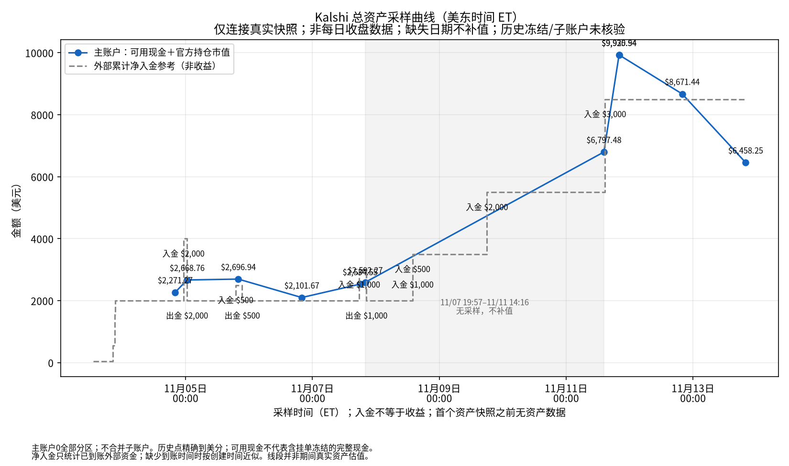

# Kalshi 每日交易报告 — 2026-11-13（美东时间）

_生成时间：2026-11-13 19:53 美东_

## 一、当日成交（228 笔）

| 时间(ET) | 市场 | 方向 | 份数 | 价格 | 金额 | 手续费 |
|---|---|---|---:|---:|---:|---:|
| 03:15:26 | Singapore wins `KXINTLFRIENDLYGAME-26NOV13SINPAR-SIN` | 买入 NO | 328.87 | $0.9800 | $322.29 | $0.45 |
| 03:15:26 | Singapore wins `KXINTLFRIENDLYGAME-26NOV13SINPAR-SIN` | 买入 NO | 400.00 | $0.9800 | $392.00 | $0.55 |
| 03:15:26 | Singapore wins `KXINTLFRIENDLYGAME-26NOV13SINPAR-SIN` | 买入 NO | 399.13 | $0.9800 | $391.15 | $0.55 |
| 06:18:15 | Lebanon wins `KXINTLFRIENDLYGAME-26NOV13IRQLBN-LBN` | 买入 NO | 402.00 | $0.9100 | $365.82 | $2.30 |
| 07:28:50 | Libya wins `KXAFCONGAME-26NOV13TUNLBA-LBA` | 买入 NO | 344.00 | $0.9200 | $316.48 | $1.77 |
| 07:28:50 | Libya wins `KXAFCONGAME-26NOV13TUNLBA-LBA` | 买入 NO | 55.00 | $0.9200 | $50.60 | $0.28 |
| 07:28:50 | Lesotho wins `KXAFCONGAME-26NOV13GABLES-LES` | 买入 NO | 113.37 | $0.9500 | $107.70 | $0.38 |
| 07:28:50 | Lesotho wins `KXAFCONGAME-26NOV13GABLES-LES` | 买入 NO | 51.00 | $0.9500 | $48.45 | $0.17 |
| 07:28:50 | Lesotho wins `KXAFCONGAME-26NOV13GABLES-LES` | 买入 NO | 115.19 | $0.9500 | $109.43 | $0.38 |
| 07:28:50 | Lesotho wins `KXAFCONGAME-26NOV13GABLES-LES` | 买入 NO | 15.63 | $0.9500 | $14.85 | $0.05 |
| 07:28:50 | Lesotho wins `KXAFCONGAME-26NOV13GABLES-LES` | 买入 NO | 76.18 | $0.9500 | $72.37 | $0.25 |
| 07:28:50 | Lesotho wins `KXAFCONGAME-26NOV13GABLES-LES` | 买入 NO | 15.63 | $0.9500 | $14.85 | $0.05 |
| 07:28:50 | Tanzania wins `KXAFCONGAME-26NOV13NGRTAN-TAN` | 买入 NO | 71.00 | $0.9600 | $68.16 | $0.19 |
| 07:28:50 | Tanzania wins `KXAFCONGAME-26NOV13NGRTAN-TAN` | 买入 NO | 74.60 | $0.9600 | $71.62 | $0.20 |
| 07:28:50 | Tanzania wins `KXAFCONGAME-26NOV13NGRTAN-TAN` | 买入 NO | 101.00 | $0.9600 | $96.96 | $0.27 |
| 07:28:50 | Tanzania wins `KXAFCONGAME-26NOV13NGRTAN-TAN` | 买入 NO | 130.00 | $0.9600 | $124.80 | $0.35 |
| 07:28:50 | Tanzania wins `KXAFCONGAME-26NOV13NGRTAN-TAN` | 买入 NO | 6.40 | $0.9600 | $6.14 | $0.02 |
| 07:28:50 | Kenya wins `KXAFCONGAME-26NOV13RSAKEN-KEN` | 买入 NO | 59.00 | $0.9500 | $56.05 | $0.20 |
| 07:28:50 | Kenya wins `KXAFCONGAME-26NOV13RSAKEN-KEN` | 买入 NO | 119.00 | $0.9500 | $113.05 | $0.40 |
| 07:28:50 | Kenya wins `KXAFCONGAME-26NOV13RSAKEN-KEN` | 买入 NO | 50.00 | $0.9500 | $47.50 | $0.17 |
| 07:28:50 | Kenya wins `KXAFCONGAME-26NOV13RSAKEN-KEN` | 买入 NO | 53.00 | $0.9500 | $50.35 | $0.18 |
| 07:28:50 | Kenya wins `KXAFCONGAME-26NOV13RSAKEN-KEN` | 买入 NO | 51.00 | $0.9500 | $48.45 | $0.17 |
| 07:28:50 | Kenya wins `KXAFCONGAME-26NOV13RSAKEN-KEN` | 买入 NO | 50.00 | $0.9500 | $47.50 | $0.17 |
| 07:28:50 | Kenya wins `KXAFCONGAME-26NOV13RSAKEN-KEN` | 买入 NO | 5.00 | $0.9500 | $4.75 | $0.02 |
| 07:28:50 | Liberia wins `KXAFCONGAME-26NOV13CPVLBR-LBR` | 买入 NO | 76.88 | $0.9500 | $73.04 | $0.26 |
| 07:28:50 | Liberia wins `KXAFCONGAME-26NOV13CPVLBR-LBR` | 买入 NO | 50.00 | $0.9500 | $47.50 | $0.17 |
| 07:28:50 | Liberia wins `KXAFCONGAME-26NOV13CPVLBR-LBR` | 买入 NO | 23.12 | $0.9500 | $21.96 | $0.08 |
| 07:28:50 | Liberia wins `KXAFCONGAME-26NOV13CPVLBR-LBR` | 买入 NO | 399.00 | $0.9500 | $379.05 | $1.33 |
| 07:28:50 | Liberia wins `KXAFCONGAME-26NOV13CPVLBR-LBR` | 买入 NO | 69.00 | $0.9500 | $65.55 | $0.23 |
| 07:28:50 | Liberia wins `KXAFCONGAME-26NOV13CPVLBR-LBR` | 买入 NO | 34.00 | $0.9500 | $32.30 | $0.11 |
| 07:28:50 | Liberia wins `KXAFCONGAME-26NOV13CPVLBR-LBR` | 买入 NO | 122.00 | $0.9500 | $115.90 | $0.41 |
| 07:28:50 | Lebanon wins `KXINTLFRIENDLYGAME-26NOV13IRQLBN-LBN` | 买入 NO | 400.00 | $0.9200 | $368.00 | $2.06 |
| 08:23:16 | Purdue Fort Wayne wins `KXNCAAWBGAME-26NOV13VALPPFW-PFW` | 买入 YES | 401.00 | $0.9100 | $364.91 | $2.30 |
| 09:46:55 | Texas St. wins `KXNCAAWBGAME-26NOV13AMCCTXST-TXST` | 买入 YES | 372.00 | $0.9800 | $364.56 | $0.51 |
| 09:46:55 | American wins `KXNCAAWBGAME-26NOV13AMERDSU-AMER` | 买入 YES | 442.00 | $0.7600 | $335.92 | $5.64 |
| 09:46:55 | American wins `KXNCAAWBGAME-26NOV13AMERDSU-AMER` | 买入 YES | 30.00 | $0.7600 | $22.80 | $0.38 |
| 10:28:35 | Dominica wins `KXCONCACAFNLGAME-26NOV13PURDMA-DMA` | 买入 NO | 32.55 | $0.9300 | $30.27 | $0.15 |
| 10:28:35 | Dominica wins `KXCONCACAFNLGAME-26NOV13PURDMA-DMA` | 买入 NO | 349.93 | $0.9300 | $325.43 | $1.59 |
| 10:28:35 | Rwanda wins `KXAFCONGAME-26NOV13MLIRWA-RWA` | 买入 NO | 203.00 | $0.9400 | $190.82 | $0.80 |
| 10:28:35 | Rwanda wins `KXAFCONGAME-26NOV13MLIRWA-RWA` | 买入 NO | 183.00 | $0.9400 | $172.02 | $0.72 |
| 10:28:35 | Bermuda wins `KXCONCACAFNLGAME-26NOV13BMULCA-BMU` | 买入 NO | 186.00 | $0.9400 | $174.84 | $0.73 |
| 10:28:35 | Bermuda wins `KXCONCACAFNLGAME-26NOV13BMULCA-BMU` | 买入 NO | 200.00 | $0.9400 | $188.00 | $0.79 |
| 11:19:14 | Rwanda wins `KXAFCONGAME-26NOV13MLIRWA-RWA` | 买入 NO | 342.00 | $0.9400 | $321.48 | $1.35 |
| 11:19:14 | Niger wins `KXAFCONGAME-26NOV13MARNIG-NIG` | 买入 NO | 329.00 | $0.9800 | $322.42 | $0.45 |
| 11:19:14 | North Macedonia wins `KXUEFANLGAME-26NOV13SCOMKD-MKD` | 买入 NO | 336.00 | $0.9600 | $322.56 | $0.90 |
| 11:19:14 | Liechtenstein wins `KXUEFANLGAME-26NOV13LIEAZE-LIE` | 买入 NO | 300.00 | $0.9700 | $291.00 | $0.61 |
| 11:19:14 | Liechtenstein wins `KXUEFANLGAME-26NOV13LIEAZE-LIE` | 买入 NO | 32.00 | $0.9700 | $31.04 | $0.07 |
| 11:19:14 | Serbia wins `KXUEFANLGAME-26NOV13SRBGER-SRB` | 买入 NO | 313.24 | $0.9200 | $288.18 | $1.61 |
| 11:19:14 | Serbia wins `KXUEFANLGAME-26NOV13SRBGER-SRB` | 买入 NO | 35.76 | $0.9200 | $32.90 | $0.18 |
| 11:19:15 | Tie is the result `KXUEFANLGAME-26NOV13SVKFRO-TIE` | 买入 NO | 111.11 | $0.8200 | $91.11 | $1.15 |
| 11:19:15 | Tie is the result `KXUEFANLGAME-26NOV13SVKFRO-TIE` | 买入 NO | 53.00 | $0.8200 | $43.46 | $0.55 |
| 11:19:15 | Tie is the result `KXUEFANLGAME-26NOV13SVKFRO-TIE` | 买入 NO | 57.00 | $0.8200 | $46.74 | $0.59 |
| 11:19:15 | Malawi wins `KXAFCONGAME-26NOV13EGYMAW-MAW` | 买入 NO | 329.00 | $0.9800 | $322.42 | $0.45 |
| 12:27:54 | Tie is the result `KXUEFANLGAME-26NOV13SVKFRO-TIE` | 买入 NO | 19.00 | $0.8300 | $15.77 | $0.19 |
| 12:27:54 | Rwanda wins `KXAFCONGAME-26NOV13MLIRWA-RWA` | 买入 NO | 16.00 | $0.9400 | $15.04 | $0.06 |
| 12:27:54 | Malawi wins `KXAFCONGAME-26NOV13EGYMAW-MAW` | 买入 NO | 16.00 | $0.9800 | $15.68 | $0.02 |
| 12:27:54 | Niger wins `KXAFCONGAME-26NOV13MARNIG-NIG` | 买入 NO | 15.15 | $0.9800 | $14.85 | $0.02 |
| 12:27:54 | Niger wins `KXAFCONGAME-26NOV13MARNIG-NIG` | 买入 NO | 0.85 | $0.9800 | $0.83 | $0.00 |
| 12:27:54 | Bermuda wins `KXCONCACAFNLGAME-26NOV13BMULCA-BMU` | 买入 NO | 16.00 | $0.9400 | $15.04 | $0.06 |
| 12:27:54 | Liechtenstein wins `KXUEFANLGAME-26NOV13LIEAZE-LIE` | 买入 NO | 16.00 | $0.9700 | $15.52 | $0.03 |
| 12:27:54 | North Macedonia wins `KXUEFANLGAME-26NOV13SCOMKD-MKD` | 买入 NO | 16.00 | $0.9600 | $15.36 | $0.04 |
| 12:27:54 | Serbia wins `KXUEFANLGAME-26NOV13SRBGER-SRB` | 买入 NO | 17.00 | $0.9200 | $15.64 | $0.09 |
| 12:27:55 | Texas A&M-Corpus Christi wins `KXNCAAWBGAME-26NOV13AMCCTXST-AMCC` | 买入 NO | 3.00 | $0.9800 | $2.94 | $0.00 |
| 12:27:55 | Texas A&M-Corpus Christi wins `KXNCAAWBGAME-26NOV13AMCCTXST-AMCC` | 买入 NO | 13.00 | $0.9800 | $12.74 | $0.02 |
| 13:27:08 | Liechtenstein wins `KXUEFANLGAME-26NOV13LIEAZE-LIE` | 买入 NO | 251.00 | $0.9700 | $243.47 | $0.51 |
| 13:27:08 | North Macedonia wins `KXUEFANLGAME-26NOV13SCOMKD-MKD` | 买入 NO | 253.00 | $0.9600 | $242.88 | $0.68 |
| 13:27:08 | Serbia wins `KXUEFANLGAME-26NOV13SRBGER-SRB` | 买入 NO | 35.00 | $0.9300 | $32.55 | $0.16 |
| 13:27:08 | Serbia wins `KXUEFANLGAME-26NOV13SRBGER-SRB` | 买入 NO | 225.00 | $0.9300 | $209.25 | $1.03 |
| 13:27:08 | Serbia wins `KXUEFANLGAME-26NOV13SRBGER-SRB` | 买入 NO | 1.00 | $0.9300 | $0.93 | $0.00 |
| 13:27:09 | Canisius wins `KXNCAAWBGAME-26NOV13CANCOR-CAN` | 买入 NO | 1.00 | $0.7900 | $0.79 | $0.01 |
| 13:27:09 | Canisius wins `KXNCAAWBGAME-26NOV13CANCOR-CAN` | 买入 NO | 1.00 | $0.7900 | $0.79 | $0.01 |
| 13:27:09 | Canisius wins `KXNCAAWBGAME-26NOV13CANCOR-CAN` | 买入 NO | 5.00 | $0.7900 | $3.95 | $0.06 |
| 13:27:09 | Canisius wins `KXNCAAWBGAME-26NOV13CANCOR-CAN` | 买入 NO | 267.56 | $0.7900 | $211.37 | $3.11 |
| 13:27:09 | Saint Mary's wins `KXNCAAWBGAME-26NOV13SMCHAW-SMC` | 买入 NO | 9.00 | $0.8100 | $7.29 | $0.10 |
| 13:27:09 | Saint Mary's wins `KXNCAAWBGAME-26NOV13SMCHAW-SMC` | 买入 NO | 288.00 | $0.8100 | $233.28 | $3.10 |
| 13:27:09 | Texas A&M-Corpus Christi wins `KXNCAAMBGAME-26NOV13AMCCFSU-AMCC` | 买入 NO | 93.20 | $0.9800 | $91.34 | $0.13 |
| 13:27:09 | Texas A&M-Corpus Christi wins `KXNCAAMBGAME-26NOV13AMCCFSU-AMCC` | 买入 NO | 52.80 | $0.9800 | $51.74 | $0.07 |
| 13:27:09 | Texas A&M-Corpus Christi wins `KXNCAAMBGAME-26NOV13AMCCFSU-AMCC` | 买入 NO | 102.00 | $0.9800 | $99.96 | $0.14 |
| 13:27:09 | Tie is the result `KXUEFANLGAME-26NOV13SVKFRO-TIE` | 买入 NO | 90.00 | $0.8200 | $73.80 | $0.93 |
| 13:27:09 | Tie is the result `KXUEFANLGAME-26NOV13SVKFRO-TIE` | 买入 NO | 9.94 | $0.8200 | $8.15 | $0.10 |
| 13:27:09 | Tie is the result `KXUEFANLGAME-26NOV13SVKFRO-TIE` | 买入 NO | 15.00 | $0.8200 | $12.30 | $0.15 |
| 13:27:09 | Tie is the result `KXUEFANLGAME-26NOV13SVKFRO-TIE` | 买入 NO | 42.06 | $0.8200 | $34.49 | $0.43 |
| 13:27:09 | Tie is the result `KXUEFANLGAME-26NOV13SVKFRO-TIE` | 买入 NO | 10.00 | $0.8200 | $8.20 | $0.10 |
| 13:27:09 | Niger wins `KXAFCONGAME-26NOV13MARNIG-NIG` | 买入 NO | 248.00 | $0.9800 | $243.04 | $0.34 |
| 13:27:09 | Malawi wins `KXAFCONGAME-26NOV13EGYMAW-MAW` | 买入 NO | 248.00 | $0.9800 | $243.04 | $0.34 |
| 13:27:09 | Bermuda wins `KXCONCACAFNLGAME-26NOV13BMULCA-BMU` | 买入 NO | 258.00 | $0.9400 | $242.52 | $1.02 |
| 13:27:10 | Canisius wins `KXNCAAWBGAME-26NOV13CANCOR-CAN` | 买入 NO | 29.00 | $0.8000 | $23.20 | $0.32 |
| 14:21:25 | North Macedonia wins `KXUEFANLGAME-26NOV13SCOMKD-MKD` | 买入 NO | 76.00 | $0.9600 | $72.96 | $0.20 |
| 14:21:25 | Liechtenstein wins `KXUEFANLGAME-26NOV13LIEAZE-LIE` | 买入 NO | 75.00 | $0.9700 | $72.75 | $0.15 |
| 14:21:25 | Serbia wins `KXUEFANLGAME-26NOV13SRBGER-SRB` | 买入 NO | 78.00 | $0.9300 | $72.54 | $0.36 |
| 14:21:26 | Niger wins `KXAFCONGAME-26NOV13MARNIG-NIG` | 买入 NO | 74.00 | $0.9800 | $72.52 | $0.10 |
| 14:21:26 | Saint Martin wins `KXCONCACAFNLGAME-26NOV13SMASLV-SMA` | 买入 NO | 83.00 | $0.8700 | $72.21 | $0.66 |
| 14:22:12 | Le Moyne wins `KXNCAAWBGAME-26NOV13LMCUCF-LMC` | 买入 NO | 74.00 | $0.9800 | $72.52 | $0.10 |
| 14:22:12 | Bryant wins `KXNCAAMBGAME-26NOV13BRYRUTG-BRY` | 买入 NO | 75.00 | $0.9700 | $72.75 | $0.15 |
| 14:22:12 | Northwestern wins `KXNCAAWBGAME-26NOV13NWWVU-NW` | 买入 NO | 74.00 | $0.9900 | $73.26 | $0.05 |
| 15:23:09 | Saint Martin wins `KXCONCACAFNLGAME-26NOV13SMASLV-SMA` | 买入 NO | 41.00 | $0.8700 | $35.67 | $0.32 |
| 15:23:10 | Northern Iowa wins `KXNCAAMBGAME-26NOV13UNIMSU-UNI` | 买入 NO | 36.00 | $0.9900 | $35.64 | $0.03 |
| 15:23:10 | Northwestern wins `KXNCAAWBGAME-26NOV13NWWVU-NW` | 买入 NO | 15.00 | $0.9900 | $14.85 | $0.01 |
| 15:23:10 | Northwestern wins `KXNCAAWBGAME-26NOV13NWWVU-NW` | 买入 NO | 21.00 | $0.9900 | $20.79 | $0.01 |
| 15:23:10 | Hawai'i wins `KXNCAAWBGAME-26NOV13SMCHAW-HAW` | 买入 YES | 44.00 | $0.8000 | $35.20 | $0.49 |
| 15:23:10 | Tennessee St. wins `KXNCAAMBGAME-26NOV13TNSTTENN-TNST` | 买入 NO | 36.00 | $0.9900 | $35.64 | $0.03 |
| 15:23:10 | Texas A&M-Corpus Christi wins `KXNCAAMBGAME-26NOV13AMCCFSU-AMCC` | 买入 NO | 36.00 | $0.9800 | $35.28 | $0.05 |
| 15:23:10 | Orlando wins `KXNBAGAME-26NOV13MILORL-ORL` | 买入 YES | 45.00 | $0.7800 | $35.10 | $0.54 |
| 15:23:10 | New York wins `KXNBAGAME-26NOV13NYKIND-NYK` | 买入 YES | 46.00 | $0.7600 | $34.96 | $0.59 |
| 15:23:10 | Montserrat wins `KXCONCACAFNLGAME-26NOV13MSRNIC-MSR` | 买入 NO | 39.00 | $0.9000 | $35.10 | $0.25 |
| 15:23:10 | Costa Rica wins `KXINTLFRIENDLYGAME-26NOV13ECUCRI-CRI` | 买入 NO | 38.00 | $0.9300 | $35.34 | $0.17 |
| 15:23:11 | Cornell wins `KXNCAAWBGAME-26NOV13CANCOR-COR` | 买入 YES | 20.00 | $0.7800 | $15.60 | $0.24 |
| 15:23:11 | Cornell wins `KXNCAAWBGAME-26NOV13CANCOR-COR` | 买入 YES | 24.00 | $0.7800 | $18.72 | $0.29 |
| 15:23:11 | Cornell wins `KXNCAAWBGAME-26NOV13CANCOR-COR` | 买入 YES | 1.00 | $0.7800 | $0.78 | $0.01 |
| 15:23:11 | George Washington wins `KXNCAAMBGAME-26NOV13HARVGW-GW` | 买入 YES | 41.00 | $0.8700 | $35.67 | $0.32 |
| 15:23:11 | Le Moyne wins `KXNCAAWBGAME-26NOV13LMCUCF-LMC` | 买入 NO | 36.00 | $0.9900 | $35.64 | $0.03 |
| 15:23:11 | Troy wins `KXNCAAMBGAME-26NOV13TROYNCST-TROY` | 买入 NO | 36.00 | $0.9800 | $35.28 | $0.05 |
| 15:23:11 | Bryant wins `KXNCAAMBGAME-26NOV13BRYRUTG-BRY` | 买入 NO | 37.00 | $0.9700 | $35.89 | $0.08 |
| 15:23:11 | Mount St. Mary's wins `KXNCAAMBGAME-26NOV13MSMVT-MSM` | 买入 NO | 29.03 | $0.9900 | $28.74 | $0.02 |
| 15:23:11 | Mount St. Mary's wins `KXNCAAMBGAME-26NOV13MSMVT-MSM` | 买入 NO | 6.97 | $0.9900 | $6.90 | $0.00 |
| 15:23:11 | Ohio wins `KXNCAAMBGAME-26NOV13OHIOPUR-OHIO` | 买入 NO | 24.19 | $0.9600 | $23.22 | $0.07 |
| 15:23:11 | Ohio wins `KXNCAAMBGAME-26NOV13OHIOPUR-OHIO` | 买入 NO | 12.81 | $0.9600 | $12.30 | $0.03 |
| 16:33:45 | New York wins `KXNBAGAME-26NOV13NYKIND-NYK` | 买入 YES | 123.00 | $0.7600 | $93.48 | $1.57 |
| 16:33:45 | Montserrat wins `KXCONCACAFNLGAME-26NOV13MSRNIC-MSR` | 买入 NO | 105.00 | $0.9000 | $94.50 | $0.66 |
| 16:33:45 | Costa Rica wins `KXINTLFRIENDLYGAME-26NOV13ECUCRI-CRI` | 买入 NO | 101.00 | $0.9400 | $94.94 | $0.40 |
| 16:33:45 | Saint Martin wins `KXCONCACAFNLGAME-26NOV13SMASLV-SMA` | 买入 NO | 28.00 | $0.8600 | $24.08 | $0.24 |
| 16:33:45 | Saint Martin wins `KXCONCACAFNLGAME-26NOV13SMASLV-SMA` | 买入 NO | 8.74 | $0.8600 | $7.52 | $0.07 |
| 16:33:45 | Saint Martin wins `KXCONCACAFNLGAME-26NOV13SMASLV-SMA` | 买入 NO | 0.23 | $0.8600 | $0.20 | $0.00 |
| 16:33:45 | Saint Martin wins `KXCONCACAFNLGAME-26NOV13SMASLV-SMA` | 买入 NO | 0.03 | $0.8600 | $0.03 | $0.00 |
| 16:33:45 | Saint Martin wins `KXCONCACAFNLGAME-26NOV13SMASLV-SMA` | 买入 NO | 12.00 | $0.8600 | $10.32 | $0.10 |
| 16:33:45 | Saint Martin wins `KXCONCACAFNLGAME-26NOV13SMASLV-SMA` | 买入 NO | 55.00 | $0.8600 | $47.30 | $0.46 |
| 16:33:45 | Saint Martin wins `KXCONCACAFNLGAME-26NOV13SMASLV-SMA` | 买入 NO | 5.00 | $0.8600 | $4.30 | $0.04 |
| 16:33:46 | Northern Iowa wins `KXNCAAMBGAME-26NOV13UNIMSU-UNI` | 买入 NO | 96.00 | $0.9900 | $95.04 | $0.07 |
| 16:33:46 | Northwestern wins `KXNCAAWBGAME-26NOV13NWWVU-NW` | 买入 NO | 96.00 | $0.9900 | $95.04 | $0.07 |
| 16:33:46 | UConn wins `KXNCAAMBGAME-26NOV13OSUCONN-CONN` | 买入 YES | 107.00 | $0.8800 | $94.16 | $0.79 |
| 16:33:46 | Tennessee St. wins `KXNCAAMBGAME-26NOV13TNSTTENN-TNST` | 买入 NO | 96.00 | $0.9900 | $95.04 | $0.07 |
| 16:33:46 | FDU wins `KXNCAAMBGAME-26NOV13FDUOKLA-FDU` | 买入 NO | 8.00 | $0.9900 | $7.92 | $0.01 |
| 16:33:46 | FDU wins `KXNCAAMBGAME-26NOV13FDUOKLA-FDU` | 买入 NO | 88.00 | $0.9900 | $87.12 | $0.06 |
| 16:33:46 | Orlando wins `KXNBAGAME-26NOV13MILORL-ORL` | 买入 YES | 120.00 | $0.7800 | $93.60 | $1.44 |
| 16:33:46 | Texas A&M-Corpus Christi wins `KXNCAAMBGAME-26NOV13AMCCFSU-AMCC` | 买入 NO | 46.00 | $0.9700 | $44.62 | $0.09 |
| 16:33:46 | Texas A&M-Corpus Christi wins `KXNCAAMBGAME-26NOV13AMCCFSU-AMCC` | 买入 NO | 10.00 | $0.9700 | $9.70 | $0.02 |
| 16:33:46 | Texas A&M-Corpus Christi wins `KXNCAAMBGAME-26NOV13AMCCFSU-AMCC` | 买入 NO | 42.00 | $0.9700 | $40.74 | $0.09 |
| 16:33:46 | Utah wins `KXNBAGAME-26NOV13UTAHOU-UTA` | 买入 NO | 104.00 | $0.9100 | $94.64 | $0.60 |
| 16:33:47 | Troy wins `KXNCAAMBGAME-26NOV13TROYNCST-TROY` | 买入 NO | 97.00 | $0.9800 | $95.06 | $0.13 |
| 16:33:47 | George Washington wins `KXNCAAMBGAME-26NOV13HARVGW-GW` | 买入 YES | 108.00 | $0.8700 | $93.96 | $0.86 |
| 16:33:47 | Murray St. wins `KXNCAAMBGAME-26NOV13TXSOMURR-MURR` | 买入 YES | 96.00 | $0.9900 | $95.04 | $0.07 |
| 16:33:47 | Marquette wins `KXNCAAWBGAME-26NOV13MARQMOSU-MARQ` | 买入 NO | 8.02 | $0.7900 | $6.34 | $0.09 |
| 16:33:47 | Marquette wins `KXNCAAWBGAME-26NOV13MARQMOSU-MARQ` | 买入 NO | 110.98 | $0.7900 | $87.67 | $1.29 |
| 16:33:47 | Alcorn St. wins `KXNCAAMBGAME-26NOV13ALCNTARL-ALCN` | 买入 NO | 102.00 | $0.9300 | $94.86 | $0.46 |
| 16:33:47 | Bryant wins `KXNCAAMBGAME-26NOV13BRYRUTG-BRY` | 买入 NO | 41.20 | $0.9700 | $39.96 | $0.08 |
| 16:33:47 | Bryant wins `KXNCAAMBGAME-26NOV13BRYRUTG-BRY` | 买入 NO | 56.80 | $0.9700 | $55.10 | $0.12 |
| 16:33:47 | Mount St. Mary's wins `KXNCAAMBGAME-26NOV13MSMVT-MSM` | 买入 NO | 96.00 | $0.9900 | $95.04 | $0.07 |
| 16:33:47 | Central Arkansas wins `KXNCAAMBGAME-26NOV13CARKARK-CARK` | 买入 NO | 5.42 | $0.9900 | $5.37 | $0.00 |
| 16:33:47 | Central Arkansas wins `KXNCAAMBGAME-26NOV13CARKARK-CARK` | 买入 NO | 90.58 | $0.9900 | $89.67 | $0.06 |
| 16:33:47 | Samford wins `KXNCAAWBGAME-26NOV13SAMIND-SAM` | 买入 NO | 96.00 | $0.9900 | $95.04 | $0.07 |
| 16:33:48 | Purdue wins `KXNCAAMBGAME-26NOV13OHIOPUR-PUR` | 买入 YES | 99.00 | $0.9600 | $95.04 | $0.27 |
| 16:33:48 | Kansas City wins `KXNCAAWBGAME-26NOV13SEMOUMKC-UMKC` | 买入 YES | 113.00 | $0.8300 | $93.79 | $1.12 |
| 16:33:48 | Georgia Southern wins `KXNCAAMBGAME-26NOV13GASOUCF-GASO` | 买入 NO | 36.88 | $0.9700 | $35.77 | $0.08 |
| 16:33:48 | Georgia Southern wins `KXNCAAMBGAME-26NOV13GASOUCF-GASO` | 买入 NO | 52.00 | $0.9700 | $50.44 | $0.11 |
| 16:33:48 | Georgia Southern wins `KXNCAAMBGAME-26NOV13GASOUCF-GASO` | 买入 NO | 9.12 | $0.9700 | $8.85 | $0.02 |
| 16:33:48 | Milwaukee wins `KXNCAAMBGAME-26NOV13MILWTCU-MILW` | 买入 NO | 97.00 | $0.9800 | $95.06 | $0.13 |
| 17:20:19 | Utah wins `KXNBAGAME-26NOV13UTAHOU-UTA` | 买入 NO | 77.00 | $0.9100 | $70.07 | $0.44 |
| 17:20:19 | Utah wins `KXNBAGAME-26NOV13UTAHOU-UTA` | 买入 NO | 4.40 | $0.9100 | $4.00 | $0.03 |
| 17:20:19 | Utah wins `KXNBAGAME-26NOV13UTAHOU-UTA` | 买入 NO | 0.60 | $0.9100 | $0.55 | $0.00 |
| 17:20:19 | Utah wins `KXNBAGAME-26NOV13UTAHOU-UTA` | 买入 NO | 42.00 | $0.9100 | $38.22 | $0.24 |
| 17:20:19 | New York wins `KXNBAGAME-26NOV13NYKIND-NYK` | 买入 YES | 147.00 | $0.7600 | $111.72 | $1.88 |
| 17:20:19 | Guatemala wins `KXCONCACAFNLGAME-26NOV13GTMCAN-GTM` | 买入 NO | 135.00 | $0.8300 | $112.05 | $1.33 |
| 17:20:20 | Central Arkansas wins `KXNCAAMBGAME-26NOV13CARKARK-CARK` | 买入 NO | 114.00 | $0.9900 | $112.86 | $0.08 |
| 17:20:20 | Tarleton St. wins `KXNCAAMBGAME-26NOV13ALCNTARL-TARL` | 买入 YES | 121.00 | $0.9300 | $112.53 | $0.55 |
| 17:20:20 | Northern Iowa wins `KXNCAAMBGAME-26NOV13UNIMSU-UNI` | 买入 NO | 114.00 | $0.9900 | $112.86 | $0.08 |
| 17:20:20 | UConn wins `KXNCAAMBGAME-26NOV13OSUCONN-CONN` | 买入 YES | 128.00 | $0.8800 | $112.64 | $0.95 |
| 17:20:20 | Tennessee St. wins `KXNCAAMBGAME-26NOV13TNSTTENN-TNST` | 买入 NO | 114.00 | $0.9900 | $112.86 | $0.08 |
| 17:20:20 | FDU wins `KXNCAAMBGAME-26NOV13FDUOKLA-FDU` | 买入 NO | 2.00 | $0.9900 | $1.98 | $0.00 |
| 17:20:20 | FDU wins `KXNCAAMBGAME-26NOV13FDUOKLA-FDU` | 买入 NO | 112.00 | $0.9900 | $110.88 | $0.08 |
| 17:20:20 | Orlando wins `KXNBAGAME-26NOV13MILORL-ORL` | 买入 YES | 26.41 | $0.7800 | $20.60 | $0.32 |
| 17:20:20 | Orlando wins `KXNBAGAME-26NOV13MILORL-ORL` | 买入 YES | 116.59 | $0.7800 | $90.94 | $1.40 |
| 17:20:21 | Marquette wins `KXNCAAWBGAME-26NOV13MARQMOSU-MARQ` | 买入 NO | 43.00 | $0.7700 | $33.11 | $0.53 |
| 17:20:21 | Marquette wins `KXNCAAWBGAME-26NOV13MARQMOSU-MARQ` | 买入 NO | 35.00 | $0.7700 | $26.95 | $0.43 |
| 17:20:21 | Marquette wins `KXNCAAWBGAME-26NOV13MARQMOSU-MARQ` | 买入 NO | 0.05 | $0.7700 | $0.04 | $0.00 |
| 17:20:21 | Seton Hall wins `KXNCAAMBGAME-26NOV13HALLALA-HALL` | 买入 NO | 6.12 | $0.9400 | $5.75 | $0.02 |
| 17:20:21 | Seton Hall wins `KXNCAAMBGAME-26NOV13HALLALA-HALL` | 买入 NO | 33.00 | $0.9400 | $31.02 | $0.13 |
| 17:20:21 | Seton Hall wins `KXNCAAMBGAME-26NOV13HALLALA-HALL` | 买入 NO | 80.88 | $0.9400 | $76.03 | $0.32 |
| 17:20:21 | Mount St. Mary's wins `KXNCAAMBGAME-26NOV13MSMVT-MSM` | 买入 NO | 114.00 | $0.9900 | $112.86 | $0.08 |
| 17:20:22 | Troy wins `KXNCAAMBGAME-26NOV13TROYNCST-TROY` | 买入 NO | 4.58 | $0.9800 | $4.49 | $0.01 |
| 17:20:22 | Troy wins `KXNCAAMBGAME-26NOV13TROYNCST-TROY` | 买入 NO | 102.00 | $0.9800 | $99.96 | $0.14 |
| 17:20:22 | Troy wins `KXNCAAMBGAME-26NOV13TROYNCST-TROY` | 买入 NO | 9.42 | $0.9800 | $9.23 | $0.01 |
| 17:20:22 | Milwaukee wins `KXNCAAMBGAME-26NOV13MILWTCU-MILW` | 买入 NO | 9.36 | $0.9800 | $9.17 | $0.01 |
| 17:20:22 | Milwaukee wins `KXNCAAMBGAME-26NOV13MILWTCU-MILW` | 买入 NO | 6.64 | $0.9800 | $6.51 | $0.01 |
| 17:20:22 | Milwaukee wins `KXNCAAMBGAME-26NOV13MILWTCU-MILW` | 买入 NO | 100.00 | $0.9800 | $98.00 | $0.14 |
| 17:20:22 | Murray St. wins `KXNCAAMBGAME-26NOV13TXSOMURR-MURR` | 买入 YES | 55.75 | $0.9900 | $55.19 | $0.04 |
| 17:20:22 | Murray St. wins `KXNCAAMBGAME-26NOV13TXSOMURR-MURR` | 买入 YES | 58.25 | $0.9900 | $57.67 | $0.04 |
| 17:20:23 | Illinois wins `KXNCAAFGAME-26NOV13ILLUCLA-ILL` | 买入 NO | 140.00 | $0.8000 | $112.00 | $1.57 |
| 17:20:23 | Liberty wins `KXNCAAMBGAME-26NOV13NCCULIB-LIB` | 买入 YES | 120.00 | $0.9400 | $112.80 | $0.47 |
| 17:20:23 | Georgia Southern wins `KXNCAAMBGAME-26NOV13GASOUCF-GASO` | 买入 NO | 117.00 | $0.9700 | $113.49 | $0.24 |
| 17:20:23 | Purdue wins `KXNCAAMBGAME-26NOV13OHIOPUR-PUR` | 买入 YES | 118.00 | $0.9600 | $113.28 | $0.32 |
| 17:20:23 | Kansas City wins `KXNCAAWBGAME-26NOV13SEMOUMKC-UMKC` | 买入 YES | 124.00 | $0.8300 | $102.92 | $1.22 |
| 17:20:23 | Kansas City wins `KXNCAAWBGAME-26NOV13SEMOUMKC-UMKC` | 买入 YES | 11.00 | $0.8300 | $9.13 | $0.11 |
| 17:20:23 | Drake wins `KXNCAAMBGAME-26NOV13SDAKDRKE-DRKE` | 买入 YES | 125.00 | $0.9000 | $112.50 | $0.79 |
| 17:20:23 | Ball St. wins `KXNCAAMBGAME-26NOV13BALLSMU-BALL` | 买入 NO | 48.90 | $0.9700 | $47.43 | $0.10 |
| 17:20:23 | Ball St. wins `KXNCAAMBGAME-26NOV13BALLSMU-BALL` | 买入 NO | 1.00 | $0.9700 | $0.97 | $0.00 |
| 17:20:23 | Ball St. wins `KXNCAAMBGAME-26NOV13BALLSMU-BALL` | 买入 NO | 67.10 | $0.9700 | $65.09 | $0.14 |
| 17:20:23 | George Washington wins `KXNCAAMBGAME-26NOV13HARVGW-GW` | 买入 YES | 129.00 | $0.8700 | $112.23 | $1.02 |
| 18:12:38 | Hawai'i wins `KXNCAAWBGAME-26NOV13SMCHAW-HAW` | 卖出 YES | 0.36 | $0.2000 | $0.07 | $0.00 |
| 18:12:38 | Hawai'i wins `KXNCAAWBGAME-26NOV13SMCHAW-HAW` | 卖出 YES | 43.64 | $0.2000 | $8.73 | $0.49 |
| 18:12:40 | Saint Mary's wins `KXNCAAWBGAME-26NOV13SMCHAW-SMC` | 卖出 NO | 20.00 | $0.2100 | $4.20 | $0.23 |
| 18:12:40 | Saint Mary's wins `KXNCAAWBGAME-26NOV13SMCHAW-SMC` | 卖出 NO | 0.07 | $0.2000 | $0.01 | $0.00 |
| 18:12:40 | Saint Mary's wins `KXNCAAWBGAME-26NOV13SMCHAW-SMC` | 卖出 NO | 31.00 | $0.2000 | $6.20 | $0.35 |
| 18:12:40 | Saint Mary's wins `KXNCAAWBGAME-26NOV13SMCHAW-SMC` | 卖出 NO | 50.00 | $0.2000 | $10.00 | $0.56 |
| 18:12:40 | Saint Mary's wins `KXNCAAWBGAME-26NOV13SMCHAW-SMC` | 卖出 NO | 33.00 | $0.2100 | $6.93 | $0.38 |
| 18:12:40 | Saint Mary's wins `KXNCAAWBGAME-26NOV13SMCHAW-SMC` | 卖出 NO | 13.00 | $0.2000 | $2.60 | $0.15 |
| 18:12:40 | Saint Mary's wins `KXNCAAWBGAME-26NOV13SMCHAW-SMC` | 卖出 NO | 20.00 | $0.2000 | $4.00 | $0.22 |
| 18:12:47 | Saint Mary's wins `KXNCAAWBGAME-26NOV13SMCHAW-SMC` | 卖出 NO | 25.56 | $0.1600 | $4.09 | $0.24 |
| 18:12:47 | Saint Mary's wins `KXNCAAWBGAME-26NOV13SMCHAW-SMC` | 卖出 NO | 104.37 | $0.1500 | $15.66 | $0.93 |
| 19:43:42 | Arkansas-Pine Bluff wins `KXNCAAMBGAME-26NOV13ARPBCBU-ARPB` | 买入 NO | 70.00 | $0.9200 | $64.40 | $0.36 |
| 19:43:42 | Portland wins `KXNBAGAME-26NOV13PORSAC-POR` | 买入 YES | 79.00 | $0.8100 | $63.99 | $0.85 |
| 19:43:42 | Louisiana-Monroe wins `KXNCAAMBGAME-26NOV13ULMASU-ULM` | 买入 NO | 65.00 | $0.9900 | $64.35 | $0.05 |
| 19:43:42 | Utah wins `KXNBAGAME-26NOV13UTAHOU-UTA` | 买入 NO | 71.00 | $0.9100 | $64.61 | $0.41 |
| 19:43:42 | Golden State wins `KXNBAGAME-26NOV13GSWSAS-GSW` | 买入 NO | 75.00 | $0.8500 | $63.75 | $0.67 |
| 19:43:42 | Guatemala wins `KXCONCACAFNLGAME-26NOV13GTMCAN-GTM` | 买入 NO | 78.00 | $0.8200 | $63.96 | $0.81 |
| 19:43:43 | Ball St. wins `KXNCAAMBGAME-26NOV13BALLSMU-BALL` | 买入 NO | 66.00 | $0.9700 | $64.02 | $0.13 |
| 19:43:43 | Murray St. wins `KXNCAAMBGAME-26NOV13TXSOMURR-MURR` | 买入 YES | 39.33 | $0.9900 | $38.94 | $0.03 |
| 19:43:43 | Murray St. wins `KXNCAAMBGAME-26NOV13TXSOMURR-MURR` | 买入 YES | 25.67 | $0.9900 | $25.41 | $0.02 |
| 19:43:43 | UCF wins `KXNCAAMBGAME-26NOV13GASOUCF-UCF` | 买入 YES | 66.00 | $0.9700 | $64.02 | $0.13 |
| 19:43:43 | Milwaukee wins `KXNCAAMBGAME-26NOV13MILWTCU-MILW` | 买入 NO | 66.00 | $0.9800 | $64.68 | $0.09 |
| 19:43:43 | Tarleton St. wins `KXNCAAMBGAME-26NOV13ALCNTARL-TARL` | 买入 YES | 47.00 | $0.9300 | $43.71 | $0.21 |
| 19:43:43 | Tarleton St. wins `KXNCAAMBGAME-26NOV13ALCNTARL-TARL` | 买入 YES | 22.00 | $0.9300 | $20.46 | $0.10 |
| 19:43:43 | Seton Hall wins `KXNCAAMBGAME-26NOV13HALLALA-HALL` | 买入 NO | 68.00 | $0.9400 | $63.92 | $0.27 |
| 19:43:43 | Central Arkansas wins `KXNCAAMBGAME-26NOV13CARKARK-CARK` | 买入 NO | 66.00 | $0.9800 | $64.68 | $0.09 |
| 19:43:43 | Utah St. wins `KXNCAAMBGAME-26NOV13UCSDUSU-USU` | 买入 YES | 71.00 | $0.9000 | $63.90 | $0.45 |
| 19:43:44 | Illinois wins `KXNCAAFGAME-26NOV13ILLUCLA-ILL` | 买入 NO | 80.00 | $0.8000 | $64.00 | $0.90 |
| 19:43:44 | Southern Utah wins `KXNCAAWBGAME-26NOV13SUUWSU-SUU` | 买入 NO | 76.00 | $0.8400 | $63.84 | $0.72 |
| 19:43:44 | Texas St. wins `KXNCAAMBGAME-26NOV13USMTXST-TXST` | 买入 YES | 75.00 | $0.8500 | $63.75 | $0.67 |
| 19:43:44 | Kansas City wins `KXNCAAWBGAME-26NOV13SEMOUMKC-UMKC` | 买入 YES | 78.00 | $0.8200 | $63.96 | $0.81 |

合计：买入 $18,142.34，卖出 $62.49，手续费 $93.01

_“买入/卖出”根据成交前的持仓方向判断（Kalshi 中卖 YES 与买 NO 是同一方向的订单）。_

## 二、当日已实现盈亏

### 1. 结算（31 个市场）

| 结算时间(ET) | 市场 | 结果 | 持有 | 结算赔付 | 成本 | 手续费 | 盈亏 |
|---|---|---|---|---:|---:|---:|---:|
| 00:13 | UC Riverside wins `KXNCAAMBGAME-26NOV12UCRVSJSU-UCRV` | YES | NO 1,101.00 | $0.00 | $847.77 | $13.65 | **-$861.42** |
| 00:13 | San Jose St. wins `KXNCAAMBGAME-26NOV12UCRVSJSU-SJSU` | NO | YES 1,167.16 | $0.00 | $989.45 | $10.54 | **-$999.99** |
| 00:33 | Arizona wins `KXNCAAWBGAME-26NOV12ARIZUCLA-ARIZ` | NO | NO 1,354.00 | $1,354.00 | $1,331.71 | $1.53 | **+$20.76** |
| 00:47 | Louisiana wins `KXNCAAFGAME-26NOV12ULLULM-ULL` | YES | YES 3,935.09 | $3,935.09 | $3,531.02 | $24.43 | **+$379.64** |
| 09:00 | Singapore wins `KXINTLFRIENDLYGAME-26NOV13SINPAR-SIN` | NO | NO 1,128.00 | $1,128.00 | $1,105.44 | $1.55 | **+$21.01** |
| 12:57 | Purdue Fort Wayne wins `KXNCAAWBGAME-26NOV13VALPPFW-PFW` | YES | YES 401.00 | $401.00 | $364.91 | $2.30 | **+$33.79** |
| 13:05 | Liberia wins `KXAFCONGAME-26NOV13CPVLBR-LBR` | NO | NO 774.00 | $774.00 | $735.30 | $2.57 | **+$36.13** |
| 13:05 | Kenya wins `KXAFCONGAME-26NOV13RSAKEN-KEN` | NO | NO 387.00 | $387.00 | $367.65 | $1.29 | **+$18.06** |
| 13:05 | Tanzania wins `KXAFCONGAME-26NOV13NGRTAN-TAN` | NO | NO 383.00 | $383.00 | $367.68 | $1.03 | **+$14.29** |
| 13:05 | Lesotho wins `KXAFCONGAME-26NOV13GABLES-LES` | NO | NO 387.00 | $387.00 | $367.65 | $1.29 | **+$18.06** |
| 13:10 | Libya wins `KXAFCONGAME-26NOV13TUNLBA-LBA` | YES | NO 399.00 | $0.00 | $367.08 | $2.06 | **-$369.14** |
| 13:11 | American wins `KXNCAAWBGAME-26NOV13AMERDSU-AMER` | NO | YES 472.00 | $0.00 | $358.72 | $6.03 | **-$364.75** |
| 13:42 | Lebanon wins `KXINTLFRIENDLYGAME-26NOV13IRQLBN-LBN` | NO | NO 802.00 | $802.00 | $733.82 | $4.37 | **+$63.81** |
| 14:37 | Texas St. wins `KXNCAAWBGAME-26NOV13AMCCTXST-TXST` | YES | YES 372.00 | $372.00 | $364.56 | $0.51 | **+$6.93** |
| 14:37 | Texas A&M-Corpus Christi wins `KXNCAAWBGAME-26NOV13AMCCTXST-AMCC` | NO | NO 16.00 | $16.00 | $15.68 | $0.02 | **+$0.30** |
| 16:01 | Dominica wins `KXCONCACAFNLGAME-26NOV13PURDMA-DMA` | NO | NO 382.48 | $382.48 | $355.71 | $1.74 | **+$25.03** |
| 16:01 | Bermuda wins `KXCONCACAFNLGAME-26NOV13BMULCA-BMU` | NO | NO 660.00 | $660.00 | $620.40 | $2.61 | **+$36.99** |
| 16:05 | Malawi wins `KXAFCONGAME-26NOV13EGYMAW-MAW` | NO | NO 593.00 | $593.00 | $581.14 | $0.81 | **+$11.05** |
| 16:05 | Rwanda wins `KXAFCONGAME-26NOV13MLIRWA-RWA` | NO | NO 744.00 | $744.00 | $699.36 | $2.94 | **+$41.70** |
| 16:45 | Serbia wins `KXUEFANLGAME-26NOV13SRBGER-SRB` | NO | NO 705.00 | $705.00 | $651.99 | $3.43 | **+$49.58** |
| 16:45 | Tie is the result `KXUEFANLGAME-26NOV13SVKFRO-TIE` | YES | NO 407.11 | $0.00 | $334.02 | $4.20 | **-$338.22** |
| 16:45 | Liechtenstein wins `KXUEFANLGAME-26NOV13LIEAZE-LIE` | NO | NO 674.00 | $674.00 | $653.78 | $1.37 | **+$18.85** |
| 16:45 | North Macedonia wins `KXUEFANLGAME-26NOV13SCOMKD-MKD` | NO | NO 681.00 | $681.00 | $653.76 | $1.83 | **+$25.41** |
| 17:10 | Niger wins `KXAFCONGAME-26NOV13MARNIG-NIG` | NO | NO 667.00 | $667.00 | $653.66 | $0.92 | **+$12.42** |
| 18:55 | Saint Mary's wins `KXNCAAWBGAME-26NOV13SMCHAW-SMC` | NO | YES 297.00 / NO 297.00 | $297.00（含 YES/NO 配对兑付 $297.00） | $483.88 | $6.26 | **-$193.15** |
| 18:55 | Hawai'i wins `KXNCAAWBGAME-26NOV13SMCHAW-HAW` | YES | YES 44.00 / NO 44.00 | $44.00（含 YES/NO 配对兑付 $44.00） | $70.40 | $0.99 | **-$27.39** |
| 19:07 | Cornell wins `KXNCAAWBGAME-26NOV13CANCOR-COR` | YES | YES 45.00 | $45.00 | $35.10 | $0.54 | **+$9.36** |
| 19:07 | Canisius wins `KXNCAAWBGAME-26NOV13CANCOR-CAN` | NO | NO 303.56 | $303.56 | $240.10 | $3.51 | **+$59.94** |
| 19:21 | Le Moyne wins `KXNCAAWBGAME-26NOV13LMCUCF-LMC` | NO | NO 110.00 | $110.00 | $108.16 | $0.13 | **+$1.71** |
| 19:23 | Texas A&M-Corpus Christi wins `KXNCAAMBGAME-26NOV13AMCCFSU-AMCC` | NO | NO 382.00 | $382.00 | $373.38 | $0.59 | **+$8.03** |
| 19:31 | Northwestern wins `KXNCAAWBGAME-26NOV13NWWVU-NW` | NO | NO 206.00 | $206.00 | $203.94 | $0.14 | **+$1.92** |

_同时持有过 YES 和 NO 的市场（中途卖出平仓过），结算盈亏已经包含该市场所有买卖和手续费，不再单独计入卖出平仓。_

### 2. 卖出平仓（0 个市场）

当天没有卖出平仓。

### 3. 按市场汇总

| 市场 | 来源 | 净盈亏 |
|---|---|---:|
| Louisiana wins | 结算 | +$379.64 |
| Lebanon wins | 结算 | +$63.81 |
| Canisius wins | 结算 | +$59.94 |
| Serbia wins | 结算 | +$49.58 |
| Rwanda wins | 结算 | +$41.70 |
| Bermuda wins | 结算 | +$36.99 |
| Liberia wins | 结算 | +$36.13 |
| Purdue Fort Wayne wins | 结算 | +$33.79 |
| North Macedonia wins | 结算 | +$25.41 |
| Dominica wins | 结算 | +$25.03 |
| Singapore wins | 结算 | +$21.01 |
| Arizona wins | 结算 | +$20.76 |
| Liechtenstein wins | 结算 | +$18.85 |
| Kenya wins | 结算 | +$18.06 |
| Lesotho wins | 结算 | +$18.06 |
| Tanzania wins | 结算 | +$14.29 |
| Niger wins | 结算 | +$12.42 |
| Malawi wins | 结算 | +$11.05 |
| Cornell wins | 结算 | +$9.36 |
| Texas A&M-Corpus Christi wins | 结算 | +$8.03 |
| Texas St. wins | 结算 | +$6.93 |
| Northwestern wins | 结算 | +$1.92 |
| Le Moyne wins | 结算 | +$1.71 |
| Texas A&M-Corpus Christi wins | 结算 | +$0.30 |
| Hawai'i wins | 结算 | -$27.39 |
| Saint Mary's wins | 结算 | -$193.15 |
| Tie is the result | 结算 | -$338.22 |
| American wins | 结算 | -$364.75 |
| Libya wins | 结算 | -$369.14 |
| UC Riverside wins | 结算 | -$861.42 |
| San Jose St. wins | 结算 | -$999.99 |

**当日已实现净盈亏合计：-$2,239.26**（盈利 24 个市场，亏损 7 个市场；均已扣手续费）

_当天买入但尚未平仓/结算的仓位不计入已实现盈亏，见下方持仓。_

## 三、当前持仓与资金（报告生成时的实时数据）

- 现金余额：**$10.24**
- Kalshi 显示的持仓市值（portfolio_value）：$6,441.69
- 持仓市场数：39

| 市场 | 方向 | 份数 | 成本 | 均价 | 当前买价(bid) | 估算市值 | 浮动盈亏(估) |
|---|---|---:|---:|---:|---:|---:|---:|
| Milwaukee wins `KXNCAAMBGAME-26NOV13MILWTCU-MILW` | NO | 279.00 | $273.42 | $0.9800 | $0.9700 | $270.63 | -$2.79 |
| Central Arkansas wins `KXNCAAMBGAME-26NOV13CARKARK-CARK` | NO | 276.00 | $272.58 | $0.9876 | $0.9700 | $267.72 | -$4.86 |
| Murray St. wins `KXNCAAMBGAME-26NOV13TXSOMURR-MURR` | YES | 275.00 | $272.25 | $0.9900 | $0.9800 | $269.50 | -$2.75 |
| Utah wins `KXNBAGAME-26NOV13UTAHOU-UTA` | NO | 299.00 | $272.09 | $0.9100 | $0.9100 | $272.09 | $0.00 |
| Kansas City wins `KXNCAAWBGAME-26NOV13SEMOUMKC-UMKC` | YES | 326.00 | $269.80 | $0.8276 | $0.7900 | $257.54 | -$12.26 |
| Troy wins `KXNCAAMBGAME-26NOV13TROYNCST-TROY` | NO | 249.00 | $244.02 | $0.9800 | $0.9700 | $241.53 | -$2.49 |
| Mount St. Mary's wins `KXNCAAMBGAME-26NOV13MSMVT-MSM` | NO | 246.00 | $243.54 | $0.9900 | $0.9900 | $243.54 | $0.00 |
| Northern Iowa wins `KXNCAAMBGAME-26NOV13UNIMSU-UNI` | NO | 246.00 | $243.54 | $0.9900 | $0.9900 | $243.54 | $0.00 |
| Tennessee St. wins `KXNCAAMBGAME-26NOV13TNSTTENN-TNST` | NO | 246.00 | $243.54 | $0.9900 | $0.9800 | $241.08 | -$2.46 |
| George Washington wins `KXNCAAMBGAME-26NOV13HARVGW-GW` | YES | 278.00 | $241.86 | $0.8700 | $0.9000 | $250.20 | +$8.34 |
| Orlando wins `KXNBAGAME-26NOV13MILORL-ORL` | YES | 308.00 | $240.24 | $0.7800 | $0.8500 | $261.80 | +$21.56 |
| New York wins `KXNBAGAME-26NOV13NYKIND-NYK` | YES | 316.00 | $240.16 | $0.7600 | $0.6400 | $202.24 | -$37.92 |
| Georgia Southern wins `KXNCAAMBGAME-26NOV13GASOUCF-GASO` | NO | 215.00 | $208.55 | $0.9700 | $0.9600 | $206.40 | -$2.15 |
| Purdue wins `KXNCAAMBGAME-26NOV13OHIOPUR-PUR` | YES | 217.00 | $208.32 | $0.9600 | $0.9600 | $208.32 | $0.00 |
| FDU wins `KXNCAAMBGAME-26NOV13FDUOKLA-FDU` | NO | 210.00 | $207.90 | $0.9900 | $0.9900 | $207.90 | $0.00 |
| UConn wins `KXNCAAMBGAME-26NOV13OSUCONN-CONN` | YES | 235.00 | $206.80 | $0.8800 | $0.9500 | $223.25 | +$16.45 |
| Bryant wins `KXNCAAMBGAME-26NOV13BRYRUTG-BRY` | NO | 210.00 | $203.70 | $0.9700 | $0.9900 | $207.90 | +$4.20 |
| Saint Martin wins `KXCONCACAFNLGAME-26NOV13SMASLV-SMA` | NO | 233.00 | $201.62 | $0.8653 | $0.9900 | $230.67 | +$29.05 |
| Ball St. wins `KXNCAAMBGAME-26NOV13BALLSMU-BALL` | NO | 183.00 | $177.51 | $0.9700 | $0.9600 | $175.68 | -$1.83 |
| Seton Hall wins `KXNCAAMBGAME-26NOV13HALLALA-HALL` | NO | 188.00 | $176.72 | $0.9400 | $0.9300 | $174.84 | -$1.88 |
| Tarleton St. wins `KXNCAAMBGAME-26NOV13ALCNTARL-TARL` | YES | 190.00 | $176.70 | $0.9300 | $0.9200 | $174.80 | -$1.90 |
| Guatemala wins `KXCONCACAFNLGAME-26NOV13GTMCAN-GTM` | NO | 213.00 | $176.01 | $0.8263 | $0.8100 | $172.53 | -$3.48 |
| Illinois wins `KXNCAAFGAME-26NOV13ILLUCLA-ILL` | NO | 220.00 | $176.00 | $0.8000 | $0.7900 | $173.80 | -$2.20 |
| Marquette wins `KXNCAAWBGAME-26NOV13MARQMOSU-MARQ` | NO | 197.05 | $154.11 | $0.7821 | $0.4600 | $90.64 | -$63.47 |
| Costa Rica wins `KXINTLFRIENDLYGAME-26NOV13ECUCRI-CRI` | NO | 139.00 | $130.28 | $0.9373 | $0.9800 | $136.22 | +$5.94 |
| Montserrat wins `KXCONCACAFNLGAME-26NOV13MSRNIC-MSR` | NO | 144.00 | $129.60 | $0.9000 | $0.7000 | $100.80 | -$28.80 |
| Liberty wins `KXNCAAMBGAME-26NOV13NCCULIB-LIB` | YES | 120.00 | $112.80 | $0.9400 | $0.9200 | $110.40 | -$2.40 |
| Drake wins `KXNCAAMBGAME-26NOV13SDAKDRKE-DRKE` | YES | 125.00 | $112.50 | $0.9000 | $0.7000 | $87.50 | -$25.00 |
| Samford wins `KXNCAAWBGAME-26NOV13SAMIND-SAM` | NO | 96.00 | $95.04 | $0.9900 | $0.9900 | $95.04 | $0.00 |
| Alcorn St. wins `KXNCAAMBGAME-26NOV13ALCNTARL-ALCN` | NO | 102.00 | $94.86 | $0.9300 | $0.9300 | $94.86 | $0.00 |
| Arkansas-Pine Bluff wins `KXNCAAMBGAME-26NOV13ARPBCBU-ARPB` | NO | 70.00 | $64.40 | $0.9200 | $0.9100 | $63.70 | -$0.70 |
| Louisiana-Monroe wins `KXNCAAMBGAME-26NOV13ULMASU-ULM` | NO | 65.00 | $64.35 | $0.9900 | $0.9800 | $63.70 | -$0.65 |
| UCF wins `KXNCAAMBGAME-26NOV13GASOUCF-UCF` | YES | 66.00 | $64.02 | $0.9700 | $0.9600 | $63.36 | -$0.66 |
| Portland wins `KXNBAGAME-26NOV13PORSAC-POR` | YES | 79.00 | $63.99 | $0.8100 | $0.8000 | $63.20 | -$0.79 |
| Utah St. wins `KXNCAAMBGAME-26NOV13UCSDUSU-USU` | YES | 71.00 | $63.90 | $0.9000 | $0.8900 | $63.19 | -$0.71 |
| Southern Utah wins `KXNCAAWBGAME-26NOV13SUUWSU-SUU` | NO | 76.00 | $63.84 | $0.8400 | $0.8100 | $61.56 | -$2.28 |
| Texas St. wins `KXNCAAMBGAME-26NOV13USMTXST-TXST` | YES | 75.00 | $63.75 | $0.8500 | $0.8400 | $63.00 | -$0.75 |
| Golden State wins `KXNBAGAME-26NOV13GSWSAS-GSW` | NO | 75.00 | $63.75 | $0.8500 | $0.8400 | $63.00 | -$0.75 |
| Ohio wins `KXNCAAMBGAME-26NOV13OHIOPUR-OHIO` | NO | 37.00 | $35.52 | $0.9600 | $0.9600 | $35.52 | $0.00 |

持仓总成本 $6,553.58，按当前买价估算市值 $6,433.19，浮动盈亏 -$120.39（估算，未扣卖出手续费）

## 总资产曲线（真实资产快照）

采样时间：2026-11-13T19:53:39-05:00（ET）。主账户可用现金 **$10.2401** ＋ 官方持仓市值 **$6,441.69** ＝ **$6,451.9301**。

当前未成交挂单 0 笔；冻结资金为0。

主账户0，全部交易分区；不合并子账户；内部划转不计外部入金。

总资产曲线口径为API可用现金＋官方持仓市值，不用买价估值替代官方市值。历史挂单冻结及子账户余额未留存，历史点仅代表主账户可核对资产，不保证完整账户净值。真实采样点之间连线仅辅助阅读，不代表连续估值；缺失日期不补值。净入金仅取已到账外部充值减已完成提现；缺少完成时间时以创建时间近似，因此不保证日内到账时点。主账户与子账户内部划转不计入金；主账户资产与全账户外部净入金之差不一定是收益。

审计数据：`../data/total_assets.csv`、`../data/total_assets.json`；原始快照在 `data/asset_snapshots/`（原始快照文件未放入本仓库，路径和 sha256 记在 JSON 里）。

---
**口径说明**：结算盈亏 = 结算赔付（含 YES/NO 配对兑付）− 该市场累计买入成本 − 累计手续费 − 之前已计入的平仓盈亏；卖出平仓盈亏用平均成本法（含开仓、平仓手续费）。数据全部来自 Kalshi 只读 API。
