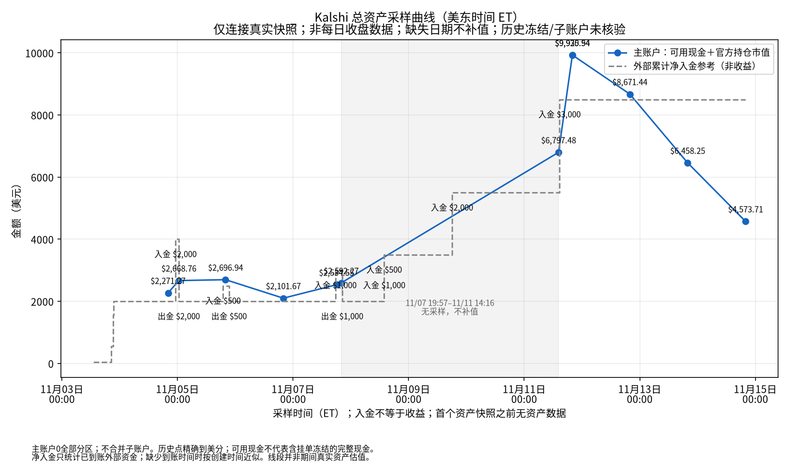

# Kalshi 每日交易报告 — 2026-11-14（美东时间）

_生成时间：2026-11-14 19:56 美东_

## 一、当日成交（230 笔）

| 时间(ET) | 市场 | 方向 | 份数 | 价格 | 金额 | 手续费 |
|---|---|---|---:|---:|---:|---:|
| 00:33:28 | UCLA wins `KXNCAAFGAME-26NOV13ILLUCLA-UCLA` | 买入 YES | 2,333.71 | $0.9900 | $2,310.37 | $1.62 |
| 00:34:29 | Southern Utah wins `KXNCAAFGAME-26NOV13SUUPRST-SUU` | 买入 YES | 0.07 | $0.7800 | $0.05 | $0.00 |
| 00:45:38 | Southern Utah wins `KXNCAAFGAME-26NOV13SUUPRST-SUU` | 买入 YES | 539.09 | $0.6300 | $339.63 | $8.80 |
| 00:52:43 | Southern Utah wins `KXNCAAFGAME-26NOV13SUUPRST-SUU` | 卖出 YES | 391.74 | $0.4000 | $156.70 | $6.58 |
| 00:52:43 | Southern Utah wins `KXNCAAFGAME-26NOV13SUUPRST-SUU` | 卖出 YES | 147.42 | $0.4000 | $58.97 | $2.48 |
| 00:53:09 | Portland St. wins `KXNCAAFGAME-26NOV13SUUPRST-PRST` | 买入 YES | 329.52 | $0.5900 | $194.42 | $5.58 |
| 01:00:37 | Portland St. wins `KXNCAAFGAME-26NOV13SUUPRST-PRST` | 买入 YES | 146.93 | $0.1100 | $16.16 | $1.01 |
| 01:00:37 | Portland St. wins `KXNCAAFGAME-26NOV13SUUPRST-PRST` | 买入 YES | 30.00 | $0.1100 | $3.30 | $0.21 |
| 01:00:37 | Portland St. wins `KXNCAAFGAME-26NOV13SUUPRST-PRST` | 买入 YES | 2,156.00 | $0.1100 | $237.16 | $14.78 |
| 01:00:37 | Portland St. wins `KXNCAAFGAME-26NOV13SUUPRST-PRST` | 买入 YES | 1.00 | $0.1100 | $0.11 | $0.01 |
| 01:00:37 | Portland St. wins `KXNCAAFGAME-26NOV13SUUPRST-PRST` | 买入 YES | 2,571.00 | $0.1100 | $282.81 | $17.62 |
| 01:00:37 | Portland St. wins `KXNCAAFGAME-26NOV13SUUPRST-PRST` | 买入 YES | 766.00 | $0.1100 | $84.26 | $5.25 |
| 01:00:37 | Portland St. wins `KXNCAAFGAME-26NOV13SUUPRST-PRST` | 买入 YES | 2,020.00 | $0.1100 | $222.20 | $13.84 |
| 01:00:37 | Portland St. wins `KXNCAAFGAME-26NOV13SUUPRST-PRST` | 买入 YES | 1.00 | $0.1100 | $0.11 | $0.01 |
| 01:00:37 | Portland St. wins `KXNCAAFGAME-26NOV13SUUPRST-PRST` | 买入 YES | 2,361.00 | $0.1100 | $259.71 | $16.18 |
| 01:00:37 | Portland St. wins `KXNCAAFGAME-26NOV13SUUPRST-PRST` | 买入 YES | 1,378.50 | $0.1100 | $151.63 | $9.45 |
| 01:00:37 | Portland St. wins `KXNCAAFGAME-26NOV13SUUPRST-PRST` | 买入 YES | 280.00 | $0.1100 | $30.80 | $1.92 |
| 01:05:35 | Portland St. wins `KXNCAAFGAME-26NOV13SUUPRST-PRST` | 卖出 YES | 200.00 | $0.0400 | $8.00 | $0.54 |
| 01:05:35 | Portland St. wins `KXNCAAFGAME-26NOV13SUUPRST-PRST` | 卖出 YES | 9,963.99 | $0.0400 | $398.56 | $26.78 |
| 01:05:35 | Portland St. wins `KXNCAAFGAME-26NOV13SUUPRST-PRST` | 卖出 YES | 1.00 | $0.0400 | $0.04 | $0.00 |
| 01:05:35 | Portland St. wins `KXNCAAFGAME-26NOV13SUUPRST-PRST` | 卖出 YES | 1,875.75 | $0.0400 | $75.03 | $5.04 |
| 01:05:35 | Portland St. wins `KXNCAAFGAME-26NOV13SUUPRST-PRST` | 卖出 YES | 0.21 | $0.0400 | $0.01 | $0.00 |
| 01:45:28 | Tie is the result `KXINTLFRIENDLYGAME-26NOV13TAHCOK-TIE` | 买入 NO | 3.29 | $0.6800 | $2.24 | $0.05 |
| 01:45:28 | Tie is the result `KXINTLFRIENDLYGAME-26NOV13TAHCOK-TIE` | 买入 NO | 4.02 | $0.6800 | $2.73 | $0.06 |
| 01:45:28 | Tie is the result `KXINTLFRIENDLYGAME-26NOV13TAHCOK-TIE` | 买入 NO | 10.00 | $0.6800 | $6.80 | $0.15 |
| 01:45:28 | Tie is the result `KXINTLFRIENDLYGAME-26NOV13TAHCOK-TIE` | 买入 NO | 0.37 | $0.6800 | $0.25 | $0.01 |
| 07:35:45 | Tulane wins `KXNCAAMBGAME-26NOV14TULNAKR-TULN` | 买入 NO | 240.00 | $0.8600 | $206.40 | $2.02 |
| 07:35:46 | Rutgers wins `KXNCAAFGAME-26NOV14NEBRUTG-RUTG` | 买入 NO | 378.00 | $0.8600 | $325.08 | $3.19 |
| 07:35:46 | Northwestern wins `KXNCAAFGAME-26NOV14NWOSU-NW` | 买入 NO | 391.00 | $0.8300 | $324.53 | $3.86 |
| 07:35:46 | Duke wins `KXNCAAFGAME-26NOV14DUKEMIA-DUKE` | 买入 NO | 28.75 | $0.8400 | $24.15 | $0.27 |
| 07:35:46 | Duke wins `KXNCAAFGAME-26NOV14DUKEMIA-DUKE` | 买入 NO | 139.00 | $0.8400 | $116.76 | $1.31 |
| 07:35:46 | Duke wins `KXNCAAFGAME-26NOV14DUKEMIA-DUKE` | 买入 NO | 111.00 | $0.8400 | $93.24 | $1.04 |
| 07:35:46 | Duke wins `KXNCAAFGAME-26NOV14DUKEMIA-DUKE` | 买入 NO | 86.00 | $0.8400 | $72.24 | $0.81 |
| 07:35:46 | Duke wins `KXNCAAFGAME-26NOV14DUKEMIA-DUKE` | 买入 NO | 0.03 | $0.8400 | $0.03 | $0.00 |
| 07:35:46 | Duke wins `KXNCAAFGAME-26NOV14DUKEMIA-DUKE` | 买入 NO | 22.22 | $0.8400 | $18.66 | $0.21 |
| 07:35:47 | Wisconsin wins `KXNCAAFGAME-26NOV14WISMD-WIS` | 买入 YES | 425.00 | $0.7600 | $323.00 | $5.43 |
| 07:35:47 | Georgia Tech wins `KXNCAAFGAME-26NOV14GTCLEM-GT` | 买入 NO | 139.81 | $0.8600 | $120.24 | $1.18 |
| 07:35:47 | Georgia Tech wins `KXNCAAFGAME-26NOV14GTCLEM-GT` | 买入 NO | 238.19 | $0.8600 | $204.84 | $2.01 |
| 08:35:15 | Charlotte wins `KXNCAAFGAME-26NOV14ECUCHAR-CHAR` | 买入 NO | 248.75 | $0.7900 | $196.51 | $2.89 |
| 08:35:15 | Charlotte wins `KXNCAAFGAME-26NOV14ECUCHAR-CHAR` | 买入 NO | 49.25 | $0.7900 | $38.91 | $0.57 |
| 08:35:15 | Charlotte wins `KXNCAAFGAME-26NOV14ECUCHAR-CHAR` | 买入 NO | 110.00 | $0.7900 | $86.90 | $1.28 |
| 08:35:15 | South Carolina wins `KXNCAAFGAME-26NOV14SCARARK-SCAR` | 买入 YES | 423.00 | $0.7600 | $321.48 | $5.40 |
| 08:35:15 | Vanderbilt wins `KXNCAAFGAME-26NOV14ALAVAN-VAN` | 买入 NO | 376.00 | $0.8600 | $323.36 | $3.17 |
| 08:35:15 | Tulane wins `KXNCAAMBGAME-26NOV14TULNAKR-TULN` | 买入 NO | 100.00 | $0.8700 | $87.00 | $0.79 |
| 08:35:15 | Tulane wins `KXNCAAMBGAME-26NOV14TULNAKR-TULN` | 买入 NO | 35.00 | $0.8700 | $30.45 | $0.28 |
| 08:35:16 | Carolina wins `KXNHLGAME-26NOV14SEACAR-CAR` | 买入 YES | 408.00 | $0.7900 | $322.32 | $4.74 |
| 09:32:59 | Yale wins `KXNCAAWBGAME-26NOV14RIDYALE-YALE` | 买入 YES | 23.49 | $0.8700 | $20.44 | $0.19 |
| 09:32:59 | Yale wins `KXNCAAWBGAME-26NOV14RIDYALE-YALE` | 买入 YES | 38.00 | $0.8700 | $33.06 | $0.30 |
| 09:32:59 | Minnesota wins `KXNCAAWBGAME-26NOV14KSUMINN-MINN` | 买入 YES | 379.00 | $0.8500 | $322.15 | $3.38 |
| 09:33:00 | Bradley wins `KXNCAAMBGAME-26NOV14BRADGMU-BRAD` | 买入 NO | 34.00 | $0.8900 | $30.26 | $0.23 |
| 09:33:00 | Bradley wins `KXNCAAMBGAME-26NOV14BRADGMU-BRAD` | 买入 NO | 28.00 | $0.8900 | $24.92 | $0.19 |
| 09:33:00 | Bradley wins `KXNCAAMBGAME-26NOV14BRADGMU-BRAD` | 买入 NO | 242.00 | $0.8900 | $215.38 | $1.66 |
| 09:33:00 | Bradley wins `KXNCAAMBGAME-26NOV14BRADGMU-BRAD` | 买入 NO | 58.00 | $0.8900 | $51.62 | $0.40 |
| 09:33:00 | Rice wins `KXNCAAMBGAME-26NOV14RICESFA-RICE` | 买入 NO | 379.00 | $0.8500 | $322.15 | $3.38 |
| 09:33:01 | Kansas St. wins `KXNCAAFGAME-26NOV14KSUTCU-KSU` | 买入 NO | 90.98 | $0.8200 | $74.60 | $0.94 |
| 09:33:01 | Kansas St. wins `KXNCAAFGAME-26NOV14KSUTCU-KSU` | 买入 NO | 301.02 | $0.8200 | $246.84 | $3.11 |
| 10:37:31 | Detroit Mercy wins `KXNCAAWBGAME-26NOV14UNDDET-DET` | 买入 YES | 100.00 | $0.8500 | $85.00 | $0.89 |
| 10:37:31 | Detroit Mercy wins `KXNCAAWBGAME-26NOV14UNDDET-DET` | 买入 YES | 6.00 | $0.8500 | $5.10 | $0.05 |
| 10:37:32 | Fresno St. wins `KXNCAAWBGAME-26NOV14NAUFRES-FRES` | 买入 YES | 10.00 | $0.8300 | $8.30 | $0.10 |
| 10:37:32 | Fresno St. wins `KXNCAAWBGAME-26NOV14NAUFRES-FRES` | 买入 YES | 100.00 | $0.8300 | $83.00 | $0.99 |
| 10:37:32 | Fresno St. wins `KXNCAAWBGAME-26NOV14NAUFRES-FRES` | 买入 YES | 124.00 | $0.8300 | $102.92 | $1.22 |
| 10:37:33 | Georgia wins `KXNCAAFGAME-26NOV14MIZZUGA-UGA` | 买入 YES | 277.00 | $0.8700 | $240.99 | $2.19 |
| 10:37:33 | USC wins `KXNCAAFGAME-26NOV14USCIND-USC` | 买入 NO | 311.00 | $0.7700 | $239.47 | $3.86 |
| 10:37:33 | Yale wins `KXNCAAWBGAME-26NOV14RIDYALE-YALE` | 买入 YES | 277.00 | $0.8700 | $240.99 | $2.19 |
| 10:37:34 | Middle Tennessee wins `KXNCAAFGAME-26NOV14MTULIB-MTU` | 买入 NO | 260.00 | $0.9300 | $241.80 | $1.18 |
| 10:37:34 | California wins `KXNCAAFGAME-26NOV14CALUVA-CAL` | 买入 NO | 296.00 | $0.8100 | $239.76 | $3.19 |
| 10:37:34 | Oregon wins `KXNCAAFGAME-26NOV14MICHORE-ORE` | 买入 YES | 303.00 | $0.7900 | $239.37 | $3.52 |
| 13:34:19 | Colorado wins `KXNCAAMBGAME-26NOV14COLOPROV-COLO` | 买入 NO | 31.00 | $0.8600 | $26.66 | $0.26 |
| 13:34:19 | Fresno St. wins `KXNCAAWBGAME-26NOV14NAUFRES-FRES` | 买入 YES | 31.00 | $0.8600 | $26.66 | $0.26 |
| 13:34:19 | Delaware St. wins `KXNCAAMBGAME-26NOV14DSUECU-DSU` | 买入 NO | 28.00 | $0.9300 | $26.04 | $0.13 |
| 13:34:19 | Utah Tech wins `KXNCAAMBGAME-26NOV14UTUCAL-UTU` | 买入 NO | 29.00 | $0.9100 | $26.39 | $0.17 |
| 13:34:19 | Southern Utah wins `KXNCAAMBGAME-26NOV14SUUWAKE-SUU` | 买入 NO | 28.00 | $0.9500 | $26.60 | $0.09 |
| 13:34:20 | Oregon wins `KXNCAAFGAME-26NOV14MICHORE-ORE` | 买入 YES | 33.00 | $0.7900 | $26.07 | $0.38 |
| 13:34:20 | Georgia wins `KXNCAAFGAME-26NOV14MIZZUGA-UGA` | 买入 YES | 30.00 | $0.8700 | $26.10 | $0.24 |
| 13:34:20 | USC wins `KXNCAAFGAME-26NOV14USCIND-USC` | 买入 NO | 34.00 | $0.7700 | $26.18 | $0.42 |
| 13:34:20 | Bellarmine wins `KXNCAAWBGAME-26NOV14BRADBELL-BELL` | 买入 NO | 19.74 | $0.9700 | $19.15 | $0.04 |
| 13:34:20 | Bellarmine wins `KXNCAAWBGAME-26NOV14BRADBELL-BELL` | 买入 NO | 7.26 | $0.9700 | $7.04 | $0.01 |
| 13:34:20 | Nevada wins `KXNCAAWBGAME-26NOV14NEVUVU-NEV` | 买入 NO | 34.00 | $0.7600 | $25.84 | $0.43 |
| 13:34:20 | UNC Asheville wins `KXNCAAMBGAME-26NOV14UNCAGT-UNCA` | 买入 NO | 28.00 | $0.9300 | $26.04 | $0.13 |
| 13:34:20 | Furman wins `KXNCAAWBGAME-26NOV14FURCAMP-FUR` | 买入 YES | 34.00 | $0.7800 | $26.52 | $0.41 |
| 13:34:20 | Toledo wins `KXNCAAMBGAME-26NOV14TOLDET-TOL` | 买入 YES | 31.00 | $0.8400 | $26.04 | $0.29 |
| 13:34:20 | Sam Houston wins `KXNCAAWBGAME-26NOV14SHSUUNCO-SHSU` | 买入 NO | 33.00 | $0.8000 | $26.40 | $0.37 |
| 13:34:20 | North Texas wins `KXNCAAMBGAME-26NOV14USAUNT-UNT` | 买入 YES | 33.00 | $0.8000 | $26.40 | $0.37 |
| 13:34:21 | Southern Miss wins `KXNCAAFGAME-26NOV14USMLT-USM` | 买入 NO | 20.00 | $0.8900 | $17.80 | $0.14 |
| 13:34:21 | Southern Miss wins `KXNCAAFGAME-26NOV14USMLT-USM` | 买入 NO | 10.00 | $0.8900 | $8.90 | $0.07 |
| 13:34:21 | Middle Tennessee wins `KXNCAAFGAME-26NOV14MTULIB-MTU` | 买入 NO | 28.00 | $0.9300 | $26.04 | $0.13 |
| 13:34:21 | California wins `KXNCAAFGAME-26NOV14CALUVA-CAL` | 买入 NO | 32.00 | $0.8100 | $25.92 | $0.34 |
| 13:34:21 | Texas St. wins `KXNCAAFGAME-26NOV14FRESTXST-TXST` | 买入 YES | 34.00 | $0.7800 | $26.52 | $0.41 |
| 13:34:21 | Boise St. wins `KXNCAAFGAME-26NOV14ORSTBSU-BSU` | 买入 YES | 31.00 | $0.8600 | $26.66 | $0.26 |
| 13:37:13 | Tulane wins `KXNCAAMBGAME-26NOV14TULNAKR-TULN` | 买入 NO | 6.00 | $0.5500 | $3.30 | $0.10 |
| 14:11:26 | Georgia Tech wins `KXNCAAFGAME-26NOV14GTCLEM-GT` | 卖出 NO | 378.00 | $0.3800 | $143.64 | $6.23 |
| 14:11:54 | Clemson wins `KXNCAAFGAME-26NOV14GTCLEM-CLEM` | 买入 NO | 215.00 | $0.6200 | $133.30 | $3.55 |
| 14:22:31 | Gen.G wins `KXLOLGAME-26NOV141400GENBLG-GEN` | 买入 YES | 609.59 | $0.6200 | $377.95 | $10.05 |
| 15:14:16 | Rice wins `KXNCAAMBGAME-26NOV14RICESFA-RICE` | 卖出 NO | 4.00 | $0.3400 | $1.36 | $0.06 |
| 15:14:16 | Rice wins `KXNCAAMBGAME-26NOV14RICESFA-RICE` | 卖出 NO | 3.00 | $0.3400 | $1.02 | $0.05 |
| 15:14:16 | Rice wins `KXNCAAMBGAME-26NOV14RICESFA-RICE` | 卖出 NO | 49.56 | $0.3400 | $16.85 | $0.78 |
| 15:14:16 | Rice wins `KXNCAAMBGAME-26NOV14RICESFA-RICE` | 卖出 NO | 0.01 | $0.3300 | $0.00 | $0.00 |
| 15:14:16 | Rice wins `KXNCAAMBGAME-26NOV14RICESFA-RICE` | 卖出 NO | 98.53 | $0.3400 | $33.50 | $1.55 |
| 15:14:16 | Rice wins `KXNCAAMBGAME-26NOV14RICESFA-RICE` | 卖出 NO | 82.00 | $0.3400 | $27.88 | $1.29 |
| 15:14:16 | Rice wins `KXNCAAMBGAME-26NOV14RICESFA-RICE` | 卖出 NO | 75.90 | $0.3300 | $25.05 | $1.17 |
| 15:14:16 | Rice wins `KXNCAAMBGAME-26NOV14RICESFA-RICE` | 卖出 NO | 59.00 | $0.3300 | $19.47 | $0.91 |
| 15:14:16 | Rice wins `KXNCAAMBGAME-26NOV14RICESFA-RICE` | 卖出 NO | 7.00 | $0.3400 | $2.38 | $0.11 |
| 15:14:28 | Stephen F. Austin wins `KXNCAAMBGAME-26NOV14RICESFA-SFA` | 买入 NO | 182.00 | $0.6500 | $118.30 | $2.90 |
| 15:32:19 | Gen.G wins `KXLOLGAME-26NOV141400GENBLG-GEN` | 买入 YES | 635.22 | $0.7700 | $489.12 | $7.87 |
| 15:42:40 | Minnesota wins `KXNCAAWBGAME-26NOV14KSUMINN-MINN` | 买入 YES | 3.00 | $0.5700 | $1.71 | $0.05 |
| 15:42:42 | Minnesota wins `KXNCAAWBGAME-26NOV14KSUMINN-MINN` | 买入 YES | 50.00 | $0.5700 | $28.50 | $0.86 |
| 15:42:42 | Minnesota wins `KXNCAAWBGAME-26NOV14KSUMINN-MINN` | 买入 YES | 37.00 | $0.5700 | $21.09 | $0.63 |
| 15:42:43 | Charlotte wins `KXNCAAFGAME-26NOV14ECUCHAR-CHAR` | 买入 NO | 25.00 | $0.5600 | $14.00 | $0.43 |
| 15:42:43 | Charlotte wins `KXNCAAFGAME-26NOV14ECUCHAR-CHAR` | 买入 NO | 0.01 | $0.5600 | $0.01 | $0.00 |
| 15:42:43 | Charlotte wins `KXNCAAFGAME-26NOV14ECUCHAR-CHAR` | 买入 NO | 3.00 | $0.5600 | $1.68 | $0.05 |
| 15:42:44 | Charlotte wins `KXNCAAFGAME-26NOV14ECUCHAR-CHAR` | 买入 NO | 140.00 | $0.5300 | $74.20 | $2.44 |
| 15:42:44 | Charlotte wins `KXNCAAFGAME-26NOV14ECUCHAR-CHAR` | 买入 NO | 164.00 | $0.5300 | $86.92 | $2.86 |
| 15:47:40 | Southern Utah wins `KXNCAAMBGAME-26NOV14SUUWAKE-SUU` | 买入 NO | 26.00 | $0.9500 | $24.70 | $0.09 |
| 15:47:40 | Denver wins `KXNBAGAME-26NOV14DENNOP-DEN` | 买入 YES | 29.00 | $0.8500 | $24.65 | $0.26 |
| 15:47:40 | Minnesota wins `KXNBAGAME-26NOV14CHIMIN-MIN` | 买入 YES | 27.00 | $0.8900 | $24.03 | $0.19 |
| 15:47:41 | Nevada wins `KXNCAAWBGAME-26NOV14NEVUVU-NEV` | 买入 NO | 31.00 | $0.7700 | $23.87 | $0.38 |
| 15:47:41 | Toledo wins `KXNCAAMBGAME-26NOV14TOLDET-TOL` | 买入 YES | 29.00 | $0.8300 | $24.07 | $0.29 |
| 15:47:41 | North Texas wins `KXNCAAMBGAME-26NOV14USAUNT-UNT` | 买入 YES | 30.00 | $0.8000 | $24.00 | $0.34 |
| 15:47:41 | USC Upstate wins `KXNCAAMBGAME-26NOV14SCUSCAMP-SCUS` | 买入 NO | 30.00 | $0.8100 | $24.30 | $0.32 |
| 15:47:41 | Colorado wins `KXNCAAMBGAME-26NOV14COLOPROV-COLO` | 买入 NO | 13.25 | $0.8600 | $11.39 | $0.11 |
| 15:47:41 | Colorado wins `KXNCAAMBGAME-26NOV14COLOPROV-COLO` | 买入 NO | 14.75 | $0.8600 | $12.69 | $0.12 |
| 15:47:41 | UNC Asheville wins `KXNCAAMBGAME-26NOV14UNCAGT-UNCA` | 买入 NO | 10.00 | $0.9400 | $9.40 | $0.04 |
| 15:47:41 | UNC Asheville wins `KXNCAAMBGAME-26NOV14UNCAGT-UNCA` | 买入 NO | 2.00 | $0.9400 | $1.88 | $0.01 |
| 15:47:41 | UNC Asheville wins `KXNCAAMBGAME-26NOV14UNCAGT-UNCA` | 买入 NO | 10.00 | $0.9400 | $9.40 | $0.04 |
| 15:47:41 | UNC Asheville wins `KXNCAAMBGAME-26NOV14UNCAGT-UNCA` | 买入 NO | 1.00 | $0.9400 | $0.94 | $0.00 |
| 15:47:41 | UNC Asheville wins `KXNCAAMBGAME-26NOV14UNCAGT-UNCA` | 买入 NO | 1.00 | $0.9400 | $0.94 | $0.00 |
| 15:47:41 | UNC Asheville wins `KXNCAAMBGAME-26NOV14UNCAGT-UNCA` | 买入 NO | 1.00 | $0.9400 | $0.94 | $0.00 |
| 15:47:41 | UNC Asheville wins `KXNCAAMBGAME-26NOV14UNCAGT-UNCA` | 买入 NO | 1.00 | $0.9400 | $0.94 | $0.00 |
| 15:47:41 | Delaware St. wins `KXNCAAMBGAME-26NOV14DSUECU-DSU` | 买入 NO | 26.00 | $0.9300 | $24.18 | $0.12 |
| 15:47:41 | Utah Tech wins `KXNCAAMBGAME-26NOV14UTUCAL-UTU` | 买入 NO | 27.00 | $0.9100 | $24.57 | $0.15 |
| 15:47:42 | Air Force wins `KXNCAAFGAME-26NOV14SJSUAFA-AFA` | 买入 YES | 29.00 | $0.8400 | $24.36 | $0.27 |
| 15:47:42 | New Mexico wins `KXNCAAFGAME-26NOV14UNLVUNM-UNM` | 买入 YES | 27.00 | $0.8900 | $24.03 | $0.19 |
| 15:47:42 | Boise St. wins `KXNCAAFGAME-26NOV14ORSTBSU-BSU` | 买入 YES | 28.00 | $0.8600 | $24.08 | $0.24 |
| 15:47:42 | Iowa wins `KXNCAAFGAME-26NOV14PURIOWA-IOWA` | 买入 YES | 27.00 | $0.9000 | $24.30 | $0.17 |
| 15:47:42 | Virginia Tech wins `KXNCAAFGAME-26NOV14STANVT-VT` | 买入 YES | 28.00 | $0.8800 | $24.64 | $0.21 |
| 15:47:42 | Texas St. wins `KXNCAAFGAME-26NOV14FRESTXST-TXST` | 买入 YES | 31.00 | $0.7900 | $24.49 | $0.36 |
| 15:47:42 | Minnesota wins `KXNCAAFGAME-26NOV14MINNPSU-MINN` | 买入 NO | 30.00 | $0.8100 | $24.30 | $0.32 |
| 15:47:42 | UMBC wins `KXNCAAMBGAME-26NOV14UMBCTOWS-UMBC` | 买入 NO | 29.00 | $0.8400 | $24.36 | $0.27 |
| 15:47:42 | Bellarmine wins `KXNCAAWBGAME-26NOV14BRADBELL-BELL` | 买入 NO | 25.00 | $0.9700 | $24.25 | $0.05 |
| 15:47:42 | Siena wins `KXNCAAMBGAME-26NOV14BRWNSIE-SIE` | 买入 YES | 29.00 | $0.8300 | $24.07 | $0.29 |
| 15:47:43 | Southern Miss wins `KXNCAAFGAME-26NOV14USMLT-USM` | 买入 NO | 27.00 | $0.8900 | $24.03 | $0.19 |
| 16:17:09 | Stephen F. Austin wins `KXNCAAMBGAME-26NOV14RICESFA-SFA` | 卖出 NO | 34.00 | $0.2300 | $7.82 | $0.42 |
| 16:17:09 | Stephen F. Austin wins `KXNCAAMBGAME-26NOV14RICESFA-SFA` | 卖出 NO | 5.00 | $0.2000 | $1.00 | $0.06 |
| 16:17:09 | Stephen F. Austin wins `KXNCAAMBGAME-26NOV14RICESFA-SFA` | 卖出 NO | 94.00 | $0.2100 | $19.74 | $1.09 |
| 16:17:09 | Stephen F. Austin wins `KXNCAAMBGAME-26NOV14RICESFA-SFA` | 卖出 NO | 1.44 | $0.2200 | $0.32 | $0.02 |
| 16:17:09 | Stephen F. Austin wins `KXNCAAMBGAME-26NOV14RICESFA-SFA` | 卖出 NO | 26.00 | $0.2400 | $6.24 | $0.33 |
| 16:17:09 | Stephen F. Austin wins `KXNCAAMBGAME-26NOV14RICESFA-SFA` | 卖出 NO | 0.23 | $0.2400 | $0.06 | $0.00 |
| 16:17:09 | Stephen F. Austin wins `KXNCAAMBGAME-26NOV14RICESFA-SFA` | 卖出 NO | 0.43 | $0.2200 | $0.09 | $0.01 |
| 16:17:09 | Stephen F. Austin wins `KXNCAAMBGAME-26NOV14RICESFA-SFA` | 卖出 NO | 0.24 | $0.2300 | $0.06 | $0.00 |
| 16:17:09 | Stephen F. Austin wins `KXNCAAMBGAME-26NOV14RICESFA-SFA` | 卖出 NO | 0.19 | $0.2100 | $0.04 | $0.00 |
| 16:17:09 | Stephen F. Austin wins `KXNCAAMBGAME-26NOV14RICESFA-SFA` | 卖出 NO | 3.00 | $0.2300 | $0.69 | $0.04 |
| 16:17:09 | Stephen F. Austin wins `KXNCAAMBGAME-26NOV14RICESFA-SFA` | 卖出 NO | 2.00 | $0.2200 | $0.44 | $0.02 |
| 16:17:09 | Stephen F. Austin wins `KXNCAAMBGAME-26NOV14RICESFA-SFA` | 卖出 NO | 5.00 | $0.2100 | $1.05 | $0.06 |
| 16:17:09 | Stephen F. Austin wins `KXNCAAMBGAME-26NOV14RICESFA-SFA` | 卖出 NO | 9.64 | $0.2000 | $1.93 | $0.11 |
| 16:17:09 | Stephen F. Austin wins `KXNCAAMBGAME-26NOV14RICESFA-SFA` | 卖出 NO | 0.41 | $0.2300 | $0.09 | $0.01 |
| 16:17:09 | Stephen F. Austin wins `KXNCAAMBGAME-26NOV14RICESFA-SFA` | 卖出 NO | 0.42 | $0.2000 | $0.08 | $0.00 |
| 16:17:17 | Rice wins `KXNCAAMBGAME-26NOV14RICESFA-RICE` | 买入 NO | 1.90 | $0.7900 | $1.50 | $0.02 |
| 16:17:17 | Rice wins `KXNCAAMBGAME-26NOV14RICESFA-RICE` | 买入 NO | 42.00 | $0.7800 | $32.76 | $0.50 |
| 16:17:17 | Rice wins `KXNCAAMBGAME-26NOV14RICESFA-RICE` | 买入 NO | 2.70 | $0.7800 | $2.11 | $0.03 |
| 16:17:17 | Rice wins `KXNCAAMBGAME-26NOV14RICESFA-RICE` | 卖出 YES | 0.40 | $0.2200 | $0.09 | $0.00 |
| 16:41:43 | UNC Asheville wins `KXNCAAMBGAME-26NOV14UNCAGT-UNCA` | 买入 NO | 20.72 | $0.7200 | $14.92 | $0.29 |
| 16:41:43 | UNC Asheville wins `KXNCAAMBGAME-26NOV14UNCAGT-UNCA` | 买入 NO | 659.28 | $0.7200 | $474.68 | $9.30 |
| 16:45:37 | Gen.G wins `KXLOLGAME-26NOV141400GENBLG-GEN` | 买入 YES | 0.29 | $0.7500 | $0.22 | $0.00 |
| 16:45:37 | Gen.G wins `KXLOLGAME-26NOV141400GENBLG-GEN` | 买入 YES | 396.82 | $0.7500 | $297.62 | $5.21 |
| 16:45:37 | Gen.G wins `KXLOLGAME-26NOV141400GENBLG-GEN` | 买入 YES | 35.42 | $0.7500 | $26.57 | $0.46 |
| 16:45:37 | Gen.G wins `KXLOLGAME-26NOV141400GENBLG-GEN` | 买入 YES | 825.00 | $0.7500 | $618.75 | $10.83 |
| 16:45:37 | Gen.G wins `KXLOLGAME-26NOV141400GENBLG-GEN` | 买入 YES | 0.45 | $0.7500 | $0.34 | $0.01 |
| 17:35:35 | Gen.G wins `KXLOLGAME-26NOV141400GENBLG-GEN` | 买入 YES | 88.66 | $0.6700 | $59.40 | $1.37 |
| 17:35:35 | Gen.G wins `KXLOLGAME-26NOV141400GENBLG-GEN` | 买入 YES | 22.00 | $0.6600 | $14.52 | $0.35 |
| 17:35:35 | Gen.G wins `KXLOLGAME-26NOV141400GENBLG-GEN` | 买入 YES | 200.00 | $0.6600 | $132.00 | $3.14 |
| 17:35:35 | Gen.G wins `KXLOLGAME-26NOV141400GENBLG-GEN` | 买入 YES | 13.52 | $0.6600 | $8.92 | $0.21 |
| 17:35:35 | Gen.G wins `KXLOLGAME-26NOV141400GENBLG-GEN` | 买入 YES | 55.82 | $0.6600 | $36.84 | $0.88 |
| 17:35:35 | Gen.G wins `KXLOLGAME-26NOV141400GENBLG-GEN` | 买入 YES | 142.49 | $0.6600 | $94.04 | $2.24 |
| 17:35:35 | Gen.G wins `KXLOLGAME-26NOV141400GENBLG-GEN` | 买入 YES | 825.00 | $0.6600 | $544.50 | $12.96 |
| 17:35:35 | Gen.G wins `KXLOLGAME-26NOV141400GENBLG-GEN` | 买入 YES | 750.00 | $0.6700 | $502.50 | $11.61 |
| 17:35:35 | Gen.G wins `KXLOLGAME-26NOV141400GENBLG-GEN` | 买入 YES | 6.57 | $0.6700 | $4.40 | $0.10 |
| 17:56:38 | Gen.G wins `KXLOLGAME-26NOV141400GENBLG-GEN` | 卖出 YES | 4,606.85 | $0.3000 | $1,382.06 | $67.72 |
| 17:56:48 | Bilibili Gaming wins `KXLOLGAME-26NOV141400GENBLG-BLG` | 买入 YES | 100.00 | $0.7000 | $70.00 | $1.47 |
| 17:56:48 | Bilibili Gaming wins `KXLOLGAME-26NOV141400GENBLG-BLG` | 买入 YES | 24.00 | $0.7000 | $16.80 | $0.35 |
| 17:56:48 | Bilibili Gaming wins `KXLOLGAME-26NOV141400GENBLG-BLG` | 买入 YES | 472.43 | $0.7000 | $330.70 | $6.94 |
| 17:56:48 | Bilibili Gaming wins `KXLOLGAME-26NOV141400GENBLG-BLG` | 买入 YES | 232.00 | $0.7000 | $162.40 | $3.41 |
| 17:56:48 | Bilibili Gaming wins `KXLOLGAME-26NOV141400GENBLG-BLG` | 买入 YES | 607.00 | $0.7000 | $424.90 | $8.92 |
| 17:56:48 | Bilibili Gaming wins `KXLOLGAME-26NOV141400GENBLG-BLG` | 买入 YES | 96.00 | $0.7000 | $67.20 | $1.41 |
| 17:56:48 | Bilibili Gaming wins `KXLOLGAME-26NOV141400GENBLG-BLG` | 买入 YES | 188.00 | $0.7000 | $131.60 | $2.76 |
| 17:56:48 | Bilibili Gaming wins `KXLOLGAME-26NOV141400GENBLG-BLG` | 买入 YES | 250.00 | $0.7000 | $175.00 | $3.67 |
| 17:56:48 | Bilibili Gaming wins `KXLOLGAME-26NOV141400GENBLG-BLG` | 买入 YES | 44.00 | $0.7000 | $30.80 | $0.65 |
| 18:23:45 | Bilibili Gaming wins `KXLOLGAME-26NOV141400GENBLG-BLG` | 卖出 YES | 523.00 | $0.6200 | $324.26 | $8.63 |
| 18:23:45 | Bilibili Gaming wins `KXLOLGAME-26NOV141400GENBLG-BLG` | 卖出 YES | 50.00 | $0.6200 | $31.00 | $0.82 |
| 18:23:45 | Bilibili Gaming wins `KXLOLGAME-26NOV141400GENBLG-BLG` | 卖出 YES | 0.37 | $0.6200 | $0.23 | $0.01 |
| 18:23:45 | Bilibili Gaming wins `KXLOLGAME-26NOV141400GENBLG-BLG` | 卖出 YES | 394.67 | $0.6200 | $244.70 | $6.51 |
| 18:23:45 | Bilibili Gaming wins `KXLOLGAME-26NOV141400GENBLG-BLG` | 卖出 YES | 650.00 | $0.6200 | $403.00 | $10.72 |
| 18:23:45 | Bilibili Gaming wins `KXLOLGAME-26NOV141400GENBLG-BLG` | 卖出 YES | 0.46 | $0.6300 | $0.29 | $0.01 |
| 18:23:45 | Bilibili Gaming wins `KXLOLGAME-26NOV141400GENBLG-BLG` | 卖出 YES | 30.00 | $0.6300 | $18.90 | $0.49 |
| 18:23:45 | Bilibili Gaming wins `KXLOLGAME-26NOV141400GENBLG-BLG` | 卖出 YES | 5.00 | $0.6300 | $3.15 | $0.08 |
| 18:23:45 | Bilibili Gaming wins `KXLOLGAME-26NOV141400GENBLG-BLG` | 卖出 YES | 329.93 | $0.6200 | $204.56 | $5.44 |
| 18:23:45 | Bilibili Gaming wins `KXLOLGAME-26NOV141400GENBLG-BLG` | 卖出 YES | 30.00 | $0.6300 | $18.90 | $0.49 |
| 18:24:06 | Gen.G wins `KXLOLGAME-26NOV141400GENBLG-GEN` | 买入 YES | 0.03 | $0.3800 | $0.01 | $0.00 |
| 18:24:06 | Gen.G wins `KXLOLGAME-26NOV141400GENBLG-GEN` | 买入 YES | 250.00 | $0.3800 | $95.00 | $4.12 |
| 18:24:06 | Gen.G wins `KXLOLGAME-26NOV141400GENBLG-GEN` | 买入 YES | 30.00 | $0.3800 | $11.40 | $0.49 |
| 18:24:06 | Gen.G wins `KXLOLGAME-26NOV141400GENBLG-GEN` | 买入 YES | 201.57 | $0.3900 | $78.61 | $3.36 |
| 18:24:06 | Gen.G wins `KXLOLGAME-26NOV141400GENBLG-GEN` | 买入 YES | 0.33 | $0.3800 | $0.13 | $0.01 |
| 18:24:06 | Gen.G wins `KXLOLGAME-26NOV141400GENBLG-GEN` | 买入 YES | 750.00 | $0.3800 | $285.00 | $12.37 |
| 18:34:04 | UMBC wins `KXNCAAMBGAME-26NOV14UMBCTOWS-UMBC` | 买入 NO | 141.00 | $0.8400 | $118.44 | $1.33 |
| 18:34:04 | Utah Valley wins `KXNCAAMBGAME-26NOV14UVUNEV-UVU` | 买入 NO | 141.00 | $0.8400 | $118.44 | $1.33 |
| 18:34:04 | Austin Peay wins `KXNCAAMBGAME-26NOV14PEAYWICH-PEAY` | 买入 NO | 29.31 | $0.8800 | $25.79 | $0.22 |
| 18:34:04 | Austin Peay wins `KXNCAAMBGAME-26NOV14PEAYWICH-PEAY` | 买入 NO | 105.69 | $0.8800 | $93.01 | $0.78 |
| 18:34:04 | Brown wins `KXNCAAMBGAME-26NOV14BRWNSIE-BRWN` | 买入 NO | 143.00 | $0.8300 | $118.69 | $1.41 |
| 18:34:04 | Binghamton wins `KXNCAAMBGAME-26NOV14BINGDUQ-BING` | 买入 NO | 107.00 | $0.9400 | $100.58 | $0.42 |
| 18:34:04 | Binghamton wins `KXNCAAMBGAME-26NOV14BINGDUQ-BING` | 买入 NO | 3.00 | $0.9400 | $2.82 | $0.01 |
| 18:34:04 | Binghamton wins `KXNCAAMBGAME-26NOV14BINGDUQ-BING` | 买入 NO | 17.00 | $0.9400 | $15.98 | $0.07 |
| 18:34:04 | Denver wins `KXNBAGAME-26NOV14DENNOP-DEN` | 买入 YES | 141.00 | $0.8400 | $118.44 | $1.33 |
| 18:34:04 | Minnesota wins `KXNBAGAME-26NOV14CHIMIN-MIN` | 买入 YES | 134.00 | $0.8900 | $119.26 | $0.92 |
| 18:34:05 | Air Force wins `KXNCAAFGAME-26NOV14SJSUAFA-AFA` | 买入 YES | 141.00 | $0.8400 | $118.44 | $1.33 |
| 18:34:05 | New Mexico wins `KXNCAAFGAME-26NOV14UNLVUNM-UNM` | 买入 YES | 134.00 | $0.8900 | $119.26 | $0.92 |
| 18:34:05 | Iowa wins `KXNCAAFGAME-26NOV14PURIOWA-IOWA` | 买入 YES | 133.00 | $0.9000 | $119.70 | $0.84 |
| 18:34:05 | Virginia Tech wins `KXNCAAFGAME-26NOV14STANVT-VT` | 买入 YES | 135.00 | $0.8800 | $118.80 | $1.00 |
| 18:34:05 | Minnesota wins `KXNCAAFGAME-26NOV14MINNPSU-MINN` | 买入 NO | 146.00 | $0.8100 | $118.26 | $1.57 |
| 18:34:05 | San Francisco wins `KXNCAAMBGAME-26NOV14PRSTSF-SF` | 买入 YES | 148.00 | $0.8000 | $118.40 | $1.66 |
| 18:37:55 | Gen.G wins `KXLOLGAME-26NOV141400GENBLG-GEN` | 卖出 YES | 4.00 | $0.2900 | $1.16 | $0.06 |
| 18:37:55 | Gen.G wins `KXLOLGAME-26NOV141400GENBLG-GEN` | 卖出 YES | 1,227.93 | $0.2800 | $343.82 | $17.33 |
| 18:38:28 | Bilibili Gaming wins `KXLOLGAME-26NOV141400GENBLG-BLG` | 买入 YES | 250.00 | $0.7300 | $182.50 | $3.45 |
| 18:38:28 | Bilibili Gaming wins `KXLOLGAME-26NOV141400GENBLG-BLG` | 卖出 NO | 195.93 | $0.2700 | $52.90 | $2.70 |
| 19:10:50 | Texas St. wins `KXNCAAFGAME-26NOV14FRESTXST-TXST` | 卖出 YES | 65.00 | $0.3100 | $20.15 | $0.97 |
| 19:10:57 | Fresno St. wins `KXNCAAFGAME-26NOV14FRESTXST-FRES` | 买入 YES | 27.00 | $0.6900 | $18.63 | $0.40 |
| 19:40:29 | North Texas wins `KXNCAAMBGAME-26NOV14USAUNT-UNT` | 买入 YES | 641.00 | $0.5200 | $333.32 | $11.20 |
| 19:51:11 | Little Rock wins `KXNCAAMBGAME-26NOV14NWSTUALR-UALR` | 买入 YES | 85.65 | $0.8100 | $69.38 | $0.92 |
| 19:51:11 | Little Rock wins `KXNCAAMBGAME-26NOV14NWSTUALR-UALR` | 买入 YES | 124.00 | $0.8100 | $100.44 | $1.34 |
| 19:51:11 | Little Rock wins `KXNCAAMBGAME-26NOV14NWSTUALR-UALR` | 买入 YES | 59.35 | $0.8100 | $48.07 | $0.64 |
| 19:51:11 | Utah Valley wins `KXNCAAMBGAME-26NOV14UVUNEV-UVU` | 买入 NO | 118.00 | $0.8400 | $99.12 | $1.11 |
| 19:51:11 | Minnesota wins `KXNBAGAME-26NOV14CHIMIN-MIN` | 买入 YES | 85.00 | $0.8900 | $75.65 | $0.58 |

合计：买入 $20,076.36，卖出 $4,057.26，手续费 $534.28

_“买入/卖出”根据成交前的持仓方向判断（Kalshi 中卖 YES 与买 NO 是同一方向的订单）。_

## 二、当日已实现盈亏

### 1. 结算（46 个市场）

| 结算时间(ET) | 市场 | 结果 | 持有 | 结算赔付 | 成本 | 手续费 | 盈亏 |
|---|---|---|---|---:|---:|---:|---:|
| 00:07 | Utah St. wins `KXNCAAMBGAME-26NOV13UCSDUSU-USU` | YES | YES 741.00 | $741.00 | $660.20 | $5.04 | **+$75.76** |
| 00:07 | Golden State wins `KXNBAGAME-26NOV13GSWSAS-GSW` | NO | NO 75.00 | $75.00 | $63.75 | $0.67 | **+$10.58** |
| 00:29 | Portland wins `KXNBAGAME-26NOV13PORSAC-POR` | YES | YES 1,495.13 | $1,495.13 | $1,250.98 | $14.14 | **+$230.01** |
| 00:39 | Arkansas-Pine Bluff wins `KXNCAAMBGAME-26NOV13ARPBCBU-ARPB` | NO | NO 359.00 | $359.00 | $330.28 | $1.85 | **+$26.87** |
| 00:46 | UCLA wins `KXNCAAFGAME-26NOV13ILLUCLA-UCLA` | YES | YES 2,333.71 | $2,333.71 | $2,310.37 | $1.62 | **+$21.72** |
| 00:46 | Illinois wins `KXNCAAFGAME-26NOV13ILLUCLA-ILL` | NO | NO 4,823.55 | $4,823.55 | $4,439.16 | $24.28 | **+$360.10** |
| 01:22 | Southern Utah wins `KXNCAAFGAME-26NOV13SUUPRST-SUU` | YES | YES 539.16 / NO 539.16 | $539.16（含 YES/NO 配对兑付 $539.16） | $663.18 | $17.86 | **-$141.87** |
| 01:22 | Portland St. wins `KXNCAAFGAME-26NOV13SUUPRST-PRST` | NO | YES 12,040.95 / NO 12,040.95 | $12,040.95（含 YES/NO 配对兑付 $12,040.95） | $13,041.99 | $118.20 | **-$1,119.24** |
| 03:30 | Tie is the result `KXINTLFRIENDLYGAME-26NOV13TAHCOK-TIE` | NO | NO 337.63 | $337.63 | $303.44 | $2.09 | **+$32.10** |
| 12:47 | Yale wins `KXNCAAWBGAME-26NOV14RIDYALE-YALE` | YES | YES 338.49 | $338.49 | $294.49 | $2.68 | **+$41.32** |
| 14:05 | Tulane wins `KXNCAAMBGAME-26NOV14TULNAKR-TULN` | NO | NO 381.00 | $381.00 | $327.15 | $3.20 | **+$50.65** |
| 15:11 | Detroit Mercy wins `KXNCAAWBGAME-26NOV14UNDDET-DET` | YES | YES 106.00 | $106.00 | $90.10 | $0.95 | **+$14.95** |
| 15:11 | Bradley wins `KXNCAAMBGAME-26NOV14BRADGMU-BRAD` | YES | NO 362.00 | $0.00 | $322.18 | $2.48 | **-$324.66** |
| 15:27 | Northwestern wins `KXNCAAFGAME-26NOV14NWOSU-NW` | NO | NO 391.00 | $391.00 | $324.53 | $3.86 | **+$62.61** |
| 15:37 | Rutgers wins `KXNCAAFGAME-26NOV14NEBRUTG-RUTG` | NO | NO 378.00 | $378.00 | $325.08 | $3.19 | **+$49.73** |
| 15:43 | Carolina wins `KXNHLGAME-26NOV14SEACAR-CAR` | YES | YES 408.00 | $408.00 | $322.32 | $4.74 | **+$80.94** |
| 15:47 | Duke wins `KXNCAAFGAME-26NOV14DUKEMIA-DUKE` | NO | NO 387.00 | $387.00 | $325.08 | $3.64 | **+$58.28** |
| 15:49 | Minnesota wins `KXNCAAWBGAME-26NOV14KSUMINN-MINN` | YES | YES 469.00 | $469.00 | $373.45 | $4.93 | **+$90.62** |
| 15:53 | Wisconsin wins `KXNCAAFGAME-26NOV14WISMD-WIS` | NO | YES 425.00 | $0.00 | $323.00 | $5.43 | **-$328.43** |
| 16:03 | Vanderbilt wins `KXNCAAFGAME-26NOV14ALAVAN-VAN` | NO | NO 376.00 | $376.00 | $323.36 | $3.17 | **+$49.47** |
| 16:03 | Clemson wins `KXNCAAFGAME-26NOV14GTCLEM-CLEM` | NO | NO 215.00 | $215.00 | $133.30 | $3.55 | **+$78.15** |
| 16:03 | Georgia Tech wins `KXNCAAFGAME-26NOV14GTCLEM-GT` | YES | YES 378.00 / NO 378.00 | $378.00（含 YES/NO 配对兑付 $378.00） | $559.44 | $9.42 | **-$190.86** |
| 16:15 | Furman wins `KXNCAAWBGAME-26NOV14FURCAMP-FUR` | NO | YES 34.00 | $0.00 | $26.52 | $0.41 | **-$26.93** |
| 16:31 | Rice wins `KXNCAAMBGAME-26NOV14RICESFA-RICE` | YES | YES 379.00 / NO 426.00 | $379.00（含 YES/NO 配对兑付 $379.00） | $610.32 | $9.87 | **-$241.19** |
| 16:31 | Stephen F. Austin wins `KXNCAAMBGAME-26NOV14RICESFA-SFA` | NO | YES 182.00 / NO 182.00 | $182.00（含 YES/NO 配对兑付 $182.00） | $260.65 | $5.07 | **-$83.72** |
| 16:52 | Charlotte wins `KXNCAAFGAME-26NOV14ECUCHAR-CHAR` | NO | NO 740.01 | $740.01 | $499.13 | $10.52 | **+$230.36** |
| 17:05 | Fresno St. wins `KXNCAAWBGAME-26NOV14NAUFRES-FRES` | YES | YES 265.00 | $265.00 | $220.88 | $2.57 | **+$41.55** |
| 17:05 | Sam Houston wins `KXNCAAWBGAME-26NOV14SHSUUNCO-SHSU` | NO | NO 33.00 | $33.00 | $26.40 | $0.37 | **+$6.23** |
| 17:07 | Kansas St. wins `KXNCAAFGAME-26NOV14KSUTCU-KSU` | NO | NO 392.00 | $392.00 | $321.44 | $4.05 | **+$66.51** |
| 17:55 | Nevada wins `KXNCAAWBGAME-26NOV14NEVUVU-NEV` | NO | NO 65.00 | $65.00 | $49.71 | $0.82 | **+$14.47** |
| 17:55 | Toledo wins `KXNCAAMBGAME-26NOV14TOLDET-TOL` | YES | YES 60.00 | $60.00 | $50.11 | $0.58 | **+$9.31** |
| 17:59 | Delaware St. wins `KXNCAAMBGAME-26NOV14DSUECU-DSU` | NO | NO 54.00 | $54.00 | $50.22 | $0.25 | **+$3.53** |
| 18:07 | Southern Utah wins `KXNCAAMBGAME-26NOV14SUUWAKE-SUU` | NO | NO 54.00 | $54.00 | $51.30 | $0.18 | **+$2.52** |
| 18:17 | UNC Asheville wins `KXNCAAMBGAME-26NOV14UNCAGT-UNCA` | NO | NO 734.00 | $734.00 | $540.08 | $9.83 | **+$184.09** |
| 18:43 | USC Upstate wins `KXNCAAMBGAME-26NOV14SCUSCAMP-SCUS` | NO | NO 30.00 | $30.00 | $24.30 | $0.32 | **+$5.38** |
| 18:47 | California wins `KXNCAAFGAME-26NOV14CALUVA-CAL` | NO | NO 328.00 | $328.00 | $265.68 | $3.53 | **+$58.79** |
| 18:57 | Utah Tech wins `KXNCAAMBGAME-26NOV14UTUCAL-UTU` | NO | NO 56.00 | $56.00 | $50.96 | $0.32 | **+$4.72** |
| 19:02 | Oregon wins `KXNCAAFGAME-26NOV14MICHORE-ORE` | YES | YES 336.00 | $336.00 | $265.44 | $3.90 | **+$66.66** |
| 19:02 | Georgia wins `KXNCAAFGAME-26NOV14MIZZUGA-UGA` | YES | YES 307.00 | $307.00 | $267.09 | $2.43 | **+$37.48** |
| 19:02 | Middle Tennessee wins `KXNCAAFGAME-26NOV14MTULIB-MTU` | NO | NO 288.00 | $288.00 | $267.84 | $1.31 | **+$18.85** |
| 19:03 | Bellarmine wins `KXNCAAWBGAME-26NOV14BRADBELL-BELL` | NO | NO 52.00 | $52.00 | $50.44 | $0.11 | **+$1.45** |
| 19:07 | Bilibili Gaming wins `KXLOLGAME-26NOV141400GENBLG-BLG` | YES | YES 2,459.36 / NO 2,013.43 | $2,459.36（含 YES/NO 配对兑付 $2,013.43） | $2,499.38 | $68.94 | **-$108.96** |
| 19:07 | Gen.G wins `KXLOLGAME-26NOV141400GENBLG-GEN` | NO | YES 5,838.78 / NO 5,838.78 | $5,838.78（含 YES/NO 配对兑付 $5,838.78） | $7,789.58 | $172.75 | **-$2,123.55** |
| 19:08 | USC wins `KXNCAAFGAME-26NOV14USCIND-USC` | NO | NO 345.00 | $345.00 | $265.65 | $4.28 | **+$75.07** |
| 19:37 | Fresno St. wins `KXNCAAFGAME-26NOV14FRESTXST-FRES` | NO | YES 27.00 | $0.00 | $18.63 | $0.40 | **-$19.03** |
| 19:37 | Texas St. wins `KXNCAAFGAME-26NOV14FRESTXST-TXST` | YES | YES 65.00 / NO 65.00 | $65.00（含 YES/NO 配对兑付 $65.00） | $95.86 | $1.74 | **-$32.60** |

_同时持有过 YES 和 NO 的市场（中途卖出平仓过），结算盈亏已经包含该市场所有买卖和手续费，不再单独计入卖出平仓。_

### 2. 卖出平仓（0 个市场）

当天没有卖出平仓。

### 3. 按市场汇总

| 市场 | 来源 | 净盈亏 |
|---|---|---:|
| Illinois wins | 结算 | +$360.10 |
| Charlotte wins | 结算 | +$230.36 |
| Portland wins | 结算 | +$230.01 |
| UNC Asheville wins | 结算 | +$184.09 |
| Minnesota wins | 结算 | +$90.62 |
| Carolina wins | 结算 | +$80.94 |
| Clemson wins | 结算 | +$78.15 |
| Utah St. wins | 结算 | +$75.76 |
| USC wins | 结算 | +$75.07 |
| Oregon wins | 结算 | +$66.66 |
| Kansas St. wins | 结算 | +$66.51 |
| Northwestern wins | 结算 | +$62.61 |
| California wins | 结算 | +$58.79 |
| Duke wins | 结算 | +$58.28 |
| Tulane wins | 结算 | +$50.65 |
| Rutgers wins | 结算 | +$49.73 |
| Vanderbilt wins | 结算 | +$49.47 |
| Fresno St. wins | 结算 | +$41.55 |
| Yale wins | 结算 | +$41.32 |
| Georgia wins | 结算 | +$37.48 |
| Tie is the result | 结算 | +$32.10 |
| Arkansas-Pine Bluff wins | 结算 | +$26.87 |
| UCLA wins | 结算 | +$21.72 |
| Middle Tennessee wins | 结算 | +$18.85 |
| Detroit Mercy wins | 结算 | +$14.95 |
| Nevada wins | 结算 | +$14.47 |
| Golden State wins | 结算 | +$10.58 |
| Toledo wins | 结算 | +$9.31 |
| Sam Houston wins | 结算 | +$6.23 |
| USC Upstate wins | 结算 | +$5.38 |
| Utah Tech wins | 结算 | +$4.72 |
| Delaware St. wins | 结算 | +$3.53 |
| Southern Utah wins | 结算 | +$2.52 |
| Bellarmine wins | 结算 | +$1.45 |
| Fresno St. wins | 结算 | -$19.03 |
| Furman wins | 结算 | -$26.93 |
| Texas St. wins | 结算 | -$32.60 |
| Stephen F. Austin wins | 结算 | -$83.72 |
| Bilibili Gaming wins | 结算 | -$108.96 |
| Southern Utah wins | 结算 | -$141.87 |
| Georgia Tech wins | 结算 | -$190.86 |
| Rice wins | 结算 | -$241.19 |
| Bradley wins | 结算 | -$324.66 |
| Wisconsin wins | 结算 | -$328.43 |
| Portland St. wins | 结算 | -$1,119.24 |
| Gen.G wins | 结算 | -$2,123.55 |

**当日已实现净盈亏合计：-$2,580.17**（盈利 34 个市场，亏损 12 个市场；均已扣手续费）

_当天买入但尚未平仓/结算的仓位不计入已实现盈亏，见下方持仓。_

## 三、当前持仓与资金（报告生成时的实时数据）

- 现金余额：**$1,450.66**
- Kalshi 显示的持仓市值（portfolio_value）：$3,131.26
- 持仓市场数：20

| 市场 | 方向 | 份数 | 成本 | 均价 | 当前买价(bid) | 估算市值 | 浮动盈亏(估) |
|---|---|---:|---:|---:|---:|---:|---:|
| North Texas wins `KXNCAAMBGAME-26NOV14USAUNT-UNT` | YES | 704.00 | $383.72 | $0.5451 | $0.8900 | $626.56 | +$242.84 |
| South Carolina wins `KXNCAAFGAME-26NOV14SCARARK-SCAR` | YES | 423.00 | $321.48 | $0.7600 | $0.6900 | $291.87 | -$29.61 |
| Minnesota wins `KXNBAGAME-26NOV14CHIMIN-MIN` | YES | 246.00 | $218.94 | $0.8900 | $0.8800 | $216.48 | -$2.46 |
| Little Rock wins `KXNCAAMBGAME-26NOV14NWSTUALR-UALR` | YES | 269.00 | $217.89 | $0.8100 | $0.8000 | $215.20 | -$2.69 |
| Utah Valley wins `KXNCAAMBGAME-26NOV14UVUNEV-UVU` | NO | 259.00 | $217.56 | $0.8400 | $0.8300 | $214.97 | -$2.59 |
| Iowa wins `KXNCAAFGAME-26NOV14PURIOWA-IOWA` | YES | 160.00 | $144.00 | $0.9000 | $0.9400 | $150.40 | +$6.40 |
| Virginia Tech wins `KXNCAAFGAME-26NOV14STANVT-VT` | YES | 163.00 | $143.44 | $0.8800 | $0.8800 | $143.44 | $0.00 |
| New Mexico wins `KXNCAAFGAME-26NOV14UNLVUNM-UNM` | YES | 161.00 | $143.29 | $0.8900 | $0.9100 | $146.51 | +$3.22 |
| Denver wins `KXNBAGAME-26NOV14DENNOP-DEN` | YES | 170.00 | $143.09 | $0.8417 | $0.8700 | $147.90 | +$4.81 |
| Air Force wins `KXNCAAFGAME-26NOV14SJSUAFA-AFA` | YES | 170.00 | $142.80 | $0.8400 | $0.8400 | $142.80 | $0.00 |
| UMBC wins `KXNCAAMBGAME-26NOV14UMBCTOWS-UMBC` | NO | 170.00 | $142.80 | $0.8400 | $0.8500 | $144.50 | +$1.70 |
| Minnesota wins `KXNCAAFGAME-26NOV14MINNPSU-MINN` | NO | 176.00 | $142.56 | $0.8100 | $0.9600 | $168.96 | +$26.40 |
| Binghamton wins `KXNCAAMBGAME-26NOV14BINGDUQ-BING` | NO | 127.00 | $119.38 | $0.9400 | $0.9800 | $124.46 | +$5.08 |
| Austin Peay wins `KXNCAAMBGAME-26NOV14PEAYWICH-PEAY` | NO | 135.00 | $118.80 | $0.8800 | $0.9100 | $122.85 | +$4.05 |
| Brown wins `KXNCAAMBGAME-26NOV14BRWNSIE-BRWN` | NO | 143.00 | $118.69 | $0.8300 | $0.3700 | $52.91 | -$65.78 |
| San Francisco wins `KXNCAAMBGAME-26NOV14PRSTSF-SF` | YES | 148.00 | $118.40 | $0.8000 | $0.1200 | $17.76 | -$100.64 |
| Boise St. wins `KXNCAAFGAME-26NOV14ORSTBSU-BSU` | YES | 59.00 | $50.74 | $0.8600 | $0.9400 | $55.46 | +$4.72 |
| Colorado wins `KXNCAAMBGAME-26NOV14COLOPROV-COLO` | NO | 59.00 | $50.74 | $0.8600 | $0.9600 | $56.64 | +$5.90 |
| Southern Miss wins `KXNCAAFGAME-26NOV14USMLT-USM` | NO | 57.00 | $50.73 | $0.8900 | $0.9900 | $56.43 | +$5.70 |
| Siena wins `KXNCAAMBGAME-26NOV14BRWNSIE-SIE` | YES | 29.00 | $24.07 | $0.8300 | $0.3700 | $10.73 | -$13.34 |

持仓总成本 $3,013.12，按当前买价估算市值 $3,106.83，浮动盈亏 +$93.71（估算，未扣卖出手续费）

## 总资产曲线（真实资产快照）

采样时间：2026-11-14T19:56:36-05:00（ET）。主账户可用现金 **$1,450.6595** ＋ 官方持仓市值 **$3,131.26** ＝ **$4,581.9195**。

当前未成交挂单 0 笔；冻结资金为0。

主账户0，全部交易分区；不合并子账户；内部划转不计外部入金。

总资产曲线口径为API可用现金＋官方持仓市值，不用买价估值替代官方市值。历史挂单冻结及子账户余额未留存，历史点仅代表主账户可核对资产，不保证完整账户净值。真实采样点之间连线仅辅助阅读，不代表连续估值；缺失日期不补值。净入金仅取已到账外部充值减已完成提现；缺少完成时间时以创建时间近似，因此不保证日内到账时点。主账户与子账户内部划转不计入金；主账户资产与全账户外部净入金之差不一定是收益。

审计数据：`charts/total_assets.csv`、`charts/total_assets.json`；原始快照在 `data/asset_snapshots/`。

---
**口径说明**：结算盈亏 = 结算赔付（含 YES/NO 配对兑付）− 该市场累计买入成本 − 累计手续费 − 之前已计入的平仓盈亏；卖出平仓盈亏用平均成本法（含开仓、平仓手续费）。数据全部来自 Kalshi 只读 API。
