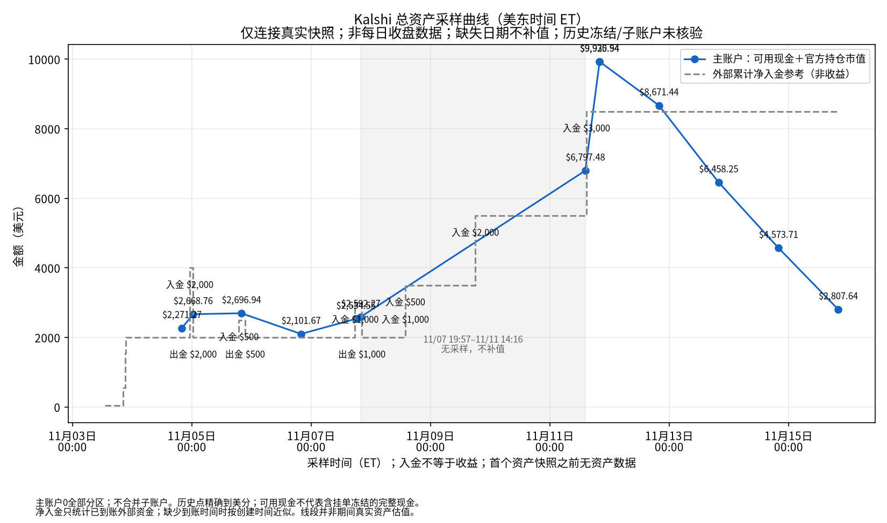

# Kalshi 每日交易报告 — 2026-11-15（美东时间）

_生成时间：2026-11-15 19:58 美东_

## 一、当日成交（96 笔）

| 时间(ET) | 市场 | 方向 | 份数 | 价格 | 金额 | 手续费 |
|---|---|---|---:|---:|---:|---:|
| 00:06:31 | Utah Valley wins `KXNCAAMBGAME-26NOV14UVUNEV-UVU` | 买入 YES | 0.11 | $0.6900 | $0.08 | $0.00 |
| 00:06:31 | Utah Valley wins `KXNCAAMBGAME-26NOV14UVUNEV-UVU` | 买入 YES | 132.46 | $0.7000 | $92.72 | $1.95 |
| 00:06:31 | Utah Valley wins `KXNCAAMBGAME-26NOV14UVUNEV-UVU` | 买入 YES | 5.00 | $0.6900 | $3.45 | $0.07 |
| 00:16:10 | Utah Valley wins `KXNCAAMBGAME-26NOV14UVUNEV-UVU` | 买入 YES | 1,038.75 | $0.9600 | $997.20 | $2.79 |
| 00:19:45 | UTSA wins `KXNCAAFGAME-26NOV14UNTUTSA-UTSA` | 买入 YES | 1,644.17 | $0.9800 | $1,611.29 | $2.26 |
| 00:19:45 | UTSA wins `KXNCAAFGAME-26NOV14UNTUTSA-UTSA` | 买入 YES | 393.79 | $0.9800 | $385.91 | $0.54 |
| 00:21:18 | Utah Valley wins `KXNCAAMBGAME-26NOV14UVUNEV-UVU` | 买入 YES | 39.31 | $0.9100 | $35.77 | $0.23 |
| 00:28:01 | North Dakota St. wins `KXNCAAFGAME-26NOV14NDSUHAW-NDSU` | 买入 YES | 0.63 | $0.7700 | $0.49 | $0.01 |
| 00:28:34 | Texas Tech wins `KXNCAAFGAME-26NOV14TTUOKST-TTU` | 买入 YES | 0.01 | $0.9500 | $0.01 | $0.00 |
| 00:33:31 | North Dakota St. wins `KXNCAAFGAME-26NOV14NDSUHAW-NDSU` | 买入 YES | 157.11 | $0.6200 | $97.41 | $2.59 |
| 00:33:36 | Hawai'i wins `KXNCAAFGAME-26NOV14NDSUHAW-HAW` | 买入 YES | 252.21 | $0.3800 | $95.84 | $4.16 |
| 00:33:55 | Oklahoma St. wins `KXNCAAFGAME-26NOV14TTUOKST-OKST` | 买入 YES | 156.37 | $0.0600 | $9.38 | $0.62 |
| 00:34:58 | Oklahoma St. wins `KXNCAAFGAME-26NOV14TTUOKST-OKST` | 卖出 YES | 45.55 | $0.0200 | $0.91 | $0.06 |
| 00:34:58 | Oklahoma St. wins `KXNCAAFGAME-26NOV14TTUOKST-OKST` | 卖出 YES | 110.82 | $0.0200 | $2.22 | $0.15 |
| 00:35:23 | Texas Tech wins `KXNCAAFGAME-26NOV14TTUOKST-TTU` | 买入 YES | 1,273.72 | $0.9800 | $1,248.25 | $1.75 |
| 00:38:38 | Kataller T wins `KXJ2LEAGUEGAME-26NOV15KATVOR-KAT` | 买入 YES | 451.23 | $0.2100 | $94.76 | $5.24 |
| 00:44:39 | Utah wins `KXNCAAFGAME-26NOV14UTAHARIZ-UTAH` | 买入 YES | 41.89 | $0.4600 | $19.27 | $0.73 |
| 00:44:45 | Arizona wins `KXNCAAFGAME-26NOV14UTAHARIZ-ARIZ` | 买入 YES | 32.52 | $0.5300 | $17.24 | $0.57 |
| 00:44:45 | Arizona wins `KXNCAAFGAME-26NOV14UTAHARIZ-ARIZ` | 买入 YES | 3.00 | $0.5300 | $1.59 | $0.05 |
| 00:44:45 | Arizona wins `KXNCAAFGAME-26NOV14UTAHARIZ-ARIZ` | 买入 YES | 0.01 | $0.5300 | $0.01 | $0.00 |
| 00:44:45 | Arizona wins `KXNCAAFGAME-26NOV14UTAHARIZ-ARIZ` | 买入 YES | 1.00 | $0.5300 | $0.53 | $0.02 |
| 00:49:25 | Arizona wins `KXNCAAFGAME-26NOV14UTAHARIZ-ARIZ` | 卖出 YES | 36.53 | $0.3600 | $13.15 | $0.59 |
| 00:49:27 | Kataller T wins `KXJ2LEAGUEGAME-26NOV15KATVOR-KAT` | 卖出 YES | 451.23 | $0.0500 | $22.56 | $1.50 |
| 00:49:30 | Hawai'i wins `KXNCAAFGAME-26NOV14NDSUHAW-HAW` | 卖出 YES | 252.21 | $0.3700 | $93.32 | $4.12 |
| 00:49:39 | Utah wins `KXNCAAFGAME-26NOV14UTAHARIZ-UTAH` | 买入 YES | 19.00 | $0.6400 | $12.16 | $0.31 |
| 00:49:42 | Kataller T wins `KXJ2LEAGUEGAME-26NOV15KATVOR-KAT` | 买入 NO | 22.00 | $0.9400 | $20.68 | $0.09 |
| 00:49:44 | North Dakota St. wins `KXNCAAFGAME-26NOV14NDSUHAW-NDSU` | 买入 YES | 138.00 | $0.6300 | $86.94 | $2.25 |
| 00:50:02 | Kataller T wins `KXJ2LEAGUEGAME-26NOV15KATVOR-KAT` | 卖出 NO | 22.00 | $0.9300 | $20.46 | $0.10 |
| 00:50:10 | North Dakota St. wins `KXNCAAFGAME-26NOV14NDSUHAW-NDSU` | 卖出 YES | 295.74 | $0.6200 | $183.36 | $4.88 |
| 00:50:16 | Utah wins `KXNCAAFGAME-26NOV14UTAHARIZ-UTAH` | 卖出 YES | 60.89 | $0.6300 | $38.36 | $0.99 |
| 15:38:13 | Turkiye wins `KXUEFANLGAME-26NOV15FRATUR-TUR` | 买入 NO | 1,059.38 | $0.9400 | $995.82 | $4.18 |
| 15:39:00 | Grenada wins `KXCONCACAFNLGAME-26NOV16CUBGRN-GRN` | 买入 NO | 42.71 | $0.9100 | $38.87 | $0.24 |
| 15:39:00 | Grenada wins `KXCONCACAFNLGAME-26NOV16CUBGRN-GRN` | 买入 NO | 12.00 | $0.9000 | $10.80 | $0.08 |
| 15:40:28 | Princeton wins `KXNCAAMBGAME-26NOV15PRINURI-PRIN` | 买入 YES | 5.00 | $0.5100 | $2.55 | $0.09 |
| 15:40:28 | Princeton wins `KXNCAAMBGAME-26NOV15PRINURI-PRIN` | 买入 YES | 10.00 | $0.5100 | $5.10 | $0.17 |
| 15:40:28 | Princeton wins `KXNCAAMBGAME-26NOV15PRINURI-PRIN` | 买入 YES | 5.00 | $0.5100 | $2.55 | $0.09 |
| 15:40:28 | Princeton wins `KXNCAAMBGAME-26NOV15PRINURI-PRIN` | 买入 YES | 39.14 | $0.5200 | $20.35 | $0.68 |
| 15:40:28 | Princeton wins `KXNCAAMBGAME-26NOV15PRINURI-PRIN` | 买入 YES | 0.41 | $0.5200 | $0.21 | $0.01 |
| 15:40:28 | Princeton wins `KXNCAAMBGAME-26NOV15PRINURI-PRIN` | 买入 YES | 0.22 | $0.5100 | $0.11 | $0.00 |
| 15:40:28 | Princeton wins `KXNCAAMBGAME-26NOV15PRINURI-PRIN` | 买入 YES | 129.05 | $0.5100 | $65.82 | $2.26 |
| 15:40:33 | Rhode Island wins `KXNCAAMBGAME-26NOV15PRINURI-URI` | 买入 YES | 23.57 | $0.5100 | $12.02 | $0.41 |
| 15:40:33 | Rhode Island wins `KXNCAAMBGAME-26NOV15PRINURI-URI` | 买入 YES | 166.00 | $0.5100 | $84.66 | $2.90 |
| 15:41:35 | Grenada wins `KXCONCACAFNLGAME-26NOV16CUBGRN-GRN` | 卖出 NO | 54.71 | $0.9000 | $49.24 | $0.34 |
| 15:42:05 | Canisius wins `KXNCAAMBGAME-26NOV15CANBUFF-CAN` | 买入 NO | 0.11 | $0.9000 | $0.10 | $0.00 |
| 15:48:30 | Rhode Island wins `KXNCAAMBGAME-26NOV15PRINURI-URI` | 卖出 YES | 100.00 | $0.6700 | $67.00 | $1.55 |
| 15:48:30 | Rhode Island wins `KXNCAAMBGAME-26NOV15PRINURI-URI` | 卖出 YES | 1.00 | $0.6600 | $0.66 | $0.02 |
| 15:48:30 | Rhode Island wins `KXNCAAMBGAME-26NOV15PRINURI-URI` | 卖出 YES | 72.57 | $0.6600 | $47.90 | $1.14 |
| 15:48:30 | Rhode Island wins `KXNCAAMBGAME-26NOV15PRINURI-URI` | 卖出 YES | 16.00 | $0.6600 | $10.56 | $0.25 |
| 15:49:23 | Princeton wins `KXNCAAMBGAME-26NOV15PRINURI-PRIN` | 买入 YES | 0.45 | $0.4900 | $0.22 | $0.01 |
| 15:49:23 | Princeton wins `KXNCAAMBGAME-26NOV15PRINURI-PRIN` | 买入 YES | 0.22 | $0.5000 | $0.11 | $0.00 |
| 15:49:23 | Princeton wins `KXNCAAMBGAME-26NOV15PRINURI-PRIN` | 买入 YES | 53.00 | $0.4800 | $25.44 | $0.93 |
| 15:49:23 | Princeton wins `KXNCAAMBGAME-26NOV15PRINURI-PRIN` | 买入 YES | 397.00 | $0.4900 | $194.53 | $6.94 |
| 15:49:23 | Princeton wins `KXNCAAMBGAME-26NOV15PRINURI-PRIN` | 买入 YES | 232.00 | $0.4900 | $113.68 | $4.06 |
| 15:49:23 | Princeton wins `KXNCAAMBGAME-26NOV15PRINURI-PRIN` | 买入 YES | 10.00 | $0.5300 | $5.30 | $0.17 |
| 15:49:23 | Princeton wins `KXNCAAMBGAME-26NOV15PRINURI-PRIN` | 买入 YES | 0.01 | $0.5200 | $0.01 | $0.00 |
| 15:49:23 | Princeton wins `KXNCAAMBGAME-26NOV15PRINURI-PRIN` | 买入 YES | 27.00 | $0.4900 | $13.23 | $0.47 |
| 15:49:23 | Princeton wins `KXNCAAMBGAME-26NOV15PRINURI-PRIN` | 买入 YES | 0.55 | $0.5100 | $0.28 | $0.01 |
| 15:49:23 | Princeton wins `KXNCAAMBGAME-26NOV15PRINURI-PRIN` | 买入 YES | 13.00 | $0.4900 | $6.37 | $0.23 |
| 15:49:23 | Princeton wins `KXNCAAMBGAME-26NOV15PRINURI-PRIN` | 买入 YES | 16.00 | $0.5000 | $8.00 | $0.28 |
| 15:49:23 | Princeton wins `KXNCAAMBGAME-26NOV15PRINURI-PRIN` | 买入 YES | 1.00 | $0.5300 | $0.53 | $0.02 |
| 15:49:23 | Princeton wins `KXNCAAMBGAME-26NOV15PRINURI-PRIN` | 买入 YES | 3.00 | $0.5100 | $1.53 | $0.05 |
| 15:49:23 | Princeton wins `KXNCAAMBGAME-26NOV15PRINURI-PRIN` | 买入 YES | 442.12 | $0.5400 | $238.74 | $7.69 |
| 15:49:23 | Princeton wins `KXNCAAMBGAME-26NOV15PRINURI-PRIN` | 买入 YES | 316.00 | $0.5300 | $167.48 | $5.51 |
| 15:49:23 | Princeton wins `KXNCAAMBGAME-26NOV15PRINURI-PRIN` | 买入 YES | 2.00 | $0.5200 | $1.04 | $0.03 |
| 15:49:23 | Princeton wins `KXNCAAMBGAME-26NOV15PRINURI-PRIN` | 买入 YES | 93.00 | $0.4900 | $45.57 | $1.63 |
| 15:49:23 | Princeton wins `KXNCAAMBGAME-26NOV15PRINURI-PRIN` | 买入 YES | 75.00 | $0.5300 | $39.75 | $1.31 |
| 15:49:23 | Princeton wins `KXNCAAMBGAME-26NOV15PRINURI-PRIN` | 买入 YES | 1.10 | $0.5100 | $0.56 | $0.02 |
| 15:49:23 | Princeton wins `KXNCAAMBGAME-26NOV15PRINURI-PRIN` | 买入 YES | 0.09 | $0.5100 | $0.05 | $0.00 |
| 15:49:23 | Princeton wins `KXNCAAMBGAME-26NOV15PRINURI-PRIN` | 买入 YES | 9.00 | $0.5000 | $4.50 | $0.16 |
| 15:49:23 | Princeton wins `KXNCAAMBGAME-26NOV15PRINURI-PRIN` | 买入 YES | 0.47 | $0.5300 | $0.25 | $0.01 |
| 15:49:23 | Princeton wins `KXNCAAMBGAME-26NOV15PRINURI-PRIN` | 买入 YES | 3.00 | $0.5200 | $1.56 | $0.05 |
| 15:49:23 | Princeton wins `KXNCAAMBGAME-26NOV15PRINURI-PRIN` | 买入 YES | 1.00 | $0.5100 | $0.51 | $0.02 |
| 15:49:44 | Rhode Island wins `KXNCAAMBGAME-26NOV15PRINURI-URI` | 买入 YES | 0.01 | $0.5800 | $0.01 | $0.00 |
| 15:49:44 | Rhode Island wins `KXNCAAMBGAME-26NOV15PRINURI-URI` | 买入 YES | 32.00 | $0.5700 | $18.24 | $0.55 |
| 15:49:44 | Rhode Island wins `KXNCAAMBGAME-26NOV15PRINURI-URI` | 买入 YES | 527.39 | $0.5800 | $305.89 | $8.99 |
| 15:49:44 | Rhode Island wins `KXNCAAMBGAME-26NOV15PRINURI-URI` | 买入 YES | 346.54 | $0.5900 | $204.46 | $5.87 |
| 15:49:44 | Rhode Island wins `KXNCAAMBGAME-26NOV15PRINURI-URI` | 买入 YES | 5.00 | $0.5700 | $2.85 | $0.09 |
| 15:49:44 | Rhode Island wins `KXNCAAMBGAME-26NOV15PRINURI-URI` | 买入 YES | 661.00 | $0.5900 | $389.99 | $11.19 |
| 15:49:44 | Rhode Island wins `KXNCAAMBGAME-26NOV15PRINURI-URI` | 买入 YES | 38.21 | $0.5700 | $21.78 | $0.66 |
| 15:49:44 | Rhode Island wins `KXNCAAMBGAME-26NOV15PRINURI-URI` | 买入 YES | 0.44 | $0.5900 | $0.26 | $0.01 |
| 15:49:44 | Rhode Island wins `KXNCAAMBGAME-26NOV15PRINURI-URI` | 买入 YES | 10.00 | $0.5700 | $5.70 | $0.17 |
| 15:49:44 | Rhode Island wins `KXNCAAMBGAME-26NOV15PRINURI-URI` | 买入 YES | 39.00 | $0.5800 | $22.62 | $0.67 |
| 15:52:27 | Northern Iowa wins `KXNCAAWBGAME-26NOV15CREIUNI-UNI` | 买入 YES | 0.13 | $0.0700 | $0.01 | $0.00 |
| 16:05:33 | Rhode Island wins `KXNCAAMBGAME-26NOV15PRINURI-URI` | 卖出 YES | 0.47 | $0.8000 | $0.38 | $0.01 |
| 16:05:33 | Rhode Island wins `KXNCAAMBGAME-26NOV15PRINURI-URI` | 卖出 YES | 1,202.46 | $0.7700 | $925.89 | $14.91 |
| 16:05:33 | Rhode Island wins `KXNCAAMBGAME-26NOV15PRINURI-URI` | 卖出 YES | 100.00 | $0.8000 | $80.00 | $1.12 |
| 16:05:33 | Rhode Island wins `KXNCAAMBGAME-26NOV15PRINURI-URI` | 卖出 YES | 1.00 | $0.8000 | $0.80 | $0.01 |
| 16:05:33 | Rhode Island wins `KXNCAAMBGAME-26NOV15PRINURI-URI` | 卖出 YES | 0.13 | $0.7900 | $0.10 | $0.00 |
| 16:05:33 | Rhode Island wins `KXNCAAMBGAME-26NOV15PRINURI-URI` | 卖出 YES | 1.00 | $0.7700 | $0.77 | $0.01 |
| 16:05:33 | Rhode Island wins `KXNCAAMBGAME-26NOV15PRINURI-URI` | 卖出 YES | 69.00 | $0.7800 | $53.82 | $0.83 |
| 16:05:33 | Rhode Island wins `KXNCAAMBGAME-26NOV15PRINURI-URI` | 卖出 YES | 5.00 | $0.7700 | $3.85 | $0.06 |
| 16:05:33 | Rhode Island wins `KXNCAAMBGAME-26NOV15PRINURI-URI` | 卖出 YES | 0.01 | $0.7700 | $0.01 | $0.00 |
| 16:05:33 | Rhode Island wins `KXNCAAMBGAME-26NOV15PRINURI-URI` | 卖出 YES | 0.49 | $0.7800 | $0.38 | $0.01 |
| 16:05:33 | Rhode Island wins `KXNCAAMBGAME-26NOV15PRINURI-URI` | 卖出 YES | 0.03 | $0.7700 | $0.02 | $0.00 |
| 16:05:33 | Rhode Island wins `KXNCAAMBGAME-26NOV15PRINURI-URI` | 卖出 YES | 280.00 | $0.7900 | $221.20 | $3.25 |
| 16:21:08 | Princeton wins `KXNCAAMBGAME-26NOV15PRINURI-PRIN` | 卖出 YES | 1,884.83 | $0.0200 | $37.70 | $2.59 |

合计：买入 $7,910.95，卖出 $1,874.61，手续费 $133.60

_“买入/卖出”根据成交前的持仓方向判断（Kalshi 中卖 YES 与买 NO 是同一方向的订单）。_

## 二、当日已实现盈亏

### 1. 结算（15 个市场）

| 结算时间(ET) | 市场 | 结果 | 持有 | 结算赔付 | 成本 | 手续费 | 盈亏 |
|---|---|---|---|---:|---:|---:|---:|
| 00:33 | Utah Valley wins `KXNCAAMBGAME-26NOV14UVUNEV-UVU` | YES | YES 1,719.49 / NO 259.00 | $1,719.49（含 YES/NO 配对兑付 $259.00） | $1,758.66 | $12.74 | **+$126.62** |
| 00:33 | Nevada wins `KXNCAAMBGAME-26NOV14UVUNEV-NEV` | NO | YES 346.47 / NO 346.47 | $346.47（含 YES/NO 配对兑付 $346.47） | $485.38 | $9.22 | **$0.00** |
| 00:36 | UTSA wins `KXNCAAFGAME-26NOV14UNTUTSA-UTSA` | YES | YES 2,049.11 | $2,049.11 | $2,007.12 | $2.87 | **+$39.11** |
| 01:28 | Texas Tech wins `KXNCAAFGAME-26NOV14TTUOKST-TTU` | YES | YES 1,273.73 | $1,273.73 | $1,248.26 | $1.75 | **+$23.73** |
| 01:28 | Oklahoma St. wins `KXNCAAFGAME-26NOV14TTUOKST-OKST` | NO | YES 156.37 / NO 156.37 | $156.37（含 YES/NO 配对兑付 $156.37） | $162.62 | $0.83 | **-$7.09** |
| 01:58 | Kataller T wins `KXJ2LEAGUEGAME-26NOV15KATVOR-KAT` | NO | YES 473.23 / NO 473.23 | $473.23（含 YES/NO 配对兑付 $473.23） | $545.65 | $6.93 | **-$79.34** |
| 02:23 | Utah wins `KXNCAAFGAME-26NOV14UTAHARIZ-UTAH` | YES | YES 60.89 / NO 60.89 | $60.89（含 YES/NO 配对兑付 $60.89） | $53.96 | $2.03 | **+$4.90** |
| 02:23 | Arizona wins `KXNCAAFGAME-26NOV14UTAHARIZ-ARIZ` | NO | YES 36.53 / NO 36.53 | $36.53（含 YES/NO 配对兑付 $36.53） | $42.74 | $1.23 | **-$7.44** |
| 02:42 | North Dakota St. wins `KXNCAAFGAME-26NOV14NDSUHAW-NDSU` | YES | YES 295.74 / NO 295.74 | $295.74（含 YES/NO 配对兑付 $295.74） | $297.21 | $9.73 | **-$11.20** |
| 02:42 | Hawai'i wins `KXNCAAFGAME-26NOV14NDSUHAW-HAW` | NO | YES 252.21 / NO 252.21 | $252.21（含 YES/NO 配对兑付 $252.21） | $254.73 | $8.27 | **-$10.80** |
| 16:31 | Rhode Island wins `KXNCAAMBGAME-26NOV15PRINURI-URI` | YES | YES 1,849.16 / NO 1,849.16 | $1,849.16（含 YES/NO 配对兑付 $1,849.16） | $1,504.29 | $54.67 | **+$290.21** |
| 16:31 | Princeton wins `KXNCAAMBGAME-26NOV15PRINURI-PRIN` | NO | YES 1,884.83 / NO 1,884.83 | $1,884.83（含 YES/NO 配对兑付 $1,884.83） | $2,813.06 | $35.49 | **-$963.72** |
| 16:45 | Turkiye wins `KXUEFANLGAME-26NOV15FRATUR-TUR` | NO | NO 1,059.38 | $1,059.38 | $995.82 | $4.18 | **+$59.38** |
| 16:59 | Northern Iowa wins `KXNCAAWBGAME-26NOV15CREIUNI-UNI` | NO | YES 0.13 | $0.00 | $0.01 | $0.00 | **-$0.01** |
| 19:25 | Canisius wins `KXNCAAMBGAME-26NOV15CANBUFF-CAN` | NO | NO 0.11 | $0.11 | $0.10 | $0.00 | **+$0.01** |

_同时持有过 YES 和 NO 的市场（中途卖出平仓过），结算盈亏已经包含该市场所有买卖和手续费，不再单独计入卖出平仓。_

### 2. 卖出平仓（1 个市场）

| 市场 | 平仓份数 | 卖出所得 | 开仓成本(均价) | 毛盈亏 | 手续费(开+平) | 净盈亏 | Kalshi realized_pnl(累计,不含费) |
|---|---:|---:|---:|---:|---:|---:|---:|
| Grenada wins `KXCONCACAFNLGAME-26NOV16CUBGRN-GRN` | 54.71 | $49.24 | $49.67 | -$0.43 | $0.67 | **-$1.09** | -$0.43 |

### 3. 按市场汇总

| 市场 | 来源 | 净盈亏 |
|---|---|---:|
| Rhode Island wins | 结算 | +$290.21 |
| Utah Valley wins | 结算 | +$126.62 |
| Turkiye wins | 结算 | +$59.38 |
| UTSA wins | 结算 | +$39.11 |
| Texas Tech wins | 结算 | +$23.73 |
| Utah wins | 结算 | +$4.90 |
| Canisius wins | 结算 | +$0.01 |
| Nevada wins | 结算 | $0.00 |
| Northern Iowa wins | 结算 | -$0.01 |
| Grenada wins | 卖出平仓 | -$1.09 |
| Oklahoma St. wins | 结算 | -$7.09 |
| Arizona wins | 结算 | -$7.44 |
| Hawai'i wins | 结算 | -$10.80 |
| North Dakota St. wins | 结算 | -$11.20 |
| Kataller T wins | 结算 | -$79.34 |
| Princeton wins | 结算 | -$963.72 |

**当日已实现净盈亏合计：-$536.73**（盈利 7 个市场，亏损 9 个市场；均已扣手续费）

_当天买入但尚未平仓/结算的仓位不计入已实现盈亏，见下方持仓。_

## 三、当前持仓与资金（报告生成时的实时数据）

- 现金余额：**$2,807.64**
- Kalshi 显示的持仓市值（portfolio_value）：$0.00
- 持仓市场数：0

## 总资产曲线（真实资产快照）

采样时间：2026-11-15T19:58:23-05:00（ET）。主账户可用现金 **$2,807.6428** ＋ 官方持仓市值 **$0.00** ＝ **$2,807.6428**。

当前未成交挂单 0 笔；冻结资金为0。

主账户0，全部交易分区；不合并子账户；内部划转不计外部入金。

总资产曲线口径为API可用现金＋官方持仓市值，不用买价估值替代官方市值。历史挂单冻结及子账户余额未留存，历史点仅代表主账户可核对资产，不保证完整账户净值。真实采样点之间连线仅辅助阅读，不代表连续估值；缺失日期不补值。净入金仅取已到账外部充值减已完成提现；缺少完成时间时以创建时间近似，因此不保证日内到账时点。主账户与子账户内部划转不计入金；主账户资产与全账户外部净入金之差不一定是收益。

审计数据：`charts/total_assets.csv`、`charts/total_assets.json`；原始快照在 `data/asset_snapshots/`。

---
**口径说明**：结算盈亏 = 结算赔付（含 YES/NO 配对兑付）− 该市场累计买入成本 − 累计手续费 − 之前已计入的平仓盈亏；卖出平仓盈亏用平均成本法（含开仓、平仓手续费）。数据全部来自 Kalshi 只读 API。
