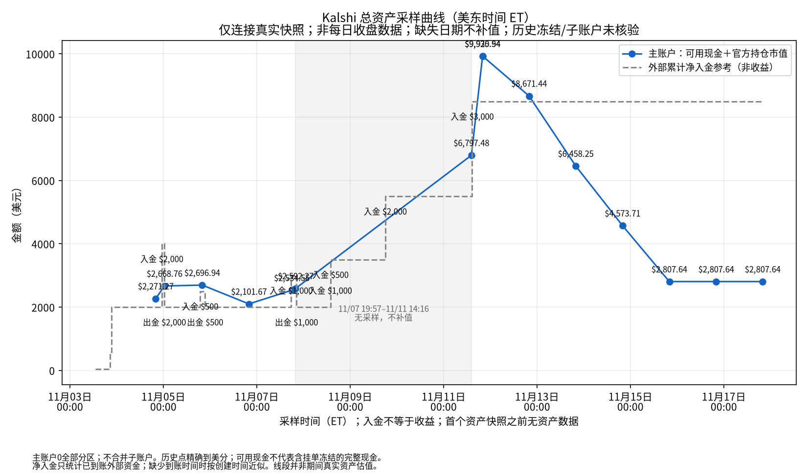

# Kalshi 每日交易报告 — 2026-11-17（美东时间）

_生成时间：2026-11-17 19:55 美东_

## 一、当日成交（0 笔）

当天没有成交。

## 二、当日已实现盈亏

### 1. 结算（0 个市场）

当天没有结算的市场。

### 2. 卖出平仓（0 个市场）

当天没有卖出平仓。

### 3. 按市场汇总

当天没有已实现盈亏。

_当天买入但尚未平仓/结算的仓位不计入已实现盈亏，见下方持仓。_

## 三、当前持仓与资金（报告生成时的实时数据）

- 现金余额：**$2,807.64**
- Kalshi 显示的持仓市值（portfolio_value）：$0.00
- 持仓市场数：0

## 总资产曲线（真实资产快照）

采样时间：2026-11-17T19:55:14-05:00（ET）。主账户可用现金 **$2,807.6428** ＋ 官方持仓市值 **$0.00** ＝ **$2,807.6428**。

当前未成交挂单 0 笔；冻结资金为0。

主账户0，全部交易分区；不合并子账户；内部划转不计外部入金。

总资产曲线口径为API可用现金＋官方持仓市值，不用买价估值替代官方市值。历史挂单冻结及子账户余额未留存，历史点仅代表主账户可核对资产，不保证完整账户净值。真实采样点之间连线仅辅助阅读，不代表连续估值；缺失日期不补值。净入金仅取已到账外部充值减已完成提现；缺少完成时间时以创建时间近似，因此不保证日内到账时点。主账户与子账户内部划转不计入金；主账户资产与全账户外部净入金之差不一定是收益。

审计数据：`charts/total_assets.csv`、`charts/total_assets.json`；原始快照在 `data/asset_snapshots/`。

---
**口径说明**：结算盈亏 = 结算赔付（含 YES/NO 配对兑付）− 该市场累计买入成本 − 累计手续费 − 之前已计入的平仓盈亏；卖出平仓盈亏用平均成本法（含开仓、平仓手续费）。数据全部来自 Kalshi 只读 API。
