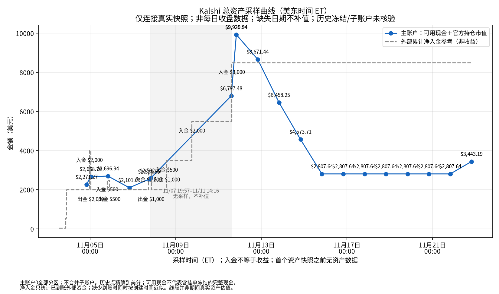

# Kalshi 每日交易报告 — 2026-11-22（美东时间）

_生成时间：2026-11-22 19:53 美东_

## 一、当日成交（16 笔）

| 时间(ET) | 市场 | 方向 | 份数 | 价格 | 金额 | 手续费 |
|---|---|---|---:|---:|---:|---:|
| 16:43:28 | Jacksonville wins `KXNFLGAME-26NOV22JACNYG-JAC` | 买入 YES | 623.74 | $0.7900 | $492.75 | $7.24 |
| 17:24:15 | Samford wins `KXNCAAMBGAME-26NOV22UNCASAM-SAM` | 买入 YES | 10.00 | $0.7800 | $7.80 | $0.12 |
| 17:24:15 | Samford wins `KXNCAAMBGAME-26NOV22UNCASAM-SAM` | 买入 YES | 2.33 | $0.7800 | $1.82 | $0.03 |
| 17:24:15 | Samford wins `KXNCAAMBGAME-26NOV22UNCASAM-SAM` | 买入 YES | 0.28 | $0.7700 | $0.22 | $0.00 |
| 17:24:15 | Samford wins `KXNCAAMBGAME-26NOV22UNCASAM-SAM` | 买入 YES | 0.01 | $0.7700 | $0.01 | $0.00 |
| 17:27:30 | Portland St. wins `KXNCAAMBGAME-26NOV22CSFPRST-PRST` | 买入 YES | 6.09 | $0.7700 | $4.69 | $0.08 |
| 17:27:30 | Portland St. wins `KXNCAAMBGAME-26NOV22CSFPRST-PRST` | 买入 YES | 0.30 | $0.7700 | $0.23 | $0.00 |
| 17:40:30 | Jacksonville wins `KXNFLGAME-26NOV22JACNYG-JAC` | 卖出 YES | 623.74 | $0.3500 | $218.31 | $9.93 |
| 17:40:41 | New York G wins `KXNFLGAME-26NOV22JACNYG-NYG` | 买入 YES | 300.33 | $0.6500 | $195.21 | $4.78 |
| 17:41:15 | New York G wins `KXNFLGAME-26NOV22JACNYG-NYG` | 买入 YES | 750.83 | $0.6500 | $488.04 | $11.96 |
| 17:41:28 | New York G wins `KXNFLGAME-26NOV22JACNYG-NYG` | 买入 YES | 1,501.67 | $0.6500 | $976.09 | $23.91 |
| 18:43:27 | New York G wins `KXNFLGAME-26NOV22JACNYG-NYG` | 买入 YES | 912.38 | $0.8700 | $793.77 | $7.22 |
| 19:27:59 | Southern Miss wins `KXNCAAMBGAME-26NOV22VALPUSM-USM` | 买入 YES | 0.13 | $0.8800 | $0.11 | $0.00 |
| 19:27:59 | Southern Miss wins `KXNCAAMBGAME-26NOV22VALPUSM-USM` | 买入 YES | 1.00 | $0.8700 | $0.87 | $0.01 |
| 19:28:41 | California Baptist wins `KXNCAAMBGAME-26NOV22PORTCBU-CBU` | 买入 YES | 1.86 | $0.5200 | $0.97 | $0.03 |
| 19:34:11 | Washington wins `KXNBAGAME-26NOV22ORLWAS-WAS` | 买入 YES | 1.38 | $0.7000 | $0.97 | $0.02 |

合计：买入 $2,963.54，卖出 $218.31，手续费 $65.35

_“买入/卖出”根据成交前的持仓方向判断（Kalshi 中卖 YES 与买 NO 是同一方向的订单）。_

## 二、当日已实现盈亏

### 1. 结算（2 个市场）

| 结算时间(ET) | 市场 | 结果 | 持有 | 结算赔付 | 成本 | 手续费 | 盈亏 |
|---|---|---|---|---:|---:|---:|---:|
| 19:01 | Portland St. wins `KXNCAAMBGAME-26NOV22CSFPRST-PRST` | NO | YES 6.39 | $0.00 | $4.92 | $0.08 | **-$5.00** |
| 19:17 | Samford wins `KXNCAAMBGAME-26NOV22UNCASAM-SAM` | YES | YES 12.62 | $12.62 | $9.84 | $0.15 | **+$2.63** |

### 2. 卖出平仓（1 个市场）

| 市场 | 平仓份数 | 卖出所得 | 开仓成本(均价) | 毛盈亏 | 手续费(开+平) | 净盈亏 | Kalshi realized_pnl(累计,不含费) |
|---|---:|---:|---:|---:|---:|---:|---:|
| Jacksonville wins `KXNFLGAME-26NOV22JACNYG-JAC` | 623.74 | $218.31 | $492.75 | -$274.45 | $17.18 | **-$291.62** | -$274.45 |

### 3. 按市场汇总

| 市场 | 来源 | 净盈亏 |
|---|---|---:|
| Samford wins | 结算 | +$2.63 |
| Portland St. wins | 结算 | -$5.00 |
| Jacksonville wins | 卖出平仓 | -$291.62 |

**当日已实现净盈亏合计：-$293.99**（盈利 1 个市场，亏损 2 个市场；均已扣手续费）

_当天买入但尚未平仓/结算的仓位不计入已实现盈亏，见下方持仓。_

## 三、当前持仓与资金（报告生成时的实时数据）

- 现金余额：**$9.68**
- Kalshi 显示的持仓市值（portfolio_value）：$3,433.54
- 持仓市场数：4

| 市场 | 方向 | 份数 | 成本 | 均价 | 当前买价(bid) | 估算市值 | 浮动盈亏(估) |
|---|---|---:|---:|---:|---:|---:|---:|
| New York G wins `KXNFLGAME-26NOV22JACNYG-NYG` | YES | 3,465.21 | $2,453.11 | $0.7079 | $0.9900 | $3,430.56 | +$977.45 |
| Southern Miss wins `KXNCAAMBGAME-26NOV22VALPUSM-USM` | YES | 1.13 | $0.98 | $0.8712 | $0.8700 | $0.98 | $0.00 |
| California Baptist wins `KXNCAAMBGAME-26NOV22PORTCBU-CBU` | YES | 1.86 | $0.97 | $0.5200 | $0.5900 | $1.10 | +$0.13 |
| Washington wins `KXNBAGAME-26NOV22ORLWAS-WAS` | YES | 1.38 | $0.97 | $0.7000 | $0.6100 | $0.84 | -$0.12 |

持仓总成本 $2,456.03，按当前买价估算市值 $3,433.48，浮动盈亏 +$977.45（估算，未扣卖出手续费）

## 总资产曲线（真实资产快照）

采样时间：2026-11-22T19:53:31-05:00（ET）。主账户可用现金 **$9.6818** ＋ 官方持仓市值 **$3,433.54** ＝ **$3,443.2218**。

当前未成交挂单 0 笔；冻结资金为0。

主账户0，全部交易分区；不合并子账户；内部划转不计外部入金。

总资产曲线口径为API可用现金＋官方持仓市值，不用买价估值替代官方市值。历史挂单冻结及子账户余额未留存，历史点仅代表主账户可核对资产，不保证完整账户净值。真实采样点之间连线仅辅助阅读，不代表连续估值；缺失日期不补值。净入金仅取已到账外部充值减已完成提现；缺少完成时间时以创建时间近似，因此不保证日内到账时点。主账户与子账户内部划转不计入金；主账户资产与全账户外部净入金之差不一定是收益。

审计数据：`charts/total_assets.csv`、`charts/total_assets.json`；原始快照在 `data/asset_snapshots/`。

---
**口径说明**：结算盈亏 = 结算赔付（含 YES/NO 配对兑付）− 该市场累计买入成本 − 累计手续费 − 之前已计入的平仓盈亏；卖出平仓盈亏用平均成本法（含开仓、平仓手续费）。数据全部来自 Kalshi 只读 API。
