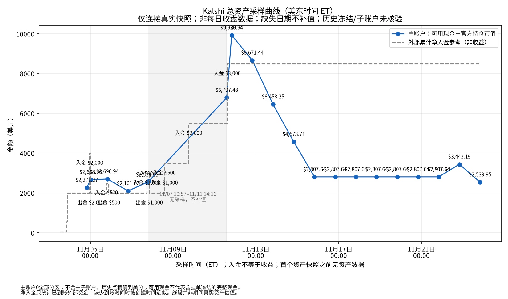

# Kalshi 每日交易报告 — 2026-11-23（美东时间）

_生成时间：2026-11-23 19:55 美东_

## 一、当日成交（249 笔）

| 时间(ET) | 市场 | 方向 | 份数 | 价格 | 金额 | 手续费 |
|---|---|---|---:|---:|---:|---:|
| 08:35:02 | Robin Catry wins `KXATPCHALLENGERMATCH-26NOV23BOICAT-CAT` | 买入 YES | 0.15 | $0.6300 | $0.09 | $0.00 |
| 08:35:34 | Rebeca Pereira wins `KXITFWMATCH-26NOV22DIAPER-PER` | 买入 YES | 0.10 | $0.9900 | $0.10 | $0.00 |
| 08:48:41 | Federico Iannaccone wins `KXATPCHALLENGERMATCH-26NOV23IANSMI-IAN` | 买入 YES | 119.06 | $0.8300 | $98.82 | $1.18 |
| 08:50:21 | Federico Iannaccone wins `KXATPCHALLENGERMATCH-26NOV23IANSMI-IAN` | 买入 YES | 1,151.50 | $0.8600 | $990.29 | $9.70 |
| 08:55:00 | Federico Iannaccone wins `KXATPCHALLENGERMATCH-26NOV23IANSMI-IAN` | 买入 YES | 900.03 | $0.8900 | $801.03 | $6.17 |
| 08:55:00 | Federico Iannaccone wins `KXATPCHALLENGERMATCH-26NOV23IANSMI-IAN` | 买入 YES | 0.27 | $0.8900 | $0.24 | $0.00 |
| 08:55:00 | Federico Iannaccone wins `KXATPCHALLENGERMATCH-26NOV23IANSMI-IAN` | 买入 YES | 13.00 | $0.8900 | $11.57 | $0.09 |
| 08:55:00 | Federico Iannaccone wins `KXATPCHALLENGERMATCH-26NOV23IANSMI-IAN` | 买入 YES | 1.00 | $0.8900 | $0.89 | $0.01 |
| 08:55:00 | Federico Iannaccone wins `KXATPCHALLENGERMATCH-26NOV23IANSMI-IAN` | 买入 YES | 1.00 | $0.8900 | $0.89 | $0.01 |
| 08:55:00 | Federico Iannaccone wins `KXATPCHALLENGERMATCH-26NOV23IANSMI-IAN` | 买入 YES | 2.00 | $0.8900 | $1.78 | $0.01 |
| 08:55:00 | Federico Iannaccone wins `KXATPCHALLENGERMATCH-26NOV23IANSMI-IAN` | 买入 YES | 19.00 | $0.8900 | $16.91 | $0.13 |
| 08:55:00 | Federico Iannaccone wins `KXATPCHALLENGERMATCH-26NOV23IANSMI-IAN` | 买入 YES | 0.01 | $0.8900 | $0.01 | $0.00 |
| 08:55:00 | Federico Iannaccone wins `KXATPCHALLENGERMATCH-26NOV23IANSMI-IAN` | 买入 YES | 176.75 | $0.8900 | $157.31 | $1.21 |
| 08:55:00 | Federico Iannaccone wins `KXATPCHALLENGERMATCH-26NOV23IANSMI-IAN` | 买入 YES | 0.36 | $0.8900 | $0.32 | $0.00 |
| 09:08:12 | Federico Iannaccone wins `KXATPCHALLENGERMATCH-26NOV23IANSMI-IAN` | 买入 YES | 111.50 | $0.8900 | $99.23 | $0.76 |
| 13:14:04 | Florida International wins `KXNCAAMBGAME-26NOV23LBSUFIU-FIU` | 买入 YES | 32.00 | $0.8200 | $26.24 | $0.33 |
| 13:14:04 | Florida International wins `KXNCAAMBGAME-26NOV23LBSUFIU-FIU` | 买入 YES | 48.43 | $0.8200 | $39.71 | $0.50 |
| 13:14:04 | Florida International wins `KXNCAAMBGAME-26NOV23LBSUFIU-FIU` | 买入 YES | 40.00 | $0.8200 | $32.80 | $0.41 |
| 13:16:32 | Eastern Illinois wins `KXNCAAMBGAME-26NOV23IUSBEIU-EIU` | 买入 YES | 0.10 | $0.9800 | $0.10 | $0.00 |
| 13:18:46 | East Carolina wins `KXNCAAMBGAME-26NOV23INSTECU-ECU` | 买入 YES | 0.14 | $0.6700 | $0.09 | $0.00 |
| 13:26:31 | Florida International wins `KXNCAAMBGAME-26NOV23LBSUFIU-FIU` | 买入 YES | 157.00 | $0.8900 | $139.73 | $1.08 |
| 13:26:31 | Florida International wins `KXNCAAMBGAME-26NOV23LBSUFIU-FIU` | 买入 YES | 66.00 | $0.8900 | $58.74 | $0.45 |
| 13:26:58 | Florida International wins `KXNCAAMBGAME-26NOV23LBSUFIU-FIU` | 买入 YES | 11.00 | $0.8600 | $9.46 | $0.09 |
| 13:26:58 | Florida International wins `KXNCAAMBGAME-26NOV23LBSUFIU-FIU` | 买入 YES | 70.00 | $0.8700 | $60.90 | $0.55 |
| 13:26:58 | Florida International wins `KXNCAAMBGAME-26NOV23LBSUFIU-FIU` | 买入 YES | 32.90 | $0.8700 | $28.62 | $0.26 |
| 13:27:36 | Florida International wins `KXNCAAMBGAME-26NOV23LBSUFIU-FIU` | 买入 YES | 183.00 | $0.8800 | $161.04 | $1.35 |
| 13:27:36 | Florida International wins `KXNCAAMBGAME-26NOV23LBSUFIU-FIU` | 买入 YES | 298.71 | $0.8900 | $265.85 | $2.05 |
| 13:27:36 | Florida International wins `KXNCAAMBGAME-26NOV23LBSUFIU-FIU` | 买入 YES | 123.00 | $0.8800 | $108.24 | $0.91 |
| 13:27:36 | Florida International wins `KXNCAAMBGAME-26NOV23LBSUFIU-FIU` | 买入 YES | 250.00 | $0.8800 | $220.00 | $1.85 |
| 13:27:36 | Florida International wins `KXNCAAMBGAME-26NOV23LBSUFIU-FIU` | 买入 YES | 1.00 | $0.8800 | $0.88 | $0.01 |
| 13:27:36 | Florida International wins `KXNCAAMBGAME-26NOV23LBSUFIU-FIU` | 买入 YES | 93.00 | $0.8800 | $81.84 | $0.69 |
| 13:27:36 | Florida International wins `KXNCAAMBGAME-26NOV23LBSUFIU-FIU` | 买入 YES | 175.00 | $0.8800 | $154.00 | $1.29 |
| 13:27:58 | Florida International wins `KXNCAAMBGAME-26NOV23LBSUFIU-FIU` | 买入 YES | 92.45 | $0.8300 | $76.73 | $0.91 |
| 13:27:58 | Florida International wins `KXNCAAMBGAME-26NOV23LBSUFIU-FIU` | 买入 YES | 145.68 | $0.8300 | $120.91 | $1.44 |
| 13:28:44 | Florida International wins `KXNCAAMBGAME-26NOV23LBSUFIU-FIU` | 买入 YES | 225.37 | $0.8800 | $198.33 | $1.67 |
| 13:29:58 | Eastern Illinois wins `KXNCAAMBGAME-26NOV23IUSBEIU-EIU` | 买入 YES | 0.10 | $0.9100 | $0.09 | $0.00 |
| 13:49:37 | East Carolina wins `KXNCAAMBGAME-26NOV23INSTECU-ECU` | 买入 YES | 67.22 | $0.7300 | $49.07 | $0.93 |
| 13:52:56 | East Carolina wins `KXNCAAMBGAME-26NOV23INSTECU-ECU` | 买入 YES | 616.37 | $0.8000 | $493.10 | $6.90 |
| 13:55:02 | East Carolina wins `KXNCAAMBGAME-26NOV23INSTECU-ECU` | 买入 YES | 255.62 | $0.7700 | $196.83 | $3.17 |
| 13:57:20 | East Carolina wins `KXNCAAMBGAME-26NOV23INSTECU-ECU` | 买入 YES | 63.13 | $0.7800 | $49.24 | $0.76 |
| 13:59:04 | East Carolina wins `KXNCAAMBGAME-26NOV23INSTECU-ECU` | 买入 YES | 595.32 | $0.8300 | $494.12 | $5.88 |
| 14:00:21 | East Carolina wins `KXNCAAMBGAME-26NOV23INSTECU-ECU` | 买入 YES | 103.16 | $0.8200 | $84.59 | $1.07 |
| 14:00:21 | East Carolina wins `KXNCAAMBGAME-26NOV23INSTECU-ECU` | 买入 YES | 137.37 | $0.8200 | $112.64 | $1.42 |
| 14:00:21 | East Carolina wins `KXNCAAMBGAME-26NOV23INSTECU-ECU` | 买入 YES | 0.33 | $0.8200 | $0.27 | $0.00 |
| 14:01:14 | East Carolina wins `KXNCAAMBGAME-26NOV23INSTECU-ECU` | 买入 YES | 240.86 | $0.8200 | $197.51 | $2.49 |
| 14:02:32 | East Carolina wins `KXNCAAMBGAME-26NOV23INSTECU-ECU` | 买入 YES | 240.86 | $0.8200 | $197.51 | $2.49 |
| 14:04:19 | East Carolina wins `KXNCAAMBGAME-26NOV23INSTECU-ECU` | 买入 YES | 72.81 | $0.7700 | $56.06 | $0.90 |
| 14:04:19 | East Carolina wins `KXNCAAMBGAME-26NOV23INSTECU-ECU` | 买入 YES | 5.00 | $0.7700 | $3.85 | $0.06 |
| 14:04:19 | East Carolina wins `KXNCAAMBGAME-26NOV23INSTECU-ECU` | 买入 YES | 50.00 | $0.7600 | $38.00 | $0.64 |
| 14:05:20 | East Carolina wins `KXNCAAMBGAME-26NOV23INSTECU-ECU` | 买入 YES | 50.00 | $0.7400 | $37.00 | $0.67 |
| 14:05:20 | East Carolina wins `KXNCAAMBGAME-26NOV23INSTECU-ECU` | 买入 YES | 3.02 | $0.7400 | $2.23 | $0.04 |
| 14:05:20 | East Carolina wins `KXNCAAMBGAME-26NOV23INSTECU-ECU` | 买入 YES | 73.00 | $0.7400 | $54.02 | $0.98 |
| 14:05:20 | East Carolina wins `KXNCAAMBGAME-26NOV23INSTECU-ECU` | 买入 YES | 0.07 | $0.7400 | $0.05 | $0.00 |
| 14:05:20 | East Carolina wins `KXNCAAMBGAME-26NOV23INSTECU-ECU` | 买入 YES | 5.00 | $0.7400 | $3.70 | $0.07 |
| 14:05:20 | East Carolina wins `KXNCAAMBGAME-26NOV23INSTECU-ECU` | 买入 YES | 0.01 | $0.7400 | $0.01 | $0.00 |
| 14:06:37 | East Carolina wins `KXNCAAMBGAME-26NOV23INSTECU-ECU` | 买入 YES | 134.44 | $0.7300 | $98.14 | $1.85 |
| 14:08:49 | East Carolina wins `KXNCAAMBGAME-26NOV23INSTECU-ECU` | 买入 YES | 147.99 | $0.6600 | $97.67 | $2.32 |
| 14:09:52 | East Carolina wins `KXNCAAMBGAME-26NOV23INSTECU-ECU` | 买入 YES | 4.88 | $0.5800 | $2.83 | $0.08 |
| 14:09:52 | East Carolina wins `KXNCAAMBGAME-26NOV23INSTECU-ECU` | 买入 YES | 0.12 | $0.5800 | $0.07 | $0.00 |
| 14:09:52 | East Carolina wins `KXNCAAMBGAME-26NOV23INSTECU-ECU` | 买入 YES | 21.00 | $0.5800 | $12.18 | $0.36 |
| 14:09:52 | East Carolina wins `KXNCAAMBGAME-26NOV23INSTECU-ECU` | 买入 YES | 141.47 | $0.5800 | $82.05 | $2.41 |
| 14:09:52 | East Carolina wins `KXNCAAMBGAME-26NOV23INSTECU-ECU` | 买入 YES | 0.01 | $0.5800 | $0.01 | $0.00 |
| 14:13:30 | East Carolina wins `KXNCAAMBGAME-26NOV23INSTECU-ECU` | 买入 YES | 246.86 | $0.6200 | $153.05 | $4.07 |
| 14:13:30 | East Carolina wins `KXNCAAMBGAME-26NOV23INSTECU-ECU` | 买入 YES | 67.36 | $0.6200 | $41.76 | $1.11 |
| 14:16:25 | East Carolina wins `KXNCAAMBGAME-26NOV23INSTECU-ECU` | 买入 YES | 27.18 | $0.6300 | $17.12 | $0.44 |
| 14:16:25 | East Carolina wins `KXNCAAMBGAME-26NOV23INSTECU-ECU` | 买入 YES | 12.01 | $0.6300 | $7.57 | $0.20 |
| 14:16:25 | East Carolina wins `KXNCAAMBGAME-26NOV23INSTECU-ECU` | 买入 YES | 58.00 | $0.6300 | $36.54 | $0.95 |
| 14:16:25 | East Carolina wins `KXNCAAMBGAME-26NOV23INSTECU-ECU` | 买入 YES | 57.53 | $0.6300 | $36.24 | $0.94 |
| 14:16:49 | East Carolina wins `KXNCAAMBGAME-26NOV23INSTECU-ECU` | 买入 YES | 164.76 | $0.5900 | $97.21 | $2.79 |
| 14:23:21 | East Carolina wins `KXNCAAMBGAME-26NOV23INSTECU-ECU` | 买入 YES | 170.31 | $0.5600 | $95.37 | $2.94 |
| 14:26:23 | East Carolina wins `KXNCAAMBGAME-26NOV23INSTECU-ECU` | 买入 YES | 0.38 | $0.5700 | $0.22 | $0.01 |
| 14:26:23 | East Carolina wins `KXNCAAMBGAME-26NOV23INSTECU-ECU` | 买入 YES | 56.34 | $0.5700 | $32.11 | $0.97 |
| 14:26:23 | East Carolina wins `KXNCAAMBGAME-26NOV23INSTECU-ECU` | 买入 YES | 51.00 | $0.5700 | $29.07 | $0.88 |
| 14:26:23 | East Carolina wins `KXNCAAMBGAME-26NOV23INSTECU-ECU` | 买入 YES | 6.00 | $0.5700 | $3.42 | $0.10 |
| 14:26:23 | East Carolina wins `KXNCAAMBGAME-26NOV23INSTECU-ECU` | 买入 YES | 49.00 | $0.5700 | $27.93 | $0.84 |
| 14:26:23 | East Carolina wins `KXNCAAMBGAME-26NOV23INSTECU-ECU` | 买入 YES | 7.59 | $0.5700 | $4.33 | $0.13 |
| 14:32:21 | East Carolina wins `KXNCAAMBGAME-26NOV23INSTECU-ECU` | 买入 YES | 6.00 | $0.5200 | $3.12 | $0.10 |
| 14:32:21 | East Carolina wins `KXNCAAMBGAME-26NOV23INSTECU-ECU` | 买入 YES | 6.00 | $0.5100 | $3.06 | $0.10 |
| 14:32:21 | East Carolina wins `KXNCAAMBGAME-26NOV23INSTECU-ECU` | 买入 YES | 54.00 | $0.5200 | $28.08 | $0.94 |
| 14:32:21 | East Carolina wins `KXNCAAMBGAME-26NOV23INSTECU-ECU` | 买入 YES | 1.00 | $0.5100 | $0.51 | $0.02 |
| 14:32:21 | East Carolina wins `KXNCAAMBGAME-26NOV23INSTECU-ECU` | 买入 YES | 60.13 | $0.5300 | $31.87 | $1.05 |
| 14:32:21 | East Carolina wins `KXNCAAMBGAME-26NOV23INSTECU-ECU` | 买入 YES | 0.11 | $0.5100 | $0.06 | $0.00 |
| 14:32:21 | East Carolina wins `KXNCAAMBGAME-26NOV23INSTECU-ECU` | 买入 YES | 0.34 | $0.5200 | $0.18 | $0.01 |
| 14:32:21 | East Carolina wins `KXNCAAMBGAME-26NOV23INSTECU-ECU` | 买入 YES | 54.00 | $0.5300 | $28.62 | $0.94 |
| 14:32:21 | East Carolina wins `KXNCAAMBGAME-26NOV23INSTECU-ECU` | 买入 YES | 0.05 | $0.5300 | $0.03 | $0.00 |
| 14:32:21 | East Carolina wins `KXNCAAMBGAME-26NOV23INSTECU-ECU` | 买入 YES | 1.11 | $0.5200 | $0.58 | $0.02 |
| 14:32:21 | East Carolina wins `KXNCAAMBGAME-26NOV23INSTECU-ECU` | 买入 YES | 0.01 | $0.5300 | $0.01 | $0.00 |
| 14:32:21 | East Carolina wins `KXNCAAMBGAME-26NOV23INSTECU-ECU` | 买入 YES | 0.01 | $0.5200 | $0.01 | $0.00 |
| 14:55:02 | East Carolina wins `KXNCAAMBGAME-26NOV23INSTECU-ECU` | 卖出 YES | 0.19 | $0.0900 | $0.02 | $0.00 |
| 14:55:02 | East Carolina wins `KXNCAAMBGAME-26NOV23INSTECU-ECU` | 卖出 YES | 7.10 | $0.1000 | $0.71 | $0.04 |
| 14:55:02 | East Carolina wins `KXNCAAMBGAME-26NOV23INSTECU-ECU` | 卖出 YES | 7.88 | $0.0900 | $0.71 | $0.05 |
| 14:55:02 | East Carolina wins `KXNCAAMBGAME-26NOV23INSTECU-ECU` | 卖出 YES | 890.38 | $0.1000 | $89.04 | $5.61 |
| 14:55:02 | East Carolina wins `KXNCAAMBGAME-26NOV23INSTECU-ECU` | 卖出 YES | 46.80 | $0.1000 | $4.68 | $0.29 |
| 14:55:02 | East Carolina wins `KXNCAAMBGAME-26NOV23INSTECU-ECU` | 卖出 YES | 0.01 | $0.1000 | $0.00 | $0.00 |
| 14:55:02 | East Carolina wins `KXNCAAMBGAME-26NOV23INSTECU-ECU` | 卖出 YES | 47.36 | $0.1100 | $5.21 | $0.32 |
| 14:55:02 | East Carolina wins `KXNCAAMBGAME-26NOV23INSTECU-ECU` | 卖出 YES | 92.47 | $0.1100 | $10.17 | $0.63 |
| 14:55:02 | East Carolina wins `KXNCAAMBGAME-26NOV23INSTECU-ECU` | 卖出 YES | 0.35 | $0.1100 | $0.04 | $0.00 |
| 14:55:02 | East Carolina wins `KXNCAAMBGAME-26NOV23INSTECU-ECU` | 卖出 YES | 32.00 | $0.1400 | $4.48 | $0.27 |
| 14:55:02 | East Carolina wins `KXNCAAMBGAME-26NOV23INSTECU-ECU` | 卖出 YES | 0.50 | $0.1300 | $0.07 | $0.00 |
| 14:55:02 | East Carolina wins `KXNCAAMBGAME-26NOV23INSTECU-ECU` | 卖出 YES | 9.82 | $0.1200 | $1.18 | $0.07 |
| 14:55:02 | East Carolina wins `KXNCAAMBGAME-26NOV23INSTECU-ECU` | 卖出 YES | 80.00 | $0.1200 | $9.60 | $0.59 |
| 14:55:02 | East Carolina wins `KXNCAAMBGAME-26NOV23INSTECU-ECU` | 卖出 YES | 841.00 | $0.1000 | $84.10 | $5.30 |
| 14:55:02 | East Carolina wins `KXNCAAMBGAME-26NOV23INSTECU-ECU` | 卖出 YES | 166.00 | $0.1200 | $19.92 | $1.23 |
| 14:55:02 | East Carolina wins `KXNCAAMBGAME-26NOV23INSTECU-ECU` | 卖出 YES | 23.00 | $0.1200 | $2.76 | $0.17 |
| 14:55:02 | East Carolina wins `KXNCAAMBGAME-26NOV23INSTECU-ECU` | 卖出 YES | 0.27 | $0.1200 | $0.03 | $0.00 |
| 14:55:02 | East Carolina wins `KXNCAAMBGAME-26NOV23INSTECU-ECU` | 卖出 YES | 40.00 | $0.1300 | $5.20 | $0.32 |
| 14:55:02 | East Carolina wins `KXNCAAMBGAME-26NOV23INSTECU-ECU` | 卖出 YES | 1.00 | $0.1200 | $0.12 | $0.01 |
| 14:55:02 | East Carolina wins `KXNCAAMBGAME-26NOV23INSTECU-ECU` | 卖出 YES | 0.04 | $0.1200 | $0.00 | $0.00 |
| 14:55:02 | East Carolina wins `KXNCAAMBGAME-26NOV23INSTECU-ECU` | 卖出 YES | 120.00 | $0.1300 | $15.60 | $0.95 |
| 14:55:02 | East Carolina wins `KXNCAAMBGAME-26NOV23INSTECU-ECU` | 卖出 YES | 42.00 | $0.1300 | $5.46 | $0.33 |
| 14:55:02 | East Carolina wins `KXNCAAMBGAME-26NOV23INSTECU-ECU` | 卖出 YES | 2.00 | $0.1200 | $0.24 | $0.01 |
| 14:55:02 | East Carolina wins `KXNCAAMBGAME-26NOV23INSTECU-ECU` | 卖出 YES | 20.00 | $0.1200 | $2.40 | $0.15 |
| 14:55:02 | East Carolina wins `KXNCAAMBGAME-26NOV23INSTECU-ECU` | 卖出 YES | 0.16 | $0.1000 | $0.02 | $0.00 |
| 14:55:02 | East Carolina wins `KXNCAAMBGAME-26NOV23INSTECU-ECU` | 卖出 YES | 100.00 | $0.1100 | $11.00 | $0.69 |
| 14:55:02 | East Carolina wins `KXNCAAMBGAME-26NOV23INSTECU-ECU` | 卖出 YES | 181.00 | $0.1100 | $19.91 | $1.24 |
| 14:55:02 | East Carolina wins `KXNCAAMBGAME-26NOV23INSTECU-ECU` | 卖出 YES | 5.00 | $0.1200 | $0.60 | $0.04 |
| 14:55:02 | East Carolina wins `KXNCAAMBGAME-26NOV23INSTECU-ECU` | 卖出 YES | 52.00 | $0.0900 | $4.68 | $0.30 |
| 14:55:02 | East Carolina wins `KXNCAAMBGAME-26NOV23INSTECU-ECU` | 卖出 YES | 49.39 | $0.1000 | $4.94 | $0.31 |
| 14:55:02 | East Carolina wins `KXNCAAMBGAME-26NOV23INSTECU-ECU` | 卖出 YES | 28.22 | $0.0900 | $2.54 | $0.16 |
| 14:55:02 | East Carolina wins `KXNCAAMBGAME-26NOV23INSTECU-ECU` | 卖出 YES | 464.00 | $0.1000 | $46.40 | $2.92 |
| 14:55:02 | East Carolina wins `KXNCAAMBGAME-26NOV23INSTECU-ECU` | 卖出 YES | 50.00 | $0.1000 | $5.00 | $0.32 |
| 14:55:02 | East Carolina wins `KXNCAAMBGAME-26NOV23INSTECU-ECU` | 卖出 YES | 771.34 | $0.1100 | $84.85 | $5.29 |
| 14:55:02 | East Carolina wins `KXNCAAMBGAME-26NOV23INSTECU-ECU` | 卖出 YES | 15.00 | $0.1000 | $1.50 | $0.09 |
| 14:57:45 | East Carolina wins `KXNCAAMBGAME-26NOV23INSTECU-ECU` | 买入 YES | 5.00 | $0.4300 | $2.15 | $0.09 |
| 14:57:45 | East Carolina wins `KXNCAAMBGAME-26NOV23INSTECU-ECU` | 买入 YES | 602.66 | $0.5000 | $301.33 | $10.55 |
| 14:57:45 | East Carolina wins `KXNCAAMBGAME-26NOV23INSTECU-ECU` | 买入 YES | 10.00 | $0.4300 | $4.30 | $0.17 |
| 14:57:45 | East Carolina wins `KXNCAAMBGAME-26NOV23INSTECU-ECU` | 买入 YES | 20.00 | $0.4600 | $9.20 | $0.35 |
| 14:57:45 | East Carolina wins `KXNCAAMBGAME-26NOV23INSTECU-ECU` | 买入 YES | 24.85 | $0.4400 | $10.93 | $0.43 |
| 14:57:45 | East Carolina wins `KXNCAAMBGAME-26NOV23INSTECU-ECU` | 买入 YES | 0.01 | $0.4500 | $0.00 | $0.00 |
| 14:57:45 | East Carolina wins `KXNCAAMBGAME-26NOV23INSTECU-ECU` | 买入 YES | 8.00 | $0.5000 | $4.00 | $0.14 |
| 14:57:45 | East Carolina wins `KXNCAAMBGAME-26NOV23INSTECU-ECU` | 买入 YES | 8.00 | $0.4700 | $3.76 | $0.14 |
| 14:57:45 | East Carolina wins `KXNCAAMBGAME-26NOV23INSTECU-ECU` | 买入 YES | 0.07 | $0.5000 | $0.04 | $0.00 |
| 14:57:45 | East Carolina wins `KXNCAAMBGAME-26NOV23INSTECU-ECU` | 买入 YES | 76.00 | $0.4500 | $34.20 | $1.32 |
| 14:57:45 | East Carolina wins `KXNCAAMBGAME-26NOV23INSTECU-ECU` | 买入 YES | 72.09 | $0.5000 | $36.05 | $1.26 |
| 14:57:45 | East Carolina wins `KXNCAAMBGAME-26NOV23INSTECU-ECU` | 买入 YES | 5.00 | $0.4600 | $2.30 | $0.09 |
| 14:57:45 | East Carolina wins `KXNCAAMBGAME-26NOV23INSTECU-ECU` | 买入 YES | 54.00 | $0.4800 | $25.92 | $0.94 |
| 14:57:45 | East Carolina wins `KXNCAAMBGAME-26NOV23INSTECU-ECU` | 买入 YES | 0.40 | $0.4400 | $0.18 | $0.01 |
| 14:57:45 | East Carolina wins `KXNCAAMBGAME-26NOV23INSTECU-ECU` | 买入 YES | 10.00 | $0.4500 | $4.50 | $0.17 |
| 14:57:45 | East Carolina wins `KXNCAAMBGAME-26NOV23INSTECU-ECU` | 买入 YES | 0.30 | $0.4500 | $0.14 | $0.01 |
| 14:57:45 | East Carolina wins `KXNCAAMBGAME-26NOV23INSTECU-ECU` | 买入 YES | 31.24 | $0.4800 | $15.00 | $0.55 |
| 14:57:45 | East Carolina wins `KXNCAAMBGAME-26NOV23INSTECU-ECU` | 买入 YES | 3.00 | $0.4900 | $1.47 | $0.05 |
| 14:57:45 | East Carolina wins `KXNCAAMBGAME-26NOV23INSTECU-ECU` | 买入 YES | 0.08 | $0.4600 | $0.04 | $0.00 |
| 14:57:45 | East Carolina wins `KXNCAAMBGAME-26NOV23INSTECU-ECU` | 买入 YES | 0.26 | $0.4300 | $0.11 | $0.00 |
| 14:57:45 | East Carolina wins `KXNCAAMBGAME-26NOV23INSTECU-ECU` | 买入 YES | 193.00 | $0.4900 | $94.57 | $3.38 |
| 14:57:45 | East Carolina wins `KXNCAAMBGAME-26NOV23INSTECU-ECU` | 买入 YES | 60.00 | $0.4400 | $26.40 | $1.03 |
| 14:57:45 | East Carolina wins `KXNCAAMBGAME-26NOV23INSTECU-ECU` | 买入 YES | 0.01 | $0.4700 | $0.00 | $0.00 |
| 14:57:45 | East Carolina wins `KXNCAAMBGAME-26NOV23INSTECU-ECU` | 买入 YES | 5.00 | $0.4500 | $2.25 | $0.09 |
| 14:57:45 | East Carolina wins `KXNCAAMBGAME-26NOV23INSTECU-ECU` | 买入 YES | 120.00 | $0.4600 | $55.20 | $2.09 |
| 14:57:45 | East Carolina wins `KXNCAAMBGAME-26NOV23INSTECU-ECU` | 买入 YES | 8.00 | $0.4900 | $3.92 | $0.14 |
| 14:57:45 | East Carolina wins `KXNCAAMBGAME-26NOV23INSTECU-ECU` | 买入 YES | 55.00 | $0.4300 | $23.65 | $0.94 |
| 14:57:45 | East Carolina wins `KXNCAAMBGAME-26NOV23INSTECU-ECU` | 买入 YES | 19.00 | $0.4400 | $8.36 | $0.33 |
| 14:57:45 | East Carolina wins `KXNCAAMBGAME-26NOV23INSTECU-ECU` | 买入 YES | 28.76 | $0.4800 | $13.80 | $0.50 |
| 14:57:45 | East Carolina wins `KXNCAAMBGAME-26NOV23INSTECU-ECU` | 买入 YES | 43.00 | $0.4800 | $20.64 | $0.75 |
| 14:57:45 | East Carolina wins `KXNCAAMBGAME-26NOV23INSTECU-ECU` | 买入 YES | 33.53 | $0.4600 | $15.42 | $0.58 |
| 14:57:45 | East Carolina wins `KXNCAAMBGAME-26NOV23INSTECU-ECU` | 买入 YES | 0.30 | $0.4900 | $0.15 | $0.01 |
| 14:57:45 | East Carolina wins `KXNCAAMBGAME-26NOV23INSTECU-ECU` | 买入 YES | 0.07 | $0.4800 | $0.03 | $0.00 |
| 14:57:45 | East Carolina wins `KXNCAAMBGAME-26NOV23INSTECU-ECU` | 买入 YES | 0.44 | $0.4700 | $0.21 | $0.01 |
| 14:57:45 | East Carolina wins `KXNCAAMBGAME-26NOV23INSTECU-ECU` | 买入 YES | 0.19 | $0.4600 | $0.09 | $0.00 |
| 14:57:45 | East Carolina wins `KXNCAAMBGAME-26NOV23INSTECU-ECU` | 买入 YES | 102.00 | $0.4400 | $44.88 | $1.76 |
| 14:57:45 | East Carolina wins `KXNCAAMBGAME-26NOV23INSTECU-ECU` | 买入 YES | 102.00 | $0.4500 | $45.90 | $1.77 |
| 14:57:45 | East Carolina wins `KXNCAAMBGAME-26NOV23INSTECU-ECU` | 买入 YES | 1.00 | $0.4900 | $0.49 | $0.02 |
| 14:57:45 | East Carolina wins `KXNCAAMBGAME-26NOV23INSTECU-ECU` | 买入 YES | 102.00 | $0.4900 | $49.98 | $1.78 |
| 14:57:45 | East Carolina wins `KXNCAAMBGAME-26NOV23INSTECU-ECU` | 买入 YES | 10.00 | $0.4900 | $4.90 | $0.17 |
| 14:59:26 | Florida International wins `KXNCAAMBGAME-26NOV23LBSUFIU-FIU` | 买入 YES | 7.52 | $0.6400 | $4.81 | $0.12 |
| 14:59:26 | Florida International wins `KXNCAAMBGAME-26NOV23LBSUFIU-FIU` | 买入 YES | 16.00 | $0.6400 | $10.24 | $0.26 |
| 14:59:26 | Florida International wins `KXNCAAMBGAME-26NOV23LBSUFIU-FIU` | 买入 YES | 72.00 | $0.6400 | $46.08 | $1.16 |
| 15:16:09 | Akron wins `KXNCAAMBGAME-26NOV23AKRWRST-AKR` | 买入 YES | 2.45 | $0.3900 | $0.96 | $0.04 |
| 15:17:18 | Wright St. wins `KXNCAAMBGAME-26NOV23AKRWRST-WRST` | 买入 YES | 38.00 | $0.7700 | $29.26 | $0.47 |
| 15:17:18 | Wright St. wins `KXNCAAMBGAME-26NOV23AKRWRST-WRST` | 买入 YES | 40.00 | $0.7700 | $30.80 | $0.50 |
| 15:17:18 | Wright St. wins `KXNCAAMBGAME-26NOV23AKRWRST-WRST` | 买入 YES | 15.08 | $0.7500 | $11.31 | $0.20 |
| 15:17:18 | Wright St. wins `KXNCAAMBGAME-26NOV23AKRWRST-WRST` | 买入 YES | 1.00 | $0.7700 | $0.77 | $0.01 |
| 15:17:18 | Wright St. wins `KXNCAAMBGAME-26NOV23AKRWRST-WRST` | 买入 YES | 15.08 | $0.7600 | $11.46 | $0.19 |
| 15:17:18 | Wright St. wins `KXNCAAMBGAME-26NOV23AKRWRST-WRST` | 买入 YES | 31.23 | $0.7700 | $24.05 | $0.39 |
| 15:17:18 | Wright St. wins `KXNCAAMBGAME-26NOV23AKRWRST-WRST` | 买入 YES | 0.42 | $0.7600 | $0.32 | $0.01 |
| 15:17:18 | Wright St. wins `KXNCAAMBGAME-26NOV23AKRWRST-WRST` | 买入 YES | 0.35 | $0.7500 | $0.26 | $0.00 |
| 15:17:18 | Wright St. wins `KXNCAAMBGAME-26NOV23AKRWRST-WRST` | 买入 YES | 15.00 | $0.7500 | $11.25 | $0.20 |
| 15:17:18 | Wright St. wins `KXNCAAMBGAME-26NOV23AKRWRST-WRST` | 买入 YES | 5.00 | $0.7600 | $3.80 | $0.06 |
| 15:17:18 | Wright St. wins `KXNCAAMBGAME-26NOV23AKRWRST-WRST` | 买入 YES | 1.00 | $0.7500 | $0.75 | $0.01 |
| 15:17:18 | Wright St. wins `KXNCAAMBGAME-26NOV23AKRWRST-WRST` | 买入 YES | 94.00 | $0.7600 | $71.44 | $1.20 |
| 15:17:18 | Wright St. wins `KXNCAAMBGAME-26NOV23AKRWRST-WRST` | 买入 YES | 0.21 | $0.7700 | $0.16 | $0.00 |
| 15:20:11 | Wright St. wins `KXNCAAMBGAME-26NOV23AKRWRST-WRST` | 买入 YES | 2.35 | $0.9300 | $2.19 | $0.01 |
| 15:20:11 | Wright St. wins `KXNCAAMBGAME-26NOV23AKRWRST-WRST` | 买入 YES | 0.38 | $0.9300 | $0.35 | $0.00 |
| 15:20:11 | Wright St. wins `KXNCAAMBGAME-26NOV23AKRWRST-WRST` | 买入 YES | 0.09 | $0.9200 | $0.08 | $0.00 |
| 15:20:11 | Wright St. wins `KXNCAAMBGAME-26NOV23AKRWRST-WRST` | 买入 YES | 1.00 | $0.9200 | $0.92 | $0.01 |
| 15:20:11 | Wright St. wins `KXNCAAMBGAME-26NOV23AKRWRST-WRST` | 买入 YES | 250.00 | $0.9200 | $230.00 | $1.29 |
| 15:20:11 | Wright St. wins `KXNCAAMBGAME-26NOV23AKRWRST-WRST` | 买入 YES | 2.00 | $0.9200 | $1.84 | $0.01 |
| 15:20:11 | Wright St. wins `KXNCAAMBGAME-26NOV23AKRWRST-WRST` | 买入 YES | 87.03 | $0.9300 | $80.94 | $0.40 |
| 15:20:11 | Wright St. wins `KXNCAAMBGAME-26NOV23AKRWRST-WRST` | 买入 YES | 35.00 | $0.9200 | $32.20 | $0.18 |
| 15:20:11 | Wright St. wins `KXNCAAMBGAME-26NOV23AKRWRST-WRST` | 买入 YES | 0.01 | $0.9200 | $0.01 | $0.00 |
| 15:20:11 | Wright St. wins `KXNCAAMBGAME-26NOV23AKRWRST-WRST` | 买入 YES | 39.00 | $0.9300 | $36.27 | $0.18 |
| 15:20:11 | Wright St. wins `KXNCAAMBGAME-26NOV23AKRWRST-WRST` | 买入 YES | 141.44 | $0.9300 | $131.54 | $0.64 |
| 15:20:11 | Wright St. wins `KXNCAAMBGAME-26NOV23AKRWRST-WRST` | 买入 YES | 0.36 | $0.9200 | $0.33 | $0.00 |
| 15:20:11 | Wright St. wins `KXNCAAMBGAME-26NOV23AKRWRST-WRST` | 买入 YES | 0.04 | $0.9300 | $0.04 | $0.00 |
| 15:20:11 | Wright St. wins `KXNCAAMBGAME-26NOV23AKRWRST-WRST` | 买入 YES | 25.14 | $0.9300 | $23.38 | $0.11 |
| 15:20:11 | Wright St. wins `KXNCAAMBGAME-26NOV23AKRWRST-WRST` | 买入 YES | 4.63 | $0.9300 | $4.31 | $0.02 |
| 15:20:11 | Wright St. wins `KXNCAAMBGAME-26NOV23AKRWRST-WRST` | 买入 YES | 477.24 | $0.9200 | $439.06 | $2.46 |
| 15:20:11 | Wright St. wins `KXNCAAMBGAME-26NOV23AKRWRST-WRST` | 买入 YES | 7.29 | $0.9300 | $6.78 | $0.03 |
| 15:20:11 | Wright St. wins `KXNCAAMBGAME-26NOV23AKRWRST-WRST` | 买入 YES | 4.31 | $0.9300 | $4.01 | $0.02 |
| 15:22:28 | Wright St. wins `KXNCAAMBGAME-26NOV23AKRWRST-WRST` | 买入 YES | 300.00 | $0.9600 | $288.00 | $0.81 |
| 15:22:28 | Wright St. wins `KXNCAAMBGAME-26NOV23AKRWRST-WRST` | 买入 YES | 5.00 | $0.9500 | $4.75 | $0.02 |
| 15:22:28 | Wright St. wins `KXNCAAMBGAME-26NOV23AKRWRST-WRST` | 买入 YES | 4.97 | $0.9500 | $4.72 | $0.02 |
| 15:22:28 | Wright St. wins `KXNCAAMBGAME-26NOV23AKRWRST-WRST` | 买入 YES | 306.19 | $0.9600 | $293.94 | $0.82 |
| 15:22:28 | Wright St. wins `KXNCAAMBGAME-26NOV23AKRWRST-WRST` | 买入 YES | 200.00 | $0.9600 | $192.00 | $0.54 |
| 15:22:28 | Wright St. wins `KXNCAAMBGAME-26NOV23AKRWRST-WRST` | 买入 YES | 4.97 | $0.9600 | $4.77 | $0.01 |
| 15:22:28 | Wright St. wins `KXNCAAMBGAME-26NOV23AKRWRST-WRST` | 买入 YES | 45.36 | $0.9600 | $43.55 | $0.12 |
| 15:22:28 | Wright St. wins `KXNCAAMBGAME-26NOV23AKRWRST-WRST` | 买入 YES | 53.06 | $0.9500 | $50.41 | $0.18 |
| 15:27:54 | Southern Illinois wins `KXNCAAMBGAME-26NOV23MTUSIU-SIU` | 买入 YES | 0.15 | $0.6500 | $0.10 | $0.00 |
| 15:28:10 | Oklahoma wins `KXNCAAWBGAME-26NOV23UVAOKLA-OKLA` | 买入 YES | 0.10 | $0.9800 | $0.10 | $0.00 |
| 15:29:08 | Oregon St. wins `KXNCAAMBGAME-26NOV23TLSAORST-ORST` | 买入 YES | 0.15 | $0.6200 | $0.09 | $0.00 |
| 15:33:22 | Cincinnati wins `KXNFLGAME-26NOV23CINWAS-CIN` | 买入 YES | 0.13 | $0.7300 | $0.09 | $0.00 |
| 15:33:46 | San Antonio wins `KXNBAGAME-26NOV23SASSAC-SAS` | 买入 YES | 0.11 | $0.8500 | $0.09 | $0.00 |
| 15:33:53 | Los Angeles L wins `KXNBAGAME-26NOV23UTALAL-LAL` | 买入 YES | 0.11 | $0.8700 | $0.10 | $0.00 |
| 15:34:09 | Toronto wins `KXNBAGAME-26NOV23MILTOR-TOR` | 买入 YES | 0.12 | $0.8000 | $0.10 | $0.00 |
| 15:34:29 | Cleveland wins `KXNBAGAME-26NOV23CLECHI-CLE` | 买入 YES | 0.13 | $0.7500 | $0.10 | $0.00 |
| 15:34:40 | Houston wins `KXNBAGAME-26NOV23LACHOU-HOU` | 买入 YES | 0.11 | $0.8500 | $0.09 | $0.00 |
| 16:27:05 | Belmont wins `KXNCAAMBGAME-26NOV23YALEBEL-BEL` | 买入 YES | 127.81 | $0.7700 | $98.41 | $1.58 |
| 16:28:58 | Belmont wins `KXNCAAMBGAME-26NOV23YALEBEL-BEL` | 买入 YES | 73.73 | $0.7700 | $56.77 | $0.91 |
| 16:28:58 | Belmont wins `KXNCAAMBGAME-26NOV23YALEBEL-BEL` | 买入 YES | 181.89 | $0.7700 | $140.06 | $2.25 |
| 16:30:23 | Belmont wins `KXNCAAMBGAME-26NOV23YALEBEL-BEL` | 买入 YES | 201.62 | $0.7700 | $155.25 | $2.50 |
| 16:30:23 | Belmont wins `KXNCAAMBGAME-26NOV23YALEBEL-BEL` | 买入 YES | 54.00 | $0.7700 | $41.58 | $0.67 |
| 16:35:45 | Belmont wins `KXNCAAMBGAME-26NOV23YALEBEL-BEL` | 买入 YES | 63.06 | $0.8300 | $52.34 | $0.62 |
| 16:35:45 | Belmont wins `KXNCAAMBGAME-26NOV23YALEBEL-BEL` | 买入 YES | 0.07 | $0.8300 | $0.06 | $0.00 |
| 16:35:45 | Belmont wins `KXNCAAMBGAME-26NOV23YALEBEL-BEL` | 买入 YES | 175.00 | $0.8300 | $145.25 | $1.73 |
| 16:37:39 | Belmont wins `KXNCAAMBGAME-26NOV23YALEBEL-BEL` | 买入 YES | 510.46 | $0.9100 | $464.52 | $2.93 |
| 16:37:39 | Belmont wins `KXNCAAMBGAME-26NOV23YALEBEL-BEL` | 买入 YES | 581.56 | $0.9100 | $529.22 | $3.33 |
| 16:39:44 | Belmont wins `KXNCAAMBGAME-26NOV23YALEBEL-BEL` | 买入 YES | 52.00 | $0.8900 | $46.28 | $0.36 |
| 16:39:44 | Belmont wins `KXNCAAMBGAME-26NOV23YALEBEL-BEL` | 买入 YES | 54.62 | $0.8900 | $48.61 | $0.37 |
| 16:39:44 | Belmont wins `KXNCAAMBGAME-26NOV23YALEBEL-BEL` | 买入 YES | 116.38 | $0.8900 | $103.58 | $0.80 |
| 17:01:11 | Belmont wins `KXNCAAMBGAME-26NOV23YALEBEL-BEL` | 买入 YES | 308.94 | $0.9000 | $278.05 | $1.95 |
| 17:01:31 | Belmont wins `KXNCAAMBGAME-26NOV23YALEBEL-BEL` | 买入 YES | 142.33 | $0.9000 | $128.10 | $0.90 |
| 17:54:44 | BYU wins `KXNCAAMBGAME-26NOV23WASHBYU-BYU` | 买入 YES | 77.60 | $0.5300 | $41.13 | $1.35 |
| 17:54:44 | BYU wins `KXNCAAMBGAME-26NOV23WASHBYU-BYU` | 买入 YES | 105.06 | $0.5300 | $55.68 | $1.83 |
| 17:57:28 | BYU wins `KXNCAAMBGAME-26NOV23WASHBYU-BYU` | 买入 YES | 7.18 | $0.5800 | $4.16 | $0.12 |
| 17:57:28 | BYU wins `KXNCAAMBGAME-26NOV23WASHBYU-BYU` | 买入 YES | 26.31 | $0.5800 | $15.26 | $0.45 |
| 18:17:20 | Washington wins `KXNCAAMBGAME-26NOV23WASHBYU-WASH` | 买入 YES | 61.00 | $0.4500 | $27.45 | $1.06 |
| 18:17:20 | Washington wins `KXNCAAMBGAME-26NOV23WASHBYU-WASH` | 买入 YES | 56.00 | $0.4500 | $25.20 | $0.97 |
| 18:17:20 | Washington wins `KXNCAAMBGAME-26NOV23WASHBYU-WASH` | 买入 YES | 31.96 | $0.4500 | $14.38 | $0.55 |
| 18:17:20 | Washington wins `KXNCAAMBGAME-26NOV23WASHBYU-WASH` | 买入 YES | 250.00 | $0.4500 | $112.50 | $4.33 |
| 18:17:20 | Washington wins `KXNCAAMBGAME-26NOV23WASHBYU-WASH` | 买入 YES | 29.00 | $0.4500 | $13.05 | $0.50 |
| 18:31:38 | Washington wins `KXNCAAMBGAME-26NOV23WASHBYU-WASH` | 卖出 YES | 427.96 | $0.4400 | $188.30 | $7.38 |
| 18:31:43 | BYU wins `KXNCAAMBGAME-26NOV23WASHBYU-BYU` | 卖出 YES | 216.15 | $0.5500 | $118.88 | $3.74 |
| 18:57:46 | BYU wins `KXNCAAMBGAME-26NOV23WASHBYU-BYU` | 买入 YES | 152.66 | $0.8000 | $122.13 | $1.71 |
| 18:57:46 | BYU wins `KXNCAAMBGAME-26NOV23WASHBYU-BYU` | 买入 YES | 93.88 | $0.8000 | $75.10 | $1.05 |
| 19:05:37 | Washington wins `KXNCAAMBGAME-26NOV23WASHBYU-WASH` | 买入 YES | 212.78 | $0.2600 | $55.32 | $2.87 |
| 19:05:37 | Washington wins `KXNCAAMBGAME-26NOV23WASHBYU-WASH` | 买入 YES | 152.89 | $0.2600 | $39.75 | $2.06 |
| 19:09:14 | BYU wins `KXNCAAMBGAME-26NOV23WASHBYU-BYU` | 卖出 YES | 102.02 | $0.8900 | $90.80 | $0.70 |
| 19:09:14 | BYU wins `KXNCAAMBGAME-26NOV23WASHBYU-BYU` | 卖出 YES | 6.71 | $0.9000 | $6.04 | $0.04 |
| 19:09:14 | BYU wins `KXNCAAMBGAME-26NOV23WASHBYU-BYU` | 卖出 YES | 137.81 | $0.9000 | $124.03 | $0.87 |
| 19:17:25 | Minnesota wins `KXNBAGAME-26NOV23BKNMIN-MIN` | 买入 YES | 0.12 | $0.8200 | $0.10 | $0.00 |

合计：买入 $12,895.30，卖出 $971.22，手续费 $214.72

_“买入/卖出”根据成交前的持仓方向判断（Kalshi 中卖 YES 与买 NO 是同一方向的订单）。_

## 二、当日已实现盈亏

### 1. 结算（15 个市场）

| 结算时间(ET) | 市场 | 结果 | 持有 | 结算赔付 | 成本 | 手续费 | 盈亏 |
|---|---|---|---|---:|---:|---:|---:|
| 08:47 | Rebeca Pereira wins `KXITFWMATCH-26NOV22DIAPER-PER` | YES | YES 0.10 | $0.10 | $0.10 | $0.00 | **$0.00** |
| 09:02 | Robin Catry wins `KXATPCHALLENGERMATCH-26NOV23BOICAT-CAT` | YES | YES 0.15 | $0.15 | $0.09 | $0.00 | **+$0.05** |
| 09:32 | Federico Iannaccone wins `KXATPCHALLENGERMATCH-26NOV23IANSMI-IAN` | YES | YES 2,495.48 | $2,495.48 | $2,179.29 | $19.28 | **+$296.92** |
| 15:01 | East Carolina wins `KXNCAAMBGAME-26NOV23INSTECU-ECU` | NO | YES 6,000.54 / NO 4,186.28 | $4,186.28（含 YES/NO 配对兑付 $4,186.28） | $7,650.46 | $114.38 | **-$3,578.56** |
| 15:01 | Eastern Illinois wins `KXNCAAMBGAME-26NOV23IUSBEIU-EIU` | YES | YES 0.20 | $0.20 | $0.19 | $0.00 | **+$0.01** |
| 15:15 | Florida International wins `KXNCAAMBGAME-26NOV23LBSUFIU-FIU` | YES | YES 2,140.06 | $2,140.06 | $1,845.16 | $17.38 | **+$277.51** |
| 15:31 | Wright St. wins `KXNCAAMBGAME-26NOV23AKRWRST-WRST` | YES | YES 2,253.23 | $2,253.23 | $2,072.01 | $11.12 | **+$170.10** |
| 15:31 | Akron wins `KXNCAAMBGAME-26NOV23AKRWRST-AKR` | NO | YES 2.45 | $0.00 | $0.96 | $0.04 | **-$1.00** |
| 16:07 | Oregon St. wins `KXNCAAMBGAME-26NOV23TLSAORST-ORST` | YES | YES 0.15 | $0.15 | $0.09 | $0.00 | **+$0.05** |
| 16:37 | Oklahoma wins `KXNCAAWBGAME-26NOV23UVAOKLA-OKLA` | YES | YES 0.10 | $0.10 | $0.10 | $0.00 | **$0.00** |
| 17:21 | Will the margin of victory for Democrats in the U.S. Senate election in Maine be at least 0.5 percentage points?（Jackson, 0.5+ pts） `KXMIDTERMMOV-MESEND-P0.5` | YES | YES 7.29 / NO 7.29 | $7.29（含 YES/NO 配对兑付 $7.29） | $4.95 | $0.12 | **$0.00** |
| 17:37 | Southern Illinois wins `KXNCAAMBGAME-26NOV23MTUSIU-SIU` | NO | YES 0.15 | $0.00 | $0.10 | $0.00 | **-$0.10** |
| 17:49 | Belmont wins `KXNCAAMBGAME-26NOV23YALEBEL-BEL` | YES | YES 2,643.47 | $2,643.47 | $2,288.07 | $20.91 | **+$334.50** |
| 19:31 | Washington wins `KXNCAAMBGAME-26NOV23WASHBYU-WASH` | NO | YES 793.63 / NO 427.96 | $427.96（含 YES/NO 配对兑付 $427.96） | $527.31 | $19.72 | **-$119.07** |
| 19:31 | BYU wins `KXNCAAMBGAME-26NOV23WASHBYU-BYU` | YES | YES 462.69 / NO 462.69 | $462.69（含 YES/NO 配对兑付 $462.69） | $436.41 | $11.87 | **+$14.41** |

_同时持有过 YES 和 NO 的市场（中途卖出平仓过），结算盈亏已经包含该市场所有买卖和手续费，不再单独计入卖出平仓。_

### 2. 卖出平仓（0 个市场）

当天没有卖出平仓。

### 3. 按市场汇总

| 市场 | 来源 | 净盈亏 |
|---|---|---:|
| Belmont wins | 结算 | +$334.50 |
| Federico Iannaccone wins | 结算 | +$296.92 |
| Florida International wins | 结算 | +$277.51 |
| Wright St. wins | 结算 | +$170.10 |
| BYU wins | 结算 | +$14.41 |
| Oregon St. wins | 结算 | +$0.05 |
| Robin Catry wins | 结算 | +$0.05 |
| Eastern Illinois wins | 结算 | +$0.01 |
| Oklahoma wins | 结算 | $0.00 |
| Rebeca Pereira wins | 结算 | $0.00 |
| Will the margin of victory for Democrats in the U.S. Senate election in Maine be at least 0.5 percentage points?（Jackson, 0.5+ pts） | 结算 | $0.00 |
| Southern Illinois wins | 结算 | -$0.10 |
| Akron wins | 结算 | -$1.00 |
| Washington wins | 结算 | -$119.07 |
| East Carolina wins | 结算 | -$3,578.56 |

**当日已实现净盈亏合计：-$2,605.18**（盈利 11 个市场，亏损 4 个市场；均已扣手续费）

_当天买入但尚未平仓/结算的仓位不计入已实现盈亏，见下方持仓。_

## 三、当前持仓与资金（报告生成时的实时数据）

- 现金余额：**$2,539.28**
- Kalshi 显示的持仓市值（portfolio_value）：$0.67
- 持仓市场数：7

| 市场 | 方向 | 份数 | 成本 | 均价 | 当前买价(bid) | 估算市值 | 浮动盈亏(估) |
|---|---|---:|---:|---:|---:|---:|---:|
| Minnesota wins `KXNBAGAME-26NOV23BKNMIN-MIN` | YES | 0.12 | $0.10 | $0.8200 | $0.8800 | $0.11 | +$0.01 |
| Cleveland wins `KXNBAGAME-26NOV23CLECHI-CLE` | YES | 0.13 | $0.10 | $0.7500 | $0.7400 | $0.10 | $0.00 |
| Toronto wins `KXNBAGAME-26NOV23MILTOR-TOR` | YES | 0.12 | $0.10 | $0.8000 | $0.7900 | $0.09 | $0.00 |
| Los Angeles L wins `KXNBAGAME-26NOV23UTALAL-LAL` | YES | 0.11 | $0.10 | $0.8700 | $0.8600 | $0.09 | $0.00 |
| Cincinnati wins `KXNFLGAME-26NOV23CINWAS-CIN` | YES | 0.13 | $0.09 | $0.7300 | $0.7300 | $0.09 | $0.00 |
| Houston wins `KXNBAGAME-26NOV23LACHOU-HOU` | YES | 0.11 | $0.09 | $0.8500 | $0.8500 | $0.09 | $0.00 |
| San Antonio wins `KXNBAGAME-26NOV23SASSAC-SAS` | YES | 0.11 | $0.09 | $0.8500 | $0.8200 | $0.09 | $0.00 |

持仓总成本 $0.67，按当前买价估算市值 $0.67，浮动盈亏 $0.00（估算，未扣卖出手续费）

## 总资产曲线（真实资产快照）

采样时间：2026-11-23T19:55:14-05:00（ET）。主账户可用现金 **$2,539.2810** ＋ 官方持仓市值 **$0.67** ＝ **$2,539.9510**。

当前未成交挂单 0 笔；冻结资金为0。

主账户0，全部交易分区；不合并子账户；内部划转不计外部入金。

总资产曲线口径为API可用现金＋官方持仓市值，不用买价估值替代官方市值。历史挂单冻结及子账户余额未留存，历史点仅代表主账户可核对资产，不保证完整账户净值。真实采样点之间连线仅辅助阅读，不代表连续估值；缺失日期不补值。净入金仅取已到账外部充值减已完成提现；缺少完成时间时以创建时间近似，因此不保证日内到账时点。主账户与子账户内部划转不计入金；主账户资产与全账户外部净入金之差不一定是收益。

审计数据：`charts/total_assets.csv`、`charts/total_assets.json`；原始快照在 `data/asset_snapshots/`。

---
**口径说明**：结算盈亏 = 结算赔付（含 YES/NO 配对兑付）− 该市场累计买入成本 − 累计手续费 − 之前已计入的平仓盈亏；卖出平仓盈亏用平均成本法（含开仓、平仓手续费）。数据全部来自 Kalshi 只读 API。
