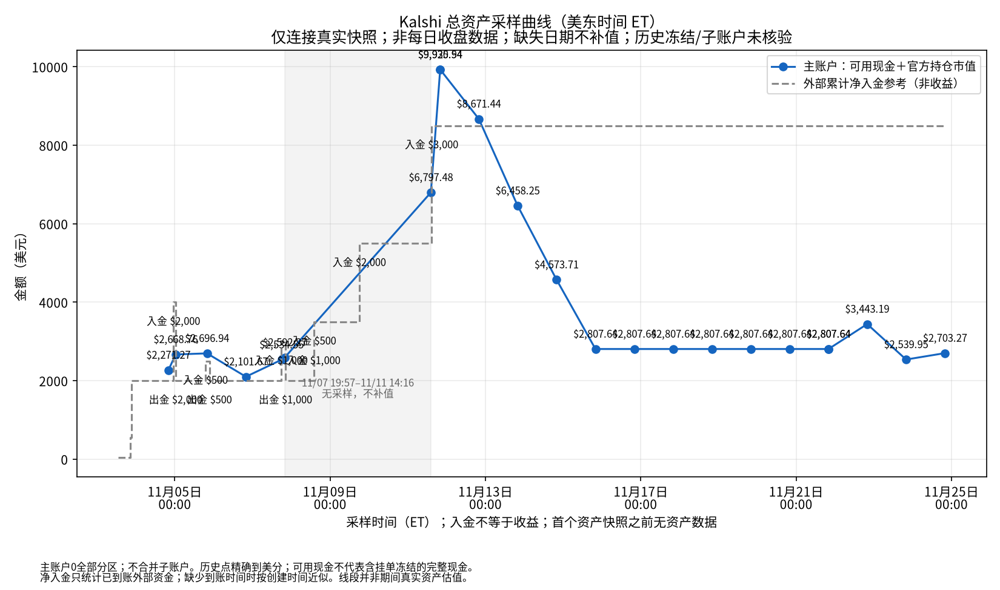

# Kalshi 每日交易报告 — 2026-11-24（美东时间）

_生成时间：2026-11-24 19:59 美东_

## 一、当日成交（40 笔）

| 时间(ET) | 市场 | 方向 | 份数 | 价格 | 金额 | 手续费 |
|---|---|---|---:|---:|---:|---:|
| 16:33:50 | Tennessee wins `KXNCAAMBGAME-26NOV24TENNMD-TENN` | 买入 YES | 0.11 | $0.8500 | $0.09 | $0.00 |
| 16:37:15 | BYU wins `KXNCAAMBGAME-26NOV24MISSBYU-BYU` | 买入 YES | 49.80 | $0.1900 | $9.46 | $0.54 |
| 16:38:21 | BYU wins `KXNCAAMBGAME-26NOV24MISSBYU-BYU` | 买入 YES | 42.78 | $0.1100 | $4.71 | $0.29 |
| 16:43:55 | TCU wins `KXNCAAMBGAME-26NOV24TCUMIA-TCU` | 买入 YES | 246.54 | $0.8000 | $197.23 | $2.76 |
| 16:46:57 | TCU wins `KXNCAAMBGAME-26NOV24TCUMIA-TCU` | 买入 YES | 125.00 | $0.8300 | $103.75 | $1.23 |
| 16:46:57 | TCU wins `KXNCAAMBGAME-26NOV24TCUMIA-TCU` | 买入 YES | 20.89 | $0.8300 | $17.34 | $0.21 |
| 16:46:57 | TCU wins `KXNCAAMBGAME-26NOV24TCUMIA-TCU` | 买入 YES | 50.00 | $0.8300 | $41.50 | $0.49 |
| 16:46:57 | TCU wins `KXNCAAMBGAME-26NOV24TCUMIA-TCU` | 买入 YES | 23.24 | $0.8300 | $19.29 | $0.23 |
| 16:46:57 | TCU wins `KXNCAAMBGAME-26NOV24TCUMIA-TCU` | 买入 YES | 19.00 | $0.8300 | $15.77 | $0.19 |
| 17:52:24 | Illinois St. wins `KXNCAAMBGAME-26NOV24ILSTTLSA-ILST` | 买入 YES | 0.14 | $0.6900 | $0.10 | $0.00 |
| 17:53:09 | Iowa St. wins `KXNCAAMBGAME-26NOV24SDSUISU-ISU` | 买入 YES | 0.12 | $0.7900 | $0.09 | $0.00 |
| 17:53:16 | Michigan wins `KXNCAAMBGAME-26NOV24MICHCREI-MICH` | 买入 YES | 0.13 | $0.7000 | $0.09 | $0.00 |
| 17:53:25 | Rutgers wins `KXNCAAMBGAME-26NOV24SHURUTG-RUTG` | 买入 YES | 0.10 | $0.9800 | $0.10 | $0.00 |
| 17:53:55 | Boston wins `KXNBAGAME-26NOV24BOSWAS-BOS` | 买入 YES | 0.12 | $0.7900 | $0.09 | $0.00 |
| 17:54:02 | Denver wins `KXNBAGAME-26NOV24DALDEN-DEN` | 买入 YES | 0.13 | $0.7200 | $0.09 | $0.00 |
| 17:56:43 | Illinois St. wins `KXNCAAMBGAME-26NOV24ILSTTLSA-ILST` | 买入 YES | 0.29 | $0.8200 | $0.24 | $0.00 |
| 17:56:43 | Illinois St. wins `KXNCAAMBGAME-26NOV24ILSTTLSA-ILST` | 买入 YES | 54.60 | $0.8200 | $44.77 | $0.56 |
| 17:56:43 | Illinois St. wins `KXNCAAMBGAME-26NOV24ILSTTLSA-ILST` | 买入 YES | 184.07 | $0.8200 | $150.94 | $1.90 |
| 17:56:43 | Illinois St. wins `KXNCAAMBGAME-26NOV24ILSTTLSA-ILST` | 买入 YES | 0.01 | $0.8200 | $0.01 | $0.00 |
| 17:57:19 | Illinois St. wins `KXNCAAMBGAME-26NOV24ILSTTLSA-ILST` | 买入 YES | 240.86 | $0.8200 | $197.51 | $2.49 |
| 18:16:12 | Illinois St. wins `KXNCAAMBGAME-26NOV24ILSTTLSA-ILST` | 买入 YES | 211.87 | $0.9400 | $199.16 | $0.84 |
| 18:21:03 | Eastern Michigan wins `KXNCAAMBGAME-26NOV24EMUKENN-EMU` | 买入 YES | 0.17 | $0.5700 | $0.10 | $0.00 |
| 18:29:00 | Iowa St. wins `KXNCAAMBGAME-26NOV24SDSUISU-ISU` | 买入 YES | 4.75 | $0.8400 | $3.99 | $0.04 |
| 18:29:00 | Iowa St. wins `KXNCAAMBGAME-26NOV24SDSUISU-ISU` | 买入 YES | 16.00 | $0.8400 | $13.44 | $0.15 |
| 18:29:00 | Iowa St. wins `KXNCAAMBGAME-26NOV24SDSUISU-ISU` | 买入 YES | 40.00 | $0.8400 | $33.60 | $0.38 |
| 18:29:00 | Iowa St. wins `KXNCAAMBGAME-26NOV24SDSUISU-ISU` | 买入 YES | 40.00 | $0.8400 | $33.60 | $0.38 |
| 18:29:00 | Iowa St. wins `KXNCAAMBGAME-26NOV24SDSUISU-ISU` | 买入 YES | 62.00 | $0.8500 | $52.70 | $0.55 |
| 18:29:00 | Iowa St. wins `KXNCAAMBGAME-26NOV24SDSUISU-ISU` | 买入 YES | 72.00 | $0.8400 | $60.48 | $0.68 |
| 18:29:35 | Iowa St. wins `KXNCAAMBGAME-26NOV24SDSUISU-ISU` | 买入 YES | 72.00 | $0.8500 | $61.20 | $0.64 |
| 18:29:35 | Iowa St. wins `KXNCAAMBGAME-26NOV24SDSUISU-ISU` | 买入 YES | 4.88 | $0.8500 | $4.15 | $0.04 |
| 18:29:35 | Iowa St. wins `KXNCAAMBGAME-26NOV24SDSUISU-ISU` | 买入 YES | 153.42 | $0.8600 | $131.94 | $1.29 |
| 18:31:07 | Iowa St. wins `KXNCAAMBGAME-26NOV24SDSUISU-ISU` | 买入 YES | 582.12 | $0.8500 | $494.80 | $5.20 |
| 18:31:42 | Iowa St. wins `KXNCAAMBGAME-26NOV24SDSUISU-ISU` | 买入 YES | 12.67 | $0.8900 | $11.28 | $0.09 |
| 18:31:42 | Iowa St. wins `KXNCAAMBGAME-26NOV24SDSUISU-ISU` | 买入 YES | 5.00 | $0.8900 | $4.45 | $0.03 |
| 18:31:42 | Iowa St. wins `KXNCAAMBGAME-26NOV24SDSUISU-ISU` | 买入 YES | 205.33 | $0.8900 | $182.74 | $1.41 |
| 18:33:46 | Iowa St. wins `KXNCAAMBGAME-26NOV24SDSUISU-ISU` | 买入 YES | 218.40 | $0.9100 | $198.74 | $1.25 |
| 18:34:59 | Iowa St. wins `KXNCAAMBGAME-26NOV24SDSUISU-ISU` | 买入 YES | 1.23 | $0.9200 | $1.13 | $0.01 |
| 18:34:59 | Iowa St. wins `KXNCAAMBGAME-26NOV24SDSUISU-ISU` | 买入 YES | 439.40 | $0.9200 | $404.25 | $2.26 |
| 18:34:59 | Iowa St. wins `KXNCAAMBGAME-26NOV24SDSUISU-ISU` | 买入 YES | 58.00 | $0.9200 | $53.36 | $0.30 |
| 18:34:59 | Iowa St. wins `KXNCAAMBGAME-26NOV24SDSUISU-ISU` | 买入 YES | 41.82 | $0.9200 | $38.47 | $0.22 |

合计：买入 $2,786.75，卖出 $0.00，手续费 $26.67

_“买入/卖出”根据成交前的持仓方向判断（Kalshi 中卖 YES 与买 NO 是同一方向的订单）。_

## 二、当日已实现盈亏

### 1. 结算（7 个市场）

| 结算时间(ET) | 市场 | 结果 | 持有 | 结算赔付 | 成本 | 手续费 | 盈亏 |
|---|---|---|---|---:|---:|---:|---:|
| 00:29 | San Antonio wins `KXNBAGAME-26NOV23SASSAC-SAS` | YES | YES 2,330.06 | $2,330.06 | $2,215.75 | $7.41 | **+$106.90** |
| 00:37 | Los Angeles L wins `KXNBAGAME-26NOV23UTALAL-LAL` | YES | YES 0.11 | $0.11 | $0.10 | $0.00 | **+$0.01** |
| 16:55 | BYU wins `KXNCAAMBGAME-26NOV24MISSBYU-BYU` | NO | YES 92.58 | $0.00 | $14.17 | $0.83 | **-$15.00** |
| 17:27 | Tennessee wins `KXNCAAMBGAME-26NOV24TENNMD-TENN` | YES | YES 0.11 | $0.11 | $0.09 | $0.00 | **+$0.02** |
| 17:29 | TCU wins `KXNCAAMBGAME-26NOV24TCUMIA-TCU` | YES | YES 484.67 | $484.67 | $394.88 | $5.11 | **+$84.68** |
| 18:45 | Illinois St. wins `KXNCAAMBGAME-26NOV24ILSTTLSA-ILST` | YES | YES 691.84 | $691.84 | $592.72 | $5.80 | **+$93.33** |
| 19:57 | Rutgers wins `KXNCAAMBGAME-26NOV24SHURUTG-RUTG` | YES | YES 0.10 | $0.10 | $0.10 | $0.00 | **$0.00** |

### 2. 卖出平仓（0 个市场）

当天没有卖出平仓。

### 3. 按市场汇总

| 市场 | 来源 | 净盈亏 |
|---|---|---:|
| San Antonio wins | 结算 | +$106.90 |
| Illinois St. wins | 结算 | +$93.33 |
| TCU wins | 结算 | +$84.68 |
| Tennessee wins | 结算 | +$0.02 |
| Los Angeles L wins | 结算 | +$0.01 |
| Rutgers wins | 结算 | $0.00 |
| BYU wins | 结算 | -$15.00 |

**当日已实现净盈亏合计：+$269.94**（盈利 6 个市场，亏损 1 个市场；均已扣手续费）

_当天买入但尚未平仓/结算的仓位不计入已实现盈亏，见下方持仓。_

## 三、当前持仓与资金（报告生成时的实时数据）

- 现金余额：**$694.21**
- Kalshi 显示的持仓市值（portfolio_value）：$2,009.06
- 持仓市场数：5

| 市场 | 方向 | 份数 | 成本 | 均价 | 当前买价(bid) | 估算市值 | 浮动盈亏(估) |
|---|---|---:|---:|---:|---:|---:|---:|
| Iowa St. wins `KXNCAAMBGAME-26NOV24SDSUISU-ISU` | YES | 2,029.14 | $1,784.42 | $0.8794 | $0.9900 | $2,008.85 | +$224.42 |
| Eastern Michigan wins `KXNCAAMBGAME-26NOV24EMUKENN-EMU` | YES | 0.17 | $0.10 | $0.5700 | $0.1400 | $0.02 | -$0.07 |
| Boston wins `KXNBAGAME-26NOV24BOSWAS-BOS` | YES | 0.12 | $0.09 | $0.7900 | $0.7800 | $0.09 | $0.00 |
| Denver wins `KXNBAGAME-26NOV24DALDEN-DEN` | YES | 0.13 | $0.09 | $0.7200 | $0.7100 | $0.09 | $0.00 |
| Michigan wins `KXNCAAMBGAME-26NOV24MICHCREI-MICH` | YES | 0.13 | $0.09 | $0.7000 | $0.0000 | $0.00 | -$0.09 |

持仓总成本 $1,784.80，按当前买价估算市值 $2,009.06，浮动盈亏 +$224.26（估算，未扣卖出手续费）

## 总资产曲线（真实资产快照）

采样时间：2026-11-24T19:59:25-05:00（ET）。主账户可用现金 **$694.2078** ＋ 官方持仓市值 **$2,009.06** ＝ **$2,703.2678**。

当前未成交挂单 0 笔；冻结资金为0。

主账户0，全部交易分区；不合并子账户；内部划转不计外部入金。

总资产曲线口径为API可用现金＋官方持仓市值，不用买价估值替代官方市值。历史挂单冻结及子账户余额未留存，历史点仅代表主账户可核对资产，不保证完整账户净值。真实采样点之间连线仅辅助阅读，不代表连续估值；缺失日期不补值。净入金仅取已到账外部充值减已完成提现；缺少完成时间时以创建时间近似，因此不保证日内到账时点。主账户与子账户内部划转不计入金；主账户资产与全账户外部净入金之差不一定是收益。

审计数据：`charts/total_assets.csv`、`charts/total_assets.json`；原始快照在 `data/asset_snapshots/`。

---
**口径说明**：结算盈亏 = 结算赔付（含 YES/NO 配对兑付）− 该市场累计买入成本 − 累计手续费 − 之前已计入的平仓盈亏；卖出平仓盈亏用平均成本法（含开仓、平仓手续费）。数据全部来自 Kalshi 只读 API。
