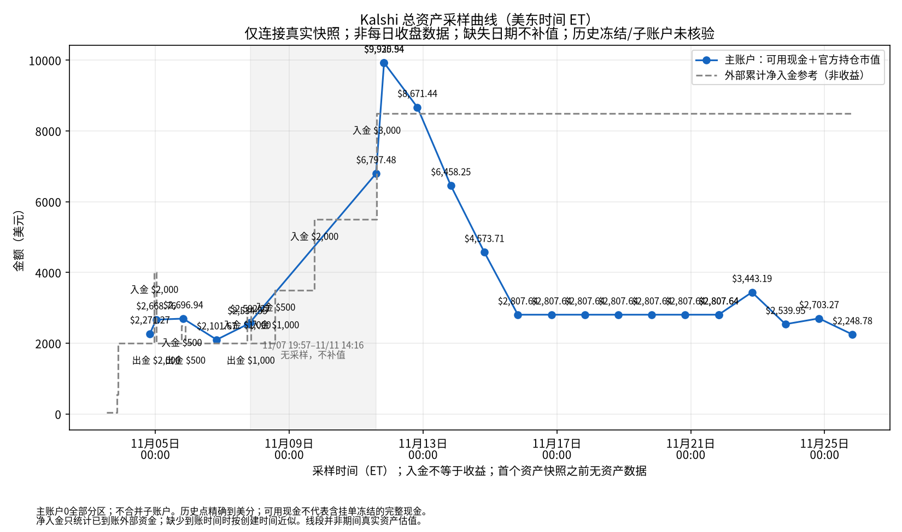

# Kalshi 每日交易报告 — 2026-11-25（美东时间）

_生成时间：2026-11-25 19:55 美东_

## 一、当日成交（32 笔）

| 时间(ET) | 市场 | 方向 | 份数 | 价格 | 金额 | 手续费 |
|---|---|---|---:|---:|---:|---:|
| 15:22:17 | Arizona St. wins `KXNCAAMBGAME-26NOV25LSUASU-ASU` | 买入 YES | 240.86 | $0.8200 | $197.51 | $2.49 |
| 15:22:59 | Arizona St. wins `KXNCAAMBGAME-26NOV25LSUASU-ASU` | 买入 YES | 816.96 | $0.8500 | $694.42 | $7.29 |
| 15:22:59 | Arizona St. wins `KXNCAAMBGAME-26NOV25LSUASU-ASU` | 买入 YES | 2,023.00 | $0.8500 | $1,719.55 | $18.06 |
| 15:22:59 | Arizona St. wins `KXNCAAMBGAME-26NOV25LSUASU-ASU` | 买入 YES | 20.65 | $0.8500 | $17.55 | $0.18 |
| 15:22:59 | Arizona St. wins `KXNCAAMBGAME-26NOV25LSUASU-ASU` | 买入 YES | 50.00 | $0.8500 | $42.50 | $0.45 |
| 15:48:33 | Arizona St. wins `KXNCAAMBGAME-26NOV25LSUASU-ASU` | 卖出 YES | 375.89 | $0.5100 | $191.70 | $6.58 |
| 15:48:33 | Arizona St. wins `KXNCAAMBGAME-26NOV25LSUASU-ASU` | 卖出 YES | 1,144.58 | $0.5100 | $583.74 | $20.02 |
| 15:48:33 | Arizona St. wins `KXNCAAMBGAME-26NOV25LSUASU-ASU` | 卖出 YES | 343.00 | $0.5100 | $174.93 | $6.00 |
| 15:48:33 | Arizona St. wins `KXNCAAMBGAME-26NOV25LSUASU-ASU` | 卖出 YES | 644.00 | $0.5100 | $328.44 | $11.27 |
| 15:48:33 | Arizona St. wins `KXNCAAMBGAME-26NOV25LSUASU-ASU` | 卖出 YES | 644.00 | $0.5100 | $328.44 | $11.27 |
| 15:48:39 | LSU wins `KXNCAAMBGAME-26NOV25LSUASU-LSU` | 买入 YES | 350.01 | $0.4900 | $171.50 | $6.12 |
| 15:48:39 | LSU wins `KXNCAAMBGAME-26NOV25LSUASU-LSU` | 买入 YES | 2,677.00 | $0.4900 | $1,311.73 | $46.83 |
| 15:48:39 | LSU wins `KXNCAAMBGAME-26NOV25LSUASU-LSU` | 买入 YES | 76.48 | $0.4900 | $37.48 | $1.34 |
| 16:16:25 | LSU wins `KXNCAAMBGAME-26NOV25LSUASU-LSU` | 卖出 YES | 0.01 | $0.8300 | $0.01 | $0.00 |
| 16:16:25 | LSU wins `KXNCAAMBGAME-26NOV25LSUASU-LSU` | 卖出 YES | 10.00 | $0.8300 | $8.30 | $0.10 |
| 16:16:25 | LSU wins `KXNCAAMBGAME-26NOV25LSUASU-LSU` | 卖出 YES | 10.00 | $0.8300 | $8.30 | $0.10 |
| 16:16:25 | LSU wins `KXNCAAMBGAME-26NOV25LSUASU-LSU` | 卖出 YES | 2,449.02 | $0.8300 | $2,032.69 | $24.19 |
| 16:16:25 | LSU wins `KXNCAAMBGAME-26NOV25LSUASU-LSU` | 卖出 YES | 634.06 | $0.8300 | $526.27 | $6.26 |
| 16:16:25 | LSU wins `KXNCAAMBGAME-26NOV25LSUASU-LSU` | 卖出 YES | 0.40 | $0.8300 | $0.33 | $0.00 |
| 16:17:57 | Arizona St. wins `KXNCAAMBGAME-26NOV25LSUASU-ASU` | 买入 YES | 52.53 | $0.1800 | $9.46 | $0.54 |
| 16:20:24 | Arizona St. wins `KXNCAAMBGAME-26NOV25LSUASU-ASU` | 卖出 YES | 49.00 | $0.4700 | $23.03 | $0.85 |
| 16:20:24 | Arizona St. wins `KXNCAAMBGAME-26NOV25LSUASU-ASU` | 卖出 YES | 3.53 | $0.4600 | $1.62 | $0.06 |
| 16:21:51 | Arizona St. wins `KXNCAAMBGAME-26NOV25LSUASU-ASU` | 买入 YES | 38.00 | $0.2400 | $9.12 | $0.49 |
| 16:22:08 | Arizona St. wins `KXNCAAMBGAME-26NOV25LSUASU-ASU` | 卖出 YES | 0.01 | $0.2400 | $0.00 | $0.00 |
| 16:22:08 | Arizona St. wins `KXNCAAMBGAME-26NOV25LSUASU-ASU` | 卖出 YES | 5.00 | $0.2400 | $1.20 | $0.06 |
| 16:22:08 | Arizona St. wins `KXNCAAMBGAME-26NOV25LSUASU-ASU` | 卖出 YES | 32.99 | $0.2400 | $7.92 | $0.42 |
| 16:23:32 | Ole Miss wins `KXNCAAMBGAME-26NOV25MISSARIZ-MISS` | 买入 YES | 67.37 | $0.1400 | $9.43 | $0.57 |
| 16:27:32 | Ole Miss wins `KXNCAAMBGAME-26NOV25MISSARIZ-MISS` | 买入 YES | 855.77 | $0.1100 | $94.13 | $5.86 |
| 16:29:00 | Ole Miss wins `KXNCAAMBGAME-26NOV25MISSARIZ-MISS` | 买入 YES | 976.16 | $0.0700 | $68.33 | $4.45 |
| 16:29:00 | Ole Miss wins `KXNCAAMBGAME-26NOV25MISSARIZ-MISS` | 买入 YES | 365.09 | $0.0700 | $25.56 | $1.66 |
| 16:30:00 | Ole Miss wins `KXNCAAMBGAME-26NOV25MISSARIZ-MISS` | 买入 YES | 1,716.04 | $0.0500 | $85.80 | $5.71 |
| 16:30:00 | Ole Miss wins `KXNCAAMBGAME-26NOV25MISSARIZ-MISS` | 买入 YES | 159.25 | $0.0500 | $7.96 | $0.53 |

合计：买入 $4,502.03，卖出 $4,216.92，手续费 $189.75

_“买入/卖出”根据成交前的持仓方向判断（Kalshi 中卖 YES 与买 NO 是同一方向的订单）。_

## 二、当日已实现盈亏

### 1. 结算（4 个市场）

| 结算时间(ET) | 市场 | 结果 | 持有 | 结算赔付 | 成本 | 手续费 | 盈亏 |
|---|---|---|---|---:|---:|---:|---:|
| 00:39 | Denver wins `KXNBAGAME-26NOV24DALDEN-DEN` | NO | YES 0.13 | $0.00 | $0.09 | $0.00 | **-$0.10** |
| 16:47 | LSU wins `KXNCAAMBGAME-26NOV25LSUASU-LSU` | YES | YES 3,103.49 / NO 3,103.49 | $3,103.49（含 YES/NO 配对兑付 $3,103.49） | $2,048.30 | $84.94 | **+$970.24** |
| 16:47 | Arizona St. wins `KXNCAAMBGAME-26NOV25LSUASU-ASU` | NO | YES 3,242.00 / NO 3,242.00 | $3,242.00（含 YES/NO 配对兑付 $3,242.00） | $4,291.08 | $86.02 | **-$1,135.10** |
| 16:57 | Ole Miss wins `KXNCAAMBGAME-26NOV25MISSARIZ-MISS` | NO | YES 4,139.68 | $0.00 | $291.22 | $18.78 | **-$310.00** |

_同时持有过 YES 和 NO 的市场（中途卖出平仓过），结算盈亏已经包含该市场所有买卖和手续费，不再单独计入卖出平仓。_

### 2. 卖出平仓（0 个市场）

当天没有卖出平仓。

### 3. 按市场汇总

| 市场 | 来源 | 净盈亏 |
|---|---|---:|
| LSU wins | 结算 | +$970.24 |
| Denver wins | 结算 | -$0.10 |
| Ole Miss wins | 结算 | -$310.00 |
| Arizona St. wins | 结算 | -$1,135.10 |

**当日已实现净盈亏合计：-$474.95**（盈利 1 个市场，亏损 3 个市场；均已扣手续费）

_当天买入但尚未平仓/结算的仓位不计入已实现盈亏，见下方持仓。_

## 三、当前持仓与资金（报告生成时的实时数据）

- 现金余额：**$2,248.78**
- Kalshi 显示的持仓市值（portfolio_value）：$0.00
- 持仓市场数：0

## 总资产曲线（真实资产快照）

采样时间：2026-11-25T19:55:44-05:00（ET）。主账户可用现金 **$2,248.7843** ＋ 官方持仓市值 **$0.00** ＝ **$2,248.7843**。

当前未成交挂单 0 笔；冻结资金为0。

主账户0，全部交易分区；不合并子账户；内部划转不计外部入金。

总资产曲线口径为API可用现金＋官方持仓市值，不用买价估值替代官方市值。历史挂单冻结及子账户余额未留存，历史点仅代表主账户可核对资产，不保证完整账户净值。真实采样点之间连线仅辅助阅读，不代表连续估值；缺失日期不补值。净入金仅取已到账外部充值减已完成提现；缺少完成时间时以创建时间近似，因此不保证日内到账时点。主账户与子账户内部划转不计入金；主账户资产与全账户外部净入金之差不一定是收益。

审计数据：`charts/total_assets.csv`、`charts/total_assets.json`；原始快照在 `data/asset_snapshots/`。

---
**口径说明**：结算盈亏 = 结算赔付（含 YES/NO 配对兑付）− 该市场累计买入成本 − 累计手续费 − 之前已计入的平仓盈亏；卖出平仓盈亏用平均成本法（含开仓、平仓手续费）。数据全部来自 Kalshi 只读 API。
