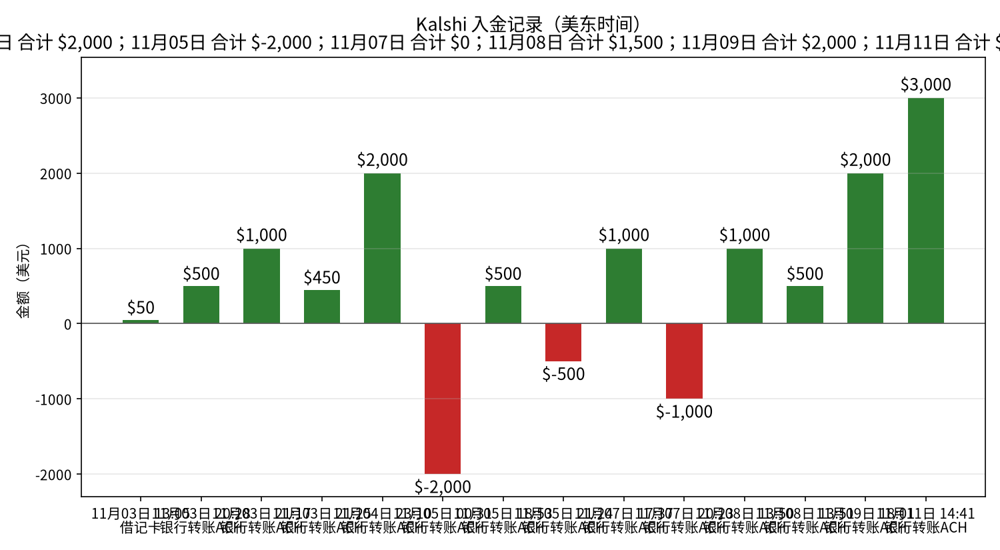
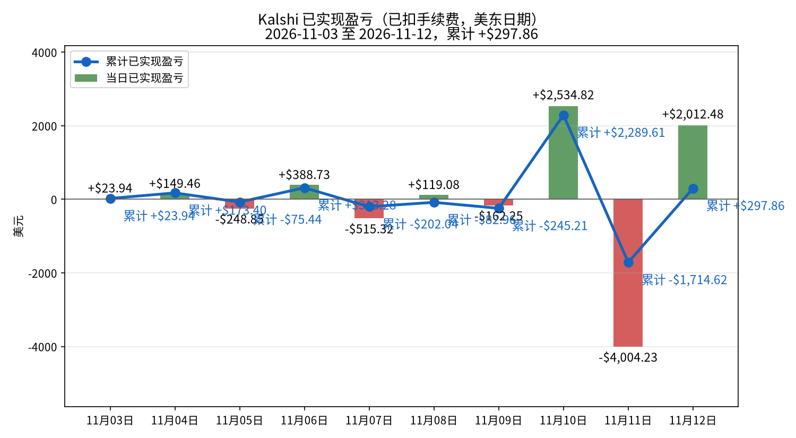
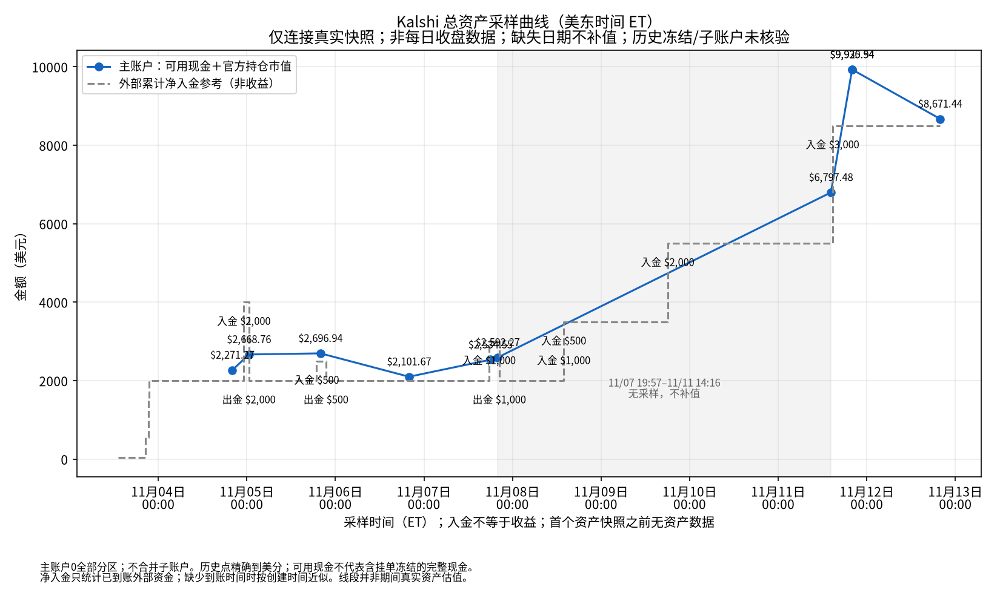
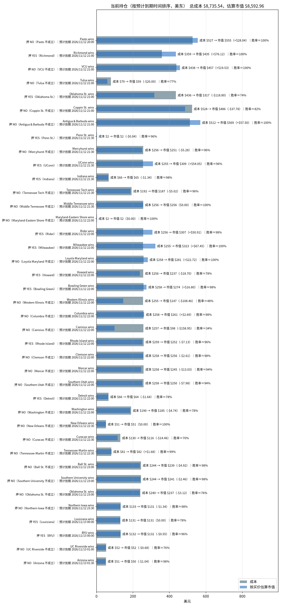

# Kalshi 资金、盈亏与持仓分析（2026-11-12）

_数据生成时间：2026-11-12 19:53（美东），全部来自 Kalshi 只读 API。持仓价格是生成那一刻的报价，之后会变。_

## 一、入金记录

| 时间（美东） | 类型 | 方式 | 金额 | 手续费 | 状态 |
|---|---|---|---:|---:|---|
| 2026-11-03 13:05 | 入金 | 借记卡 | $50.00 | $0.00 | 已到账 |
| 2026-11-03 20:28 | 入金 | 银行转账ACH | $500.00 | $0.00 | 已到账 |
| 2026-11-03 21:17 | 入金 | 银行转账ACH | $1,000.00 | $0.00 | 已到账 |
| 2026-11-03 21:25 | 入金 | 银行转账ACH | $450.00 | $0.00 | 已到账 |
| 2026-11-04 23:10 | 入金 | 银行转账ACH | $2,000.00 | $0.00 | 已到账 |
| 2026-11-05 00:31 | 出金 | 银行转账ACH | $2,000.00 | $0.00 | 已到账 |
| 2026-11-05 18:53 | 入金 | 银行转账ACH | $500.00 | $0.00 | 已到账 |
| 2026-11-05 21:24 | 出金 | 银行转账ACH | $500.00 | $0.00 | 已到账 |
| 2026-11-07 17:37 | 入金 | 银行转账ACH | $1,000.00 | $0.00 | 已到账 |
| 2026-11-07 20:23 | 出金 | 银行转账ACH | $1,000.00 | $0.00 | 已到账 |
| 2026-11-08 13:50 | 入金 | 银行转账ACH | $1,000.00 | $0.00 | 已到账 |
| 2026-11-08 13:51 | 入金 | 银行转账ACH | $500.00 | $0.00 | 已到账 |
| 2026-11-09 18:01 | 入金 | 银行转账ACH | $2,000.00 | $0.00 | 已到账 |
| 2026-11-11 14:41 | 入金 | 银行转账ACH | $3,000.00 | $0.00 | 已到账 |

**合计入金 $12,000.00，出金 $3,500.00。**

## 二、已实现盈亏曲线

| 日期（美东） | 结算盈亏 | 卖出平仓盈亏 | 当日已实现 | 累计 | 成交笔数 | 当日手续费 |
|---|---:|---:|---:|---:|---:|---:|
| 2026-11-03 | +$23.94（4 个市场） | $0.00（0 个市场） | **+$23.94** | +$23.94 | 72 | $17.04 |
| 2026-11-04 | +$386.26（35 个市场） | -$236.80（1 个市场） | **+$149.46** | +$173.40 | 112 | $125.59 |
| 2026-11-05 | -$248.85（28 个市场） | $0.00（0 个市场） | **-$248.85** | -$75.44 | 61 | $40.92 |
| 2026-11-06 | +$123.19（45 个市场） | +$265.54（4 个市场） | **+$388.73** | +$313.28 | 109 | $47.80 |
| 2026-11-07 | -$515.32（49 个市场） | $0.00（0 个市场） | **-$515.32** | -$202.04 | 200 | $126.79 |
| 2026-11-08 | +$119.08（22 个市场） | $0.00（0 个市场） | **+$119.08** | -$82.96 | 61 | $72.93 |
| 2026-11-09 | +$483.39（13 个市场） | -$645.64（4 个市场） | **-$162.25** | -$245.21 | 125 | $186.45 |
| 2026-11-10 | +$2,534.82（32 个市场） | $0.00（0 个市场） | **+$2,534.82** | +$2,289.61 | 238 | $394.43 |
| 2026-11-11 | -$2,371.65（50 个市场） | -$1,632.59（3 个市场） | **-$4,004.23** | -$1,714.62 | 457 | $410.22 |
| 2026-11-12 | +$2,160.60（31 个市场） | -$148.13（1 个市场） | **+$2,012.48** | +$297.86 | 284 | $142.38 |

口径：都已扣手续费。结算盈亏 = 结算赔付（含 YES/NO 配对兑付）− 该市场累计买入成本 − 累计手续费；卖出平仓用平均成本法。

**对账**：现金 $5.83 + 持仓按买价估算市值 $8,592.96 = $8,598.79，减去净入金 $8,500.00，买价估值口径差额 **+$98.79**（不是下图官方总资产口径）。盈亏模型对照（可能因采样时差、成本口径而不同，非强制相等）：累计已实现 +$297.86 + 浮动 -$142.58 − 持仓已付手续费 $56.49 = +$98.79。

## 总资产曲线（真实资产快照）

采样时间：2026-11-12T19:53:32-05:00（ET）。主账户可用现金 **$5.8294** ＋ 官方持仓市值 **$8,665.61** ＝ **$8,671.4394**。

当前未成交挂单 0 笔；冻结资金为0。

主账户0，全部交易分区；不合并子账户；内部划转不计外部入金。

总资产曲线口径为API可用现金＋官方持仓市值，不用买价估值替代官方市值。历史挂单冻结及子账户余额未留存，历史点仅代表主账户可核对资产，不保证完整账户净值。真实采样点之间连线仅辅助阅读，不代表连续估值；缺失日期不补值。净入金仅取已到账外部充值减已完成提现；缺少完成时间时以创建时间近似，因此不保证日内到账时点。主账户与子账户内部划转不计入金；主账户资产与全账户外部净入金之差不一定是收益。

审计数据：`../data/total_assets.csv`、`../data/total_assets.json`；原始快照在 `data/asset_snapshots/`（原始快照文件未放入本仓库，路径和 sha256 记在 JSON 里）。

**官方口径复核**：可用现金 $5.8294 ＋ 官方持仓市值 $8,665.61 ＝ 总资产 $8,671.4394。官方市值比逐仓买价估值高 $72.6535；因此两种资产口径不能混用。

总资产减外部净入金 = +$171.44；盈亏模型加估值差额 = +$171.44，对账残差 $0.000000。仅在无子账户内部资金影响且现金覆盖完整时，此差额才可解释为整体盈亏。

## 三、当前持仓与到期时间

| 预计到期（美东） | 市场 | 押注 | 份数 | 成本 | 均价 | 买价/卖价 | 估算市值 | 浮动盈亏 | 赢了净赚* | 隐含胜率 |
|---|---|---|---:|---:|---:|---|---:|---:|---:|---:|
| 2026-11-12 20:00 | Pasto wins `KXDIMAYORGAME-26NOV12PASJUN-PAS` | NO（Pasto 不成立） | 560.84 | $527.19 | $0.940 | 0.99/1.0 | $555.23 | +$28.04 | +$31.44 | 99.5% |
| 2026-11-12 21:00 | Richmond wins `KXNCAAWBGAME-26NOV12ODURICH-RICH` | YES（Richmond） | 439.25 | $358.74 | $0.817 | 0.99/1.0 | $434.86 | +$76.12 | +$75.91 | 99.5% |
| 2026-11-12 21:00 | VCU wins `KXNCAAWBGAME-26NOV12VTVCU-VCU` | NO（VCU 不成立） | 462.00 | $437.85 | $0.948 | 0.99/1.0 | $457.38 | +$19.53 | +$22.55 | 99.5% |
| 2026-11-12 21:00 | Tulsa wins `KXNCAAWBGAME-26NOV12OKSTTLSA-TLSA` | NO（Tulsa 不成立） | 80.00 | $79.20 | $0.990 | 0.74/0.8 | $59.20 | -$20.00 | +$0.74 | 77.0% |
| 2026-11-12 21:00 | Oklahoma St. wins `KXNCAAWBGAME-26NOV12OKSTTLSA-OKST` | YES（Oklahoma St.） | 440.00 | $435.60 | $0.990 | 0.72/0.77 | $316.80 | -$118.80 | +$4.09 | 74.5% |
| 2026-11-12 21:00 | Coppin St. wins `KXNCAAMBGAME-26NOV12COPPBRAD-COPP` | NO（Coppin St. 不成立） | 600.00 | $523.78 | $0.873 | 0.81/0.82 | $486.00 | -$37.78 | +$71.56 | 81.5% |
| 2026-11-12 21:00 | Antigua & Barbuda wins `KXCONCACAFNLGAME-26NOV12ANTTTO-ANT` | NO（Antigua & Barbuda 不成立） | 575.00 | $511.75 | $0.890 | 0.99/1.0 | $569.25 | +$57.50 | +$59.31 | 99.5% |
| 2026-11-12 21:30 | Penn St. wins `KXNCAAMBGAME-26NOV12MHUPSU-PSU` | YES（Penn St.） | 2.00 | $1.94 | $0.970 | 0.95/0.96 | $1.90 | -$0.04 | +$0.06 | 95.5% |
| 2026-11-12 21:30 | Mercyhurst wins `KXNCAAMBGAME-26NOV12MHUPSU-MHU` | NO（Mercyhurst 不成立） | 264.00 | $256.08 | $0.970 | 0.95/0.96 | $250.80 | -$5.28 | +$7.38 | 95.5% |
| 2026-11-12 21:30 | UConn wins `KXNCAAWBGAME-26NOV12CONNOSU-CONN` | YES（UConn） | 322.00 | $255.07 | $0.792 | 0.96/0.97 | $309.12 | +$54.05 | +$63.22 | 96.5% |
| 2026-11-12 21:30 | Indiana wins `KXNCAAMBGAME-26NOV12TNTCIND-IND` | YES（Indiana） | 67.00 | $66.33 | $0.990 | 0.97/0.98 | $64.99 | -$1.34 | +$0.62 | 97.5% |
| 2026-11-12 21:30 | Tennessee Tech wins `KXNCAAMBGAME-26NOV12TNTCIND-TNTC` | NO（Tennessee Tech 不成立） | 195.00 | $192.22 | $0.986 | 0.96/0.97 | $187.20 | -$5.02 | +$2.59 | 96.5% |
| 2026-11-12 21:30 | Middle Tennessee wins `KXNCAAWBGAME-26NOV12MTUTENN-MTU` | NO（Middle Tennessee 不成立） | 259.00 | $256.41 | $0.990 | 0.99/1.0 | $256.41 | $0.00 | +$2.41 | 99.5% |
| 2026-11-12 22:00 | Maryland-Eastern Shore wins `KXNCAAWBGAME-26NOV12UMESGT-UMES` | NO（Maryland-Eastern Shore 不成立） | 2.00 | $1.98 | $0.990 | 0.99/1.0 | $1.98 | $0.00 | +$0.02 | 99.5% |
| 2026-11-12 22:00 | Rider wins `KXNCAAWBGAME-26NOV12RIDCCSU-RID` | YES（Rider） | 313.00 | $255.83 | $0.817 | 0.98/0.99 | $306.74 | +$50.91 | +$53.90 | 98.5% |
| 2026-11-12 22:00 | Milwaukee wins `KXNCAAWBGAME-26NOV12UNDMILW-MILW` | YES（Milwaukee） | 326.00 | $255.29 | $0.783 | 0.99/1.0 | $322.74 | +$67.45 | +$66.83 | 99.5% |
| 2026-11-12 22:00 | Loyola Maryland wins `KXNCAAMBGAME-26NOV12LMDTOWS-LMD` | NO（Loyola Maryland 不成立） | 284.00 | $258.44 | $0.910 | 0.99/1.0 | $281.16 | +$22.72 | +$23.93 | 99.5% |
| 2026-11-12 22:00 | Howard wins `KXNCAAMBGAME-26NOV12STETHOW-HOW` | YES（Howard） | 312.00 | $255.82 | $0.820 | 0.76/0.8 | $237.12 | -$18.70 | +$52.96 | 78.0% |
| 2026-11-12 22:00 | Bowling Green wins `KXNCAAMBGAME-26NOV12NIAGBGSU-BGSU` | YES（Bowling Green） | 280.00 | $257.60 | $0.920 | 0.98/0.99 | $274.40 | +$16.80 | +$20.96 | 98.5% |
| 2026-11-12 22:00 | Western Illinois wins `KXNCAAMBGAME-26NOV12CSBWIU-WIU` | NO（Western Illinois 不成立） | 319.00 | $255.20 | $0.800 | 0.46/0.5 | $146.74 | -$108.46 | +$60.23 | 48.0% |
| 2026-11-12 22:00 | Columbia wins `KXNCAAWBGAME-26NOV12MICHCLMB-CLMB` | NO（Columbia 不成立） | 269.00 | $258.24 | $0.960 | 0.97/0.99 | $260.93 | +$2.69 | +$10.04 | 98.0% |
| 2026-11-12 22:00 | Canisius wins `KXNCAAMBGAME-26NOV12CANBRWN-CAN` | NO（Canisius 不成立） | 289.00 | $257.21 | $0.890 | 0.34/0.35 | $98.26 | -$158.95 | +$29.81 | 34.5% |
| 2026-11-12 22:00 | Rhode Island wins `KXNCAAMBGAME-26NOV12UMESURI-URI` | YES（Rhode Island） | 265.00 | $258.88 | $0.977 | 0.95/0.96 | $251.75 | -$7.13 | +$5.70 | 95.5% |
| 2026-11-12 22:00 | Clemson wins `KXNCAAWBGAME-26NOV12SCARCLEM-CLEM` | NO（Clemson 不成立） | 261.00 | $258.39 | $0.990 | 0.98/0.99 | $255.78 | -$2.61 | +$2.43 | 98.5% |
| 2026-11-12 22:00 | Mercer wins `KXNCAAMBGAME-26NOV12MERWVU-MER` | NO（Mercer 不成立） | 261.00 | $258.37 | $0.990 | 0.94/0.95 | $245.34 | -$13.03 | +$2.45 | 94.5% |
| 2026-11-12 22:00 | Southern Utah wins `KXNCAAMBGAME-26NOV12SUUHP-SUU` | NO（Southern Utah 不成立） | 266.00 | $258.02 | $0.970 | 0.94/0.95 | $250.04 | -$7.98 | +$7.44 | 94.5% |
| 2026-11-12 22:00 | Detroit wins `KXNBAGAME-26NOV12DETWAS-DET` | YES（Detroit） | 82.00 | $65.60 | $0.800 | 0.78/0.79 | $63.96 | -$1.64 | +$15.48 | 78.5% |
| 2026-11-12 22:00 | Washington wins `KXNBAGAME-26NOV12DETWAS-WAS` | NO（Washington 不成立） | 237.00 | $189.60 | $0.800 | 0.78/0.79 | $184.86 | -$4.74 | +$44.75 | 78.5% |
| 2026-11-12 22:30 | New Orleans wins `KXNCAAWBGAME-26NOV12UNOTULN-UNO` | NO（New Orleans 不成立） | 52.00 | $51.48 | $0.990 | 0.99/1.0 | $51.48 | $0.00 | +$0.48 | 99.5% |
| 2026-11-12 22:30 | Curacao wins `KXCONCACAFNLGAME-26NOV12CUWPAN-CUW` | NO（Curacao 不成立） | 168.00 | $130.38 | $0.776 | 0.69/0.7 | $115.92 | -$14.46 | +$35.58 | 69.5% |
| 2026-11-12 22:30 | Tennessee-Martin wins `KXNCAAWBGAME-26NOV12UTMMIZZ-UTM` | NO（Tennessee-Martin 不成立） | 84.00 | $80.64 | $0.960 | 0.98/1.0 | $82.32 | +$1.68 | +$3.13 | 99.0% |
| 2026-11-12 23:00 | Ball St. wins `KXNCAAWBGAME-26NOV12LOUBALL-BALL` | NO（Ball St. 不成立） | 246.00 | $243.54 | $0.990 | 0.97/0.99 | $238.62 | -$4.92 | +$2.29 | 98.0% |
| 2026-11-12 23:00 | Southern University wins `KXNCAAMBGAME-26NOV12SOUMINN-SOU` | NO（Southern University 不成立） | 246.00 | $243.54 | $0.990 | 0.98/0.99 | $241.08 | -$2.46 | +$2.29 | 98.5% |
| 2026-11-12 23:00 | Oklahoma St. wins `KXNCAAMBGAME-26NOV12OKSTTXAM-OKST` | NO（Oklahoma St. 不成立） | 312.00 | $240.24 | $0.770 | 0.76/0.77 | $237.12 | -$3.12 | +$67.89 | 76.5% |
| 2026-11-12 23:30 | Northern Iowa wins `KXNCAAWBGAME-26NOV12UNIIOWA-UNI` | NO（Northern Iowa 不成立） | 134.00 | $132.66 | $0.990 | 0.98/0.99 | $131.32 | -$1.34 | +$1.25 | 98.5% |
| 2026-11-13 00:00 | Louisiana wins `KXNCAAFGAME-26NOV12ULLULM-ULL` | YES（Louisiana） | 167.33 | $130.52 | $0.780 | 0.78/0.79 | $130.52 | $0.00 | +$34.80 | 78.5% |
| 2026-11-13 00:00 | BYU wins `KXNCAAMBGAME-26NOV12MTSTBYU-BYU` | YES（BYU） | 137.00 | $132.07 | $0.964 | 0.96/0.97 | $131.52 | -$0.55 | +$4.60 | 96.5% |
| 2026-11-13 01:00 | UC Riverside wins `KXNCAAMBGAME-26NOV12UCRVSJSU-UCRV` | NO（UC Riverside 不成立） | 68.00 | $52.36 | $0.770 | 0.76/0.77 | $51.68 | -$0.68 | +$14.80 | 76.5% |
| 2026-11-13 01:30 | Arizona wins `KXNCAAWBGAME-26NOV12ARIZUCLA-ARIZ` | NO（Arizona 不成立） | 52.00 | $51.48 | $0.990 | 0.97/0.99 | $50.44 | -$1.04 | +$0.48 | 98.0% |
| **合计（39 个市场）** | | | | **$8,735.54** | | | **$8,592.96** | **-$142.58** | **+$906.39** | |

\*赢了净赚 = 赔付 − 成本 − 该仓位已付手续费。隐含胜率取你这一边买价和卖价的中间值。预计到期取 Kalshi 的 `expected_expiration_time`。

### 分析

**总敞口。** 持仓总成本 $8,735.54，按当前买价估算市值 $8,592.96，浮动 -$142.58（未扣卖出手续费）。全部押中可再净赚 +$906.39；最坏情况全部押错，亏掉 $8,735.54。账上现金 $5.83。

**什么时候到期：**
- **今天：** 35 个市场，成本 $8,369.11（占 95.8%）；最大一笔是 Pasto wins NO（Pasto 不成立），成本 $527.19，预计 2026-11-12 20:00 到期。
- **2026-11-13：** 4 个市场，成本 $366.43（占 4.2%）；最大一笔是 BYU wins YES（BYU），成本 $132.07，预计 2026-11-13 00:00 到期。

**集中度。** 成本最大的三笔：Pasto wins NO（Pasto 不成立） $527.19（6.0%）；Coppin St. wins NO（Coppin St. 不成立） $523.78（6.0%）；Antigua & Barbuda wins NO（Antigua & Barbuda 不成立） $511.75（5.9%）。
浮盈最大的是 Richmond wins（+$76.12）。

注意：KXNCAAWBGAME-26NOV12OKSTTLSA-TLSA, KXNCAAWBGAME-26NOV12OKSTTLSA-OKST 属于同一个事件，合计成本 $514.80，要看它们是对冲还是同向加注。

注意：KXNCAAMBGAME-26NOV12MHUPSU-PSU, KXNCAAMBGAME-26NOV12MHUPSU-MHU 属于同一个事件，合计成本 $258.02，要看它们是对冲还是同向加注。

注意：KXNCAAMBGAME-26NOV12TNTCIND-IND, KXNCAAMBGAME-26NOV12TNTCIND-TNTC 属于同一个事件，合计成本 $258.55，要看它们是对冲还是同向加注。

注意：KXNBAGAME-26NOV12DETWAS-DET, KXNBAGAME-26NOV12DETWAS-WAS 属于同一个事件，合计成本 $255.20，要看它们是对冲还是同向加注。

**确定程度（按隐含胜率）：**
- **基本确定（≥95%）：** Pasto wins NO（Pasto 不成立）（99.5%）、Richmond wins YES（Richmond）（99.5%）、VCU wins NO（VCU 不成立）（99.5%）、Antigua & Barbuda wins NO（Antigua & Barbuda 不成立）（99.5%）、Middle Tennessee wins NO（Middle Tennessee 不成立）（99.5%）、Maryland-Eastern Shore wins NO（Maryland-Eastern Shore 不成立）（99.5%）、Milwaukee wins YES（Milwaukee）（99.5%）、Loyola Maryland wins NO（Loyola Maryland 不成立）（99.5%）、New Orleans wins NO（New Orleans 不成立）（99.5%）、Tennessee-Martin wins NO（Tennessee-Martin 不成立）（99.0%）、Rider wins YES（Rider）（98.5%）、Bowling Green wins YES（Bowling Green）（98.5%）、Clemson wins NO（Clemson 不成立）（98.5%）、Southern University wins NO（Southern University 不成立）（98.5%）、Northern Iowa wins NO（Northern Iowa 不成立）（98.5%）、Columbia wins NO（Columbia 不成立）（98.0%）、Ball St. wins NO（Ball St. 不成立）（98.0%）、Arizona wins NO（Arizona 不成立）（98.0%）、Indiana wins YES（Indiana）（97.5%）、UConn wins YES（UConn）（96.5%）、Tennessee Tech wins NO（Tennessee Tech 不成立）（96.5%）、BYU wins YES（BYU）（96.5%）、Penn St. wins YES（Penn St.）（95.5%）、Mercyhurst wins NO（Mercyhurst 不成立）（95.5%）、Rhode Island wins YES（Rhode Island）（95.5%）；合计成本 $5,603.64。
- **比较稳（90%–95%）：** Mercer wins NO（Mercer 不成立）（94.5%）、Southern Utah wins NO（Southern Utah 不成立）（94.5%）；合计成本 $516.39。
- **有不确定性（<90%）：** Coppin St. wins NO（Coppin St. 不成立）（81.5%）、Detroit wins YES（Detroit）（78.5%）、Washington wins NO（Washington 不成立）（78.5%）、Louisiana wins YES（Louisiana）（78.5%）、Howard wins YES（Howard）（78.0%）、Tulsa wins NO（Tulsa 不成立）（77.0%）、Oklahoma St. wins NO（Oklahoma St. 不成立）（76.5%）、UC Riverside wins NO（UC Riverside 不成立）（76.5%）、Oklahoma St. wins YES（Oklahoma St.）（74.5%）、Curacao wins NO（Curacao 不成立）（69.5%）、Western Illinois wins NO（Western Illinois 不成立）（48.0%）、Canisius wins NO（Canisius 不成立）（34.5%）；合计成本 $2,615.51。

---
图表文件：`../charts/deposits-2026-11-12.png`、`../charts/pnl_curve-2026-11-12.png`、`../charts/positions-2026-11-12.png`、`../charts/total_assets-2026-11-12.png`；审计数据 `../data/total_assets.csv`、`../data/total_assets.json`。
