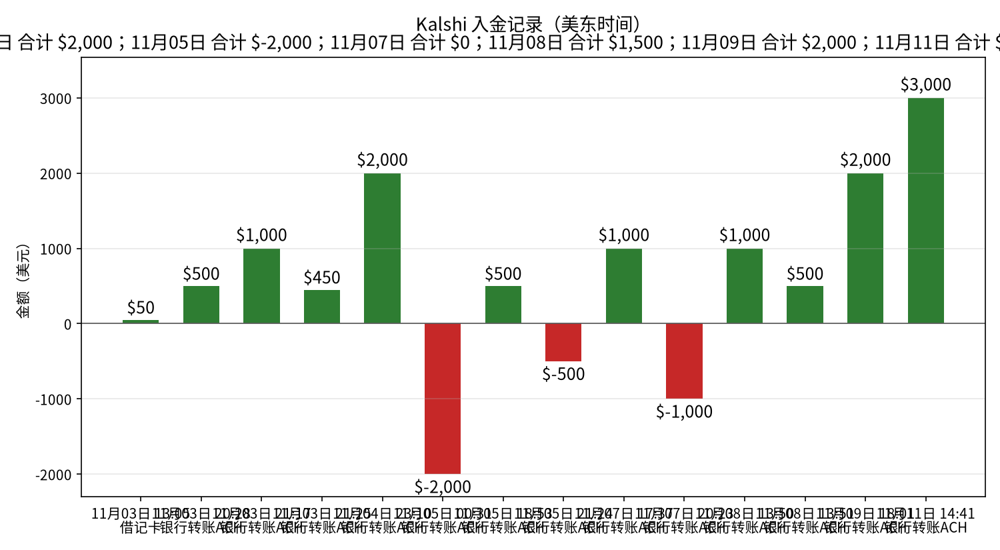
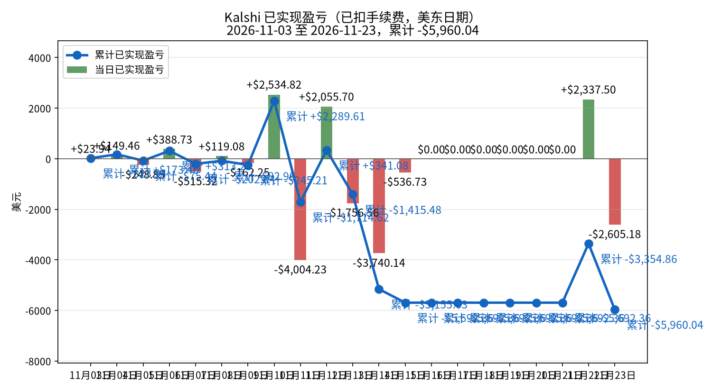
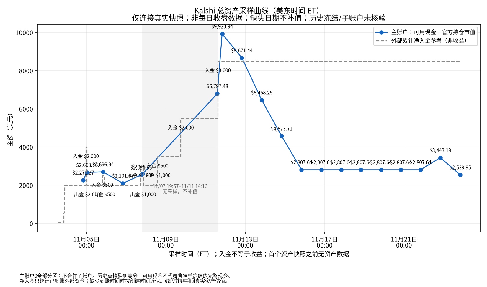
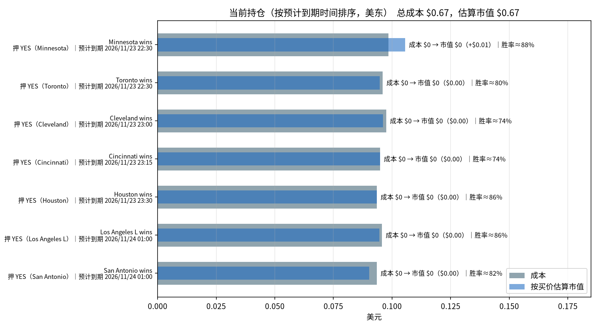

# Kalshi 资金、盈亏与持仓分析（2026-11-23）

_数据生成时间：2026-11-23 19:55（美东），全部来自 Kalshi 只读 API。持仓价格是生成那一刻的报价，之后会变。_

## 一、入金记录

| 时间（美东） | 类型 | 方式 | 金额 | 手续费 | 状态 |
|---|---|---|---:|---:|---|
| 2026-11-03 13:05 | 入金 | 借记卡 | $50.00 | $0.00 | 已到账 |
| 2026-11-03 20:28 | 入金 | 银行转账ACH | $500.00 | $0.00 | 已到账 |
| 2026-11-03 21:17 | 入金 | 银行转账ACH | $1,000.00 | $0.00 | 已到账 |
| 2026-11-03 21:25 | 入金 | 银行转账ACH | $450.00 | $0.00 | 已到账 |
| 2026-11-04 23:10 | 入金 | 银行转账ACH | $2,000.00 | $0.00 | 已到账 |
| 2026-11-05 00:31 | 出金 | 银行转账ACH | $2,000.00 | $0.00 | 已到账 |
| 2026-11-05 18:53 | 入金 | 银行转账ACH | $500.00 | $0.00 | 已到账 |
| 2026-11-05 21:24 | 出金 | 银行转账ACH | $500.00 | $0.00 | 已到账 |
| 2026-11-07 17:37 | 入金 | 银行转账ACH | $1,000.00 | $0.00 | 已到账 |
| 2026-11-07 20:23 | 出金 | 银行转账ACH | $1,000.00 | $0.00 | 已到账 |
| 2026-11-08 13:50 | 入金 | 银行转账ACH | $1,000.00 | $0.00 | 已到账 |
| 2026-11-08 13:51 | 入金 | 银行转账ACH | $500.00 | $0.00 | 已到账 |
| 2026-11-09 18:01 | 入金 | 银行转账ACH | $2,000.00 | $0.00 | 已到账 |
| 2026-11-11 14:41 | 入金 | 银行转账ACH | $3,000.00 | $0.00 | 已到账 |

**合计入金 $12,000.00，出金 $3,500.00。**

## 二、已实现盈亏曲线

| 日期（美东） | 结算盈亏 | 卖出平仓盈亏 | 当日已实现 | 累计 | 成交笔数 | 当日手续费 |
|---|---:|---:|---:|---:|---:|---:|
| 2026-11-03 | +$23.94（4 个市场） | $0.00（0 个市场） | **+$23.94** | +$23.94 | 72 | $17.04 |
| 2026-11-04 | +$386.26（35 个市场） | -$236.80（1 个市场） | **+$149.46** | +$173.40 | 112 | $125.59 |
| 2026-11-05 | -$248.85（28 个市场） | $0.00（0 个市场） | **-$248.85** | -$75.44 | 61 | $40.92 |
| 2026-11-06 | +$123.19（45 个市场） | +$265.54（4 个市场） | **+$388.73** | +$313.28 | 109 | $47.80 |
| 2026-11-07 | -$515.32（49 个市场） | $0.00（0 个市场） | **-$515.32** | -$202.04 | 200 | $126.79 |
| 2026-11-08 | +$119.08（22 个市场） | $0.00（0 个市场） | **+$119.08** | -$82.96 | 61 | $72.93 |
| 2026-11-09 | +$483.39（13 个市场） | -$645.64（4 个市场） | **-$162.25** | -$245.21 | 125 | $186.45 |
| 2026-11-10 | +$2,534.82（32 个市场） | $0.00（0 个市场） | **+$2,534.82** | +$2,289.61 | 238 | $394.43 |
| 2026-11-11 | -$2,371.65（50 个市场） | -$1,632.59（3 个市场） | **-$4,004.23** | -$1,714.62 | 457 | $410.22 |
| 2026-11-12 | +$2,055.70（68 个市场） | $0.00（0 个市场） | **+$2,055.70** | +$341.08 | 350 | $204.49 |
| 2026-11-13 | -$1,756.56（67 个市场） | $0.00（0 个市场） | **-$1,756.56** | -$1,415.48 | 280 | $201.57 |
| 2026-11-14 | -$3,413.49（68 个市场） | -$326.65（2 个市场） | **-$3,740.14** | -$5,155.63 | 307 | $604.58 |
| 2026-11-15 | -$535.64（15 个市场） | -$1.09（1 个市场） | **-$536.73** | -$5,692.36 | 96 | $133.60 |
| 2026-11-16 | $0.00（1 个市场） | $0.00（0 个市场） | **$0.00** | -$5,692.36 | 0 | $0.00 |
| 2026-11-17 | $0.00（1 个市场） | $0.00（0 个市场） | **$0.00** | -$5,692.36 | 0 | $0.00 |
| 2026-11-18 | $0.00（0 个市场） | $0.00（0 个市场） | **$0.00** | -$5,692.36 | 0 | $0.00 |
| 2026-11-19 | $0.00（0 个市场） | $0.00（0 个市场） | **$0.00** | -$5,692.36 | 0 | $0.00 |
| 2026-11-20 | $0.00（0 个市场） | $0.00（0 个市场） | **$0.00** | -$5,692.36 | 0 | $0.00 |
| 2026-11-21 | $0.00（0 个市场） | $0.00（0 个市场） | **$0.00** | -$5,692.36 | 0 | $0.00 |
| 2026-11-22 | +$2,337.50（15 个市场） | $0.00（0 个市场） | **+$2,337.50** | -$3,354.86 | 115 | $170.72 |
| 2026-11-23 | -$2,605.18（15 个市场） | $0.00（0 个市场） | **-$2,605.18** | -$5,960.04 | 249 | $214.72 |

口径：都已扣手续费。结算盈亏 = 结算赔付（含 YES/NO 配对兑付）− 该市场累计买入成本 − 累计手续费；卖出平仓用平均成本法。

**对账**：现金 $2,539.28 + 持仓按买价估算市值 $0.67 = $2,539.95，减去净入金 $8,500.00，买价估值口径差额 **-$5,960.05**（不是下图官方总资产口径）。盈亏模型对照（可能因采样时差、成本口径而不同，非强制相等）：累计已实现 -$5,960.04 + 浮动 $0.00 − 持仓已付手续费 $0.01 = -$5,960.05。

## 总资产曲线（真实资产快照）

采样时间：2026-11-23T19:55:19-05:00（ET）。主账户可用现金 **$2,539.2810** ＋ 官方持仓市值 **$0.67** ＝ **$2,539.9510**。

当前未成交挂单 0 笔；冻结资金为0。

主账户0，全部交易分区；不合并子账户；内部划转不计外部入金。

总资产曲线口径为API可用现金＋官方持仓市值，不用买价估值替代官方市值。历史挂单冻结及子账户余额未留存，历史点仅代表主账户可核对资产，不保证完整账户净值。真实采样点之间连线仅辅助阅读，不代表连续估值；缺失日期不补值。净入金仅取已到账外部充值减已完成提现；缺少完成时间时以创建时间近似，因此不保证日内到账时点。主账户与子账户内部划转不计入金；主账户资产与全账户外部净入金之差不一定是收益。

审计数据：`charts/total_assets.csv`、`charts/total_assets.json`；原始快照在 `data/asset_snapshots/`。

**官方口径复核**：可用现金 $2,539.2810 ＋ 官方持仓市值 $0.67 ＝ 总资产 $2,539.9510。官方市值比逐仓买价估值高 $0.0002；因此两种资产口径不能混用。

总资产减外部净入金 = -$5,960.05；盈亏模型加估值差额 = -$5,960.05，对账残差 $0.000000。仅在无子账户内部资金影响且现金覆盖完整时，此差额才可解释为整体盈亏。

## 三、当前持仓与到期时间

| 预计到期（美东） | 市场 | 押注 | 份数 | 成本 | 均价 | 买价/卖价 | 估算市值 | 浮动盈亏 | 赢了净赚* | 隐含胜率 |
|---|---|---|---:|---:|---:|---|---:|---:|---:|---:|
| 2026-11-23 22:30 | Minnesota wins `KXNBAGAME-26NOV23BKNMIN-MIN` | YES（Minnesota） | 0.12 | $0.10 | $0.820 | 0.88/0.89 | $0.11 | +$0.01 | +$0.02 | 88.5% |
| 2026-11-23 22:30 | Toronto wins `KXNBAGAME-26NOV23MILTOR-TOR` | YES（Toronto） | 0.12 | $0.10 | $0.800 | 0.79/0.8 | $0.09 | $0.00 | +$0.02 | 79.5% |
| 2026-11-23 23:00 | Cleveland wins `KXNBAGAME-26NOV23CLECHI-CLE` | YES（Cleveland） | 0.13 | $0.10 | $0.750 | 0.74/0.75 | $0.10 | $0.00 | +$0.03 | 74.5% |
| 2026-11-23 23:15 | Cincinnati wins `KXNFLGAME-26NOV23CINWAS-CIN` | YES（Cincinnati） | 0.13 | $0.09 | $0.730 | 0.73/0.74 | $0.09 | $0.00 | +$0.03 | 73.5% |
| 2026-11-23 23:30 | Houston wins `KXNBAGAME-26NOV23LACHOU-HOU` | YES（Houston） | 0.11 | $0.09 | $0.850 | 0.85/0.86 | $0.09 | $0.00 | +$0.02 | 85.5% |
| 2026-11-24 01:00 | Los Angeles L wins `KXNBAGAME-26NOV23UTALAL-LAL` | YES（Los Angeles L） | 0.11 | $0.10 | $0.870 | 0.86/0.87 | $0.09 | $0.00 | +$0.01 | 86.5% |
| 2026-11-24 01:00 | San Antonio wins `KXNBAGAME-26NOV23SASSAC-SAS` | YES（San Antonio） | 0.11 | $0.09 | $0.850 | 0.82/0.83 | $0.09 | $0.00 | +$0.02 | 82.5% |
| **合计（7 个市场）** | | | | **$0.67** | | | **$0.67** | **$0.00** | **+$0.15** | |

\*赢了净赚 = 赔付 − 成本 − 该仓位已付手续费。隐含胜率取你这一边买价和卖价的中间值。预计到期取 Kalshi 的 `expected_expiration_time`。

### 分析

**总敞口。** 持仓总成本 $0.67，按当前买价估算市值 $0.67，浮动 $0.00（未扣卖出手续费）。全部押中可再净赚 +$0.15；最坏情况全部押错，亏掉 $0.67。账上现金 $2,539.28。

**什么时候到期：**
- **今天：** 5 个市场，成本 $0.48（占 71.7%）；最大一笔是 Minnesota wins YES（Minnesota），成本 $0.10，预计 2026-11-23 22:30 到期。
- **2026-11-24：** 2 个市场，成本 $0.19（占 28.3%）；最大一笔是 Los Angeles L wins YES（Los Angeles L），成本 $0.10，预计 2026-11-24 01:00 到期。

**集中度。** 成本最大的三笔：Minnesota wins YES（Minnesota） $0.10（14.7%）；Cleveland wins YES（Cleveland） $0.10（14.6%）；Toronto wins YES（Toronto） $0.10（14.3%）。
浮盈最大的是 Minnesota wins（+$0.01）。

**确定程度（按隐含胜率）：**
- **有不确定性（<90%）：** Minnesota wins YES（Minnesota）（88.5%）、Los Angeles L wins YES（Los Angeles L）（86.5%）、Houston wins YES（Houston）（85.5%）、San Antonio wins YES（San Antonio）（82.5%）、Toronto wins YES（Toronto）（79.5%）、Cleveland wins YES（Cleveland）（74.5%）、Cincinnati wins YES（Cincinnati）（73.5%）；合计成本 $0.67。

---
图表文件：`charts/deposits-2026-11-23.png`、`charts/pnl_curve-2026-11-23.png`、`charts/positions-2026-11-23.png`、`charts/total_assets-2026-11-23.png`；每日盈亏 `charts/pnl_daily.csv`。
